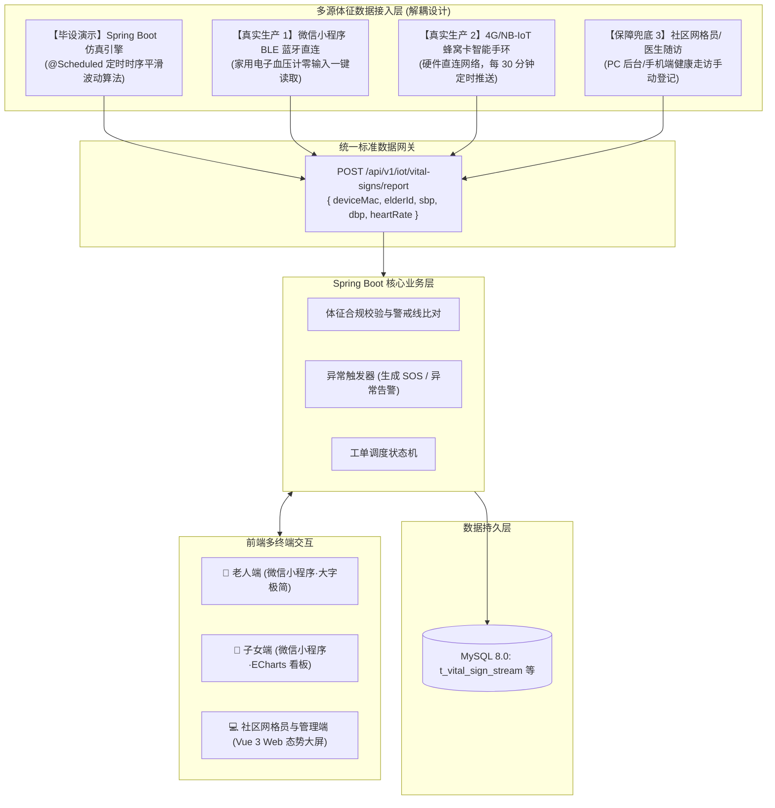
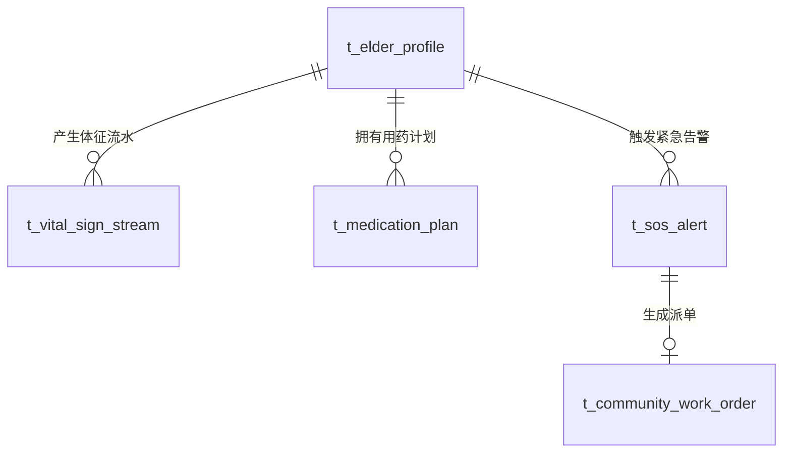
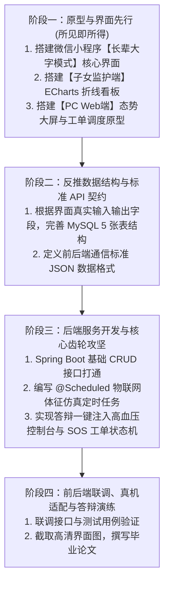

# 《基于 Spring Boot 与适老化设计的社区居家养老健康管理与服务系统》毕设全案整理

---

## 一、 课题基本信息与定位卡片

| 核心要素 | 详细信息 |
| :--- | :--- |
| **毕业设计题目** | **基于 Spring Boot 与适老化设计的社区居家养老服务系统设计与实现** |
| **学生专业背景** | 2027 届 计算机科学与技术（师范类） 本科 |
| **就读院校** | 信阳学院 |
| **目标用户群体** | 社区独居/空巢老人、异地监护子女、社区网格员/护工、社区综合管理人员 |
| **系统核心形态** | **一库三端**：统一 Spring Boot 后端 + 微信小程序（长辈大字/子女监护双模式）+ Web 网页端（社工/管理后台） |
| **技术栈组合** | 后端：`Java (Spring Boot) + MyBatis-Plus + MySQL 8.0`   前端：`微信小程序 (原生/Uni-app) + Vue 3 + Element Plus + ECharts` |
| **研发推进范式** | **原型/界面先行驱动**：先构建高保真页面与人机交互流，再根据界面实际呈现反推数据模型与 API 契约 |

---

## 二、 政策依据与学术理论支撑

本课题跳出了“学生为了做系统而做系统”的泛滥套路，拥有坚实的国家法规、部委标准与教育学理论作为支撑，可直接作为毕业论文“第一章 绪论”与“需求分析”的理论基石：

### 1. 国家宏观政策与法规支撑
* **“9073”养老服务格局**：我国约 90% 的老年人选择居家养老，7% 依托社区支持，3% 入住专业机构。本系统直击这 90% 居家群体的真实照护断层。
* **《中华人民共和国无障碍环境建设法》**：为信息无障碍建设提供了法制保障。
* **工信部适老化规范**：严格遵循《互联网网站适老化通用设计规范》与《移动互联网应用（APP）适老化通用设计规范》，在交互与界面呈现上量化落地。

### 2. 师范专业交叉特色（认知负荷理论）
* 结合教育心理学中的 **认知负荷理论（Cognitive Load Theory）**，剖析老年群体视力减退、短期记忆力衰退及操作焦虑特征。
* 将界面“外生认知负荷”降至最低（大字、大色块、单向路径、免繁琐配置），并在老人端内嵌**新手语音引导微课**，体现计算机师范专业“懂技术、更懂人机教育与认知规律”的差异化优势。

---

## 三、 系统总体架构与真实生产/仿真对接

系统采用标准松耦合分层架构，向外暴露标准的 RESTful API 契约，彻底解耦“开发演示仿真”与“未来真实硬件接入”：

---

## 四、 四大角色的业务闭环与深层交互机制

### 1. 账号入口与亲情免密绑定机制
* **建档先行**：子女在手机端或社区管理员在 Web 端录入老人档案，系统自动生成专属 4 位简易激活码或绑定二维码；
* **极简免密进入**：长辈打开微信小程序，点击大号【我是长辈】按钮，输入一次 4 位数字（或子女扫码代绑一次），后续**终身自动登录，直接进入大字首页**；
* **子女端亲情网格**：子女一个账号可绑定多位老人（如“父亲”、“母亲”），支持顶部卡片一键平滑切换。

### 2. 吃药提醒与“三级梯次催促”机制
* **一级提醒（08:00 准时到点）**：
  * 老人端首页弹出占满半屏的醒目大卡片，自动调用语音播放口语化提示：*“李大爷，早上好，该吃降压小白片了，请按说明服药”*；
  * 微信外部同步触发微信小程序“订阅消息”服务通知；
* **二级催促（08:45 超时 45 分钟未打卡）**：
  * 老人若再次打开小程序，顶部常驻亮黄色呼吸灯警告条：*“⚠️ 提示：您今晨有一项降压药还未打卡，点击立即处理”*，伴随二次语音催促；
* **三级兜底（09:30 超时 1.5 小时终极未打卡）**：
  * 后端定时器判定为疑似严重遗忘，向子女端推送关怀预警，提醒子女电话确认。

### 3. 长按 2 秒防误触 SOS 与工单闭环
* **防误触设计**：老人端底部常驻红色大按钮，必须长按满 2 秒（伴随环形进度条动画与震动反馈），松开即取消，避免误碰误报；
* **社区端即时响应**：触发后，社工 Web 界面通过轻量轮询/WebSocket 弹出声光报警，自动生成“待办紧急工单”；
* **拍照留痕核销**：网格员接单上门处置完毕后，必须上传现场处理照片与总结，工单结案，子女端实时同步查看办结状态与照片。

---

## 五、 全系统精选页面矩阵（共 9 个核心页面）

系统严格控制前端页面体量，拒绝无意义的臃肿堆砌，收敛为 **9 个高价值核心页面**：

### 1. 微信小程序端（长辈模式 2 页 + 子女模式 3 页）
* **【长辈适老模式】（工信部标准 1.4 倍大字、大热区、无广告）**：
  * **P1：大字综合首页**：顶部问候语、中部“口语化吃药打卡卡片”与“大字血压心率看板”、底部长按 2 秒 SOS 大按键；
  * **P2：长辈微课与进度页**：长辈语音图文微课、上门工单实时状态追踪（如“小王已接单，正在路上”）。
* **【子女监护模式】（标准电商与健康管理风格）**：
  * **P3：子女监控看板页**：顶部切换父母卡片、中部 24 小时血压/心率 ECharts 动态折线图（标红 140mmHg 警戒线）、近期服药日历；
  * **P4：助老服务预约与代设用药页**：远程添加修改父母用药计划、预约上门助餐/助医/助洁等工单；
  * **P5：个人中心页**：亲情绑定管理、紧急联系电话维护、模式切换入口。

### 2. PC Web 网页端（Vue 3 + Element Plus，4 个核心页面）
* **P6：社区养老态势感知大屏（Dashboard·答辩亮点）**：
  * 辖区老人总数、今日服药打卡率、实时待处理预警数、慢病类型占比饼图、近 7 天工单响应效率图；
* **P7：紧急告警与助老工单调度中心**：
  * 告警流水列表（置顶红标未处理 SOS）、工单派发弹窗、网格员上门留痕照片审核与结案归档；
* **P8：健康档案与亲情网格管理**：
  * 老人“一户一档”列表（支持慢病标签与姓名筛选）、既往病史与子女联系方式弹窗维护；
* **P9：【答辩演练专属】虚拟 IoT 仿真器控制台**：
  * 仿真启停开关、生成频率配置、**【一键注入突发高血压危象】演示大按钮**。

---

## 六、 零成本、轻量化技术选型与实现方案

| 核心功能需求 | 坚决不采用的重型方案 | 最终采用的轻量化零成本方案 | 优势 |
| :--- | :--- | :--- | :--- |
| **适老化语音播报** | 百度云/腾讯云收费 TTS 接口（需密钥、有并发限额） | 小程序原生 `wx.createInnerAudioContext` / Web Speech API | 零费用、纯本地运行、离线答辩不翻车 |
| **社区 Web 警报通知** | 复杂的消息队列（Kafka / RabbitMQ） | 前端 3~5 秒轻量短轮询 / Spring Boot 原生 WebSocket + 本地音频 | 代码少、配置轻、零外部中间件依赖 |
| **网格员上门现场照片**| 阿里云 OSS / 腾讯云 COS 对象存储（付费绑定） | Spring Boot 本地静态目录映射存储 (`D:/app/uploads/`) | 免网络环境制约，开发和测试极其简便 |

---

## 七、 核心数据库表结构设计（MySQL 5 张核心表）

1. **`t_elder_profile`（居家老人健康档案表）**：`elder_id`, `user_id`, `real_name`, `age`, `chronic_tags`, `emergency_contact_id`, `grid_worker_id`
2. **`t_vital_sign_stream`（物联网体征流水表）**：`record_id`, `elder_id`, `device_mac`, `sbp`, `dbp`, `heart_rate`, `collect_time`（建立 `(elder_id, collect_time)` 联合索引）
3. **`t_medication_plan`（用药提醒与打卡表）**：`plan_id`, `elder_id`, `drug_name`, `colloquial_tip`, `dosage`, `remind_time`, `checkin_status`
4. **`t_sos_alert`（一键SOS与异常指标告警表）**：`sos_id`, `elder_id`, `trigger_type`, `trigger_val`, `gps_address`, `response_status`, `create_time`
5. **`t_community_work_order`（社区助老上门工单表）**：`order_id`, `order_no`, `elder_id`, `sos_id`, `service_type`, `worker_id`, `feedback_img`, `order_status`, `rating`

---

## 八、 答辩现场“灵魂拷问”满分防御手册

* **Q1：你没有采购真实的智能手环硬件，健康数据从哪里来？**
  * **满分回答**：“本系统在架构设计上实现了**软硬件数据网关的完全解耦**。系统对外暴露符合工业标准的 RESTful 数据上报接口。在毕设阶段，通过后端 `@Scheduled` 定时任务模拟具有昼夜节律的人体生理数据流向该接口上报，验证业务链路的完整性；同时系统原生支持标准 4G NB-IoT 硬件手环与蓝牙血压计直接接入，在未来商业化落地时无需修改核心后端一行代码。”
* **Q2：市面上已有通用挂号与家政软件，你做这个有何创新？**
  * **满分回答**：“通用软件存在适老化流于形式、健康监护与上门服务割裂两大缺陷。本系统的创新在于：**一是严格按照工信部标准实现量化适老化**（口语化用药标签、长按 2 秒防误触）；**二是打通了‘体征监测 -> 异常自动告警 -> 社区网格员上门拍照核销’的完整闭环**，专注于独居老人居家安全的兜底照护。”
* **Q3：作为师范类计科生，本系统如何体现专业特色？**
  * **满分回答**：“系统在交互设计中融入了教育学中的**认知负荷理论**，通过减少界面外生干扰、降低层级深度，消除老人的操作焦虑；同时内嵌的适老新手微课遵循了微格教学法，体现了师范生‘懂技术、更懂人机教育与认知规律’的交叉优势。”

---

## 九、 “原型/界面先行”研发推进全景图

按照你的开发节奏，我们将传统的“数据库先行”调整为更加直观、所见即所得的**原型/界面先行驱动**模式：

