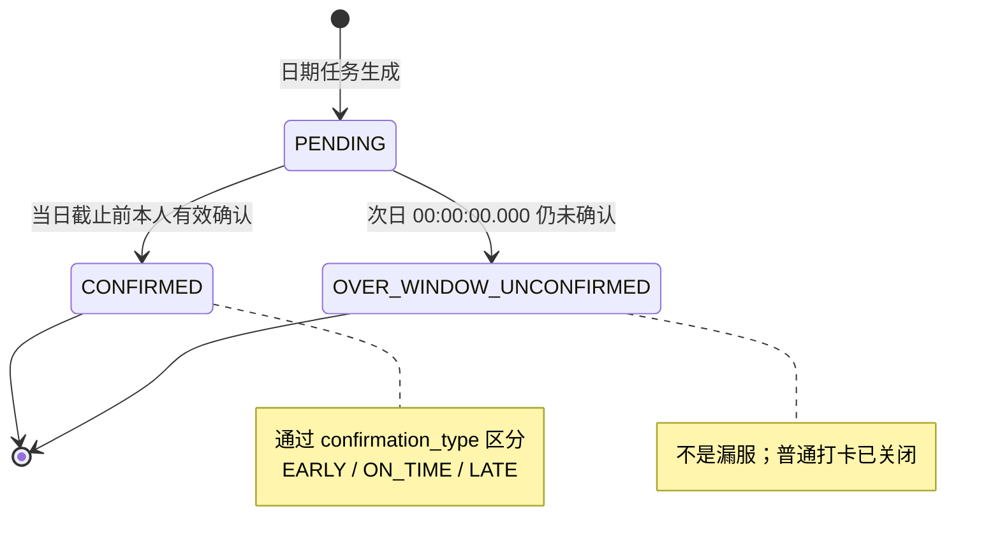

# 社区居家养老服务系统｜E-03 用药任务生成、提醒调度与通知授权专项设计

> **集成适用规则（2026-10-24）：** 本文件为 v0.1 模块初稿；共享数据模型、API/错误、锁序、时间、审计和状态映射以[集成设计基线 v1.1](../E-01—E-07集成设计基线_v1.1_2026-10-24.md)为准，需求与 AT 状态见[追踪矩阵](../需求追踪矩阵_E-01—E-07_2026-10-24.md)。SRS v1.0 的业务语义优先；本文冲突候选不得覆盖集成基线。本文不表示代码或测试已完成。

- **文档版本：** v0.1（专项设计候选稿）
- **编制日期：** 2026-10-24
- **设计状态：** 已形成可供详细设计评审的技术方案；尚未编码，所有运行测试均为“未测”
- **适用需求基线：**《社区居家养老服务系统_需求规格说明书_SRS_v1.0.md》
- **适用总体设计：**《社区居家养老服务系统：总体设计基线 v1.1.md》
- **前置专项：** E-01《身份、授权与会话专项设计 v0.1》；E-02《档案与状态联动专项设计 v0.1》
- **主要模块：** M04 用药计划与打卡；与 M01 身份权限、M02 档案/亲情绑定、M11 通知、M12 审计协作
- **主要追踪：** FR-M04-01—05、BR-07/10/11/13、G-06/G-09/G-12—G-15、Q02-L01/EX01、Q03-01—14、Q03-X01—X04、C-06、M-01、N-01、AT-06/11/19/21—23/39

> 本文是工程设计候选稿，不修改或替代已冻结的 SRS v1.0。文中明确标注“设计决策/待评审”的内容是为落实已批准需求提出的技术方案，不代表已获新的业务批准。物理 DDL、完整 API 契约、代码和运行验收仍需在相应阶段落实；没有任何测试结果被预填为通过。

## 1. 目标、范围与非目标

### 1.1 设计目标

1. 明确用药计划版本的创建、修改、停用、重新启用及生效日期规则，保证计划变更不覆盖已生成的当日任务快照。
2. 明确每个计划日期、每个固定提醒时刻的独立任务身份，保证任务在提醒时刻前已生成并可供老人本人确认。
3. 为计划生效日、滚动预生成、重复调度、并发执行、系统停机补建和中断恢复提供幂等且可追溯的机制。
4. 明确老人本人提前/正常/迟到确认的权限、服务端时间、截止边界、重复提交和并发冲突语义。
5. 落实原定提醒时刻与 +45 分钟关怀阶段的区分，保证通知按 N-01 已批准矩阵生成、逐收件人记录并在发送/重试前重新检查权限。
6. 将档案停用/恢复、亲情关系解绑/冻结、账号停用与任务生成/通知发送正确衔接。
7. 为 AT-06、AT-19、AT-21—23、AT-39 及通知相关 AT-11 提供可执行的设计与测试入口。

### 1.2 本专项负责

- 用药计划的权限、字段校验、版本、日期生效和状态变更。
- 日期级任务的预生成、快照、唯一性、重复生成防护和停机补建。
- 老人本人服药确认、提前确认、迟到确认、截止后状态和历史查询。
- 原定提醒时刻的老人端提醒、+45 分钟关怀阶段的逻辑通知触发。
- 通知逻辑事件、逐收件人投递结果、授权复核、重试与失败留痕的 M04/M11 接口契约。
- 与 E-01 身份授权、E-02 档案状态、M12 审计之间的事务和状态契约。
- 数据模型、API 草案、调度算法、失败恢复、并发约束和测试设计。

### 1.3 本专项不负责

- 登录、会话、角色分配、亲情关系审批/冻结/解绑的内部实现；分别由 E-01/E-02 负责，本专项调用其当前授权结果。
- 真实药品识别、药物相互作用、剂量建议、医学诊断或确认老人是否真实服药。打卡仅记录老人本人的明确声明。
- 真实智能设备接入、短信/微信订阅消息的必需交付。首期以系统内通知与前端短轮询为主，订阅消息仅为可选增强。
- M11 通用通知中心、文件能力的完整实现；本专项定义 M04 事件与 M11 的契约，不另建一套通知中心。
- 生产级消息中间件、分布式调度平台或复杂周期表达式。沿用 Spring Boot 单体、MySQL 8.0 与 `@Scheduled`。
- 修改 SRS 已批准的业务规则，或将本设计文档等同于代码完成和测试通过。

## 2. 需求追踪与不可违反的规则

| 来源 | 本专项必须落实的规则 | 主要设计落点 | 验收入口 |
|---|---|---|---|
| FR-M04-01 / Q03-01—06 / C-06 | 仅当前有效、关系未冻结的授权子女可维护计划；管理员不得代设/修改/停用/重启；固定每日一个或多个时刻；新建默认次日生效，可指定更晚日期；修改/停用/重启次日生效；当日已生成任务快照不被覆盖 | §§4—7、10 | AT-06、AT-21 |
| FR-M04-02 / M-01 / Q03-12—14 | 当日任务在原定提醒前已生成并可用；重复调度不重复；停机后补建应有任务并使用各日期实际生效版本；不把补建视为打卡；停用期任务不补造 | §§6、8、11 | AT-06、AT-19、AT-21、AT-23 |
| FR-M04-03 / G-12/G-13 / Q03-X01/X02 | 只有老人本人能确认本人当日已生成任务；提醒前须明确声明已经实际服用；保存服务端实际确认时间与提前/迟到标识；`Asia/Shanghai`；次日 00:00:00.000 起拒绝普通打卡；过窗不等于漏服；不开放普通历史补打 | §§7、9、12 | AT-06、AT-21、AT-39 |
| FR-M04-04 / G-14/G-15 / Q03-09—14 | 原提醒时刻后 45 分钟仍未确认触发一次关怀；同任务同阶段只有一个逻辑通知；无收件人留结果并提示管理员；正常运行跨日仍触发；恢复时只重判当前日期；每次发送/重试前复核授权；新绑定不补发旧通知 | §§8、10、11 | AT-11、AT-22、AT-23 |
| FR-M04-05 | 老人查询本人任务/打卡；子女只能查询当前有效授权老人的任务/历史；解绑后不可查；计划修改后保留旧执行快照 | §§5、7、9 | AT-06、AT-21 |
| BR-07/10 | 同键同规范化内容复用结果；同键异内容 HTTP 409 并审计；并发写入只允许一个合法结果；不得最后写入覆盖 | §§6—9、11 | AT-06、AT-21、AT-23 |
| BR-11 / G-12 | 全系统业务时间采用 `Asia/Shanghai`，服务端时间权威，明确自然日和截止边界 | §§5—9、12 | AT-06、AT-21—23 |
| BR-13 / G-06/G-11 / Q02-L01/EX01 | 档案停用保留计划、任务、打卡、通知历史；暂停新任务及新的常规提醒；恢复只恢复未来应生成的任务/提醒，不补造停用期任务或补发已过期提醒；已生成任务不自动变成已服药/漏服 | §§6、8、10 | AT-19、AT-23 |
| N-01 | 不增加通知矩阵外事件或收件角色；服药到点/超时关怀按已批准事件族实现；M11 每个收件人独立记录结果 | §§8、10、11 | AT-11、AT-22/23 |
| NFR-01/06、M12 | 权限最小化、敏感信息保护、操作可审计、失败可追踪，不向客户端暴露堆栈 | §§4、8、10—12 | AT-11、AT-12（跨模块） |

## 3. 核心设计原则

1. **计划、计划版本、任务、打卡、通知事件分开建模。** 计划是长期配置；计划版本表达某日生效的配置；任务是某日期某提醒时刻的执行实例；打卡是老人本人确认记录；通知是围绕任务阶段产生的独立事件及逐收件人投递结果。
2. **任务快照不可被计划修改反向覆盖。** 计划修改、停用和重启均次日生效；当日已生成任务及其提醒时刻、计划快照、打卡和通知历史保持不变。
3. **服务端时钟与业务时区唯一。** 业务日期统一使用 `Asia/Shanghai`；客户端时间只用于展示辅助，不能决定任务归属、截止或提前/迟到类型。
4. **生成、打卡和通知均幂等。** 调度器可以重复运行；同任务只保留一个有效执行实例和一条有效打卡；同任务同通知阶段只有一个逻辑通知。
5. **补建不是执行事实。** 补建任务不得创建打卡，不得推断老人已服药或漏服，不开放历史普通补打。
6. **档案/授权是运行时条件。** 每次新任务生成、计划写操作、通知实际发送和失败重试均重新检查相关当前状态；不依赖进程内事件作为唯一安全保障。
7. **业务事务不调用外部网络。** 先在数据库事务内提交逻辑通知及出站记录，再由 M11 发送工作器处理；外部发送失败不回滚已保存的计划、任务或打卡。
8. **不新增 N-01 事件。** 原定提醒和 +45 分钟关怀是已批准“服药到点/超时关怀”事件族中的两个阶段，不构成新的事件类型或收件角色。
9. **状态冲突必须可见。** 不使用最后写入覆盖；冲突返回稳定错误码，记录必要审计，并保留成功方结果。
10. **技术参数与业务规则分开。** 本文提出的 7 日预生成窗口、调度周期、有限重试参数等是工程参数建议，不改变业务时限；物理 DDL、运行行为及参数值仍需测试验证。

## 4. 组件职责与模块边界

| 组件 | 职责 | 关键约束 |
|---|---|---|
| `MedicationPlanController` | 计划创建、修改、停用、重启及查询入口 | 只做输入校验和调用，不依赖前端按钮隐藏实现权限 |
| `MedicationPlanService` | 计划字段校验、权限复核、版本写入和生效日期计算 | 仅有效未冻结授权子女可写；管理员写操作一律拒绝 |
| `MedicationPlanVersionService` | 维护不可变版本、有效日期区间和每日提醒时刻快照 | 版本时间线不能重叠；历史版本不可静默覆盖 |
| `MedicationTaskGenerator` | 为有效计划生成日期级任务、维护滚动预生成窗口 | 幂等；每个任务保存计划版本和字段快照 |
| `MedicationTaskRecoveryService` | 启动恢复、缺失任务补建、恢复检查点和中断续跑 | 过去日期只补任务，不补发新通知、不赋予打卡事实 |
| `MedicationCheckinService` | 本人打卡、截止判断、并发控制、历史查询 | 只允许老人本人；打卡请求必须明确声明已实际服用 |
| `MedicationReminderScheduler` | 到点提醒阶段和 +45 分钟关怀阶段的触发判定 | 服务端时间；跨日规则与停机恢复规则区分处理 |
| `MedicationNotificationCoordinator` | 创建逻辑事件及逐收件人投递请求 | 不直接调用外部网络；与 M11 的事件族、去重及 outbox 契约一致 |
| `M01 AuthorizationService` | 当前账号、角色、会话与业务对象权限 | 每次关键写入/发送前读取当前权限，不信任客户端传入的角色 |
| `M02 ArchiveAccessPolicy` | 档案状态、亲情关系状态与授权状态读取 | 停档暂停常规提醒/新任务；已生成当日任务的截止前确认按既有规则处理 |
| `M11 NotificationService` | 通知详情、收件人状态、发送/重试和权限复核 | 不增加 N-01 事件；通知详情/业务链接读取时重新授权 |
| `M12 AuditService` | 计划变更、打卡、调度异常、通知跳过与恢复事件审计 | 不记录完整药名/用法量到通用日志，不记录会话凭证 |

### 4.1 全局锁序候选

本节仅列 M04 业务对象锁。共享锁前缀遵循集成设计基线 v1.1 §2.4：如采用维护门闩则先取门闩，其后先处理幂等记录，再锁档案/关系与 M04 资源；全序在逐事务 SQL 核验和真实并发验证前仍为候选：

1. `elder_profile`，多档案时按 `elder_id` 升序；
2. `elder_family_link`，按 `link_id` 升序（仅需要子女授权的写操作）；
3. `medication_plan`，按 `plan_id` 升序；
4. `medication_plan_version`，按版本主键升序；
5. `medication_task`，按 `task_id` 升序；
6. `medication_checkin`；
7. M11 逻辑通知/收件人出站记录；
8. 审计记录。

说明：打卡事务不需要锁亲情关系，但仍须先锁档案再锁任务，避免与档案停用、任务状态更新产生反向锁顺序。实际 MySQL 锁与隔离级别需在全局数据库专项中确认，并用并发测试验证。不能仅靠 Java `synchronized` 保证多线程/多实例下的唯一性。

### 4.2 跨模块契约

- **E-01/M01：** 当前老人账号必须有效且已认证；当前角色上下文不能替代对象级权限。老人本人打卡只允许与当前账号关联的本人档案。
- **E-02/M02：** 计划写入时，目标档案必须处于允许业务维护的状态，操作者为当前有效且关系未冻结的授权子女；管理员不得代设计划。档案停用时暂停新任务与常规提醒，但保留已生成任务及历史。已生成当日任务可按原截止窗口确认，不能因停档被系统改成已服药/漏服。
- **M11：** M04 只提交通知逻辑事件及接收人候选；M11 负责实际发送、每次发送/重试前的权限复核、投递状态和通知详情读取授权。
- **M12：** 计划版本变化、任务补建、打卡冲突、通知无收件人/跳过/失败和恢复结果均有结构化审计；审计不应把完整药名、用法用量或不必要的老人健康信息复制到通用日志。

## 5. 计划版本、字段与权限设计

### 5.1 计划可写角色

| 操作 | 允许主体 | 禁止/拒绝条件 |
|---|---|---|
| 新建计划 | 当前有效、对该老人有有效且未冻结亲情授权的子女 | 管理员、网格员、护工、未绑定/已解绑/冻结关系的子女均不得写入 |
| 修改计划 | 当前有效、未冻结且有该老人授权的子女 | 同上；并发版本冲突时返回 409 |
| 停用计划 | 当前有效、未冻结且有该老人授权的子女 | 管理员不得代停用；不得把停用操作当成删除历史 |
| 重新启用计划 | 当前有效、未冻结且有该老人授权的子女 | 管理员不得代重启；不补造计划停用期间任务 |
| 查看计划 | 老人本人及当前有效授权范围内的子女，按 SRS 权限矩阵执行 | 解绑、冻结或账号失效后不得继续查看受限对象；不得因持有旧 plan ID 绕过检查 |
| 查看任务/打卡历史 | 老人本人及当前有效授权范围内的子女 | 未绑定/已解绑子女不得查询；不得只依赖前端传入 `elderId` |

> 角色权限来自 SRS FR-M04-01/05 与 E-01/E-02；本表不为管理员增加计划读写权限。管理员代设、修改、停用和重启计划属于明确禁止项，服务端必须拒绝。

### 5.2 字段与校验

计划至少包含：`plan_id`、`elder_id`、药名文本、用法用量文本、版本序号、生效日期、计划状态、创建/修改主体、创建/修改时间、行版本号及审计关联。

- 药名与用法用量是用户维护的文本，不进行自动剂量推荐或医学推断。
- 每日提醒时刻为一个或多个固定时刻；首期不接受复杂周期表达式。
- **工程输入格式建议：** API 使用 `HH:mm`，精确到分钟；重复时刻拒绝。该格式是技术契约建议，不增加新的业务时段限制。
- 生效日期不得早于次日；新建默认次日，可明确选择更晚日期。修改、停用、重新启用的生效日期均为服务端业务日期的次日，不能由客户端传入任意生效时间绕过。
- 服务端必须校验日期合法性、提醒时刻格式、时刻列表非空、同一版本内不重复、文本长度和字段编码；非法值返回字段级错误。
- 不允许把“停用计划”实现为物理删除；历史版本、任务、打卡和通知关联必须保留。

### 5.3 版本时间线

每次计划变更生成一个不可变的 `medication_plan_version`。每个任务按其 `task_date` 选择当日实际生效的版本，不得在恢复补建时用当前最新版本覆盖历史日期。

- 版本使用 `effective_from_date` 和可选的排他 `effective_to_date` 表达日期区间。
- 对同一计划，任何业务日期最多只能解析到一个有效版本；不存在有效版本或命中多个版本均视为数据完整性错误，停止生成并告警，不猜测版本。
- 停用版本仍保留药名、用法用量和提醒时刻快照以供追溯，但该版本有效期间不生成新任务。
- 计划重新启用生成新的启用版本，从其生效日开始生成未来任务；停用区间不补造任务。
- 当日已经生成的任务保存自己的版本 ID 和字段快照；即使计划当前版本改变，旧任务的快照不变。

**待评审的工程决策 D03-01：** 同一计划在同一自然日被同一/不同有效子女多次修改，导致多个候选版本均应于次日生效时，建议“最后一个合法提交并通过版本检查的操作成为该生效日的计划版本；被替代的候选版本保留审计并标记为 `SUPERSEDED_BEFORE_EFFECTIVE`”。SRS 明确各操作次日生效，但未单独规定同日多次变更的裁决顺序；实施前应在设计评审中确认此技术策略，不能静默编码。

### 5.4 计划版本变更事务

1. 认证并校验 `Idempotency-Key` 请求头、输入字段和 `expectedVersion`。
2. 读取 `elder_id` 后，按全局顺序锁定档案、当前亲情关系和计划；重新检查档案状态、账号状态、关系有效性/冻结状态与操作者权限。
3. 检查 `expectedVersion`，防止基于旧页面快照覆盖他人更新。
4. 计算服务端 `effective_from_date = today(Asia/Shanghai) + 1 day`；新建默认次日，用户指定更晚日期时使用合法的指定日期。
5. 写入不可变计划版本及其提醒时刻列表；必要时将同生效日期被替代的候选版本标记为 superseded，并留审计。
6. 对生效日期落入当前预生成窗口的日期，事务内重算未来任务：只允许替代 `task_date > today` 的未执行任务；不得修改或替代当日任务、已确认任务和历史任务。
7. 同一事务保存计划变更审计和幂等结果。若版本写入、任务协调、唯一约束或审计写入失败，整个事务回滚，不向客户端返回“已成功生效”。
8. 不在事务内调用通知服务商或任何外部网络。计划维护本身不新增 N-01 通知事件。

## 6. 日期级任务生成与快照

### 6.1 任务粒度与快照

每个“计划 + 业务日期 + 固定提醒时刻”生成一个独立任务。每个任务至少保存：

- `task_id`、`plan_id`、`plan_version_id`、`elder_id`；
- `task_date`（`Asia/Shanghai` 自然日）、`scheduled_time`、服务端计算的 `scheduled_at`、`care_due_at = scheduled_at + 45 minutes`；
- 药名/用法用量等本次执行快照；
- 任务状态、确认类型、生成来源、创建时间、行版本；
- 原定提醒阶段和关怀阶段的处理状态/关联逻辑通知 ID；
- 唯一活动槽位键及必要的调度/恢复关联信息。

任务快照不可通过计划编辑 API 更新。只有在任务尚属未来日期且计划生效版本变化时，才能把旧的未来任务标记为 `SUPERSEDED` 并建立正确的新任务；这不是修改已发生任务，而是重算尚未开始的未来执行实例。当前日期任务一律保留原快照。

### 6.2 具体预生成策略

**工程设计选择：7 个自然日滚动预生成窗口，调度器每 5 分钟运行一次；计划写入时同步保证最近窗口内的生效任务已创建。** 这是为落实 M-01 “提醒前任务必须可用”而提出的具体机制，属于技术参数建议，不是新增业务规则。

1. 窗口按 `Asia/Shanghai` 业务日期计算，覆盖今天至第 6 个未来自然日（共 7 天）。
2. 每次任务生成运行先读取服务端业务日期，扫描窗口内所有在该日期有效、且老人档案处于允许生成状态的计划版本。
3. 对每个有效版本的每个提醒时刻，确保对应日期任务存在。任务创建由数据库唯一约束与事务幂等保证；重复运行返回/保留已有有效任务，不重复插入。
4. 新建计划或计划变更的生效日已在窗口内时，在计划变更事务中立即协调该生效日起窗口内的任务，避免等待下一轮定时任务。更远的未来版本在进入 7 日窗口时由调度器创建；调度器仍需保证在其提醒时刻前生成。
5. 当版本变化影响窗口内未来日期时，只重算 `task_date > today` 的任务；已生成的当日任务、已确认任务及历史任务不重算、不覆盖。
6. 若某计划生效日期远于当前窗口，不能提前创建其有效日期之前的任务；当日期进入窗口后按当时已批准的版本时间线生成。
7. 任务在提醒时刻前可查、可由老人本人确认；提前生成不改变 `scheduled_at`，也不改变 +45 分钟的计算锚点。
8. 如果系统在提醒前持续不可用，系统不能声称任务在不可用期间已向用户提供；恢复后必须按 §8 补建缺失任务，并如实记录恢复。设计目标是正常运行条件下提前生成，停机期间的缺失通过可追踪恢复补偿。

### 6.3 幂等键与唯一约束

建议以 `plan_id + task_date + scheduled_time` 作为逻辑任务槽位身份；任务同时保存选定的 `plan_version_id`。因为未来任务可能在计划修改后被替代，建议用可空的 `active_slot_key` 唯一索引实现“同一槽位最多一个有效任务”：

- `PENDING`、`CONFIRMED`、`OVER_WINDOW_UNCONFIRMED` 等有效/历史任务保留活动键；
- 仅对尚未开始的未来任务执行替代时，将旧任务状态改为内部技术状态 `SUPERSEDED` 并清空活动键，再插入新版本任务；
- 不得将当日任务改为 `SUPERSEDED`，不得替代已确认或历史任务；
- 数据库唯一约束是最终防线，Java 层先查后插不够；并发冲突捕获后重新查询有效任务并校验版本。

`SUPERSEDED` 是内部任务生成管理状态，不是“漏服”或面向老人展示的业务结果。若物理 DDL 选择不同实现，必须保持相同的一致性语义，并在数据库专项记录。

### 6.4 任务生成算法（逻辑伪代码）

```text
businessToday = serverNow in Asia/Shanghai -> LocalDate
windowEnd = businessToday + 6 days

for each plan whose effective version overlaps [businessToday, windowEnd]:
    acquire plan generation lock in global lock order
    re-read archive state and plan version timeline
    for each date D in [businessToday, windowEnd]:
        version = exactlyOneVersionEffectiveOn(plan, D)
        if no version or version.status == DISABLED:
            do not create task for D
            continue
        if archive was inactive for task-generation eligibility on D:
            do not create task for D
            continue
        for each reminderTime in version.reminderTimes:
            ensure one active task for (plan, D, reminderTime)
            snapshot version ID, medicine text, usage text, reminder time
    commit generated rows and audit/checkpoint atomically
```

若版本时间线重叠、缺失，或档案状态历史无法可靠判定，不允许使用“最新版本”猜测。当前日期任务生成受影响时记录阻断原因并提示运维/管理员工作台；修复数据后可幂等重跑。

### 6.5 计划/档案停用规则

- 计划停用次日起不生成新任务；停用前已经生成的当日任务保留，原快照和提醒时刻不变。
- 档案停用期间不生成任务，也不发起新的常规提醒；已有计划、任务、打卡和通知历史保留。
- 档案恢复后，只生成恢复生效后未来日期仍应生成的任务，不补造停用期间任务；不补发停用期间或已过期的常规提醒。
- 已生成的当日任务在截止前仍按正常规则确认；停档不把未确认任务改成已服药或已漏服。过窗状态按统一截止规则处理。
- 任务生成必须直接读取当前数据库档案状态，并按档案状态事件判断目标日期是否属于允许生成期间；不能仅依赖 M02 发出的进程内通知。

## 7. 打卡、截止与历史查询

### 7.1 任务状态机



`SUPERSEDED` 只用于尚未开始的未来任务版本替代，不进入老人端任务状态列表。`OVER_WINDOW_UNCONFIRMED` 是系统未收到有效确认的事实，不代表老人没有服药。

### 7.2 打卡权限与请求内容

- 仅当前有效、已认证的老人本人可以确认其本人档案的当日任务。子女、管理员、网格员、护工和运维身份均不得代打卡。
- 请求必须明确携带 `declaredTaken: true`（或全局 API 规范中等价的明确本人声明字段）。缺失、`false` 或仅表达“关闭提醒”的请求拒绝。
- 只允许确认 `task_date == serverToday(Asia/Shanghai)` 的已生成任务；未来日期任务拒绝，历史普通补打拒绝。
- 提前确认条件为 `now < scheduled_at` 且老人明确声明已经实际服用。保存服务端 `confirmed_at` 和 `confirmation_type=EARLY`，不能使用计划提醒时间代替实际时间。
- 当 `now >= scheduled_at` 且仍在当日截止窗口内，确认类型为 `ON_TIME` 或 `LATE`；`now > scheduled_at` 时标记 `LATE`，保存实际时间。
- 截止提交区间包含当日 `23:59:59.999`；次日 `00:00:00.000` 起拒绝普通打卡。服务端按毫秒精度判断；数据库/Java 时间精度须在全局技术规范中统一。
- 提前确认不修改原定提醒时刻、任务快照、后续计划版本或后续日期任务；如果该任务已提前确认，到点提醒阶段应记录“已确认，抑制实际提醒发送”，不改变计划的原定时刻。
- 打卡只是老人自我确认，不代表系统验证了实际服药；界面文案不得写成“系统已确认服药事实”。

### 7.3 原子打卡流程

1. 校验认证上下文、请求结构和 `Idempotency-Key` 请求头。
2. 根据 task ID 定位老人档案；按全局顺序锁档案，再锁任务。
3. 重新验证账号有效、当前用户是该任务老人本人、任务归属一致，不能信任客户端传入的 `elderId`。
4. 检查幂等记录：同键同规范化请求返回原结果；同键不同请求体返回 `409 IDEMPOTENCY_KEY_REUSED` 并审计。
5. 检查任务日期、状态和服务端时间边界。若已过窗，拒绝普通打卡；必要时在同一事务中把仍为 `PENDING` 的任务更新为 `OVER_WINDOW_UNCONFIRMED`。
6. 若任务已存在有效打卡：同一幂等请求返回原结果；不同请求返回 `409 TASK_ALREADY_CONFIRMED`，不得插入第二条有效打卡。
7. 对合法请求，在一个事务内插入唯一打卡记录、将任务置为 `CONFIRMED`、保存实际确认时间和 `EARLY/ON_TIME/LATE` 标识、写入幂等结果和审计。
8. 若任务状态、打卡记录、幂等结果或必要审计任一写入失败，事务整体回滚，不返回成功。

**并发裁决：** 两个不同幂等键同时打卡同一任务，只允许一个事务创建有效打卡；失败方收到 409 或按全局规范返回既有幂等结果，不能覆盖成功方。数据库唯一约束 `UNIQUE(task_id)` 必须保证最多一条有效打卡。

### 7.4 午夜过窗处理

- 调度器定期将已跨入次日且仍为 `PENDING` 的任务更新为 `OVER_WINDOW_UNCONFIRMED`，使用条件更新并记录状态变更时间。
- 即使过窗调度器尚未运行，打卡 API 也必须先按服务端时间拒绝普通打卡，并在事务中完成必要状态转换；不能因定时任务延迟而允许次日补打。
- 迟到确认发生在当日截止前，仍可提交并保存真实确认时间与迟到标识；已发生的关怀通知事件不因迟到确认被删除。
- 历史纠错是独立、受权限和审计约束的流程，不复用普通打卡 API，也不得改写原始打卡证据。

### 7.5 查询与适老化反馈

老人可以查询本人当日任务、提醒时刻、确认状态和打卡历史；当前有效授权子女只能查询其当前获授权老人。查询响应至少区分：

- `PENDING`：尚未收到有效确认；
- `CONFIRMED + EARLY`：已提前确认；
- `CONFIRMED + ON_TIME`：已确认；
- `CONFIRMED + LATE`：已迟到确认；
- `OVER_WINDOW_UNCONFIRMED`：超过普通打卡窗口，未收到确认，不代表漏服。

老人端关键状态不得只靠颜色表达；文字字号、触控目标、操作反馈和语音失败回退按 NFR-03/AT-39 验收。确认成功后显示服务端记录时间；失败时明确说明原因和可用的下一步，不静默失败。

## 8. 提醒阶段、关怀通知与 N-01 对接

### 8.1 两个阶段，不新增通知事件

M04 将已批准的 N-01 “服药到点/超时关怀”事件族落实为两个阶段：

1. **`DUE_REMINDER`：** 原定提醒时刻向老人本人提供系统内提醒。首期通过任务查询/前端短轮询和页面提醒呈现，不依赖微信订阅消息。若任务已提前确认，则保留原定提醒时刻但抑制实际提醒投递并记录结果。
2. **`CARE_45M`：** 原定提醒时刻后 45 分钟仍未确认时创建一次关怀逻辑事件，目标为阈值判定时所有当前有效、账号可用、亲情关系有效且未冻结的绑定子女。此阶段不向管理员或其他角色新增通知；无有效子女时记录结果并提示管理员工作台，不自动发送私人消息。

上述两个阶段属于同一个已批准事件族的技术分阶段，不扩张 N-01 的事件类型或接收角色。实际通知由 M11 统一管理；M04 不直接调用外部消息平台。

### 8.2 阈值判断与去重

- `care_due_at = scheduled_at + 45 minutes`，以原定提醒时刻为锚点，不因任务提前生成、页面打开或提前确认改变。
- `now < care_due_at` 不触发关怀；`now >= care_due_at` 且任务在阈值判定时仍未确认，才满足触发条件。
- 每个 `task_id + phase` 只允许一条逻辑通知记录，建议唯一键 `UNIQUE(task_id, event_family, phase)`。
- 任务已提前/按时确认，或在阈值判定事务获得任务锁时已完成确认，不创建 `CARE_45M` 事件。
- 若在阈值时刻任务未确认并已创建关怀事件，之后才完成打卡，不删除已发生的逻辑通知事件；事件记录表示“阈值时尚未收到确认”，不是永久断言老人未服药。
- 44 分钟不触发；45 分钟整满足阈值。调度器每分钟检查，实际执行时间可能晚于阈值一个调度周期，`triggered_at` 记录实际触发时间，`care_due_at` 保留理论阈值时间。

### 8.3 逐收件人授权复核

关怀事件创建时，按当前授权生成该时点的收件人候选快照；每个收件人拥有独立投递状态。每次实际发送和每次失败重试前，M11 必须重新检查：

- 收件人账号仍有效且可用；
- 子女与目标老人之间的亲情关系仍有效；
- 关系未处于争议冻结状态；
- 当前通知接收权限仍存在；
- 老人档案/账号状态未使该常规通知失去资格；
- 收件人仍在原事件创建时的候选集合内。

不满足条件时只跳过该收件人，记录原因、时间和授权检查结果；其他有效收件人继续发送。跳过是该逻辑事件的终态结果，后续重新绑定、解除冻结或恢复账号不重新加入旧事件，不补发旧通知。事件创建后新绑定的子女只接收关系生效后产生的新通知。

### 8.4 无有效收件人

在 +45 分钟阈值判断时没有任何有效、账号可用且未冻结的绑定子女：

1. 仍记录本次 `CARE_45M` 逻辑事件及 `NO_ELIGIBLE_RECIPIENT` 结果；
2. 记录当时授权查询时间和无收件人的结果依据；
3. 在管理员工作台提供待人工跟进提示，不自动发送私人消息；
4. 后续新增绑定不补发此旧事件，不修改原结果；新绑定只接收关系生效后的通知；
5. 不因为无收件人而反复创建第二条逻辑通知。

### 8.5 通知 outbox 与失败重试

M04 在同一数据库事务中保存逻辑事件、接收人投递任务（或 M11 outbox 记录）及必要审计；事务提交后由 M11 工作器执行外部/系统内投递。不得在任务或打卡事务中同步调用消息服务商。

建议投递状态：

- `PENDING`：等待发送；
- `SENDING`：当前工作器已领取；需有租约/超时回收，避免进程崩溃后永久卡住；
- `SENT`：发送服务确认已接受；不等于用户已读；
- `RETRY_WAIT`：可重试失败；
- `SKIPPED_UNAUTHORIZED`：发送前权限复核失败，终态；
- `SKIPPED_ACCOUNT_UNAVAILABLE`：账号不可用，终态；
- `FAILED_FINAL`：超过有界重试策略或发生不可重试错误；
- `NO_ELIGIBLE_RECIPIENT`：逻辑事件无有效收件人时的事件级结果。

**工程参数建议，待评审：** 初次失败后按 1 分钟、5 分钟、15 分钟间隔重试，最多 3 次重试；每次重试前重验授权。不可重试错误直接终止；过期任务不生成新逻辑通知。为避免恢复后把多日前事件重新推送，建议对投递重试设置有界有效期，超过期限标记终态并留痕。该重试间隔、次数和有效期是技术参数，不是 SRS 已批准的业务时限，须由 M11 专项统一确认并通过失败注入测试。

外部发送接口不支持幂等时，网络超时可能导致“对端已接受但本地未获确认”；系统不能宣称外部消息绝对恰好一次。应以逻辑事件去重、服务商幂等键（若支持）、有限重试和逐次留痕实现可解释的至多一条逻辑通知与可控投递重试。

### 8.6 提醒与通知状态不混用

- 任务 `CONFIRMED` 不等于通知 `SENT`；通知发送失败不撤销打卡。
- 通知 `SENT` 不等于老人已服药，也不等于子女已阅读。
- `CARE_45M` 创建不改变任务状态；任务仍可能在当日截止前被老人迟到确认。
- 档案停用暂停新的常规提醒；恢复后不补发停用期间或已过期的常规提醒。
- 不因任务未确认自动创建普通服务工单；M04 不扩大 M05/M06 的业务边界。

## 9. 数据模型与约束建议

> 以下为逻辑模型及约束建议，不是已经冻结的最终物理 DDL。全局数据库专项应统一主键、时间类型、外键策略、索引、迁移脚本和命名风格。

### 9.1 `medication_plan`——计划聚合根

关键字段建议：

| 字段 | 类型建议 | 说明 |
|---|---|---|
| `plan_id` | BIGINT/UUID | 稳定计划 ID |
| `elder_id` | BIGINT | 所属老人档案 |
| `current_effective_version_id` | BIGINT | 当前日期应生效的版本引用；具体是否冗余由数据库设计确认 |
| `row_version` | BIGINT | 乐观并发版本 |
| `created_by_user_id` | BIGINT | 创建者 |
| `created_at` / `updated_at` | DATETIME(3) | 服务端审计时间 |
| `deleted_at` | nullable | 首期不提供物理删除；字段是否需要由全局 DDL 决定 |

计划聚合根不得代替版本历史。不能仅更新此表上的药名/时刻而丢失旧版本。

### 9.2 `medication_plan_version`——不可变计划版本

建议字段：`version_id`、`plan_id`、`version_no`、`effective_from_date`、`effective_to_date`（排他，可空）、`plan_status`（`ACTIVE`/`DISABLED`）、`medicine_name_snapshot`、`usage_text_snapshot`、`created_by_user_id`、`created_at`、`idempotency_record_id`、`request_hash`、`version_state`（如 `EFFECTIVE`/`SCHEDULED`/`SUPERSEDED_BEFORE_EFFECTIVE`）、`audit_id`。

约束：

- `UNIQUE(plan_id, version_no)`；
- 版本生效日期区间不得重叠；MySQL 约束若不能直接表达，必须通过锁定计划行的事务校验实现；
- 历史已生效版本不允许普通 API 更新字段；更正应形成新的版本/独立审计流程；
- 每个版本对应一个固定提醒时刻集合。

### 9.3 `medication_plan_reminder_time`——版本时刻集合

建议字段：`slot_id`、`version_id`、`reminder_time`（TIME，分钟精度）、`created_at`。

约束：`UNIQUE(version_id, reminder_time)`。删除/修改提醒时刻应生成新的计划版本，不直接修改已生效版本的时刻集合。

### 9.4 `medication_task`——日期级任务

建议字段：

- 标识：`task_id`、`plan_id`、`plan_version_id`、`elder_id`；
- 日期/时刻：`task_date`、`scheduled_time`、`scheduled_at`、`care_due_at`；
- 快照：药名、用法用量文本、计划版本号；
- 状态：`task_status`、`confirmation_type`、`confirmed_at`、`row_version`；
- 生成与提醒：`generated_at`、`generation_source`、`due_phase_status`、`care_phase_status`；
- 唯一性：`active_slot_key`（活动任务槽位唯一键，可空）；
- 恢复：必要的 `recovery_batch_id`/`recovery_source_date`，仅用于追踪，不作为业务事实。

约束建议：

- 活动任务槽位键唯一；
- `task_date + scheduled_time` 的任务逻辑身份不可因重试改变；
- `task_status=CONFIRMED` 必须有一条对应打卡记录与 `confirmed_at`；
- `task_status=OVER_WINDOW_UNCONFIRMED` 不得存在普通打卡记录；历史纠错须单独建审计证据；
- `task_status=SUPERSEDED` 仅允许未来任务在生效前被替代，且不得有打卡记录。

### 9.5 `medication_checkin`——老人本人确认

建议字段：`checkin_id`、`task_id`、`elder_id`、`actor_user_id`、`declared_taken`、`confirmed_at`、`confirmation_type`（`EARLY`/`ON_TIME`/`LATE`）、`idempotency_key`、`request_hash`、`created_at`、`audit_id`。

约束：

- `UNIQUE(task_id)`，确保每个任务最多一条有效打卡；
- `declared_taken` 必须为 `true`；
- `actor_user_id` 必须是任务所属老人本人有效账号；
- `confirmed_at` 由服务端生成，不能直接信任客户端传入时间；
- 计划写入与打卡复用全局幂等契约：逻辑唯一范围为 `(principal_scope, operation_scope, idempotency_key)`；已认证请求的主体由服务端会话确定，操作范围由 HTTP 方法和版本化路由模板确定。客户端通过 `Idempotency-Key` 请求头提交键；保存规范化请求哈希，同范围同键异内容返回 409。物理字段映射在 D2 冻结。

### 9.6 M11 通知逻辑事件与逐收件人投递

建议逻辑事实（可映射至 M11 既有表，不要求一事实一物理表）：

- 逻辑事件：notification_event_id、policy_scope=N01_BUSINESS、来源任务/业务对象、event_family、phase、触发时间、结果、唯一 dedupe_key、trace_id；
- 逐收件人结果：`delivery_id`、`notification_event_id`、`recipient_user_id`、`recipient_relation_id`（关怀阶段）、`delivery_status`、`attempt_count`、`next_attempt_at`、`last_error_code`、`last_authorization_check_at`、`skip_reason`、`sent_at`；
- 约束：`UNIQUE(task_id, event_family, phase)`；每个事件/收件人只保留一条逻辑投递记录，重试只更新该记录，不插入第二条逻辑通知。

通知载荷应遵循最小披露原则。子女关怀消息不应包含不必要的健康细节、完整用法用量或其他老人的数据；打开详情时重新执行当前授权检查。

### 9.7 幂等、审计与调度检查点

可复用全局幂等请求和 M12 审计设施；不要为 M04 私自实现与 E-01/E-02 不兼容的幂等规则。逻辑上必须持久化：

- 计划写请求的幂等键与规范化请求哈希；
- 打卡请求的幂等键与原响应定位信息；
- 任务生成唯一键/活动槽位键；
- 通知事件去重键与每个收件人状态；
- 调度器最后成功时间、进程运行标识/连续性信息和恢复批次检查点；
- 计划版本/任务/打卡/通知之间的关联 ID。

这些是逻辑数据事实，具体合并为多少物理表由全局数据库设计决定。

## 10. API 契约草案

### 10.1 通用规范

- 默认前缀 `/api/v1`；JSON 使用 UTF-8；业务日期按 `Asia/Shanghai`；服务端返回 ISO-8601 时间戳。
- 所有会创建事实、改变状态或触发副作用的命令使用 `Idempotency-Key` 请求头，JSON 正文不重复传入；长度、字符集和保留期由全局 API 规范统一。同键同规范化请求复用原结果，同键异内容返回 409。
- `expectedVersion` 用于计划并发控制；缺失或过期时不得静默覆盖其他子女刚提交的计划版本。
- 对老人 ID、计划 ID、任务 ID 的每次请求都重新检查账号、角色、社区/对象归属和当前亲情授权；不信任客户端传入的 `elderId` 或角色字段。
- 返回的错误结构包含 `code`、面向用户的 `message`、`traceId` 和必要字段错误，不暴露 SQL、堆栈、密码、验证码或内部凭证。

### 10.2 计划接口

| 方法与路径 | 权限 | 主要请求/响应 | 关键规则 |
|---|---|---|---|
| `POST /api/v1/medication-plans` | 当前有效未冻结授权子女 | `elderId`、药名、用法用量、可选生效日期、`reminderTimes[]`；返回 `planId`、版本号、生效日期、任务预生成摘要 | 默认次日生效；管理员写入拒绝；创建与最近窗口任务协调在一个事务内 |
| `GET /api/v1/medication-plans?elderId=...` | 老人本人/当前授权子女，按 SRS 权限 | 当前有效版本与状态 | 服务端校验对象权限；解绑/冻结后拒绝 |
| `GET /api/v1/medication-plans/{planId}` | 当前有权主体 | 计划及当前/未来版本摘要 | 不暴露无权对象是否存在 |
| `PUT /api/v1/medication-plans/{planId}` | 当前有效未冻结授权子女 | 正文：`expectedVersion`、药名、用法用量、提醒时刻；请求头：`Idempotency-Key` | 修改次日生效；当前日期任务不变；版本冲突 409 |
| `POST /api/v1/medication-plans/{planId}/disable` | 当前有效未冻结授权子女 | 正文：`expectedVersion`；请求头：`Idempotency-Key` | 次日停用；不删除计划/任务/历史 |
| `POST /api/v1/medication-plans/{planId}/enable` | 当前有效未冻结授权子女 | 正文：`expectedVersion`；请求头：`Idempotency-Key` | 次日重启；不补造停用期间任务 |
| `GET /api/v1/medication-plans/{planId}/versions` | 当前有权主体 | 版本时间线与生效日期 | 仅返回当前权限允许查看的字段 |

### 10.3 任务与打卡接口

| 方法与路径 | 权限 | 主要请求/响应 | 关键规则 |
|---|---|---|---|
| `GET /api/v1/medication-tasks?date=YYYY-MM-DD` | 老人本人/当前授权子女 | 日期任务、原提醒时刻、状态、快照摘要 | 日期必须为合法业务日期；服务端计算本人/老人范围，不接受前端越权扩大范围 |
| `POST /api/v1/medication-checkins` | 老人本人 | 正文：`taskId`、`declaredTaken: true`；请求头：`Idempotency-Key`；返回 `checkinId`、服务端 `confirmedAt`、`confirmationType`、任务状态 | 只限当日已生成任务；明确声明实际服用；并发只一条有效打卡 |
| `GET /api/v1/medication-checkins/history?elderId=...&from=...&to=...` | 老人本人/当前有效授权子女 | 日期级任务与打卡历史 | 解绑/冻结后立即失权；历史快照不随计划变更 |

不提供普通历史补打接口。历史纠错若需要，按 SRS 既定独立审计流程设计，不得复用上述普通打卡端点。

### 10.4 典型请求与响应

提前确认请求示例：

```json
{
  "taskId": "task-uuid",
  "declaredTaken": true
}
```

成功响应示例（示意，最终字段遵循全局 API 契约）：

```json
{
  "checkinId": "checkin-uuid",
  "taskId": "task-uuid",
  "status": "CONFIRMED",
  "confirmationType": "EARLY",
  "confirmedAt": "2026-10-24T08:35:12.381+08:00",
  "message": "已记录你的服药确认"
}
```

响应中的时间仅为格式示例，不代表实际执行记录。系统必须使用服务端时间，不能采信客户端传入的 `confirmedAt`。

### 10.5 错误语义

| HTTP | 错误码建议 | 含义/处理 |
|---|---|---|
| 400 | `INVALID_PLAN_INPUT` | 日期、提醒时刻或文本字段不合法；返回字段级提示 |
| 401 | `SESSION_EXPIRED` / `SESSION_REVOKED` | 重新认证；客户端清理失效会话 |
| 403 | `MEDICATION_PLAN_WRITE_FORBIDDEN` | 管理员代设或操作者无写权限 |
| 404 | `RESOURCE_NOT_FOUND_OR_NOT_ACCESSIBLE` | 对象不存在或当前主体无权访问，避免 ID 枚举 |
| 409 | `IDEMPOTENCY_KEY_REUSED` | 同幂等键对应不同规范化请求内容 |
| 409 | `PLAN_VERSION_CONFLICT` | `expectedVersion` 过期；刷新计划后由用户重新提交 |
| 409 | `PLAN_ARCHIVE_INACTIVE` | 新建/修改计划时档案停用或状态不允许 |
| 409 | `TASK_NOT_CHECKINABLE` | 未来日期、历史日期、过窗或非本人任务不可普通打卡 |
| 409 | `TASK_ALREADY_CONFIRMED` | 同任务已被另一请求成功确认；不得重复写入 |
| 409 | `TASK_VERSION_CONFLICT` | 任务状态在并发期间变化；重新查询状态 |
| 429 | `REQUEST_RATE_LIMITED` | 超过安全限流，按返回的重试提示处理 |
| 500 | `INTERNAL_ERROR` | 通用错误和 trace ID；不暴露堆栈 |
| 503 | `MEDICATION_SCHEDULER_DEGRADED` | 当前任务生成/恢复状态暂不可保证；显示明确提示，不伪装为任务不存在或成功 |

具体 HTTP 状态和错误码需与全局 API 错误规范统一；本表为专项建议，不宣称已实现。

## 11. 调度、停机恢复与失败语义

### 11.1 调度任务划分

| 调度任务 | 建议频率/触发 | 处理范围 | 幂等/失败规则 |
|---|---|---|---|
| 未来日期任务预生成 | 每 5 分钟；计划写入时同步触发窗口协调 | 今天至未来第 6 天的有效计划/版本 | 数据库唯一键；失败记录并重试；已存在任务不重复创建 |
| 启动恢复/缺失任务补建 | 应用启动后优先执行当前日期保障，再分批追补历史缺失 | 从检查点到当前日期及滚动窗口 | 批次/日期检查点；每批可重跑；过去日期任务不发新通知、不创建打卡 |
| 到点提醒阶段 | 每分钟扫描已到 `scheduled_at` 的当日任务 | 仍未确认且档案/账号状态允许的任务 | 每任务每阶段一条逻辑事件；已提前确认则抑制实际提醒 |
| +45 分钟关怀判定 | 每分钟扫描 `care_due_at <= now` 的合格任务 | 正常运行的当前日期任务；允许处理在本次连续运行期间跨入次日的阈值 | 任务锁、通知唯一键、逐收件人状态 |
| 午夜过窗状态处理 | 每分钟扫描已跨入次日且仍未确认的任务 | 业务日期已结束的 `PENDING` 任务 | 条件更新；API 也独立校验截止，不能依赖调度准时运行 |
| 通知投递/重试 | 每分钟领取到期 outbox；实际由 M11 实现 | `PENDING`/`RETRY_WAIT` 投递 | 领取租约、有限重试、每次发送前重新授权、终态跳过留痕 |

### 11.2 单实例/多实例互斥

虽然本期是单体架构，也不得默认永远只有一个调度线程或实例。建议用 MySQL 行锁/租约表获取任务分区或全局调度租约；租约字段包含 `lease_owner`、`lease_until`、`heartbeat_at` 和 `scheduler_epoch`。租约过期可被新工作器接管；接管后仍须依赖任务唯一约束、通知去重键和事务保证正确性。进程内锁只能减少竞争，不能作为最终一致性保障。

### 11.3 停机恢复算法

恢复分为两个不同目标，不能混成“把所有历史通知都补发”：

**A. 任务数据补建**

1. 启动时建立新的 `scheduler_epoch`，记录启动时间与上次成功检查点。
2. 优先确保当前业务日期与滚动窗口内的有效任务可用，避免新启动的服务先向前端宣称任务已就绪却没有任务数据。
3. 按日期、计划分批扫描检查点之后的日期；对每个日期读取该日期实际生效的计划版本和档案状态时间线。
4. 对按当日计划/档案状态本应存在但缺失的任务执行幂等补建；已存在任务不重复创建。
5. 补建过去日期任务时，如果其业务日期已结束且没有有效打卡，状态设为 `OVER_WINDOW_UNCONFIRMED`；不得伪造打卡或开放历史普通补打。
6. 对计划停用期间、档案停用期间本来就不应生成的任务不补造。任务来源记录为 `RECOVERY_BACKFILL`，供审计与排查。
7. 每个批次提交后推进恢复检查点；失败批次可重跑，不跳过未完成日期。历史补建可分批后台执行，但当前日期可用性和调度降级状态须在工作台明确展示。

**B. 通知恢复**

1. 恢复后只对当前 `Asia/Shanghai` 日期的任务重新判断关怀条件；过去日期不新建关怀逻辑事件、不自动补发过期提醒。
2. 当前日期任务若已达到 `care_due_at`、仍未确认且档案在相关阶段具备通知资格，可创建唯一 `CARE_45M` 事件。
3. 正常运行期间阈值即使跨入次日也应触发一次。为区分“正常运行跨日”与“停机后恢复”，记录调度器运行标识和最近成功心跳：阈值在同一连续运行 epoch 内达到，且调度心跳没有判定为中断时，可完成该事件；进程重启或检测到调度连续性中断后，旧日期不进行新事件补发。
4. 已存在的逻辑通知投递记录按 M11 有界重试策略处理；超过重试有效期的旧投递转终态留痕，不重新创建逻辑通知。重试每次仍须重新校验收件人授权。
5. 恢复过程中发生异常时，记录任务日期、计划/版本、批次、失败原因和 trace ID；不以静默跳过或“补建成功”掩盖部分失败。

**连续运行判定建议：** 将调度心跳间隔设为 1 分钟，超过 3 分钟未成功心跳即判为连续性中断；该数值是工程参数建议，应在实现和故障注入中验证。进程启动本身始终开启新 epoch。连续性中断之后只重新判定当前日期的关怀条件，不把过去日期未生成的事件补发。

### 11.4 档案恢复与通知暂停

- 档案停用期间不得生成新的普通服药任务或常规提醒；现有任务/历史保留。
- 对于提醒时刻或 +45 分钟阈值落在档案停用期间的常规提醒，记录为 `SUPPRESSED_ARCHIVE_INACTIVE`，恢复后不补发。
- 档案恢复不补造停用期间任务、不补发停用期间或已过期提醒；只恢复未来应生成任务和常规提醒。
- 如果任务提醒时刻发生时档案有效，但随后在关怀阈值前停用，则不触发常规关怀；如果档案在阈值后恢复，也不补发该旧关怀事件。
- 档案停用前已生成的当日任务保留；只要老人账号有效、任务属于本人且仍在当日截止窗口，老人本人可按既有规则确认。不得把停档当作取消打卡历史或修改任务快照的理由。

### 11.5 失败场景与恢复策略

| 失败场景 | 期望行为 | 是否回滚业务数据 |
|---|---|---|
| 生成任务时数据库暂时不可用 | 记录失败与检查点不前移；重试/恢复后幂等补建 | 未提交批次回滚；已有任务保留 |
| 两个调度器同时生成同一任务 | 唯一约束保证最多一个有效任务；冲突方重新读取既有任务 | 不覆盖成功方 |
| 计划版本写入成功但任务协调失败 | 同事务失败则计划变更整体回滚；不允许计划已确认成功但首个应有任务缺失 | 整个本地事务回滚 |
| 打卡事务失败 | 不创建半条打卡、不更新任务为已确认；客户端可用同幂等键重试 | 失败事务回滚 |
| 打卡与关怀阈值并发 | 锁任务并以提交顺序裁决；若确认先提交则不建关怀事件；若阈值时未确认且事件先合法创建，保留事件事实 | 不回滚已提交的一方 |
| 通知创建成功但外部发送失败 | 逻辑事件保留，逐收件人状态重试/终态失败 | 不回滚任务/打卡/计划 |
| 收件人发送前失去授权 | 跳过该收件人并逐人留痕，其他收件人继续 | 不删除逻辑事件 |
| 档案在任务生成前停用 | 不生成新任务；保留原计划和历史 | 不产生任务记录，写入必要阻断审计/调度结果 |
| 应用停机多日 | 依日期版本与档案状态补建缺失任务；过去日期不新建通知；当前日期重新判断关怀条件 | 不伪造打卡，不覆盖历史 |
| 审计写入失败 | 对计划变更/打卡等关键业务事务整体失败；调度错误另存可靠技术日志/检查点，不标记成功 | 关键业务事务回滚 |

## 12. 安全、审计与隐私

### 12.1 权限与数据隔离

- 所有接口服务端校验当前账号、角色、老人对象归属、社区范围和亲情关系；不信任客户端 `elderId`、角色或时间字段。
- 管理员不具备用药计划代设/修改/停用/重启写权限。不能通过后台隐藏按钮绕过服务端权限检查。
- 子女的计划写操作每次都检查当前有效关系和冻结状态；解绑/冻结提交后，后续计划写入与历史查询立即失权。
- 老人本人打卡必须与当前账号关联的老人档案一致；不能由子女代打卡，也不能用替换 `taskId` 查询/修改其他老人任务。
- 通知详情和关联业务链接读取时重新授权；已发出的通知不应成为永久的数据访问凭证。

### 12.2 审计事件

至少记录：计划创建/修改/停用/重启、计划版本被替代、任务生成与恢复补建、任务生成阻断、打卡成功/冲突/过窗拒绝、幂等键异内容冲突、通知阶段触发/抑制、无有效收件人、逐收件人跳过/失败/重试/终态、调度连续性中断和恢复批次失败。

审计字段至少包含事件 ID、事件类型、服务端时间、操作者/系统工作器、老人/计划/版本/任务关联 ID、操作结果、原因码、trace ID 和必要的前后版本号。通用日志不得记录会话令牌、验证码、激活码、完整请求秘密或无关健康详情。审计数据使用虚构/合成演示数据。

### 12.3 隐私最小化

- 通知内容只表达必要提醒，不包含药物剂量建议、完整用法用量或其他老人的信息。
- 子女只接收其在事件创建时有资格接收且发送时仍有权限的通知。
- 通知被跳过、账号不可用或无收件人时记录原因码，不在通用日志输出完整手机号或无关个人信息。
- 任务历史不因解绑、档案停用、计划停用或通知失败自动删除；查询权限仍按当前授权检查。

## 13. 测试设计（全部未测）

> 以下是可执行测试设计，不是执行结果。所有测试使用虚构/合成账号、老人、计划和任务；实施后需填写代码版本、数据库版本、环境、实际结果、断言和证据路径。没有真实运行证据的用例保持“未测”。

| 用例 | 关联需求 | 场景与步骤 | 预期结果/关键断言 |
|---|---|---|---|
| E03-T01 管理员禁止代设 | FR-M04-01、C-06、AT-21 | 管理员调用创建/修改/停用/重启计划接口 | 全部服务端拒绝；计划/版本/任务无变化；审计拒绝结果 |
| E03-T02 授权子女创建计划 | FR-M04-01、AT-06 | 有效未冻结子女创建计划，不指定生效日 | 次日生效；字段正确；最近预生成窗口内任务快照完整 |
| E03-T03 更晚生效日期 | FR-M04-01 | 创建指定更晚生效日期的计划 | 生效日前不创建该计划任务；进入窗口后按正确版本生成 |
| E03-T04 非法日期/时刻 | FR-M04-01 | 提交过去日期、非法时间、空时刻列表或重复时刻 | 返回字段级错误；无部分计划版本或任务 |
| E03-T05 解绑后写计划 | FR-M04-01、G-09、AT-21 | 页面加载后解绑子女，再提交修改 | 服务端按当前关系拒绝；不能依赖旧页面授权 |
| E03-T06 关系冻结并发 | FR-M04-01、BR-10 | 并发冻结关系与计划更新 | 按事务/锁顺序只有授权有效期间合法提交；冻结提交后新写入被拒 |
| E03-T07 计划修改次日生效 | FR-M04-01、AT-06/21 | 当日修改药名/时刻 | 当日任务快照和原提醒时刻不变；新版本从次日生效 |
| E03-T08 计划停用与重启 | FR-M04-01、Q03-04/05 | 停用再按规则重启 | 停用/重启均次日生效；停用期不补造任务；历史版本保留 |
| E03-T09 同日多次计划变更 | D03-01（待评审） | 同日由两个有效子女基于版本并发修改 | 版本冲突按 `expectedVersion` 返回；若按评审后的策略顺序提交，候选版本/审计可追溯，不覆盖当日任务 |
| E03-T10 提醒前预生成 | FR-M04-02、M-01、AT-06/21 | 设置 00:00、08:00 等时刻，检查提醒前任务 | 任务已在原提醒前可查询/确认；`scheduled_at` 保持原时刻 |
| E03-T11 重复调度 | FR-M04-02、BR-07/10、AT-06 | 对同一日期窗口重复运行生成器多次 | 每个计划/日期/时刻只有一个有效任务；不重复插入 |
| E03-T12 双调度器竞争 | FR-M04-02、BR-10、AT-23 | 两个调度执行器并发生成同一槽位 | 唯一约束保证一个有效任务；失败方读取既有任务，不覆盖 |
| E03-T13 正确版本生成 | FR-M04-02、Q03-12、AT-23 | 计划多次变更后补建多个日期任务 | 每日期使用当日实际生效版本；不以最新版本覆盖历史 |
| E03-T14 计划停用期间补建 | FR-M04-02、Q03-12、AT-19/23 | 模拟停机覆盖计划停用日期后恢复 | 停用期不生成任务；恢复日期按有效版本生成未来任务 |
| E03-T15 档案停用期间补建 | BR-13、Q02-L01、AT-19/23 | 模拟档案停用期间调度缺失 | 不补造停档期任务；既有任务/打卡/通知历史保留 |
| E03-T16 多日停机恢复 | FR-M04-02、Q03-12/13、AT-23 | 停机多日后启动恢复服务 | 缺失的应有任务按日期版本补建；过去任务不创建打卡/通知；检查点可续跑 |
| E03-T17 恢复批次中断 | FR-M04-02、AT-23 | 补建过程中注入数据库失败，再次启动 | 已提交批次不重复；未提交批次可重跑；不跳过失败日期 |
| E03-T18 过窗任务状态 | FR-M04-03、G-13、AT-06/21 | 当前任务跨入次日仍未确认 | 状态为 `OVER_WINDOW_UNCONFIRMED`；不出现“漏服”标签 |
| E03-T19 23:59:59.999 边界 | FR-M04-03、AT-21 | 在截止最后毫秒提交本人确认 | 允许提交并保存服务端时间；确认类型为迟到（若晚于提醒时刻） |
| E03-T20 次日 00:00:00.000 边界 | FR-M04-03、AT-21 | 在次日零点提交普通打卡 | 拒绝普通打卡；任务过窗；无有效打卡记录 |
| E03-T21 提前确认声明 | M-01、FR-M04-03、AT-06/21 | 提醒前请求分别提交 true、false、缺失声明 | 仅 `declaredTaken=true` 且本人合法时允许；其他拒绝；实际时间由服务端生成 |
| E03-T22 未来/历史任务打卡 | FR-M04-03、AT-06/21 | 对未来任务或过去日期任务提交确认 | 普通打卡拒绝；不创建打卡；历史纠错不走此 API |
| E03-T23 非本人/子女代打卡 | FR-M04-03、AT-06/21 | 子女或另一老人账号提交 task ID | 服务端拒绝；不泄露其他老人任务内容 |
| E03-T24 同键同内容重试 | BR-07/10、AT-06/21 | 打卡成功后同键同内容重复请求 | 返回原结果；仅一条打卡记录 |
| E03-T25 同键异内容 | BR-07/10、AT-21 | 相同幂等键改变 taskId 或声明内容 | HTTP 409；原结果不变；审计冲突 |
| E03-T26 并发打卡 | FR-M04-03、AT-06/21 | 两个不同幂等键并发确认同任务 | 仅一条有效打卡；失败方 409 或按规范返回原结果；不覆盖成功方 |
| E03-T27 提前确认后到点 | FR-M04-02/03、AT-06 | 提醒前成功确认，随后运行到点提醒任务 | 原定时刻和快照保留；实际提醒被抑制并有结果记录；不产生重复打卡 |
| E03-T28 44/45 分钟阈值 | FR-M04-04、AT-22 | 分别在 +44 分钟与 +45 分钟执行关怀判定 | +44 不触发；+45 触发一次；唯一逻辑通知键生效 |
| E03-T29 正常运行跨日阈值 | FR-M04-04、Q03-14、AT-22 | 原提醒在前一日 23:00，系统连续运行到 23:45/次日 | 阈值满足时只创建一次关怀事件；不能因日期跨日漏发 |
| E03-T30 无有效收件人 | G-14、FR-M04-04、AT-22 | 阈值时无有效授权子女 | 留 `NO_ELIGIBLE_RECIPIENT` 结果并提示管理员工作台；新绑定不补旧通知 |
| E03-T31 事件后解绑/冻结 | G-15、AT-22 | 事件已创建，发送前将一名收件人解绑/冻结 | 该人发送前被跳过并留痕；其他有效收件人继续 |
| E03-T32 授权恢复不补旧通知 | G-14/G-15、AT-22 | 收件人因无权被终态跳过，之后重新绑定/解冻 | 旧事件不重新加入该收件人；不创建第二条逻辑通知 |
| E03-T33 通知失败重试 | FR-M04-04、FR-M11-01、AT-11/22/23 | 注入发送失败后按策略重试 | 同一逻辑事件/投递记录；每次重试前复核授权；超过上限终态留痕 |
| E03-T34 通知失败不回滚打卡 | FR-M04-03/04、AT-11 | 打卡成功后通知服务不可用 | 打卡与任务状态仍成功；通知失败独立留痕和重试 |
| E03-T35 停机恢复不补过去通知 | FR-M04-04、Q03-13、AT-23 | 停机跨多日后恢复，过去日期没有逻辑通知 | 不为过去日期新建关怀事件/补发过期提醒；只重判当前日期 |
| E03-T36 档案停用与提醒竞争 | BR-13、AT-19 | 并发档案停用与到点/关怀阶段执行 | 停档生效后新常规提醒被抑制；已接受任务历史不丢失；恢复不补旧提醒 |
| E03-T37 子女历史访问即时撤销 | FR-M04-05、AT-06/21 | 子女打开历史页面后解绑，再请求历史接口 | 后续请求拒绝；旧页面缓存不能获得新的数据 |
| E03-T38 审计失败与敏感信息 | NFR-01/06、AT-11/12 | 注入审计失败并检查日志/通知内容 | 关键业务事务按设计回滚；无密码、令牌、完整药用详情泄漏 |
| E03-T39 适老化任务走查 | NFR-03、AT-39 | 非开发测试者完成查看提醒、提前确认、迟到确认及语音失败回退 | 记录成功率/误操作/求助；至少 5 人，总体独立完成率 ≥90%，服药打卡独立完成率 100%；若非老人参与，只报告代理用户走查 |

### 13.1 测试证据要求

每条用例执行后至少归档：用例编号、需求追踪、代码版本、数据库迁移版本、环境与时区、合成数据 ID、步骤、请求/响应脱敏记录、数据库断言、并发/失败注入方式、服务端 trace ID、实际结果、证据位置和结论。未执行项保持“未测”。模拟对象、单元测试 mock 或静态代码阅读不能替代真实运行验收。

## 14. 模块开工门槛

在 M04 编码前必须全部满足：

- [ ] D03-01（同日多次计划变更的版本裁决）已在设计评审中确认，或给出经批准的替代规则。
- [ ] 全局物理数据库设计已确定计划版本、提醒时刻、日期任务、打卡、通知逻辑事件/逐收件人投递、幂等和审计的 DDL/索引/外键/迁移。
- [ ] `active_slot_key` 或等价数据库约束已验证可防止重复有效任务；`UNIQUE(task_id)` 防止重复有效打卡。
- [ ] 7 日滚动预生成、每 5 分钟调度、启动恢复与检查点方案已通过架构评审；参数与运行环境可配置并有明确默认值。
- [ ] 服务端 `Asia/Shanghai` 日期计算、毫秒截止边界与数据库时间精度已统一。
- [ ] 计划版本时间线、次日生效、未来任务替代和当日任务不可变规则已通过单元/集成测试设计评审。
- [ ] E-01 当前身份/会话授权接口和 E-02 档案/关系状态读取、锁顺序契约可被 M04 调用。
- [ ] M11 确认 N-01 事件映射、逐收件人状态、发送/重试前授权复核、无收件人提示、有限重试与过期投递处理；不新增通知事件或接收角色。
- [ ] AT-06、AT-19、AT-21—23 的可执行最小用例、合成数据、数据库断言和失败注入方式已准备。
- [ ] 开发环境、初始化数据和调度器启动/停止/重启方法可复现。

满足以上门槛后，M04 可按“详细设计冻结 → 编码 → 模块测试 → 缺陷修复 → 回归”闭环；无需等待 E-04—E-07 全部完成，但不能跳过自身门槛。

## 15. 设计决策、待评审项与实施验证

### 15.1 本文提出的工程设计决策

| 编号 | 方案 | 依据/目的 | 状态 |
|---|---|---|---|
| D03-02 | 使用 7 个自然日滚动任务预生成窗口 | 使任务在原提醒前可用，同时限制未来任务数量 | 技术方案候选，需架构评审 |
| D03-03 | 任务生成调度每 5 分钟执行，提醒/关怀/过窗扫描每分钟执行 | 平衡实现简单性和触发延迟；不改变 45 分钟业务阈值 | 技术参数候选，需实测 |
| D03-04 | 使用数据库唯一活动槽位键防重复任务、`UNIQUE(task_id)` 防重复打卡、通知事件唯一键防重复逻辑通知 | BR-07/10 一致性要求 | 技术方案候选，待物理 DDL 验证 |
| D03-05 | 使用 M11 统一逻辑通知/outbox 和逐收件人投递状态，不在 M04 直接调用外部消息服务 | N-01、G-14/G-15 和失败恢复 | 跨模块契约候选，待 M11 对齐 |
| D03-06 | 以 `scheduler_epoch`、成功心跳与恢复检查点区分正常跨日和停机恢复 | 同时满足正常跨日触发与恢复不补过去通知 | 技术方案候选，需故障注入验证 |
| D03-07 | 对通知投递设置有界重试和有效期；重试前重新授权 | 避免无限重试/过期消息堆积 | 技术参数候选，需 M11 统一确认 |

### 15.2 编码前必须评审的边界

1. **D03-01：同一计划同日多次变更。** SRS 明确变更次日生效，但没有单独规定同一生效日多个候选版本的裁决；本文建议最后一个合法版本胜出，保留中间版本审计。编码前需确认。
2. **通知重试参数。** 1/5/15 分钟、最多 3 次和投递有效期是建议值，必须与 M11 的全局 outbox 策略统一，不能在 M04 与 M11 分别配置出冲突策略。
3. **调度连续性阈值。** 每分钟心跳、超过 3 分钟判定中断是建议值，需用真实运行和停机故障注入验证；不能将参数达成写成测试通过。
4. **全局时间精度。** `23:59:59.999` 截止需要统一 Java、JDBC、MySQL 时间精度与比较操作，不能只靠前端展示 `23:59`。

### 15.3 实施中必须验证

- 7 日窗口对首期固定时刻的覆盖是否足以满足性能和存储目标；所有任务均在提醒前可用的正常运行证据。
- 多实例调度、数据库锁竞争、唯一约束冲突、恢复中断和重复重跑的行为。
- 计划变更与任务预生成的事务边界，确保没有“计划修改成功但次日任务仍用旧版本”或“当日快照被覆盖”。
- +45 分钟跨日、正常运行与进程重启/调度中断的区分是否符合 SRS；恢复后没有过去日期的新通知。
- 通知事件创建后解绑/冻结/账号停用时，发送和每次重试均重新授权；无权者终态跳过、其他收件人不受影响。
- 档案停用/恢复、计划停用/重启与任务生成/提醒之间的并发状态一致性。
- 适老化页面的提醒、提前确认、迟到确认、过窗文案和语音失败回退。

## 16. 版本记录与当前结论

| 版本 | 日期 | 变更 | 状态 |
|---|---|---|---|
| v0.1 | 2026-10-24 | 初次形成 E-03 用药计划版本、日期任务预生成、打卡、关怀通知、授权复核、停机恢复和测试设计 | 专项设计候选稿；待评审；未编码、未测 |

**当前结论：** 本文把 SRS v1.0 已批准的 M04 业务规则转化为可供数据库、API、调度和测试详细设计使用的方案，并明确提出具体预生成时机和恢复机制。它不修改 SRS，不新增 N-01 通知事件，不宣称系统已实现或验收通过。完成评审并满足第 14 节开工门槛后，方可进入 M04 编码；所有未执行测试继续标记为“未测”。
