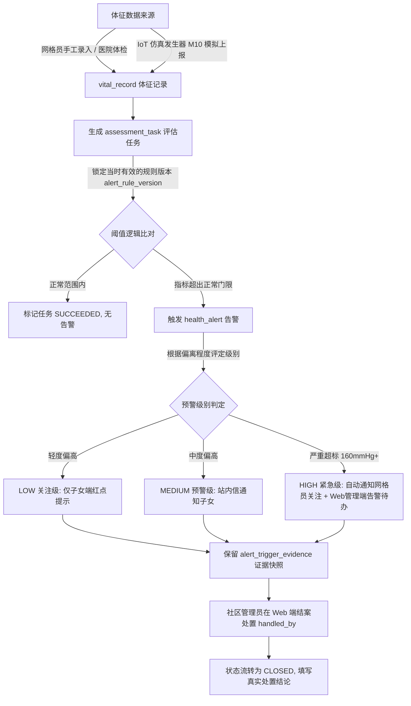
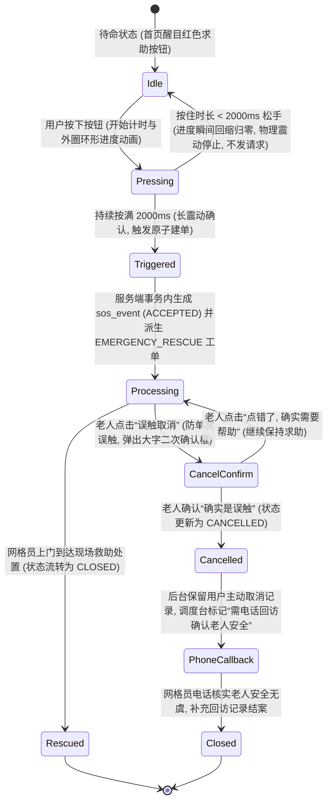
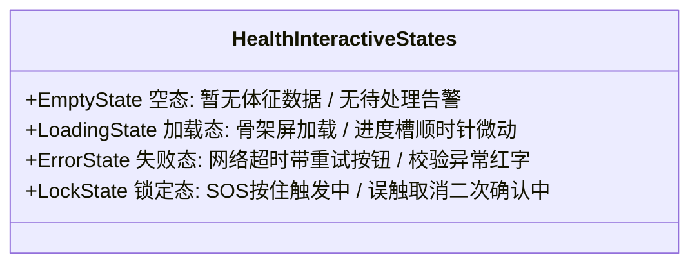

# M03 健康监测、M05 预警与 SOS 应急、M10 IoT 仿真原型与交互设计说明书（现行工作稿）

> **现行工作文档。** 本文件依据 [现行需求与范围](需求与范围.md)（FR-M03-01—04、FR-M05-01—05、FR-M10-01—03、BR-03/04/05/11）、[跨模块设计说明书](跨模块设计.md) 及 [项目计划](项目计划.md) 编制。
> **落地状态：** 交互设计规范全量确立。包含老人端长按 2 秒防误触环形 SOS、误触带痕取消二次确认与回访闭环、子女端健康走势看板、Web 端应急调度中心与 IoT 受控仿真控制台。
> **运行证据（2026-10-26）：** 当前未提交工作区的 SOS 触发、派工、处置经过独立临时库真实 HTTP 验证；体征、仿真及全部浏览器写入分支未在本轮逐项验收。参见[系统隔离联调记录](../../validation/系统隔离联调记录_2026-10-26.md)。
> 本规范落实任务 **`批次 A 原型与交互设计`**，作为相关前端视图代码与后端接口联调的唯一交互基线。

---

## 1. 业务流转与核心状态机

### 1.1 健康体征采集、评估与预警分级流转 (M03 / M05)

### 1.2 老人长按 2 秒 SOS 求助与带痕取消状态机 (M05 / 用户特别优化)

---

## 二、 交互页面与组件低保真结构表

### 1. 小程序·老人适老首页与 SOS 核心交互 (P-14)
* **路由路径**：`pages/elder/home`
* **适用角色**：`ELDER`（老人本人）
* **适老视觉规范**：
  - 页面背景采用柔和米白 `#FAF8F5`，避免纯白刺眼；
  - 正文字号 ≥ **18px**，标题 ≥ **22px**，高对比度色彩（WCAG AA 级别）；
  - 核心触控区均 ≥ **48×48px**。

| 区域/组件 | 元素与字段 | 交互动作与校验规范 | 适老化防呆设计 |
| :--- | :--- | :--- | :--- |
| **顶部状态栏** | 当前日期（农历+公历）、长辈称呼、社区网格管辖提示 | 只读展示，字号 20px 加粗 | 醒目展示“后宰门社区守护中”心理安全感 |
| **健康快报卡片** | 最新收缩压/舒张压（如 `128 / 82 mmHg`）、采集时间、测量状态标签（`正常` / `偏高`） | 点击跳转查看近 7 次历史趋势；异常时红底白字大标签高亮 | 放弃复杂的医学术语，偏高时显示“建议多喝水少盐休息”通俗提示 |
| **长按 2 秒 SOS 按钮** | 直径 140px 红色正圆大按钮、居中电话图标、“紧急求助”24px 白色大字、外层环形进度槽 | **touchstart**：启动 2000ms 计时器，环形进度条顺时针填充，手机马达高频轻震； **touchend**：若耗时 < 2000ms，进度条回弹清零，震动停止；若耗时 ≥ 2000ms，长震动 1 次并调用求助接口 | 100% 杜绝因手机放口袋或误碰导致报假警 |
| **求助中透明卡片** | “求助中”红标闪烁、已通知的网格员姓名与电话、“误触取消”副按钮 | 自动显示求助时间、地址，提供一键直拨网格员电话；点击“误触取消”唤起二次大字确认对话框 | 明确说明“已通知李明网格员”，避免虚假承诺 3 分钟必达 |
| **误触取消二次确认弹窗** | 标题“您是否需要取消求助？”、红色大按钮“是的，我刚按错了”、绿色大按钮“继续求助” | 必须点击“是的，我刚按错了”才提交取消，在数据库 `sos_event` 中更新为 `CANCELLED`，通知调度台生成“电话回访”任务 | 避免老人神智不清或受威胁时误碰取消 |

---

### 2. 小程序·子女端老人健康趋势与告警看板 (P-15)
* **路由路径**：`pages/family/health-trend`
* **适用角色**：`CHILD`（子女）
* **核心功能**：配合顶部的多老人切换组件，彻底隔离展示当前选定老人的健康画像。

| 区域/组件 | 元素与字段 | 交互动作与校验规范 | 异常防御设计 |
| :--- | :--- | :--- | :--- |
| **顶部老人选择器** | 当前查看的老人姓名、关系（如：父亲 张建国 72岁）、切换下拉卡片 | 切换老人时立即重置数据模型，禁止串载上一位老人的体征数据 | 若该老人亲情状态为 `FROZEN`，立即全屏拦截提示“争议冻结中” |
| **预警告警横幅** | 告警级别（`HIGH` / `MEDIUM`）、超标数值（收缩压 165mmHg）、发生时间、当前处置状态 | 存在未结案告警时高居顶部，点击展示处置详情弹窗 | 提示“社区已安排网格员电话核实”消除子女恐慌 |
| **体征趋势折线图** | 血压（收缩压/舒张压双折线）、血糖、心率切换 Tab；近 7 天 / 近 30 天切换 | 采用适合移动端的大字坐标轴与数据点，超标点以空心红圈放大高亮 | 支持手势滑动查看单点实测时间与录入来源（人工/设备） |
| **手工体征录入浮钮** | 浮动“+ 记录体征”按钮 | 弹窗录入收缩压、舒张压或血糖值，前端校验数值合理性（收缩压 50~260） | 录入接口携带 `Idempotency-Key`，防止网络迟缓多次保存 |

---

### 3. Web 管理端·健康告警与 SOS 应急调度中心 (P-16)
* **路由路径**：`/health/emergency-alert`
* **适用角色**：`COMMUNITY_ADMIN`（社区管理员）/ `GRID_WORKER`（网格员）

| 区域/组件 | 元素与字段 | 交互动作与校验规范 | 真实性风控设计 |
| :--- | :--- | :--- | :--- |
| **顶部紧急态声光提醒** | 实时未结案 SOS 红色闪烁徽章、三级告警待办计数 | 有新增未处理 SOS 时屏幕顶部横幅高亮闪烁，支持警报音提示 | 刷新页面保持状态同步，防止漏单 |
| **SOS 求助调度列表** | 求助单号、老人姓名、年龄、住址、触发时间、求助状态（`ACCEPTED` / `PROCESSING` / `CANCELLED` / `CLOSED`）、当前责任网格员 | 点击“立即派单 / 改派”分配网格员；点击“查看老人健康档案”穿透查看基础病史 | **误触取消回访机制**：对于老人取消的求助单，展示黄色警告标“老人主动取消·待电话回访”，管理员登记回访记录后方可彻底结案 |
| **体征超标告警处置台** | 告警编号、老人姓名、指标类型、实测值/基线比对高亮、告警级别（`HIGH`/`MEDIUM`）、状态 | 提供“一键派生走访工单”或“电话随访结案”；结案时强制填写 ≥ 5 字的《处置说明》 | 结案人 `handled_by` 不可为空，永久留痕于审计流水 |

---

### 4. Web 管理端·IoT 受控体征仿真发生器控制台 (P-17)
* **路由路径**：`/health/simulation-control`
* **适用角色**：`COMMUNITY_ADMIN` / 答辩演示人员
* **定位**：支持在无真实物理手环/血压计硬件接入时，受控模拟体征数据的产生与预警演练。

| 区域/组件 | 元素与字段 | 交互动作与校验规范 | 演示安全防线 |
| :--- | :--- | :--- | :--- |
| **目标老人与指标配置** | 老人选择下拉框（张建国 / 李秀英）、模拟体征类型（`BLOOD_PRESSURE` / `BLOOD_SUGAR`） | 必须明确指定目标老人，禁止全库广播造假 | 明确标注“仅供测试与演示环境受控使用” |
| **动力学参数设置** | 基准高压（默认 130）、基准低压（默认 82）、随机波动（±5.0）、采样间隔（默认 10 秒 / 60 秒） | 滑块或数字微调框，实时校验范围合理性 | 频率限制：最小采样间隔不得低于 5 秒，防止数据库洪泛 |
| **异常值注入开关** | 异常注入概率（0% ~ 20% 可调）、“立即单次注入一次 165mmHg 严重高血压”按钮 | 点击单次注入后，立即向 `vital_record` 插入一条严重超标数据，触发真实预警链条 | 方便在毕业答辩现场直接演示从“产生异常”到“手机端红标”再到“Web告警派单”的秒级全链路 |
| **运行监视与控制** | 发生器状态（`RUNNING` 绿灯 / `STOPPED` 灰灯）、累计生成记录数、启动/停止按钮 | 点击停止立即终止后台定时线程，更新 `simulation_control` 状态 | 页面卸载或后端重启时自动置为 STOPPED，不占用常驻资源 |

---

## 三、 交互“四态”标准定义与前端容错

1. **空态（Empty State）**：
   - 小程序端：未录入体征时展示适老大字插画：“暂未检测到健康记录，可点击下方按钮记录第一次血压”；
   - Web 调度端：无待办时展示绿色勾选卡片：“当前辖区全部老人体征平稳，无待处置紧急事件”。
2. **加载态（Loading State）**：
   - 切换老人或刷新趋势时，使用占位骨架屏（Skeleton），避免白屏闪烁；
   - SOS 长按时禁止页面被下拉刷新等触控手势中断。
3. **失败态（Error State）**：
   - 提交体征或派单因并发冲突（409）或会话失效（401）失败时，弹出大字清晰错误 Toast，保留表单输入不被清空。
4. **锁定/拦截态（Forbidden / Frozen State）**：
   - 若当前子女与老人的亲情关系为 `FROZEN`（争议冻结），趋势图与录入入口均替换为黄底警示卡片：“此老人亲情授权处于争议复核期，暂时不可查看健康数据与接收告警”。

---

## 四、 数据库物理映射对照表

本规范设计的所有字段与交互实体，均与已应用的 Flyway V3 物理模型严格 1:1 对齐：

| 前端原型组件/字段 | 对应数据库表名 | 对应数据库列名 | 约束与说明 |
| :--- | :--- | :--- | :--- |
| 体征记录（高压/低压/血糖） | `vital_record` | `value_primary`, `value_secondary`, `vital_type` | `unit` = 'mmHg' / 'mmol/L' |
| 体征录入来源（人工/仿真） | `vital_record` | `source_type` | `'MANUAL'` 或 `'SIMULATED'` |
| 自动生成的评估任务 | `assessment_task` | `rule_version_id`, `status` | 评估时固化规则版本 |
| 健康告警级别与处置 | `health_alert` | `alert_level`, `status`, `handled_by`, `handling_result` | 级别: `LOW`, `MEDIUM`, `HIGH` |
| 告警超标快照证据 | `alert_trigger_evidence`| `actual_value`, `threshold_value`, `evidence_json` | 留痕供子女与管理员查阅 |
| 长按 2 秒求助事实 | `sos_event` | `press_duration_ms`, `status`, `initial_work_order_id` | `press_duration_ms` 必须 ≥ 2000 |
| 误触取消与回访标记 | `sos_event` | `status` | 老人取消时更新为 `'CANCELLED'` |
| 派生的紧急救援工单 | `work_order` | `source_type`='SOS', `urgency_level`='URGENT' | 状态 `PENDING_DISPATCH` -> `ACCEPTED` |
| IoT 设备仿真运行控制 | `simulation_control` | `vital_type`, `status`, `base_value_primary`, `abnormal_injection_rate` | 发生器运行状态管理 |
