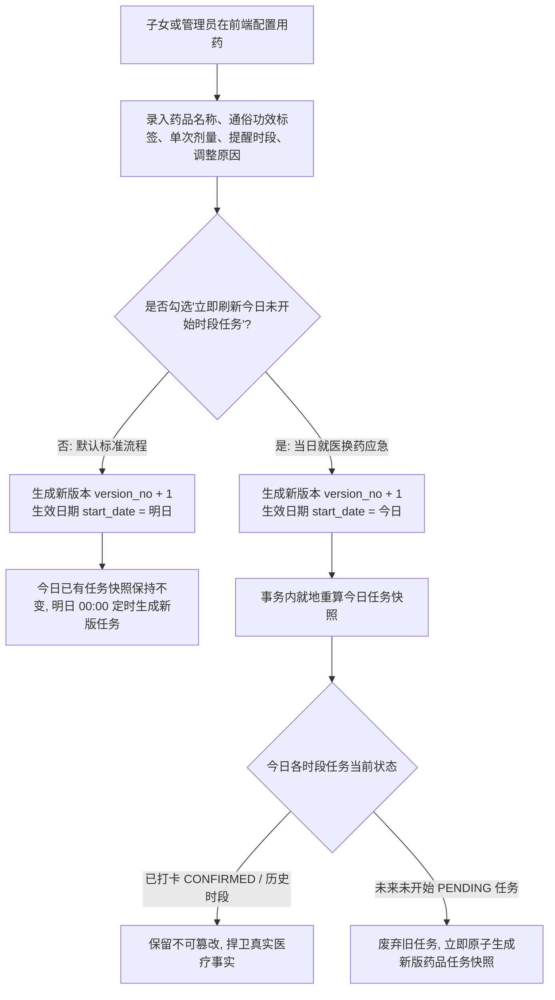
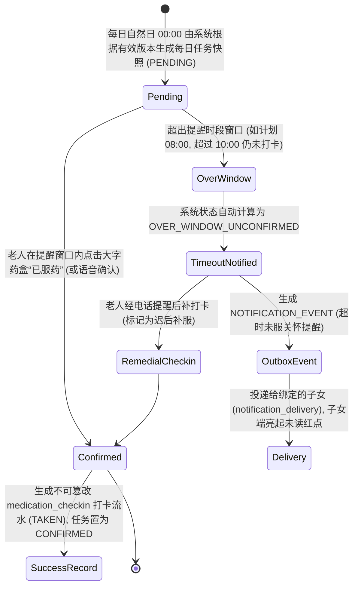

# M04 日常用药管理与 M11 消息提醒原型与交互设计说明书（现行工作稿）

> **现行工作文档。** 本文件依据 [现行需求与范围](需求与范围.md)（FR-M04-01—05、FR-M11-01—03、BR-06/07/08/14）、[跨模块设计说明书](跨模块设计.md) 及 [项目计划](项目计划.md) 编制。
> **落地状态：** 交互设计规范全量确立。包含老人端“今日大字药盒”一键服药打卡与通俗功效标签（如【降压药】）、不可变版本机制与“次日生效+可选刷新今日未开始时段”应急策略、子女端用药遵从度看板与超时未服站内信投递流。
> **运行证据（2026-10-26）：** 当前未提交工作区的老人今日任务与打卡经过独立临时库真实 HTTP 验证；跨日调度、计划应急刷新及通知投递未在本轮逐项验收。参见[系统隔离联调记录](../../validation/系统隔离联调记录_2026-10-26.md)。
> 本规范落实任务 **`批次 B 原型与交互设计`**，作为相关前端视图代码与后端接口联调的唯一交互基线。

---

## 1. 业务流转与核心状态机

### 1.1 用药计划版本化生命周期与当日应急刷新流转 (M04 / 用户特别优化)

### 1.2 每日服药任务打卡与超时未服通知状态机 (M04 / M11)

---

## 二、 交互页面与组件低保真结构表

### 1. 小程序·老人端极简“今日药盒”打卡卡片 (P-18)
* **路由路径**：`pages/elder/medication-box`
* **适用角色**：`ELDER`（老人本人）
* **适老化核心创新设计**：
  1. **通俗功效大标签**：药品通用名前面醒目加上橙底白字大标签，如【降压药】、【降糖药】、【心脏药】，彻底解决老人记不住化学多音字药名的问题；
  2. **超大触控打卡按钮**：单按钮尺寸宽 100px × 高 60px，按键带有手指下压触感及微震动反馈；
  3. **语音播报辅助**：点击打卡后，伴随清晰亲切的语音朗读：“已帮您记录早上的降压药，祝您身体安康！”；
  4. **防重复打卡**：打卡后按钮立即置为灰色“已服用”，展示绿色大勾，禁止二次点击。

| 区域/组件 | 元素与字段 | 交互动作与校验规范 | 适老化防呆设计 |
| :--- | :--- | :--- | :--- |
| **顶部状态卡片** | 标题“今日药盒”、当前时段（如：早晨 08:00）、今日已完成进度（如：已服 1 / 共 2 次） | 顶部居中大字展示，字号 22px 加粗 | 醒目直观，老人一眼明确今日是否服过药 |
| **药盒卡片列表** | 药品通俗功效标签（如【降压药】）、商品名/通用名（络活喜 苯磺酸氨氯地平片）、单次剂量（5mg 1片）、用法说明（早餐后温水送服） | 卡片高度 ≥ 120px，背景浅灰白；未服用卡片带蓝/橙强调边框；已服用卡片呈淡灰已完成态 | 大字排版（药名 24px，剂量 20px），文字避免紧贴边缘 |
| **一键打卡大按钮** | 绿色大按钮“我已服药” / 灰底大标签“✓ 已按时服用” | **tap**：发起打卡请求，携带客户端生成的 `Idempotency-Key` 防重，成功后播报语音并震动，卡片状态无缝切换 | 按钮高度 ≥ 50px，误触邻近区域不触发 |
| **漏服关怀提示** | 黄底大提示框“您有一份午间降糖药未打卡，如已服用请点击补卡” | 当处于 `OVER_WINDOW_UNCONFIRMED` 时高亮展示 | 语言温和关怀，不使用冷冰冰的“违规/超时”字眼 |

---

### 2. 小程序·子女端用药计划维护与遵从度看板 (P-19)
* **路由路径**：`pages/family/medication-plan`
* **适用角色**：`CHILD`（子女）
* **核心功能**：配合顶部多老人切换，制定不可变用药计划、查看服药打卡记录、遵从度统计与应急换药。

| 区域/组件 | 元素与字段 | 交互动作与校验规范 | 医疗安全防线设计 |
| :--- | :--- | :--- | :--- |
| **顶部长辈切换** | 当前老人（张建国 72岁）、亲情状态徽章 | 切换老人时立即刷新用药计划与今日打卡状态；若处于 `FROZEN` 状态则阻断编辑 | 严格隔离多长辈数据上下文 |
| **近30天服药遵从率** | 按时打卡率（如 `93.3%`）、近 30 天应服次数、已按时打卡次数、漏服次数卡片 | 环形百分比大字看板，按时率低于 80% 时以橙色告警提示 | 帮助子女掌握父母长期慢性病控制水平 |
| **在行用药计划列表** | 药品名称、通俗标签、剂量、每日提醒时段（如 08:00 早餐后 / 18:00 晚餐后）、当前版本号（v1）、启停状态（`ACTIVE`/`PAUSED`） | 支持点击“调整计划”，展示各版本不可变历史追溯 | 每次修改必须填写“调整原因”（如“遵医嘱减量”） |
| **新增/编辑用药计划弹窗** | 药品名称、通俗别名标签下拉（降压药/降糖药/心脏药/胃药/其他）、单次剂量、每日提醒时间点选择器、调整原因、**【勾选框】立即刷新今日未开始时段** | 表单各项前端校验必填；勾选立即刷新时，弹出黄色安全警告提示：“将立即替换今日未开始时段的任务，已打卡任务不受影响” | 遵循不可逆版本原则，兼顾就医换药真实应急场景 |

---

### 3. 小程序·子女端消息中心与未服提醒 (P-20)
* **路由路径**：`pages/family/notifications`
* **适用角色**：`CHILD`（子女）

| 区域/组件 | 元素与字段 | 交互动作与校验规范 | 消息防骚扰设计 |
| :--- | :--- | :--- | :--- |
| **消息类型分类 Tab** | 全部消息、用药提醒、健康预警、工单履约 | 支持切换过滤，未读消息带有红点徽章（Badge） | 红点随阅读自动消除 |
| **用药超时提醒卡片** | 标题“【服药超时关怀】张建国早餐降压药尚未打卡”、发生时间、提醒详情、一键致电长辈按钮 | 点击卡片展开详情，提供“一键拨打长辈电话”快捷按钮，方便子女致电叮嘱 | 采用 `dedup_key` 幂等去重，同一任务同一天最多提醒 1 次 |

---

### 4. Web 管理端·长辈用药档案与依从性监视工作台 (P-21)
* **路由路径**：`/medication/plan-monitor`
* **适用角色**：`COMMUNITY_ADMIN` / `GRID_WORKER`

| 区域/组件 | 元素与字段 | 交互动作与校验规范 | 基层减负设计 |
| :--- | :--- | :--- | :--- |
| **社区慢病用药监控大盘** | 社区建档服药老人总数、今日全社区服药打卡遵从率、今日累计超时未服老人清单 | 顶部数据指标卡片，按用药遵从率从低到高预警排序 | 网格员早巡前一目了然 |
| **长辈用药计划总览表** | 老人姓名、慢病类别、在服药品列表（通俗标签+剂量）、每日提醒时段、近7天打卡率、责任网格员 | 支持按长辈姓名模糊搜索与按网格筛选；点击“版本履历”抽屉可查看历次修改记录与操作人 | 完整留痕，责任清晰 |
| **超时未服电话关怀待办** | 今日超时未服老人姓名、住址、未打卡药品、计划时间、关怀状态（待提醒 / 已致电问候） | 网格员在办公室点击“记录电话问候”，填写问候反馈后消除待办 | 线下关怀与线上数据闭环结合 |

---

## 三、 数据库物理映射对照表

本规范设计的所有用药与通知实体，与已应用的 Flyway V3 物理模型严格 1:1 对齐：

| 前端原型组件/字段 | 对应数据库表名 | 对应数据库列名 | 约束与说明 |
| :--- | :--- | :--- | :--- |
| 用药计划总表 | `medication_plan` | `medicine_name`, `dosage`, `status`, `current_version_no` | 状态: `ACTIVE`, `PAUSED`, `STOPPED` |
| 用药计划不可变版本 | `medication_plan_version` | `version_no`, `start_date`, `end_date`, `change_reason` | 默认 `start_date` = 次日 (应急时为当日) |
| 计划每日提醒时刻 | `medication_plan_reminder_time`| `reminder_time`, `time_label` | 如 `08:00:00`, `早餐后` |
| 每日服药任务快照 | `medication_task` | `task_date`, `scheduled_time`, `medicine_name`, `status` | 状态: `PENDING`, `CONFIRMED`, `OVER_WINDOW_UNCONFIRMED` |
| 老人服药打卡流水 | `medication_checkin` | `checkin_time`, `checkin_mode`, `actual_status`, `idempotency_key` | 一任务仅能有一条成功打卡 |
| 关怀通知逻辑事件 | `notification_event` | `policy_scope`, `event_type`, `dedup_key`, `title`, `content` | `dedup_key` 唯一键防止重发骚扰 |
| 逐人通知投递流水 | `notification_delivery` | `recipient_user_id`, `read_status`, `status`, `channel` | 站内短轮询读状态维护 |
