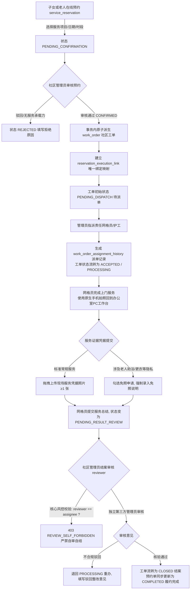

# M06 社区工单、M07 助老服务预约与 M08 履约审核原型与交互设计说明书（现行工作稿）

> **现行工作文档。** 本文件依据 [现行需求与范围](需求与范围.md)（FR-M06-01—06、FR-M07-01—05、FR-M08-01—03、BR-09/10/15/16）、[跨模块设计说明书](跨模块设计.md) 及 [项目计划](项目计划.md) 编制。
> **落地状态：** 交互设计规范全量确立。涵盖子女/老人端 4 大养老服务大图目录与预约表单、大字履约进度时间轴、Web 管理端调度派单大厅、网格员相册现场照片拖拽上传结案、隐私免照审核及 `reviewer != assignee` 防自审自结真实性闭环。
> **运行证据（2026-10-26）：** 当前未提交工作区的子女预约、管理员确认与派单、网格员接单/开工/合成照片上传/提交、管理员审核结案经过独立临时库真实 HTTP 验证；取消/中止、免照豁免及完整浏览器写入未在本轮逐项验收。参见[系统隔离联调记录](../../validation/系统隔离联调记录_2026-10-26.md)。
> 本规范落实任务 **`批次 C 原型与交互设计`**，作为相关前端视图代码与后端接口联调的唯一交互基线。

---

## 1. 业务流转与核心状态机

### 1.1 服务预约与派生工单全生命周期流转 (M06 / M07 / M08)

### 1.2 工单流转操作审计与并发控制

* **并发保护**：工单主表 (`work_order`) 和预约主表 (`service_reservation`) 全量配置 `row_version` 乐观锁字段，派单、接单、提交结果和审核时必须带入版本号，发生抢单或重复操作时拦截并提示 `409 OPTIMISTIC_LOCK_CONFLICT`；
* **操作全审计**：关键节点流转（指派、改派、开始服务、结案）均不可篡改写入 `work_order_action_history` 与 `audit_log`。

---

## 二、 交互页面与组件低保真结构表

### 1. 小程序·助老服务目录与代预约申请 (P-22)
* **路由路径**：`pages/family/service-booking`
* **适用角色**：`CHILD`（子女） / `ELDER`（老人）

| 区域/组件 | 元素与字段 | 交互动作与校验规范 | 适老与防呆设计 |
| :--- | :--- | :--- | :--- |
| **顶部长辈名片** | 被预约长辈姓名（张建国）、现居地址、健康提醒 | 只读显示，默认带入老人常住地址 | 避免子女重复手工输入冗长地址 |
| **四大服务目录卡片** | 1. 上门助浴照料 (90分钟) 2. 医院就医陪诊 (180分钟) 3. 居家适老保洁 (120分钟) 4. 社区营养助餐 (30分钟配送) | 卡片包含服务大图、时长、服务标准说明；单选高亮，点击选中 | 卡片触控高 ≥ 100px，图文并茂，说明包含“防滑准备、门诊携带社保卡”等注意事项 |
| **预约日期时段选择** | 服务日期（仅支持预约未来 7 天内）、服务时段（上午 09:00-11:30 / 下午 14:00-17:00） | 仅限预约 T+1 及以后的日期（禁止预约过去时间）；不可选当日过期时段 | 弹窗单选时段，防止时间选错 |
| **特殊情况叮嘱** | 多行文本框（如：“老人腰腿活动不便，厨房地砖湿滑，请重点擦拭干燥”） | 限制 200 字以内，可空 | 占位符提示“有无失智失能、过敏特殊情况” |
| **提交预约大按钮** | 绿色大按钮“确认提交服务预约” | 点击后生成 `Idempotency-Key` 防重复提交，成功后弹窗跳转至时间轴进度页 | 提示“社区管理员将在2小时内审核派单” |

---

### 2. 小程序·服务履约进度与时间轴大字看板 (P-23)
* **路由路径**：`pages/family/order-timeline`
* **适用角色**：`CHILD`（子女） / `ELDER`（老人）

| 区域/组件 | 元素与字段 | 交互动作与校验规范 | 基层现实关怀 |
| :--- | :--- | :--- | :--- |
| **工单核心摘要** | 服务名称（如：居家适老保洁）、预约编号（`RSV202610250001`）、预约上门时间（`2026-10-26 上午`） | 顶部卡片展示，高反差背景 | 清晰明确 |
| **大字竖向时间轴** | 1. 提交预约申请 (已完成) 2. 社区受理确认 (已派单给网格员李明) 3. 服务人员已接单 (准备上门中) 4. 现场服务执行完毕 (已上传凭据，待结案) 5. 审核通过，服务圆满完成 | 根据工单 `status` 动态点亮对应节点；节点右侧大字显示发生时间与操作人 | 适老字体 ≥ 16px，当前进行中节点动态脉冲高亮 |
| **责任网格员联络卡** | 网格员姓名（李明）、工牌号、联系电话、一键拨打按钮 | 派单后可见，点击直呼网格员电话 | 方便子女提前沟通老人习惯 |
| **未接单前取消入口** | “申请取消预约”小按钮 | 仅在网格员接单前（`PENDING_DISPATCH` / `PENDING_ACCEPT`）允许申请取消；弹出确认框并填写取消原因 | 避免护工已在路上时随意撤单 |

---

### 3. Web 管理端·社区工单调度与派单大厅 (P-24)
* **路由路径**：`/order/dispatch-desk`
* **适用角色**：`COMMUNITY_ADMIN`（社区管理员）

| 区域/组件 | 元素与字段 | 交互动作与校验规范 | 调度效率设计 |
| :--- | :--- | :--- | :--- |
| **工单调度池** | 待派单列表（工单号、来源：`RESERVATION`/`SOS`/`HEALTH_ALERT`、紧急程度：`URGENT`/`NORMAL`、老人姓名、服务类型、预约时间） | SOS 紧急工单顶部强制置顶红标高亮；普通预约工单按上门日期升序排列 | 支持批量派发与紧急插单 |
| **智能派单对话框** | 备选网格员列表（李明、张华、王强）、当前在手在途单量（如：李明 在手 1 单）、联系方式 | 点击“派单 / 改派”弹窗；选择网格员并填写派单叮嘱；提交时锁定版本号防并发并发冲突 | 展示人员负荷，避免某一位网格员过载 |

---

### 4. Web 管理端·网格员服务登记与真实性结案审核工作台 (P-25)
* **路由路径**：`/order/execution-review`
* **适用角色**：`GRID_WORKER`（登记结果）/ `COMMUNITY_ADMIN`（结案审核）
* **核心业务闭环规范**：
  1. **PC 端多图拖拽上传**：网格员现场用手机拍照后，在电脑端打开工作台，直接将照片拖入上传框完成凭据固化；
  2. **隐私免照申报**：助浴或理疗等敏感隐私场景，支持勾选“申请隐私免照”并填报事由；
  3. **防自审自结风控拦截**：系统服务端强校验 `reviewer != assignee`，执行人员点击结案直接阻断报错 `403 REVIEW_SELF_FORBIDDEN`，必须由第二人审核。

| 区域/组件 | 元素与字段 | 交互动作与校验规范 | 真实性风控设计 |
| :--- | :--- | :--- | :--- |
| **待办工单选项卡** | “我的执行工单 (网格员)” 与 “服务审核大厅 (管理员)” 双视图 | 根据当前登录角色权限自动筛选；工作人员只看指派给自己的单 | 责任边界分明 |
| **现场结果登记弹窗** | 服务总结多行文本、**【拖拽图片上传区】现场服务凭据照片（支持多图）**、**【复选框】申请隐私免照**（展开免照说明输入框） | 未勾选免照时强制至少上传 1 张现场照片；勾选免照时必须填写免照事由（≥5字） | 零移动端开发成本，贴合基层办公习惯 |
| **管理员结案审批弹窗** | 查看网格员填报总结、现场缩略图悬浮大图预览、免照理由（如有）；审批操作：通过结案 / 驳回退回重办（必填驳回整改原因） | **拦截防呆**：若审核人与执行网格员为同一账号，结案按钮置灰禁用并提示“防自审风控：禁止审核自己执行的工单” | 彻底杜绝自导自演造假 |

---

## 三、 数据库物理映射对照表

本规范设计的所有预约、工单及证据实体，与已应用的 Flyway V3 物理模型严格 1:1 对齐：

| 前端原型组件/字段 | 对应数据库表名 | 对应数据库列名 | 约束与说明 |
| :--- | :--- | :--- | :--- |
| 服务目录项目 | `service_catalog` | `service_type`, `service_name`, `estimated_duration_min`, `status` | 4 大标准服务项目 |
| 助老服务预约单 | `service_reservation` | `reservation_no`, `elder_id`, `service_date`, `slot_code`, `status` | 唯一约束防同一时段冲突 |
| 预约派生工单主表 | `work_order` | `order_no`, `source_type`, `status`, `current_assignee_id`, `row_version` | 状态机流转控制 |
| 预约与工单映射 | `reservation_execution_link` | `reservation_id`, `work_order_id` | 1:1 原子绑定 |
| 派单与改派流水 | `work_order_assignment_history`| `action_type`, `operator_user_id`, `assigned_to_user_id`, `reason` | 全局留痕 |
| 现场凭据与免照登记 | `work_order` | `service_result_summary`, `result_photo_required`, `photo_exemption_reason` | 真实性数据支撑 |
| 结案审核人与审核说明 | `work_order` | `reviewer_user_id`, `reviewed_at`, `review_comment` | `reviewer != current_assignee_id` |
| 操作状态流转历史 | `work_order_action_history` | `from_status`, `to_status`, `action_name`, `comment` | 审计留痕 |

---

## 四、 后端落地与自动化集成测试状态

1. **后端核心组件全量落地**：
   * **M06/M08 工单流转与执行**：[`WorkOrderController`](../../../services/api/src/main/java/cn/communityelderly/modules/order/controller/WorkOrderController.java)、[`WorkOrderExecutionController`](../../../services/api/src/main/java/cn/communityelderly/modules/order/controller/WorkOrderExecutionController.java)、[`WorkOrderServiceImpl`](../../../services/api/src/main/java/cn/communityelderly/modules/order/service/impl/WorkOrderServiceImpl.java)。
   * **M07 服务目录与预约**：[`ServiceCatalogController`](../../../services/api/src/main/java/cn/communityelderly/modules/reservation/controller/ServiceCatalogController.java)、[`ServiceReservationController`](../../../services/api/src/main/java/cn/communityelderly/modules/reservation/controller/ServiceReservationController.java)、[`ServiceReservationServiceImpl`](../../../services/api/src/main/java/cn/communityelderly/modules/reservation/service/impl/ServiceReservationServiceImpl.java)。
   * **跨模块协调事务**：[`ReservationWorkOrderCoordinator`](../../../services/api/src/main/java/cn/communityelderly/coordination/ReservationWorkOrderCoordinator.java)；原稿提及的 `AdminReservationCoordinationController` 在本次工作区不存在，保留名称供历史追溯。
2. **核心业务风控断言实测**：
   * 测试文件：[`WorkOrderAndReservationIntegrationTest.java`](../../../services/api/src/test/java/cn/communityelderly/modules/order/WorkOrderAndReservationIntegrationTest.java)
   * 测试结果：3 项断言全部通过（时段防重 409 拦截、预约确认原子建单与映射绑定、免照合规理由校验、`reviewer != assignee` 防自审自结 403 强拦截）。
