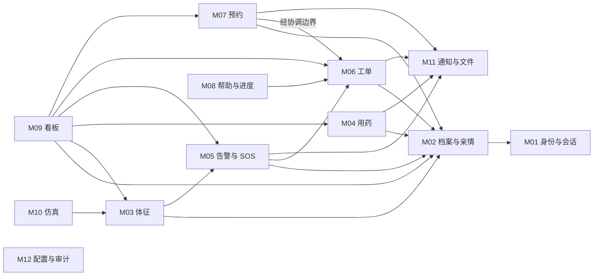
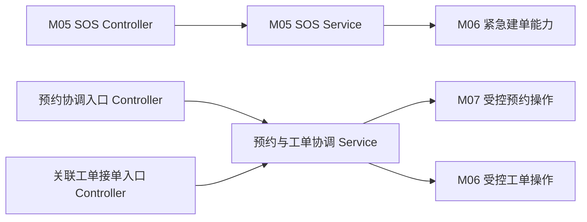

# 后端代码架构与跨模块事务（现行工作稿）

> **现行工作文档。** 本文件由[2026-10-25 原始资料](../2026-10-25-before-live-docs/design/代码架构与跨模块事务讨论稿_v0.1_2026-10-25.md)建立，后续设计和实现可直接修订本文件。原文中的版本、冻结、批准和‘下一步’等表述记录其形成时点；目前是否实现、通过测试，以新的运行记录为准。改变需求范围、权限或关键业务规则时，在[变更记录](变更记录.md)登记原因与影响。

**来源版本：** v0.1（2026-10-25）\
**状态（2026-10-26）：** 当前未提交工作区的架构参考；独立临时库后端 136 项测试中 132 通过、4 跳过，三条跨角色 HTTP 主链通过。代码存在不等于 M01–M12 全部需求验收完成；范围见[系统隔离联调记录](../../validation/系统隔离联调记录_2026-10-26.md)。\
**输入：** [SRS v1.0](需求与范围.md)、[总体设计基线 v1.1](总体设计.md)、[E-01—E-07 集成设计基线 v1.1](跨模块设计.md)、2026-10-25 提供的模块图与事务时序图\
**用途：** 将已确认的业务和集成约束转为可评审的代码职责与事务设计，不替代模块详细设计、物理 DDL、API 契约或测试用例。

## 1. 当前结论和边界

采用 Spring Boot 单体、按业务模块组织；模块内保持 `Controller → Service → Mapper`。普通跨模块调用使用公开的业务能力；需要协调 M06/M07 状态的流程使用专用协调 Service。M05 的 SOS 接受由 M05 Service 编排，调用 M06 的紧急工单创建能力。协调 Service 是同一应用中的 Bean。下文描述代码职责与目标约束；当前测试数字和已验证范围以上方状态说明为准，尤其不能把取消/中止等设计流程当作已通过 HTTP 验收。

本文图中的箭头表示**业务调用方 → 能力提供方**，不是 Java 包依赖、数据库外键或消息发送方向。跨模块状态始终由其所属模块修改。实际方法签名、包名、锁定 SQL、事务传播和错误响应须在 D2/D3 及 M06/M07 详细设计中确认。

## 2. 模块责任与依赖方向

| 模块 | 权威业务事实及写入责任 | 主要依赖或对外能力 |
| --- | --- | --- |
| M01 身份认证与权限 | 账号、角色、会话、激活与恢复 | 提供当前主体和账号有效性；对象级授权仍由各业务域判断。 |
| M02 档案与亲情授权 | 老人档案、身份关联、亲情关系、更正和状态 | 向 M03/M04/M05/M06/M07/M11 提供当前档案与亲情授权判断；不复制关系状态。 |
| M03 健康档案与体征 | 体征及其来源记录 | 向 M05 提供已接受的体征事实；仿真输入仍经受控接收路径。 |
| M04 用药计划与打卡 | 计划版本、任务和本人打卡 | 使用 M01/M02 授权，向 M11 提交已批准矩阵内的通知逻辑事件。 |
| M05 告警与 SOS | 告警、SOS 事实及评估结果 | 接受 SOS 时调用 M06 紧急建单能力；普通告警经管理员核查后才手动关联普通工单。 |
| M06 社区工单与调度 | 工单、分配、交接、处理及审核状态 | 向其他模块提供受控建单、状态变更和查询能力；预约关联工单接单走 M06/M07 协调流程。 |
| M07 助老服务预约 | 服务目录、预约、取消及中止申请 | 预约确认、确认后取消审批和中止审批走 M06/M07 协调流程；不直接修改工单表。 |
| M08 适老帮助与服务进度 | 帮助内容与面向老人的进度呈现 | 通过 M06 受控查询获得本人进度；不自行维护第二套工单状态。 |
| M09 社区数据看板 | 授权范围内的统计读模型 | 初版由相关模块提供受控查询；需要专用只读聚合时在 M09 专项确定，不绕过社区权限。 |
| M10 IoT 仿真与演示 | 仿真控制、执行单元和来源标记 | 通过 M03 等受控入口产生标记为仿真的数据，不直接伪造真实设备记录。 |
| M11 通知与文件 | 逻辑通知/逐收件人投递；文件资产、版本和业务关联 | 发送/读取前按当前授权复核；不拥有老人、预约或工单的业务权限规则。 |
| M12 配置与审计 | 业务配置、通用 `audit_log` 及其查询 | 向业务写事务提供审计写入能力；领域历史仍由各业务模块持有。 |

**依赖约束：** Controller 只接收和返回本入口的 HTTP 数据；Service 执行业务与事务编排；Mapper 只访问本模块拥有的表。跨模块传递专用命令、查询结果或必要值，不传递或修改对方的 Entity/Mapper。M09 的跨域读和 M11 的授权复核是待细化的受控协作，不意味着可以直接读取所有业务表。严禁模块 Service 与协调 Service 相互回调形成循环。附件时序图中的“MySQL”代表持久化结果，实际代码仍由各模块 Mapper 完成 SQL 访问。

### 2.1 十二模块逻辑依赖图



为使图可读，所有业务模块使用 M01 认证能力、必要写事务使用 M12 审计能力的重复箭头未逐条画出；M11 的实时授权复核也仅在第 3 节定义接口方向。M07 → M06 表示经专用协调边界复用工单能力，不表示 M07 Service 直接反向调用协调 Service。图是业务逻辑依赖；具体 Java 类依赖以无循环的协调入口设计为准。

### 2.2 高风险流程的调用形状



不关联预约的普通工单操作仍由 M06 自身处理。若协调 Service 放在顶层 `coordination` 包并依赖 M06/M07 的内部操作，则这些跨模块 HTTP 入口也宜放在 `coordination` 包，路由仍可保持预约或工单语义。这样不会形成“M06/M07 包调用 coordination，再由 coordination 调回 M06/M07 包”的双向包依赖。具体类与路由在 D3 确认；下层操作不得反向调用上层入口。

## 3. 公共能力归属

| 能力 | 候选归属 | 边界 |
| --- | --- | --- |
| 框架配置、统一响应、异常映射、追踪 | `common/config`、`response`、`exception`、`trace` | 只提供技术约定，不决定业务状态和对象权限。 |
| 当前主体、安全上下文 | `common/security` + M01 的账号/会话实现 | `common` 不复制 M02 亲情关系或 M06 工单权限。 |
| 幂等键、摘要和重放机制 | `common/idempotency` | 业务合法性仍由命令所属模块判断；结果与业务状态在同事务提交。 |
| 通用审计写入及查询 | M12 `system/audit` | 唯一通用审计事实为 `audit_log`；档案事件、预约和工单历史各归其模块。 |
| 通知 outbox、投递与文件 | M11 `notification`、`file` | 业务模块只调用受控能力；实际发送在提交后，文件访问重验当前权限。 |
| 预约—工单事务协调 | `coordination/reservationworkorder`（候选包） | 只编排跨模块用例，不拥有预约或工单 Entity/Mapper。 |

M11 可在自身定义“投递前收件人资格”和“文件读取权限”等**按用途划分的窄接口**，由拥有授权事实的模块提供独立适配器实现。适配器只调用本模块的授权查询，不反向依赖 M11 的发送/文件服务，避免运行时 Bean 循环。暂不引入通过 `supports(String resourceType)` 分派所有业务对象的万能权限接口。接口参数、实现发现方式和发送前重新核验的事务/锁范围在 M11 专项确定；M11 不在代码中直接依赖各业务模块的具体 Service 实现。

## 4. 跨模块事务共同规则

以下均为**设计候选**。真正写事务按集成基线 §2.4 的候选等级获取实际需要的行锁：D1 已选择维护门闩，故先取得等级 00；幂等记录等级 10 在业务对象前；身份、档案及关系按需复核；预约关联流程按预约 → 申请 → 执行关联 → 工单顺序；通知与审计在业务事实之后追加。同级多行按主键升序。门闩的真实表、SQL、索引、锁范围和全写入口覆盖尚未实现或验证，见[工程基座 §11](工程基座.md)。

事务入口须在锁定后重新复核操作者、对象权限、版本和状态，不能只依赖事务前的普通查询。业务状态、必要领域历史、幂等结果、必需的 `audit_log` 和可靠通知的逻辑事件/outbox 同事务提交。实际发送、文件系统 IO、备份复制及外部网络调用在事务外执行。内部 Service 不得通过独立提交的事务破坏已要求的原子性；Spring 事务代理、传播和异常回滚规则在具体方法设计中核对。

| 流程 | 事务入口 | 同事务结果 | 失败及重复请求结果 |
| --- | --- | --- | --- |
| SOS 接受 | M05 SOS Service | SOS、健康告警、唯一初始紧急工单及关联、幂等、审计、必要 outbox | 任一必要数据库写入失败则整体回滚；同键同内容返回原结果，同键异内容返回冲突。通知失败不回滚已接受 SOS。 |
| 预约确认 | M06/M07 协调 Service | 预约 `CONFIRMED`、时段占用、M06 `PENDING_DISPATCH` 工单、唯一执行关联、历史、幂等、审计、必要 outbox | 任一必要步骤失败整体回滚；重放返回原预约与工单。 |
| 确认后取消审批／关联工单接单 | 同一协调边界的两个入口 | 先提交的一方获得合法状态；对应申请、预约、执行关联、工单、历史和必要副作用一致 | 取消先提交则后续接单拒绝；接单先提交则普通取消审批不得获批，确需终止走独立中止。 |
| 服务中止审批 | M06/M07 协调 Service | 中止申请、预约及工单各自转为 `SERVICE_STOPPED`，保存已完成/未完成/后续安排、历史、审计、必要 outbox | 任一必需字段或状态不合法即整体拒绝；不得伪装成正常结案、拒绝或取消。 |

### 4.1 SOS 接受与紧急建单

| 步骤 | 候选锁行/状态条件 | 同事务写入或失败处理 |
| --- | --- | --- |
| 识别请求 | 锁该主体/操作/键的幂等记录；检查账号、老人身份与档案状态。有效老人账号在档案停用时仍允许该窄范围 SOS；账号停用或认证无效则拒绝。 | 同键同内容已完成则重放；同键异内容 409；未确认的请求不得伪装为已接受。 |
| 创建事实 | 按集成基线所需顺序锁定/检查相关业务对象；具体 SQL 和行范围待 D2。 | M05 保存不可删除的 SOS 事实与健康告警；M06 创建唯一初始紧急工单及关联。`sos_event`、告警、工单的唯一性实现待 D2。 |
| 完成事务 | 不在事务中调用实际外发通道。 | 写入必要领域历史、幂等结果、M12 审计与 M11 outbox 后整体提交；任何必需步骤失败整体回滚。成功仅表示服务器接受，不表示已接单或到场。 |

### 4.2 预约确认与唯一执行流程

| 步骤 | 候选锁行/状态条件 | 同事务写入或失败处理 |
| --- | --- | --- |
| 识别与授权 | 维护门闩（若采用）→幂等记录→必要的账号、档案及授权资源；具体锁行待 D2。 | 复核本社区管理员权限、服务目录/预约/时段状态；非法或过期版本拒绝。 |
| 协调状态 | 锁 `service_reservation`；按需锁相关申请、`reservation_execution_link`、`work_order`，顺序见基线 §2.4。 | M07 改为 `CONFIRMED` 并占用时段；M06 创建 `PENDING_DISPATCH` 工单；建立唯一执行关联及状态历史。 |
| 提交 | D2 至少验证执行关联对预约 ID、工单 ID 的唯一约束实现；具体约束/索引和空值规则待评审。 | 写入幂等结果、审计、必要 outbox；关联或工单创建失败时预约确认与时段占用一起回滚。 |

### 4.3 取消审批与接单竞争

接单入口若从工单 ID 到达，先普通只读定位预约 ID；正式写事务仍必须按候选顺序重新取得并核验预约、相关取消申请（如需）、执行关联和工单。只有关联预约的接单走此协调边界。两入口不得分别使用相反的锁序。

| 先提交的一方 | 锁定后条件 | 原子结果 | 另一方可观察结果 |
| --- | --- | --- | --- |
| 取消审批 | 原申请人提交的确认后取消申请可审批，关联工单尚未接单；审批人权限仍有效。 | 申请批准、预约 `CANCELLED`、关联工单 `TERMINATED_PRE_ACCEPTANCE`、释放时段，保存历史、审计及必要 outbox。 | 后续接单冲突/拒绝，不覆盖取消结果。 |
| 工单接单 | 预约仍有效、执行关联唯一、当前分配及承接人有效、工单仍可接单。 | 工单进入 `ACCEPTED`，分配/操作历史与必要审计一起提交。 | 普通取消审批不得获批；需终止时走独立服务中止。待审取消申请如何结束，留 M07 状态机决定。 |

条件更新、`expectedVersion` 和数据库唯一约束共同兜底；单纯“先查询再更新”不满足 BR-10。测试必须覆盖两个提交次序、同键重放、异内容冲突、版本过期和故障注入。

### 4.4 服务中止审批

| 步骤 | 候选锁行/状态条件 | 同事务写入或失败处理 |
| --- | --- | --- |
| 申请与授权 | 原申请人或当前承接人可提出；本社区管理员审核。写事务按预约 → 中止申请 → 执行关联 → 工单锁定并重新核验。 | 缺少原因、已完成内容、未完成事项或后续安排等必需事实时不得批准。 |
| 结果 | 预约与工单分别由 M07/M06 执行所属状态迁移。 | 中止申请、预约和工单均记录 `SERVICE_STOPPED` 对应结果、人员、时间、领域历史及必要审计/outbox；不得写成 `CLOSED`、`REJECTED`、`CANCELLED` 或 SOS `VOIDED`。 |
| 失败 | 任何一方已到不可中止状态、权限/版本变化或必要写入失败。 | 整体拒绝或回滚，已成功的其他业务事实不得被失败方覆盖；具体 HTTP 码与客户端下一步在 D3 确定。 |

## 5. 现行落地状态与阶段验证

1. **D1 工程基座：** 已选择维护门闩并完成工程基座和可复现环境验收，见[D1 验收记录](../../validation/D1工程基座验收记录_2026-10-25.md)。
2. **Flyway 物理迁移脚本：**
   - `V1__init_schema.sql`：系统基础表结构；
   - `V2__m01_m02_identity_and_archive.sql`：M01 身份与 M02 档案亲情核心物理表（16 张表）；
   - `V3__core_business_schema.sql`：M03 体征、M04 用药、M05 SOS、M06 工单、M07 预约、M10 仿真、M11 通知与审计全量物理表（总计 45 张物理表）。
3. **自动化测试套件：** 2026-10-26 独立临时 MySQL 上执行后端 136 项测试（132 通过、0 失败、0 错误、4 跳过）；脚本、命令和条件见[系统隔离联调记录](../../validation/系统隔离联调记录_2026-10-26.md)。

## 6. 现行工程包结构与模块落地清单

系统基于 Spring Boot 3.4.3 单体构建，代码全部位于 `services/api/src/main/java/cn/communityelderly/` 命名空间下：

```
cn.communityelderly
├── CommunityElderlyApplication.java       # Spring Boot 启动入口
├── common                                 # 通用系统基础设施
│   ├── api                                # 统一响应封装 (Result<T>)
│   ├── config                             # 密码哈希、MVC 拦截器配置 (WebMvcConfig, PasswordConfig)
│   ├── exception                          # 业务异常定义与全局捕获 (GlobalExceptionHandler, BusinessException, ErrorCode)
│   ├── idempotency                        # 幂等拦截器与防重注解 (@Idempotent, IdempotencyInterceptor)
│   ├── security                           # 会话安全上下文与角色校验 (@RequireRoles, SecurityContext, CurrentUser)
│   └── trace                              # 分布式全链路追踪 (TraceFilter, TraceContext)
├── coordination                           # 跨模块事务协调器
│   └── ReservationWorkOrderCoordinator.java # 预约与工单状态机协调器 (确认建单、取消与接单竞争)
└── modules                                # 业务模块目录
    ├── audit                              # M12 全局安全审计追踪 (AuditLog, AuditLogService, AuditLogController)
    ├── auth                               # M01 身份与权限 (UserAccount, AuthService, AuthController)
    ├── dashboard                          # M09 社区态势感知大屏 (DashboardSummaryVO, CommunityDashboardService, CommunityDashboardController)
    ├── elder                              # M02 档案与亲情 (ElderProfile, KinshipBinding, ProfileCorrection, ElderController)
    ├── emergency                          # M05 SOS 应急求助 (SosEvent, WorkOrder, SosEventService, SosEventController)
    ├── health                             # M03 体征与告警 (VitalRecord, HealthAlert, VitalRecordService, HealthAlertController)
    ├── medication                         # M04 慢病用药版本与任务 (MedicationPlan, MedicationTask, MedicationComplianceService)
    ├── notification                       # M11 关怀通知 (NotificationEvent, NotificationDelivery, NotificationService)
    ├── order                              # M06 社区工单与流转 (WorkOrder, WorkOrderService, WorkOrderController)
    ├── reservation                        # M07 助老服务预约 (ServiceReservation, ReservationService, ReservationController)
    └── simulation                         # M10 IoT 体征仿真 (SimulationControl, SimulationService, SimulationController)
```

### 6.1 核心 REST API 路由与契约

所有业务端点均遵循 `/api/v1` 契约，支持响应头 `X-Trace-Id` 全链路追踪与幂等头 `X-Idempotency-Key`：

| 模块 | 核心端点 | 请求方法 | 权限与用途 |
| --- | --- | --- | --- |
| **M01 认证** | `/api/v1/auth/login` | POST | 统一手机号/密码登录，颁发 Bearer Token |
| | `/api/v1/auth/register-family` | POST | 子女账号注册 |
| | `/api/v1/auth/logout` | POST | 登出并注销当前会话 |
| **M02 档案亲情** | `/api/v1/elders` | POST / GET | 老人建档与社区分页查询 (管理员) |
| | `/api/v1/elders/activation-ticket` | POST | 签发 6 位大字明文单次激活码 |
| | `/api/v1/elders/activate` | POST | 老人端凭 6 位激活码单次激活账号 |
| | `/api/v1/elders/{elderId}/kinship-bindings` | POST / GET | 子女申请绑定与老人/社工核验 |
| | `/api/v1/elders/corrections` | POST / PUT | 档案更正申请与快照比对复核 |
| **M03 体征告警** | `/api/v1/health/vitals` | POST / GET | 体征人工录入与走势查询 (自动触发阈值评估) |
| | `/api/v1/health/alerts` | GET | 社区健康告警列表 |
| | `/api/v1/health/alerts/{alertId}/close` | POST | 告警人工处置结案 |
| **M04 用药任务** | `/api/v1/medication/plans` | POST / GET | 创建用药计划 (自动建立 V1 不可变版本) |
| | `/api/v1/medication/plans/{planId}/versions` | POST | 变更用药计划生成新版本，支持应急刷新今日待服任务 |
| | `/api/v1/medication/tasks/today` | GET | 老人端今日药盒任务查询 (自动执行超时未服判定) |
| | `/api/v1/medication/tasks/{taskId}/checkin`| POST | 老人一键大字打卡 (带 idempotencyKey 防重) |
| | `/api/v1/medication/compliance` | GET | 30 天遵从率看板与超时关怀留痕 |
| **M05 SOS 应急** | `/api/v1/sos/trigger` | POST | 长按 >=2000ms 触发 SOS (原子建单派发工单) |
| | `/api/v1/sos/{sosId}/cancel` | POST | 误触取消 (状态带痕转为电话回访待办) |
| | `/api/v1/sos/{sosId}/dispatch` | POST | 调度员改派与处置结案 |
| **M06 工单流转** | `/api/v1/orders/{orderId}/status` | PUT | 工单状态机流转 (接单/处理/结案，带防自审锁校验) |
| **M07 助老预约** | `/api/v1/reservations` | POST / GET | 助老服务目录与发起预约申请 |
| | `/api/v1/reservations/{reservationId}/confirm` | POST | 预约确认原子生成关联工单 |
| | `/api/v1/reservations/{reservationId}/cancel` | POST | 预约取消审批与接单竞争协调 |
| **M10 IoT 仿真** | `/api/v1/simulation/control` | GET / POST | 仿真启停控制与 165mmHg 异常体征单次注入 |
| **M11 关怀通知** | `/api/v1/notifications` | GET | 家属消息中心与未读红点统计 |
| | `/api/v1/notifications/{id}/read` | POST | 标记单条通知已读消除红点 |
| **M09 态势大屏** | `/api/v1/dashboard/community/summary` | GET | 辖区在册长辈、高龄独居、预警与履约率 KPI 读模型 |
| | `/api/v1/dashboard/community/charts` | GET | 慢病画像分布、助老服务结构与 7 天吞吐响应趋势复合图 |
| | `/api/v1/dashboard/community/alerts-feed` | GET | 实时预警与 SOS 求助动态事件流 |
| **M12 全局审计** | `/api/v1/audit/logs` | GET / POST | 操作流水多维字段检索与审计记录 |
| | `/api/v1/audit/logs/{auditId}/diff` | GET | 数据变更前后基线快照比对抽屉 (Diff Viewer) 与 SHA-256 签名存证 |
| | `/api/v1/audit/logs/export` | GET | 导出合规审计 CSV 报表 (带 UTF-8 BOM) |

### 6.2 自动化测试执行清单 (37/37 PASS)

| 测试类 | 覆盖模块 | 测试方法数 | 关键断言与验证内容 |
| --- | --- | --- | --- |
| `AuthServiceTest` | M01 | 2 | 密码哈希、登录凭证校验、登出注销 |
| `ElderAndKinshipIntegrationTest` | M02 | 4 | 建档、激活码签发使用、亲情绑定申请核验、争议冻结与失权、档案更正快照对比 |
| `VitalRecordAndAlertIntegrationTest` | M03 | 2 | 体征录入、超标评估产生告警、告警合并、体征走势查询、告警处置结案 |
| `SosFullLifecycleIntegrationTest` | M05 | 3 | 长按 >=2s 触发 SOS、原子派工创建工单、误触取消转电话回访、改派、处置完成结案 |
| `SimulationIntegrationTest` | M10 | 2 | 仿真控制台启停、注入 165mmHg 异常体征并生成模拟告警 |
| `MedicationPlanAndTaskIntegrationTest` | M04 | 3 | 用药计划创建、不可变版本自增、当日任务生成、提前/准时打卡幂等、超时未服判定 |
| `NotificationAndComplianceIntegrationTest` | M04/M11 | 2 | 30 天用药遵从率、电话关怀留痕、关怀通知事件生成与逐子女投递、dedupKey 去重、已读与消除红点 |
| `WorkOrderAndReservationIntegrationTest` | M06/M07 | 3 | 工单调度流转、防自审校验、预约确认原子建单、预约取消与接单竞争协调 |
| `DashboardAndAuditIntegrationTest` | M09/M12 | 4 | 大屏 KPI 与趋势聚合计算、审计日志多维检索、快照比对与 SHA-256 签名存证、CSV 导出与 UTF-8 BOM 校验 |
| `ResultTest` | common | 3 | 统一响应体 Result 结构与序列化 |
| `GlobalExceptionHandlerTest` | common | 4 | 业务异常、参数校验、系统未知异常捕获与 traceId 透传 |
| `SecurityContextTest` | common | 2 | ThreadLocal 会话安全上下文与用户身份获取 |
| `TraceFilterTest` | common | 2 | 请求头 X-Trace-Id 继承与缺省生成 |
| `InfrastructureIntegrationTest` | common | 1 | Spring 容器初始化与 MySQL 数据源健康检查 |
