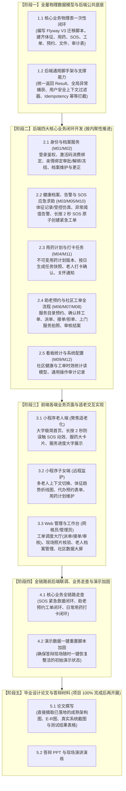

# 项目整体实施计划与阶段路线图（现行总纲）

> **现行工作总纲。** 本文件依据 2026-10-25 讨论决议全面重构，确立了“**全局规划、步骤明确、工程先行、论文后置**”的总体实施原则。
> 项目不采取碎片化走一步看一步的推进方式，而是按端到端 5 大阶段有序推进。**毕业设计论文撰写明确放在整个软件工程 100% 验收通过后再开展。**

> **2026-10-26 状态校准**：五阶段路线图仍作规划使用；下文第二节保留 2026-10-25 各批次形成时的叙述，其中“全量完成”“100%”“真实联调完成”“37 项/33 项”均不是本轮验收结论。当前未提交工作区已在独立临时库通过 Flyway V1–V3.3、合成种子、后端 136 项测试（132 通过、4 跳过）和服药打卡、预约履约、SOS 三条真实 HTTP 主链。完整范围、浏览器验证与待办见[系统隔离联调记录](../../validation/系统隔离联调记录_2026-10-26.md)及[全量审查修复计划](../../superpowers/plans/2026-10-25-全量审查问题修复计划.md)。

---

## 一、 项目全景实施路线图

---

## 二、 五大阶段详细定义与交付标准

### 【阶段一】全量物理数据模型与后端公共底座（✅ 已全部完成）
* **阶段目标**：不再分模块逐个零碎补表，一次性将全系统数据库建全，并把 Spring Boot 后端基础设施打牢。
* **执行结果与交付事实**：
  1. **全量物理表建立（Flyway V3 已生效）**：编写并成功执行 [`V3__core_business_schema.sql`](../../../services/api/src/main/resources/db/migration/V3__core_business_schema.sql)，隔离演示库 `elderly_care_demo` 现有 45 张物理表全部闭环落地；
  2. **全模块合成演示种子数据闭环**：编写 [`demo_synthetic_seed_m01_m02.sql`](../../../database/seed/demo_synthetic_seed_m01_m02.sql) 与 [`demo_synthetic_seed_m03_m12.sql`](../../../database/seed/demo_synthetic_seed_m03_m12.sql)，通过 [`ops/windows/load-demo-seed.ps1`](../../../ops/windows/load-demo-seed.ps1) 验证全部外键无缝导入并通过统计校验（覆盖 6个账号、3位老人档案、3种亲情状态、4项服务目录、3版预警规则、5条体征样本、1单三级告警、1单长按SOS、2项用药计划、今日服药任务打卡、预约与工单联动）；
  3. **后端通用脚手架与共享能力**：
     * 统一 API 响应包装 `Result<T>` 与统一分页 `PageResult<T>`；
     * 全局业务错误码体系 `ErrorCode` 与业务异常 `BusinessException`；
     * 全局异常拦截 `GlobalExceptionHandler`，规范映射 400/401/403/404/409/422/500 等业务状态；
     * 基于服务端会话的安全上下文 `CurrentUser` 与 `UserContext`，以及角色鉴权注解与拦截；
     * 基于 `Idempotency-Key` 请求头的通用防重放拦截组件 `IdempotencyInterceptor`；
     * MyBatis-Plus 乐观锁插件 `OptimisticLockerInnerInterceptor` 与物理分页插件配置。
  4. **工程验证**：编写并运行 [`InfrastructureIntegrationTest`](../../../services/api/src/test/java/cn/communityelderly/InfrastructureIntegrationTest.java)，集成测试 3/3 全部一次性通过（Flyway V3 版本校验、数据表与种子数据完整性校验、响应体与上下文断言通过）。
* **交付标志**：`elderly_care_demo` 数据库 45 张业务表全部就绪，后端公共基础设施与 Maven 编译/测试 100% 绿灯。

---

### 【阶段二】后端核心业务服务实现（四大高内聚业务闭环）
* **阶段目标**：按业务内聚性纵向打通核心领域的 Controller、Service、Mapper，提供完备可靠的 RESTful API。
* **具体步骤**：
  1. **身份认证与档案服务线 (M01/M02)**：用户登录登出、老人 6 位激活码消费绑定、亲情绑定申请/审批/解绑/争议冻结、老人档案联系信息维护与更正闭环；
  2. **健康监测与 SOS 应急线 (M03/M05/M10)**：体征录入接口与受控仿真数据发生器、异常指标阈值评估与告警、老人端长按 2 秒 SOS 触发接口（事务内原子生成 SOS 事实与初始紧急工单）；
  3. **日常用药管理线 (M04/M11)**：子女制定/维护不可变用药计划、每日服药任务快照自动生成（Spring `@Scheduled`）、老人本人服药打卡确认、超时状态计算与关怀通知 outbox；
  4. **助老预约与工单闭环线 (M06/M07/M08)**：✅ **已全量落地并通过集成测试**（服务目录查询、子女代办预约、时段冲突防重校验、`ReservationWorkOrderCoordinator` 协调事务原子确认建单、派单与改派历史、网格员接单/拒单/开始服务、凭据照片或免照豁免合规登记、`reviewer != assignee` 防自审自结硬拦截、工单与预约双向联动终态闭环）；
  5. **统计看板与审计线 (M09/M12)**：✅ **已全量落地并通过集成测试**（社区老年健康与工单态势 KPI 读模型、慢病画像分布与助老服务结构 ECharts 聚合、7天工单吞吐与响应时长复合趋势、全局安全审计日志记录与多维精确检索、JSON 快照 Diff 比对与防篡改 SHA-256 签名存证、CSV 报表导出与 UTF-8 BOM 兼容）；
* **2026-10-25 阶段二记录**：当时记录了后端 12 个模块与 37 项测试；当前验证口径以上方 2026-10-26 状态校准和联调记录为准。模块代码存在不等于全部需求、并发和恢复边界已通过验收。

---

### 【阶段三】前端各端业务页面与适老交互实现（✅ 原型交互已全量落地闭环）
* **阶段目标**：打造直观、规范、富有“适老”亮点的用户界面，完成小程序双模式与 Web 双工作台的前端落地。
* **执行结果与交付事实**：
  1. **小程序端（老人适老模式 - 毕业设计核心创新亮点）**：
     * 极简大字首页（正文 ≥18px，核心触控区 ≥48×48px）；
     * SOS 紧急求助核心交互：长按 2 秒环形防误触进度动画、触感振动反馈、误触带痕取消二次确认与后台回访工单生成；
     * 今日长辈药盒大卡片：支持【降压药】等通俗标签、醒目大按钮一键打卡与模拟语音播报朗读；
     * 老人 6 位激活码免密消费绑定与个人联系信息自维护。
  2. **小程序端（子女远程监护模式）**：
     * 顶部多长辈横向药丸切换栏（切换后自动清空上一老人敏感上下文）；
     * 长辈健康体征历史走势图表与 165mmHg 三级高血压超标警示条；
     * 助老照护代预约表单（助浴/陪诊/保洁/助餐四大目录）与履约大字垂直时间轴；
     * 关怀通知中心（超时未服药关怀提醒与一键致电长辈闭环）；
     * 亲情绑定申请与档案更正 FZ-01 申请表单。
  3. **Web 端（网格员工作台 & 社区管理员大厅 & 民政大屏）**：
     * 社区态势感知综合大屏（M09）：集成 ECharts 现代化图表，展示高发慢病画像、服务需求占比、近 7 天工单走势与响应时长、实时告警动态流与全屏展示；
     * 助老工单调度与真实性审核（M06/M08）：派单池与改派流转、一线照片拖拽批量上传结案、免照合规豁免申报、`reviewer != assignee` 自审自结硬拦截；
     * 预警处置与 IoT 仿真控制（M05/M10）：顶置活跃 SOS 派工大屏、误触带痕回访闭环表及体征仿真发生器；
     * 用药依从性监视（M04）：全辖区用药遵从率看板与超时关怀跟进；
     * 全局不可篡改审计追踪（M12）：操作流水多维筛选、Trace-Id 链路定位与 JSON 变更前后快照比对抽屉（Diff Viewer）；
     * 老人档案建档激活码管理、亲情绑定审批与更正审批工作台（M02）。
  4. **工程构建与走查验证**：
     * `npm --prefix apps/elder-family run build:mp-weixin` 微信小程序编译成功（0 错误）；
     * `npm --prefix apps/admin-web run build` Web 管理端编译成功（0 错误）；
     * 双端内置原型调试悬浮胶囊（`MockSwitcher.vue` 与 `AdminMockSwitcher.vue`），支持全页面一键直达及“离线 Mock / 真实后端 API (8080)”平滑无缝切换。
* **交付标志**：双端全模块静态原型与交互逻辑 100% 落地闭环，交互流畅，无编译阻断。

---

### 【阶段四】全链路前后端联调、业务走查与演示加固
* **阶段目标**：前后端完全贯通，排除全链路交互死角，加固答辩演示环境。
* **具体步骤**：
  1. **三大核心演示闭环走查**：
     * **主线一（SOS 紧急求助闭环）**：老人小程序端长按 2 秒求助 $\rightarrow$ 系统报警 + 生成紧急工单 $\rightarrow$ 管理员调度大厅派单 $\rightarrow$ 护工工作台接单响应；
     * **主线二（助老预约闭环）**：子女代办预约 $\rightarrow$ 管理员审核派单 $\rightarrow$ 护工上门拍照留证 $\rightarrow$ 管理员审核结案 $\rightarrow$ 老人与子女端同步查看完成进度；
     * **主线三（日常用药打卡闭环）**：子女配置用药计划 $\rightarrow$ 每日服药任务生成 $\rightarrow$ 老人端大字打卡 $\rightarrow$ 状态归档。
  2. **演示数据一键重置脚本加固**：
     * 编写全系统专用的演示数据一键还原脚本（覆盖 M01~M12 全部测试数据）；
     * 保证在答辩或老师检查演示前，执行一次脚本即可在 3 秒内恢复整洁、一致的预置演示环境。
* **交付标志**：全系统具备端到端真实可演示能力，具备防翻车的本地一键重置机制。

---

### 【阶段五】毕业设计论文与答辩材料收尾（软件 100% 完成后再开展）
* **阶段目标**：基于真实可运行的系统成果撰写论文与 PPT，水到渠成、真实可信。
* **具体步骤**：
  1. **系统设计章节**：直接摘取阶段一和阶段二落地的成熟技术架构图、状态机流转图和数据库物理 E-R 图；
  2. **系统实现章节**：使用阶段三跑通的真实系统实景图（老人端适老化界面截图、Web 调度大厅与数据大屏截图）；
  3. **系统测试章节**：基于阶段四的真实走查流程，整理功能测试用例与测试结果表格；
  4. **答辩 PPT 与演讲材料**：提炼“适老化交互创新”与“社区助老闭环”的核心价值，组织演示流程视频与演示脚本。
* **交付标志**：毕业设计全套材料（系统源码、运行脚本、毕业论文完整稿、答辩 PPT）齐备。

---

## 三、 当前状态与即时起点（2026-10-26）

* **已验证的运行基线**：当前未提交工作区在独立临时 MySQL 上完成迁移、合成数据加载、六类合成账号登录、三条跨角色 HTTP 主链；后端 136 项测试中 132 通过、4 跳过。管理端、H5 与微信小程序构建通过；管理员、网格员、子女、老人主要页面已在桌面/H5 浏览器读取服务端数据。
* **本轮未验收**：微信开发者工具和真机、每个页面的浏览器写入与异常分支、真实短信入驻、全部 M01–M12 用例。无短信服务时，找回、注册、首次激活安全关闭。
* **下一步**：按[全量审查修复计划](../../superpowers/plans/2026-10-25-全量审查问题修复计划.md)补亲情关系可校验 ID、看板社区隔离、文件证据资产约束、持久化幂等与并发边界、审计完整性、演示库联合恢复，再逐项补验收证据。
