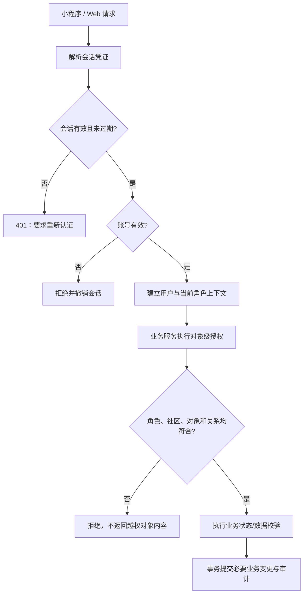
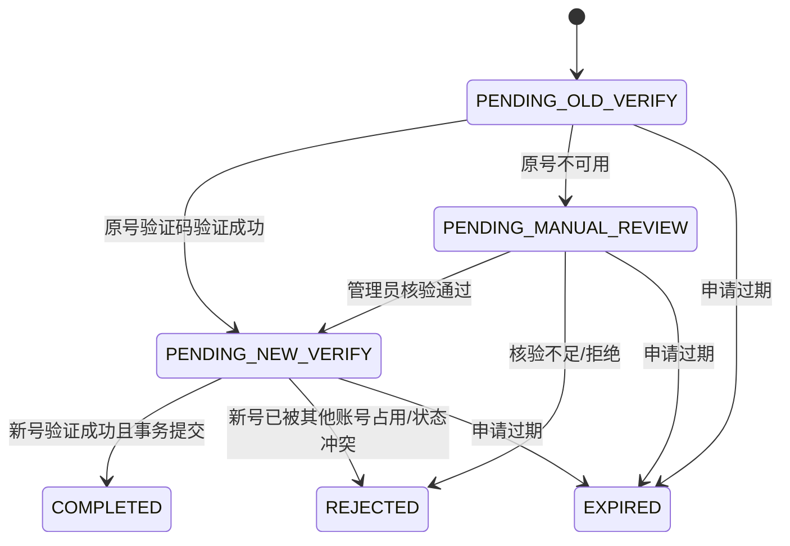

# 社区居家养老服务系统｜E-01 身份、授权与会话专项设计

> **现行工作文档。** 本文件由[2026-10-25 原始资料](../../archive/2026-10-25-before-live-docs/design/specialized/E-01%20身份、授权与会话专项设计_v0.1_2026-10-24.md)建立，后续设计和实现可直接修订本文件。原文中的版本、冻结、批准和‘下一步’等表述记录其形成时点；目前是否实现、通过测试，以新的运行记录为准。改变需求范围、权限或关键业务规则时，在[变更记录](../变更记录.md)登记原因与影响。

> **集成适用规则（2026-10-24）：** 本文件为 v0.1 模块初稿；共享数据模型、API/错误、锁序、时间、审计和状态映射以[集成设计基线 v1.1](../跨模块设计.md)为准，需求与 AT 状态见[追踪矩阵](../需求追踪.md)。SRS v1.0 的业务语义优先；本文冲突候选不得覆盖集成基线。本文不表示代码或测试已完成。

- **文档版本：** v0.1（专项设计候选稿）
- **编制日期：** 2026-10-24
- **设计状态：** 方案已形成；尚未进入代码实现，尚无运行测试结果
- **适用基线：** SRS v1.0；《社区居家养老服务系统：总体设计基线 v1.1》
- **专项范围：** E-01——身份、授权、会话、激活码、账号恢复、手机号变更安全通知及审计
- **相关模块：** M01 身份认证与权限；与 M02 老人档案/亲情绑定、M12 系统配置与审计协作

> 本文是工程设计，不修改或替代冻结的 SRS v1.0。文中标记为“设计决策”的内容是为落实已批准需求提出的技术方案，不代表代码已实现或测试已通过。若后续实现必须偏离本文，应记录原因、影响范围及更新版本，不得静默偏离需求基线。

## 1. 设计目标与边界

### 1.1 目标

1. 为小程序和社区 Web 提供共用的用户身份、认证与会话服务。
2. 在每次业务请求中执行账号状态、当前角色、社区范围、对象归属和当前授权关系检查。
3. 安全实现老人首次身份激活、子女注册、密码恢复、手机号变更和角色分配。
4. 让会话撤销、授权变化、激活码使用、人工核验及换号通知均可追踪。
5. 为 AT-01、AT-14、AT-15、AT-16、AT-17 提供可执行的设计与测试入口，并覆盖 AT-02、AT-12 的身份/授权交界。

### 1.2 本专项负责的内容

- 手机号与密码认证、子女注册、登录、退出和当前身份查询。
- 会话创建、过期、续期、单会话撤销及全会话撤销。
- 业务角色分配、当前角色上下文切换、运维身份隔离。
- 老人六位数字激活码的签发、交付记录、验证、失效、重签与幂等。
- 自助密码恢复、管理员人工核验恢复、管理员自身的独立运维恢复边界。
- 手机号变更、原号不可用时的人工核验、新号验证和独立安全通知。
- 认证限流、敏感操作审计、统一错误语义及相关测试设计。

### 1.3 明确不在本专项内

- 档案字段、档案更正申请的完整状态机与办理事务：由 E-02 负责；本专项只定义身份与权限接口。
- 亲情申请、批准、解绑、争议冻结/恢复的完整生命周期：由 M02 专项负责；本专项负责在请求时读取其当前状态并执行授权判断。
- 告警、SOS、工单、预约、用药任务自身的业务状态机：由对应专项负责；本专项提供认证上下文与公共授权能力。
- 生产级特权访问审批平台、真实设备身份认证、复杂消息中间件。
- 未经配置的真实短信发送能力。本文定义短信/手机号验证适配器契约；真实发送仍需配置可用服务商及凭据，测试替身不得冒充真实送达。

## 2. 需求追踪与不可违反的约束

| 来源 | 本专项必须落实的约束 | 设计落点 |
|---|---|---|
| FR-M01-01 / Q07-R01—R08 | 手机号+密码共用后端身份；Web 空闲 30 分钟/绝对 12 小时；小程序空闲 7 天/绝对 30 天；退出撤销当前会话；账号停用、安全事件、密码重置、手机号变更及角色分配变化按规则撤销会话 | §4、§5、§7、§10 |
| FR-M01-02 / Q01-10—16 / G-05 | 六位数字、24 小时、一次性；连续错误五次失效；重签旧码立即失效；限制反复签发和尝试；超时重试不重复关联；特殊签发核验与留痕 | §5.3、§6.3、§7.3、§11 |
| FR-M01-03 / BR-01 | 每个含对象标识的请求都要在服务端校验身份、状态、角色、对象归属及有效授权；替换对象 ID 不得泄露数据或写入 | §4.3、§5.7、§8、§11 |
| FR-M01-04 | 子女可注册和登录，但亲情审批前不能访问老人数据；工作人员账号由社区管理员创建；密码至少 8 个字符并安全哈希；失败限流与临时冷却 | §5.1、§5.2、§6.1、§9 |
| FR-M01-05 / Q07-R10—R11 | 老人/子女优先通过已验证注册手机号自助恢复；原号不可用转有权管理员人工核验；工作人员由有权管理员核验后重置；管理员自身走独立受控运维恢复；重置后撤销所有会话 | §5.4、§7.4、§9、§11 |
| FR-M01-06 / Q07-R12—R13 / FZ-02 | 换号验证原号和新号控制权；原号不可用走人工核验；新号占用拒绝；保留账号 ID、角色、关联和历史；撤销旧会话；新号必通知、原号可达也通知；通知失败不回滚换号 | §5.5、§6.4、§7.5、§8、§9 |
| FR-M01-07 / Q07-R14—R17 | 角色组合受限；角色变更使旧会话失效；角色上下文切换不扩大授权；运维身份独立，不默认拥有业务数据权限 | §5.6、§5.7、§7.2、§11 |
| FR-M12-02/03 | 敏感操作可追溯；审计不记录密码、令牌、激活码明文或无关健康信息；运维恢复和特殊访问留痕 | §8、§11 |
| NFR-01 / NFR-06 | HTTPS、凭证保护、限流、错误反馈、最小权限、可追踪；不向客户端暴露堆栈 | §4、§6、§9、§11 |
| AT-01/14/15/16/17、AT-02/12 | 认证、激活码、会话边界、换号、角色组合、越权和审计均须可测试 | §12 |

## 3. 总体技术方案

### 3.1 方案选择

沿用已确认技术栈：Java + Spring Boot 单体分层架构、MyBatis-Plus、MySQL 8.0、REST API。认证与授权实现为后端公共能力，不拆微服务，不要求 Redis 或消息中间件。

建议分层如下：

- `AuthController`：登录、退出、注册、激活、恢复、换号等 HTTP 入口和参数校验。
- `AuthenticationService`：凭证校验、会话建立/撤销、OTP/激活码校验。
- `SessionService`：会话过期、活动时间、撤销和会话查询。
- `AuthorizationService`：角色上下文、社区范围、老人对象与当前绑定/分配关系校验。
- `RoleAssignmentService`：角色组合校验、授权分配/撤销和会话失效。
- `ActivationService`：激活码签发、失效、使用、幂等与关联创建。
- `AccountRecoveryService`：自助恢复、管理员人工核验及恢复审计。
- `PhoneChangeService`：换号状态流转、唯一性检查、原子提交和安全通知出站记录。
- `PhoneVerificationGateway`：手机号验证码发送/验证适配器。
- `SecurityNotificationGateway`：换号安全通知发送适配器。
- `AuditService`：向 M12 的审计能力写入结构化事件。
- `SecurityFilter`：解析会话、检查账号状态、建立请求身份上下文；业务 Service 仍须校验对象级权限。

### 3.2 认证凭证与传输方式

采用**服务端可撤销的不透明会话令牌**，不使用无状态 JWT 作为唯一会话凭证。原因是本项目明确要求账号停用、安全事件、密码重置、换号和角色分配变化能够立即撤销已有会话；服务端会话记录更容易实现和验收。

- 生成令牌：使用密码学安全随机数生成器产生 32 字节随机值，采用 Base64URL 编码。
- 存储：数据库只保存令牌的 SHA-256 摘要，不保存原始令牌；原始令牌只在登录响应/客户端会话建立时传输。
- Web：优先使用 `HttpOnly; Secure; SameSite=Lax` Cookie；状态变更请求执行同源校验并带 CSRF Token。开发环境可按隔离开发配置调整 Cookie 的 Secure 属性，验收/部署环境必须启用 HTTPS。
- 小程序：使用 `Authorization: Bearer <token>` 传输；客户端存储仅保存当前会话凭证，退出或收到失效响应后清理。
- 两种客户端共用用户、角色和服务端会话规则，只在凭证传输适配上不同。
- 不把令牌、Cookie、验证码或激活码写入应用日志、异常消息、审计元数据或前端埋点。

### 3.3 统一认证与授权链路



身份认证通过只证明请求来自某个有效账号，不等于拥有任何老人、工单、文件或社区数据的访问权限。所有模块必须调用公共授权能力，不能只检查前端路由或按钮可见性。

## 4. 账号与权限模型

### 4.1 账号、角色和业务对象必须分离

- **账号**：登录主体，保存手机号、密码哈希、账号状态等。
- **角色分配**：账号在指定业务范围内被允许执行的角色。角色分配由有权限的管理员明确创建或撤销。
- **老人档案**：M02 管理的业务对象，不等同于用户账号。
- **老人身份关联**：激活成功后建立的账号与老人档案关联。
- **亲情绑定**：子女账号与老人档案之间的授权关系，由 M02 管理；激活老人身份不自动创建亲情授权。
- **当前角色上下文**：一个会话当前使用的已分配角色/社区入口，不是一项新的授权。
- **运维身份**：与业务账号隔离，不作为普通业务角色分配；无默认老人业务数据访问权限。

### 4.2 账号类型与角色组合

建议业务账号使用 `account_kind` 区分 `FAMILY` 和 `STAFF`；运维身份走独立的运维入口/操作身份，不并入普通业务角色集合。

| 账号类型 | 可分配角色 | 约束 |
|---|---|---|
| `FAMILY` | `ELDER`、`CHILD` | 允许同一账号兼有老人和子女角色，但两个角色上下文及数据授权独立；不自动互通数据 |
| `STAFF` | `GRID_WORKER`、`CARE_WORKER`、`COMMUNITY_ADMIN` | 网格员/护工与社区管理员仅按岗位需要有条件兼任；角色分配必须明确授权，禁止本人审核本人执行的工单 |
| 运维身份 | 不属于上述业务角色 | 独立认证/操作边界；默认不能经业务界面读取或修改老人业务数据，不得借运维身份办理日常业务 |

禁止同一账号同时拥有 `FAMILY` 与 `STAFF` 身份；禁止将运维身份合并为业务角色。服务端必须在角色分配事务中校验组合，不依赖前端限制。

### 4.3 每次请求的授权判定顺序

对于包含 `elderId`、`orderId`、`planId`、文件 ID 或社区 ID 的请求，按下列顺序校验：

1. 会话存在、未撤销、未过期；账号处于有效状态。
2. 当前角色分配仍有效，且当前会话的角色上下文属于该账号。
3. 操作属于该角色允许的操作集合。
4. 目标对象存在、状态允许操作，且属于授权社区/对象范围。
5. 若访问老人数据，重新读取老人档案状态和当前亲情绑定状态；绑定必须有效且未冻结。
6. 若访问工单，检查当前有效分配、社区范围和执行/审核分离规则。
7. 对文件同时检查文件所属业务对象和当前用户对该对象的权限；不可仅凭文件 ID 或下载 URL 授权。
8. 对敏感写操作，在提交事务前再次确认关键授权状态未发生竞争变化。

**授权不得长时间缓存。** 解绑、冻结、账号停用或角色撤销提交后，新请求必须按新状态拒绝。读请求若在撤销提交前已经完成授权检查，允许其在当前请求中完成；涉及敏感写入的操作须与授权状态变更按数据库事务/锁定规则串行化，确保撤销成功提交后不存在新的越权写入。

对读请求中“不存在”和“存在但无权”的对象，外部响应统一为 `404 RESOURCE_NOT_FOUND_OR_NOT_ACCESSIBLE`，避免通过替换对象 ID 枚举数据；对已明确可见对象上的非法操作返回 `403 ACTION_NOT_ALLOWED` 或相应状态冲突。响应必须明确告知请求未完成，不得静默丢弃。

## 5. 核心流程设计

### 5.1 登录与子女注册

#### 登录流程

1. 校验手机号格式并规范化；不因客户端传入角色而赋予角色。
2. 检查账号键和来源 IP 的限流/冷却状态。
3. 查询账号；不存在、密码错误、账号停用等情况对外返回通用认证失败消息，不泄露账号是否存在或停用原因。
4. 校验密码哈希；账号有效后加载当前有效角色分配。
5. 创建新的独立会话，记录客户端类型、创建时间、空闲活动时间和绝对过期时间。
6. 写入登录成功审计事件；返回用户 ID、可用角色列表、当前角色上下文和到期信息，不返回密码哈希等内部字段。
7. 若账号有多个角色，客户端只能在服务端返回的有效角色列表中选择当前入口；选择角色不增加其原有权限。

#### 子女注册流程

1. 用户提交手机号并申请注册验证码；验证码与 `REGISTER` 用途、目标手机号绑定。
2. 服务端验证验证码、有效期、尝试次数及手机号唯一性。
3. 密码满足至少 8 个字符的冻结要求后，生成密码哈希。
4. 在同一事务中创建 `FAMILY` 账号并分配 `CHILD` 角色，记录注册审计。
5. 注册成功后允许登录，但在亲情关系获批前不得读取任何老人数据。
6. 手机号已被使用时，不自动合并账号；返回不泄露账号类型的“该手机号不可用于本次注册，请尝试登录或账号恢复”提示。

### 5.2 会话时限、续期与撤销

| 客户端 | 空闲超时 | 绝对有效期 | 判定边界 |
|---|---:|---:|---|
| Web | 30 分钟 | 12 小时 | `now >= last_activity_at + 30min` 或 `now >= absolute_expires_at` 即过期 |
| 小程序 | 7 天 | 30 天 | `now >= last_activity_at + 7d` 或 `now >= absolute_expires_at` 即过期 |

设计决策：

- 绝对有效期从服务端创建会话时开始，任何请求、轮询或活动刷新都不得延长绝对有效期。
- 只有前台用户主动发起的有效业务请求才更新 `last_activity_at`。静态资源、通知短轮询、会话状态查询、心跳和后台重试不延长空闲时限，避免页面后台轮询被误认为用户操作。
- 服务端以自身时钟判定有效期；所有接口返回 ISO-8601 时间，业务日期/展示按 `Asia/Shanghai` 处理。
- 退出只撤销当前会话，不影响用户其他设备会话。
- 账号停用、安全事件、密码重置、手机号变更、角色分配新增/撤销或角色权限范围变化，撤销该账号全部会话并要求重新认证。
- 亲情绑定解绑/冻结只撤销对应业务授权，不自动退出子女账号；每个老人数据请求必须重新校验关系状态。
- 角色上下文切换仅能选择当前账号已有的有效分配。角色分配本身发生变化时撤销所有旧会话；纯入口切换不扩大权限，后端仍逐请求检查角色和数据范围。
- 过期/撤销会话请求返回 `401 SESSION_EXPIRED` 或 `401 SESSION_REVOKED`，客户端清除本地凭证并跳转登录，不自动降级为匿名访问。

### 5.3 老人首次激活码

#### 签发与交付

1. 有权限的社区管理员选择既有老人档案，核验老人身份及签发依据。
2. 默认当面向老人交付；老人本人在场时可以协助输入。特殊签发须核验老人身份和合法监护/代理权限，记录原因、交付方式、操作者、核验结论及必要依据元数据。
3. 使用密码学安全随机数生成六位数字码，并生成非秘密的 `activation_ticket_id`（用于定位这次签发记录，不代替激活码）。
4. 数据库只保存带服务端密钥的 HMAC 摘要，不保存激活码明文；明文只在签发成功响应中显示一次，不提供查询旧码功能。
5. 重签必须在事务中先使该档案此前的有效码失效，再创建新码；旧码立即不可用。
6. 码的有效期从 `issued_at` 起 24 小时；`now >= expires_at` 即失效。
7. 设计初始签发频率参数：同一老人档案 24 小时内最多签发 3 次；同一管理员 24 小时内最多签发 10 次。超过上限时明确拒绝并审计，不提供绕过限流的普通按钮。该参数是工程安全阈值，不改变六位/24 小时/一次性/五次错误失效等已批准业务规则。

#### 激活使用

1. 激活请求提交 `activation_ticket_id`、六位码、已验证手机号及必要的账号建立/登录信息。
2. 服务端锁定对应签发记录并检查状态、有效期、尝试次数；错误码尝试计入该 ticket。第五次连续错误后将该码标记为 `LOCKED`，之后不得继续验证。
3. 手机号必须完成与本次激活用途绑定的控制权验证。验证码不能跨手机号、跨用途或跨请求复用。
4. 若该手机号没有现有账号，则创建 `FAMILY` 账号、设置密码并分配 `ELDER` 角色；若手机号已有 `FAMILY` 账号，则要求用户先登录该账号，再通过已认证会话完成老人身份关联；若手机号属于 `STAFF` 或独立运维身份，拒绝关联，不自动合并。
5. 在一个数据库事务中完成：激活码有效性最终检查、账号/角色组合校验、老人档案与账号唯一关联、角色分配、激活码置为 `USED`、幂等结果写入和审计事件。
6. 激活本身不创建子女亲情绑定，不授予任何子女访问权；激活码不作为后续登录凭证。
7. 激活成功后要求正常登录；重复提交相同 ticket 和幂等键返回“激活已完成”的原结果，不重复建立关联；不同请求重复使用已消费码返回明确拒绝。
8. 若请求超时，客户端用相同幂等键重试或查询原结果。不能因重试创建第二个账号、第二条老人身份关联或重复消费激活码。

> `activation_ticket_id` 是非秘密定位符，用于将连续错误次数绑定到当前签发记录；真正的秘密仍是六位激活码。它不单独允许身份关联或读取老人资料。

### 5.4 密码恢复与人工核验

#### 自助恢复

1. 老人/子女提交注册手机号，系统统一返回“如该号码符合恢复条件，将发送验证信息”，避免枚举账号。
2. 对已登记且符合自助恢复条件的账号，发送与 `PASSWORD_RESET` 用途绑定的验证码；手机号不可用或无法验证时不进入自助重置。
3. 验证码正确且未过期后，提交新密码；服务端校验密码长度并生成新哈希。
4. 在同一事务中更新密码、撤销全部会话、写入审计记录；用户必须重新登录。
5. 不复用首次激活码作为恢复凭证；不能只凭姓名、亲属关系或新手机号重置账号。

#### 人工核验

- 原注册手机号不可用时，转由具有目标账号业务范围权限的社区管理员核验身份；核验不足、依据冲突或权限范围不明时拒绝或暂缓，不重置。
- 工作人员账号由有权管理员核验后重置，并记录核验依据元数据、操作者、时间、结果和原因。
- 管理员本人无法登录时，不提供普通业务页面的自助提权/重置入口。采用独立的运维恢复流程：由有服务器/部署权限的授权操作人员按受控步骤执行，生成独立审计记录并撤销该账号旧会话；该流程不授予运维人员日常业务数据权限。
- 核验元数据最小化保存，不默认保存证件照片；审计不得记录密码、验证码或完整凭证。

### 5.5 手机号变更与安全通知

#### 状态流转



#### 流程与事务

1. 已登录用户发起换号申请；记录原手机号快照、新手机号、请求 ID、发起时间和 30 分钟申请有效期。
2. 默认向原手机号发送验证码。原号验证成功后记录“原号可达”；原号不可用时转人工核验，只有有权管理员核验通过后才能继续。人工核验不能仅依据新手机号或亲属关系。
3. 向新手机号发送验证码并验证其控制权；新号必须未被其他账号占用。
4. 提交时开启事务并锁定账号及换号申请，重新检查：账号状态有效、申请未过期、原号验证/人工核验满足要求、新号验证码已消费、当前账号手机号仍等于申请时的原号快照、新号唯一。
5. 若任一检查失败，拒绝换号并保留失败结果；不能覆盖并发中先成功的变更。
6. 若全部通过，在同一事务中更新手机号、标记申请 `COMPLETED`、撤销该账号全部旧会话、写入审计，并写入安全通知 outbox 记录。
7. 成功后要求用户使用新手机号重新登录。账号 ID、已有角色、老人档案关联、亲情关系和业务历史保持不变，不新增或扩大授权。
8. 换号安全通知独立于 N-01 业务通知矩阵：新手机号必创建发送任务；若原号验证码验证成功、判定仍可达，则同时创建原号通知任务；若走原号不可用的人工核验流程，则不向原号发送，记录 `SKIPPED_OLD_PHONE_UNREACHABLE` 和原因。
9. 通知发送失败或服务商暂时不可用不回滚已成功换号。通知状态单独记录，按有限重试策略处理；最终失败必须留痕并进入人工跟进列表，不得标记为已送达。
10. 安全通知内容只说明“账号手机号已变更”及通用安全提示，不包含老人姓名、健康信息、服务记录或其他业务详情。

#### 外部通知可靠性边界

- 采用数据库 outbox：换号业务更新与通知任务在同一事务提交，避免出现“号码已改但通知任务未创建”的本地一致性问题。
- `@Scheduled` 每分钟扫描到期的待发送任务；每个逻辑收件人/事件只创建一条 outbox 记录。
- 初始发送失败后建议最多重试 3 次，间隔 1、5、15 分钟；保存每次尝试时间、服务商返回码、消息 ID 和最终状态。
- 如果短信服务商支持幂等键，使用 outbox 事件 ID；若服务商不支持且请求超时导致送达状态未知，系统只能提供有界重试和完整留痕，不能宣称外部短信绝对“恰好一次”。
- 测试替身只用于隔离演示/自动化测试；真实环境必须配置真实服务商及凭据，未配置时不得显示“发送成功”。

### 5.6 角色分配与角色上下文

#### 角色分配

1. 仅有权管理员可以分配/撤销角色；社区管理员只能在其授权社区范围内操作。
2. 服务端按 §4.2 校验账号类型和允许的角色组合；不允许前端直接提交任意 `roleCode` 就生效。
3. 角色分配、撤销、社区范围变化在一个事务中更新角色关系、写入审计并撤销该账号全部现有会话。
4. 角色变更后要求重新登录；新的会话只加载最新有效角色分配。
5. 对兼任网格员/护工与社区管理员的账号，工单审核时仍必须校验执行人与审核人不同；角色切换不得绕过自审限制。

#### 角色上下文切换

- 当前会话只能选择账号已拥有且仍有效的角色分配。
- 切换上下文只改变导航入口和本次请求的活动角色，不新增角色、不扩大社区范围、不绕过对象级授权。
- 后端每次请求检查活动角色仍属于该用户；不得信任前端传来的社区 ID 或角色名称。

### 5.7 授权撤销与跨模块契约

M01 提供公共 `AuthorizationService`，M02、M03—M11 的业务服务必须在读取和写入前调用。建议接口语义如下：

- `requireAuthenticatedUser()`：返回有效用户和会话上下文；失败抛出 401。
- `requireActiveRole(roleCode)`：校验当前活动角色分配。
- `requireCommunityAccess(communityId, operation)`：校验社区范围。
- `requireElderAccess(elderId, operation)`：校验老人档案状态、当前角色和当前有效绑定/关联。
- `requireAssignedOrderAccess(orderId, operation)`：校验当前工单分配和社区范围。
- `requireFileAccess(fileId, operation)`：通过文件所属业务对象递归检查权限，不直接信任文件 ID。

授权查询以数据库当前状态为准。亲情绑定由 M02 管理；M01 不复制一份可独立失效的“授权缓存”。解绑/冻结事务提交后，任何新请求都不得依赖旧授权继续访问。关键写操作在同一事务内锁定/复核绑定或角色分配记录，防止授权检查与写入之间的竞争窗口。

## 6. 状态与安全参数

### 6.1 密码与登录失败限制

| 参数 | 初始设计值 | 说明 |
|---|---|---|
| 最小密码长度 | 8 个字符 | 冻结需求；不得降低 |
| 最大密码长度 | 128 个 Unicode 码点 | 工程防滥用限制；超限明确拒绝，不截断 |
| 哈希方案 | PBKDF2-HMAC-SHA-256，600,000 次迭代，16 字节随机盐，256 位派生值 | 工程设计选择；保存算法/参数版本，便于后续升级 |
| 账号维度失败限制 | 同一规范化手机号 15 分钟内连续失败 5 次，冷却 15 分钟 | 初始工程参数；服务端执行，不向客户端暴露账号状态 |
| IP 维度失败限制 | 同一来源 IP 15 分钟内失败 30 次，冷却 15 分钟 | 初始工程参数；代理头只信任明确配置的反向代理 |
| 成功登录 | 重置该账号连续失败计数 | 不清除全局审计历史 |

密码校验、限流和冷却均由服务端执行。对不存在账号也执行同等结构的失败路径，避免明显的响应差异泄露账号存在性。限流参数集中配置，不散落在 Controller 中。

### 6.2 手机验证码参数

| 参数 | 初始设计值 |
|---|---:|
| 验证码格式 | 6 位数字 |
| 有效期 | 5 分钟 |
| 单个 challenge 最大错误次数 | 5 次，达到后失效 |
| 同一手机号重发间隔 | 60 秒 |
| 同一手机号发送上限 | 1 小时内最多 5 次 |
| 同一 IP 发送上限 | 1 小时内最多 10 次 |
| 一次性 | 验证成功立即消费，不可跨用途/手机号/申请复用 |

验证码采用安全随机数生成；数据库保存 `HMAC(server_secret, challenge_id || phone || purpose || code)` 摘要，避免验证码在不同 challenge、手机号或用途间复用。用途至少包括 `REGISTER`、`ELDER_ACTIVATION`、`PASSWORD_RESET`、`PHONE_CHANGE_OLD`、`PHONE_CHANGE_NEW`。每个 challenge 必须绑定手机号、用途和关联业务申请；验证码不得跨流程复用。

### 6.3 激活码状态与参数

| 项目 | 规则 |
|---|---|
| 格式 | 六位数字，前导零有效 |
| 有效期 | 签发后 24 小时；到达 `expires_at` 即失效 |
| 一次性 | 成功激活后立即置为 `USED` |
| 错误次数 | 同一 ticket 连续错误 5 次后置为 `LOCKED` |
| 重签 | 旧有效码在新码创建事务内立即失效 |
| 存储 | 只存 HMAC 摘要，不存明文 |
| 防暴力破解 | ticket 级错误次数 + IP 限流 + 签发频率限制 |
| 激活幂等 | 同一 ticket/幂等键重复请求返回原完成结果，不重复创建关联 |

状态枚举：`ISSUED`、`USED`、`EXPIRED`、`INVALIDATED`、`LOCKED`。终态不得回退为 `ISSUED`。定时任务可将已过期记录更新为 `EXPIRED`；业务请求仍必须即时检查时间，不依赖定时任务及时执行。

### 6.4 关键状态枚举

- 账号：`ACTIVE`、`DISABLED`。
- 会话：逻辑有效、`EXPIRED`、`REVOKED`；数据库可通过过期时间与撤销时间表达，无需额外存储冗余状态。
- 手机号变更申请：`PENDING_OLD_VERIFY`、`PENDING_MANUAL_REVIEW`、`PENDING_NEW_VERIFY`、`COMPLETED`、`REJECTED`、`EXPIRED`。
- 手机验证 challenge：`PENDING`、`VERIFIED/CONSUMED`、`EXPIRED`、`LOCKED`、`INVALIDATED`。
- 安全通知 outbox：`PENDING`、`SENDING`、`RETRY_WAIT`、`SENT`、`SKIPPED`、`FAILED`。

所有过期时间和会话边界均由服务端权威时钟判断。数据库统一保存明确的时间瞬间，API 用带时区的 ISO-8601 格式；业务日期解释和展示按 `Asia/Shanghai`。

## 7. 数据模型与约束

> 下表是 E-01 的逻辑/候选物理模型。最终表名、字段类型、索引和 SQL 应在全局数据库专项中统一定稿；不得把本表直接当成已执行的建表脚本。

### 7.1 `sys_user`——业务账号

| 字段 | 类型建议 | 约束/用途 |
|---|---|---|
| `user_id` | BIGINT / 雪花或数据库主键 | 稳定账号 ID；手机号变更不得改变 |
| `account_kind` | VARCHAR(16) | `FAMILY` 或 `STAFF`；运维身份不混入业务账号 |
| `phone_normalized` | VARCHAR(32) | 登录手机号规范化值，唯一索引；查询/展示按权限掩码 |
| `password_hash` | VARCHAR(255) | 保存版本化 PBKDF2 哈希，不保存明文 |
| `status` | VARCHAR(16) | `ACTIVE` / `DISABLED` |
| `password_changed_at` | DATETIME(3) | 密码更新/重置时间 |
| `created_at` / `updated_at` | DATETIME(3) | 服务端时间 |
| `disabled_at` | DATETIME(3), nullable | 停用时间 |

手机号规范化必须在服务端统一执行；唯一性不能只靠“先查后写”，必须有数据库唯一约束。手机号更新发生唯一冲突时回滚该次换号事务。

### 7.2 `sys_user_role`——当前有效角色分配

| 字段 | 类型建议 | 约束/用途 |
|---|---|---|
| `assignment_id` | BIGINT / UUID | 角色分配 ID |
| `user_id` | BIGINT | 账号外键 |
| `role_code` | VARCHAR(32) | `ELDER`、`CHILD`、`GRID_WORKER`、`CARE_WORKER`、`COMMUNITY_ADMIN` |
| `community_id` | BIGINT, nullable | 工作人员角色的社区范围；家庭角色为空 |
| `granted_by` | BIGINT | 授权操作者 |
| `granted_at` | DATETIME(3) | 授权时间 |
| `revoked_at` | DATETIME(3), nullable | 撤销时间；保留分配历史引用 |
| `revoked_by` / `revoke_reason` | nullable | 撤销操作者与原因 |

同一用户、角色和社区范围最多有一条有效分配。MySQL 物理设计应通过活动分配表或生成列唯一约束实现，不能只依赖应用层“先查后写”。角色撤销历史由 M12 审计记录保留；会话可继续引用已撤销分配，以支持失效会话排查。

### 7.3 elder_identity_link——老人账号关联（由 M02 定义，M01 调用）

| 字段 | 类型建议 | 约束/用途 |
|---|---|---|
| link_id | BIGINT | 主键 |
| elder_id | BIGINT | 指向 elder_profile；UNIQUE(elder_id) |
| user_id | BIGINT | 指向 sys_user；UNIQUE(user_id) |
| linked_by_activation_ticket_id | CHAR(36) | 指向一次性激活票据；唯一消费 |
| linked_at | DATETIME(3) | 服务端关联时间，按 UTC 保存 |

该关联不设独立 status：SRS 未定义身份解绑或关系停用流程。账号状态控制是否可登录，档案状态控制老人档案业务，亲情关系状态仅控制子女授权。账号停用/恢复和换号均不删除或重建该关联。激活票据消费、关联创建、ELDER 角色分配、幂等结果和必要审计按统一事务边界提交。

### 7.4 `auth_session`——服务端会话

| 字段 | 类型建议 | 约束/用途 |
|---|---|---|
| `session_id` | CHAR(36) | 会话 ID |
| `user_id` | BIGINT | 账号外键 |
| `token_hash` | BINARY(32) | 原始随机令牌的 SHA-256 摘要，唯一索引 |
| `client_type` | VARCHAR(16) | `WEB` / `MINIAPP` |
| `active_assignment_id` | BIGINT, nullable | 当前角色上下文；每次请求验证其仍有效 |
| `created_at` | DATETIME(3) | 创建时间，决定绝对期限起点 |
| `last_activity_at` | DATETIME(3) | 最近一次前台用户主动业务请求时间 |
| `absolute_expires_at` | DATETIME(3) | 绝对过期时间 |
| `revoked_at` | DATETIME(3), nullable | 撤销时间 |
| `revoke_reason` | VARCHAR(40), nullable | `LOGOUT`、`PASSWORD_RESET`、`PHONE_CHANGED`、`ROLE_CHANGED`、`ACCOUNT_DISABLED`、`SECURITY_EVENT` 等 |
| `csrf_token_hash` | BINARY(32), nullable | Web 会话的 CSRF Token 摘要 |

建议索引：`token_hash` 唯一；`user_id, revoked_at`；`absolute_expires_at`。清理历史会话不得早于审计和排障所需保留期；具体保留期由演示环境的数据治理规则统一确定。

### 7.5 `elder_activation_ticket`——激活码签发记录

| 字段 | 类型建议 | 约束/用途 |
|---|---|---|
| `ticket_id` | CHAR(36) | 非秘密定位符 |
| `elder_id` | BIGINT | 老人档案 ID |
| `code_mac` | BINARY(32) | 激活码的 HMAC 摘要；不保存明文 |
| `status` | VARCHAR(16) | `ISSUED` 等状态 |
| `issued_by` | BIGINT | 签发管理员 |
| `issue_mode` | VARCHAR(24) | `IN_PERSON` / `SPECIAL_PROXY` |
| `identity_check_result` | VARCHAR(16) | 核验结论 |
| `special_reason` | VARCHAR(500), nullable | 特殊签发原因；常规签发可空 |
| `proxy_basis_type` | VARCHAR(40), nullable | 合法代理依据类型/元数据，不默认保存证件影像 |
| `issued_at` / `expires_at` | DATETIME(3) | 签发时间/过期时间 |
| `failed_attempts` | INT | 当前 ticket 错误次数 |
| `used_at` / `used_by_user_id` | nullable | 消费结果 |
| `used_idempotency_key` | VARCHAR(80), nullable | 识别激活请求安全重试 |
| `invalidated_at` / `invalidation_reason` | nullable | 重签、泄露等失效原因 |

对同一老人档案，签发新码与使旧码失效必须原子完成。对相同有效 code MAC 应在签发时检测碰撞并重新生成，避免短码碰撞导致无法唯一定位；ticket ID 不代替六位码进行认证。

### 7.6 `phone_verification_challenge`——手机号验证挑战

| 字段 | 类型建议 | 约束/用途 |
|---|---|---|
| `challenge_id` | CHAR(36) | 挑战 ID |
| `user_id` | BIGINT, nullable | 已知账号时关联账号；注册时可空 |
| `phone_normalized` | VARCHAR(32) | 目标手机号 |
| `purpose` | VARCHAR(32) | 注册、激活、恢复、换号原号/新号等用途 |
| `related_request_id` | CHAR(36), nullable | 激活 ticket 或换号申请 ID |
| `code_mac` | BINARY(32) | 验证码 HMAC 摘要 |
| `created_at` / `expires_at` | DATETIME(3) | 有效时间 |
| `attempt_count` | INT | 错误尝试数 |
| `consumed_at` | DATETIME(3), nullable | 一次性消费时间 |
| `status` | VARCHAR(16) | `PENDING`、`CONSUMED`、`EXPIRED`、`LOCKED` 等 |

验证码只对指定手机号、用途和关联申请有效。验证成功必须原子消费；重复提交不得再次通过验证。

### 7.7 `phone_change_request`——换号申请

| 字段 | 类型建议 | 约束/用途 |
|---|---|---|
| `request_id` | CHAR(36) | 申请 ID |
| `user_id` | BIGINT | 账号 ID |
| `old_phone_snapshot` | VARCHAR(32) | 发起时原号快照；仅授权服务读取，日志掩码 |
| `new_phone_normalized` | VARCHAR(32) | 目标新号 |
| `old_verification_method` | VARCHAR(24) | `OTP` / `MANUAL_REVIEW` |
| `old_verified_at` | DATETIME(3), nullable | 原号控制权验证时间 |
| `manual_reviewed_by` | BIGINT, nullable | 人工核验人 |
| `manual_review_result` | VARCHAR(16), nullable | 核验结论 |
| `status` | VARCHAR(24) | 换号状态机 |
| `idempotency_key` | VARCHAR(80) | 防止重复发起/提交 |
| `created_at` / `expires_at` / `completed_at` | DATETIME(3) | 生命周期时间 |

原号快照与新号属于个人信息，普通列表不返回完整号码，日志与审计只保留掩码或受控摘要；原号快照应限制为换号服务读取，必要时采用字段级加密。换号提交时必须重新比较原号快照与当前账号手机号。

### 7.8 FZ-02 安全通知——映射到 M11 通知逻辑契约

| 字段 | 类型建议 | 约束/用途 |
|---|---|---|
| `outbox_id` | CHAR(36) | 出站任务 ID |
| `event_id` | CHAR(36) | 对应成功换号事件 |
| `recipient_type` | VARCHAR(16) | `NEW_PHONE` / `OLD_PHONE` |
| `destination_encrypted` | VARBINARY/TEXT | 受控加密的目标号码；发送器专用解密权限 |
| `template_code` | VARCHAR(40) | 固定安全通知模板，不保存任意业务详情 |
| `status` | VARCHAR(16) | `PENDING`、`SENDING`、`RETRY_WAIT`、`SENT`、`SKIPPED`、`FAILED` |
| `attempt_count` | INT | 已尝试次数 |
| `next_attempt_at` | DATETIME(3), nullable | 下次重试时间 |
| `provider_message_id` | VARCHAR(100), nullable | 服务商回执 ID |
| `last_error_code` | VARCHAR(80), nullable | 去敏后的错误码 |
| `created_at` / `sent_at` | DATETIME(3), nullable | 创建/成功时间 |

逻辑上该记录映射到 M11 notification_event/notification_delivery，并使用 policy_scope=FZ02_SECURITY；物理表可在 D2 阶段独立实现，但不得另造冲突的投递状态语义。该策略不属于 N-01，目标号码仅通过受保护引用读取；不把完整号码、短信正文、验证码或老人业务信息写入普通日志。

### 7.9 限流记录与审计

- `auth_rate_limit`：保存限流键类型、HMAC 后的手机号/IP 标识、窗口起止、失败计数和冷却截止时间；不需要为限流表保留原始密码或验证码。
- 审计使用 M12 的统一审计能力，不在 M01 再创建一套互不兼容的业务审计体系。M01 必须提交结构化事件：操作码、操作者、目标对象、结果、原因码、时间、trace/trace_id、必要的脱敏元数据。
- 对登录失败等安全事件可以记录最小必要的失败审计；对成功换号、密码重置、角色分配、激活码签发/使用等关键操作，审计记录必须与业务状态更新在同一事务提交。

## 8. 事务、并发与幂等设计

### 8.1 登录与会话

- 账号状态检查、密码验证、会话创建和登录成功审计按应用服务顺序执行。
- 会话创建使用独立 `session_id` 和随机 token；数据库只保存摘要。
- 会话撤销使用 `revoked_at` 条件更新；重复撤销保持幂等，不重新激活会话。
- 认证数据库或审计写入失败时，不向客户端返回认证成功；不得在无法持久化会话/必要审计时发放可用凭证。

### 8.2 激活码并发

- 签发/重签时锁定老人档案或该老人当前有效 ticket 的关联记录；同一老人并发签发只能有一个最终有效码。
- 激活时 `SELECT ... FOR UPDATE` 锁定 ticket；在锁内验证状态、过期时间、失败次数和消费状态。
- 成功关联、角色分配、ticket 消费、幂等结果与审计在同一事务提交；任一失败整体回滚。
- 两个并发激活请求竞争同一 ticket 时只允许一个成功；另一个返回“已使用/结果已完成”，不得创建重复账号关联。
- 错误码次数递增必须原子执行；第五次错误后 ticket 变为 `LOCKED`，不能因并发请求多次穿透五次限制。

### 8.3 手机号唯一性与换号竞争

- `phone_normalized` 必须有唯一索引；服务端预查询只用于友好提示，最终以数据库唯一约束为准。
- 换号提交时按固定顺序锁定 `sys_user` 和 `phone_change_request`，再次核验申请状态、原号快照、新号验证码和新号唯一性。
- 两个账号同时换到同一新号时，只允许一个事务成功；失败方返回 `409 PHONE_ALREADY_IN_USE`，不覆盖成功方。
- 账号手机号更新、会话撤销、换号状态更新、审计事件和新/旧号 outbox 记录在同一数据库事务提交。
- 外部短信发送不在数据库事务中执行；先持久化 outbox，再由调度器发送，避免外部网络故障长时间占用业务事务。

### 8.4 授权撤销竞争

- 亲情绑定冻结/解绑由 M02 修改；M01 的授权判断必须查询该关系的当前状态。
- 对“授权关系检查后再写入”的敏感操作，业务事务必须在写入提交前持有或复核相应授权记录，确保解绑/冻结提交与新业务写入有明确先后顺序。
- 角色分配撤销/修改必须与会话撤销在同一事务内提交。即使客户端仍持有旧 token，下一请求也因会话已撤销而失败。
- 不以本地内存缓存作为授权真源；若未来为性能引入缓存，必须提供可靠失效机制并重新评估 BR-01/BR-02 验收。

### 8.5 失败语义

| 场景 | 必须结果 |
|---|---|
| 登录失败/账号不存在/账号停用 | 不建立会话；返回通用认证失败或冷却提示；记录必要安全事件 |
| 会话超时/撤销 | 请求拒绝；不继续执行业务逻辑；客户端清理凭证 |
| 激活码过期/错误/已用/被重签 | 明确拒绝；不得建立账号关联；按规则更新尝试次数/审计 |
| 激活事务失败 | 账号关联、角色分配、ticket 消费等全部回滚；可用同一幂等键核查结果 |
| 原号不可用且人工核验未通过 | 不变更手机号，不撤销当前会话，不发送“换号成功”通知；留拒绝/暂缓记录 |
| 新手机号被占用 | 返回 409；不更新手机号、不撤销会话、不创建成功通知 |
| 换号已成功但短信发送失败 | 手机号变更保持成功；outbox 标记重试/失败并留痕，不回滚账号数据 |
| 角色分配更新失败 | 角色与会话撤销变更整体回滚，不出现角色已变但旧会话仍有效的部分状态 |
| 审计/数据库不可用 | 对必须留痕的敏感写操作失败关闭，不向客户端谎报成功 |

## 9. API 契约草案

> 路径采用 `/api/v1` 前缀；以下是 E-01 建议路径和契约，需在全局 API 文档中统一错误封装与分页/时间格式。路径不是 SRS 冻结内容。

### 9.1 统一响应

成功响应：

```json
{
  "code": "OK",
  "message": "操作成功",
  "traceId": "请求追踪 ID",
  "data": {}
}
```

错误响应：

```json
{
  "code": "SESSION_EXPIRED",
  "message": "登录状态已失效，请重新登录",
  "traceId": "请求追踪 ID",
  "data": null
}
```

不得向客户端返回 Java 堆栈、SQL、密码哈希、验证码、激活码、会话 token 或内部服务凭据。

### 9.2 接口清单

| 方法与路径（候选） | 访问权限 | 关键输入 | 成功结果 | 关键错误/规则 |
|---|---|---|---|---|
| `POST /api/v1/auth/login` | 匿名 | `phone`、`password`、`clientType` | 建立会话，返回用户/角色上下文和期限；Web 设置安全 Cookie，小程序返回 bearer token | `401 INVALID_CREDENTIALS`、`429 AUTH_COOLDOWN`；不泄露账号存在性 |
| `POST /api/v1/auth/logout` | 已登录 | 当前会话 | 只撤销当前会话 | 重复退出按幂等成功处理 |
| `GET /api/v1/auth/csrf` | Web 已登录 | 无 | 返回与当前 Web 会话绑定的 CSRF Token；服务端只存其摘要 | 仅供 Cookie 认证的 Web 写请求使用；小程序 Bearer 请求不依赖 Cookie CSRF Token |
| `GET /api/v1/auth/me` | 已登录 | 无 | 当前用户、有效角色列表、当前角色、会话期限 | 不返回密码、完整安全凭据 |
| `POST /api/v1/auth/role-context` | 已登录 | `assignmentId` | 切换至当前账号已有的有效角色上下文 | 非本人/已撤销分配拒绝；不扩大范围 |
| `POST /api/v1/auth/registration/challenges` | 匿名 | 手机号、用途 `REGISTER` | 创建并发送手机号验证码 | 限流；不得在日志显示验证码 |
| `POST /api/v1/auth/children/register` | 匿名 | 手机号、challenge、验证码、密码 | 创建 `FAMILY` 账号及 `CHILD` 角色 | 手机号占用拒绝，不自动合并；未绑定前无老人数据权限 |
| `POST /api/v1/admin/elders/{elderId}/activation-tickets` | 本社区有权管理员 | 签发方式、核验结论、特殊原因/代理依据元数据 | 返回 ticket ID 和仅显示一次的六位码 | 无权/档案不属于本社区/核验不足/超签发频率均拒绝并审计 |
| `POST /api/v1/auth/activation/challenges` | 匿名或已有家庭账号会话 | ticket ID、目标手机号 | 创建 `ELDER_ACTIVATION` 手机验证挑战 | ticket 无效时统一提示；限流 |
| `POST /api/v1/auth/elder-activation` | 新账号路径匿名；已有家庭账号路径须已登录 | ticket ID、激活码、手机验证 challenge、验证码、必要时密码；Idempotency-Key 请求头单独传递 | 建立老人身份关联与 `ELDER` 角色，返回完成结果 | 码错/过期/已用/手机号未验证/账号类型冲突/并发冲突均拒绝；不可重复关联 |
| `POST /api/v1/auth/recovery/challenges` | 匿名 | 注册手机号 | 以通用响应发起自助恢复 | 不透露号码是否注册；限流 |
| `POST /api/v1/auth/recovery/complete` | 匿名 | challenge、验证码、新密码 | 更新密码、撤销全部会话 | 验证失败/过期/超次数拒绝；激活码不能替代验证码 |
| `POST /api/v1/admin/users/{userId}/password-reset` | 有权管理员 | 核验依据元数据、原因 | 为工作人员执行受控重置并撤销会话 | 不允许管理员通过普通流程重置自己并提权；审计必需 |
| `POST /api/v1/auth/phone-change-requests` | 已登录 | 新手机号；Idempotency-Key 请求头 | 创建换号申请并启动原号验证 | 新号格式错误/申请重复/限流拒绝 |
| `POST /api/v1/auth/phone-change-requests/{id}/old-phone/verify` | 已登录且申请归本人 | 原号验证码 challenge | 记录原号控制权已验证 | challenge 过期、用途不符或申请已过期拒绝 |
| `POST /api/v1/admin/phone-change-requests/{id}/manual-review` | 对目标账号有核验权限的管理员 | 核验结论、原因和依据元数据 | 通过后进入新号验证，或拒绝/暂缓 | 不充分依据不得通过；不得由申请人自审 |
| `POST /api/v1/auth/phone-change-requests/{id}/new-phone/verify` | 已登录且申请归本人 | 新号验证码 challenge | 完成原子换号并建立通知 outbox | 新号占用/原号快照变化/并发冲突返回 409；通知失败不回滚成功换号 |
| `POST /api/v1/admin/users/{userId}/roles` | 有权管理员 | 角色、社区范围、原因 | 新增有效角色分配并撤销旧会话 | 角色组合/社区范围不符拒绝；审计必需 |
| `DELETE /api/v1/admin/users/{userId}/roles/{assignmentId}` | 有权管理员 | 撤销原因 | 撤销角色并撤销旧会话 | 不得撤销超出管理员范围的分配 |
| `POST /api/v1/admin/users/{userId}/disable` | 有权管理员 | 原因 | 停用账号、撤销全部会话 | 账号/社区范围检查；不删除关系和业务历史 |

### 9.3 API 共同要求

- 所有写接口执行服务端校验，不信任客户端传来的 `userId`、`roleCode`、`communityId`、对象状态或来源类型。
- 所有敏感写接口接受或生成可追踪的 `traceId`；可能被网络重试的业务操作使用幂等键。
- `POST /api/v1/auth/elder-activation` 的 `principal_scope` 由服务端从认证主体或一次性 ticket 安全上下文确定，幂等键绑定规范化路由与请求摘要；不得让匿名客户端任意声明主体范围。同键异内容返回 `409 IDEMPOTENCY_KEY_REUSED`。
- 所有时间字段使用 ISO-8601，明确时区；服务器时间为权威时间。
- 验证码挑战创建接口对注册/恢复类请求使用不泄露账号存在性的通用响应；限流原因可以明确，但不得泄露目标账号内部状态。
- 手机号响应默认掩码；只有本人必要页面或有权管理员在必要业务场景下可查看完整号码。

## 10. 错误码建议

| HTTP | 业务码 | 含义 | 客户端处理 |
|---:|---|---|---|
| 400 | `INVALID_REQUEST` | 参数格式错误 | 提示修正输入，不重试原请求 |
| 401 | `INVALID_CREDENTIALS` | 登录凭证不匹配 | 通用提示，不区分账号不存在/密码错误 |
| 401 | `SESSION_EXPIRED` | 会话到期 | 清理凭证并重新登录 |
| 401 | `SESSION_REVOKED` | 会话已撤销 | 清理凭证并重新登录 |
| 403 | `ACTION_NOT_ALLOWED` | 已识别对象上的操作不允许 | 停止操作并提示权限不足 |
| 404 | `RESOURCE_NOT_FOUND_OR_NOT_ACCESSIBLE` | 对象不存在或当前无权访问 | 不继续猜测对象 ID |
| 409 | `PHONE_ALREADY_IN_USE` | 新手机号已被其他账号占用 | 终止换号，不合并账号 |
| 409 | `STATE_CONFLICT` | 并发/状态变化导致当前操作不能提交 | 刷新当前状态后由用户决定是否重试 |
| 409 | `IDEMPOTENCY_KEY_REUSED` | 相同幂等键对应不同请求内容 | 不重试该键，排查客户端请求 |
| 422 | `ACTIVATION_CODE_INVALID` | 激活码不正确 | 明确失败；按规则累计错误次数 |
| 422 | `ACTIVATION_CODE_EXPIRED` | 激活码过期 | 联系管理员重新签发 |
| 422 | `ACTIVATION_CODE_USED` | 激活码已使用 | 登录或联系管理员核查原结果，不创建新关联 |
| 422 | `VERIFICATION_FAILED` | 手机验证失败/过期/用途不符 | 重新发起合规验证，受限流控制 |
| 422 | `MANUAL_VERIFICATION_REQUIRED` | 原号不可用，需要人工核验 | 转受控管理员核验流程 |
| 429 | `AUTH_COOLDOWN` | 登录冷却中 | 等待返回的剩余时间后重试 |
| 429 | `RATE_LIMITED` | 验证码/激活码/敏感操作限流 | 按明确的冷却时间等待 |
| 500 | `INTERNAL_ERROR` | 未预期服务端错误 | 展示 trace ID，不显示堆栈 |

错误码只表达客户端需要采取的动作，不应泄露激活码是否存在、其他用户手机号、密码校验细节或跨社区对象数据。

## 11. 审计、安全与运行约束

### 11.1 必须审计的事件

- 登录成功、登录失败、限流触发、会话退出/到期/撤销。
- 子女注册成功；老人激活码签发、重签、失效、错误锁定、使用成功/失败。
- 自助密码重置、管理员人工重置、管理员独立运维恢复。
- 手机号变更发起、原号验证、人工核验、拒绝、成功提交及安全通知发送/跳过/失败。
- 角色分配、撤销、上下文切换、账号停用/恢复。
- 认证/授权拒绝中的必要安全事件；不记录无关健康业务内容。

### 11.2 审计字段

最少包含：事件 ID、事件类型、操作者用户 ID（匿名请求可空）、目标对象 ID、成功/失败结果、原因码、服务端时间、trace/trace_id、客户端类型，以及必要且脱敏的元数据。人工核验额外记录核验人、核验方式、结论、原因和依据元数据。

审计事件通过 M12 统一服务写入。业务用户不能普通修改或删除审计记录；敏感操作要求审计与业务变更在同一事务提交。审计元数据禁止包含密码、原始会话令牌、验证码、激活码明文、短信完整验证码内容或不必要的老人健康信息。

### 11.3 必须执行的安全控制

- 部署启用 HTTPS；开发 HTTP 仅限隔离本机/测试环境。
- 密码哈希、随机验证码、激活码和会话令牌均由服务端安全随机/密码学组件产生。
- 手机号规范化与唯一约束由服务端和数据库共同执行。
- 登录、注册、恢复、验证码发送、激活码签发/尝试和敏感写操作有服务端限流。
- Cookie 认证的 Web 写请求执行 CSRF 防护；小程序 bearer 令牌不得放入 URL。
- 代理 IP 仅从明确配置的可信反向代理头解析，不能直接信任任意客户端 `X-Forwarded-For`。
- 认证、激活和换号相关错误日志必须脱敏；不得输出请求体中的密码、OTP、激活码或令牌。
- 授权失败不返回越权对象详情；文件访问必须检查文件所属业务对象的权限。
- 管理员恢复自己账号不得通过普通管理员接口自我授权；运维身份不能直接获得业务管理员权限。
- 生产服务商密钥只从环境变量/部署密钥配置读取，不写入代码仓库、README、截图或审计记录。

## 12. E-01 测试设计（待执行）

> 以下是可执行测试设计输入，不是测试结果。所有测试使用虚构/合成账号和数据；执行后填写实际结果、证据路径及通过/失败结论。当前统一状态：**未测**。

| 用例 | 追踪 | 前置数据与步骤 | 预期结果/关键断言 |
|---|---|---|---|
| E01-T01 正常登录与通用失败 | AT-01、AT-15、FR-M01-01/04 | 准备有效、停用及不存在的测试账号；分别提交正确密码、错误密码、停用账号和不存在手机号 | 只有有效账号建立会话；失败响应不泄露账号存在性；无效请求不创建有效会话；审计不含密码 |
| E01-T02 登录限流与冷却 | AT-01、AT-15、NFR-01 | 同一手机号 15 分钟内连续提交 5 次错误密码；另测 IP 维度限流 | 达到阈值后返回 429；冷却期内不能绕过；冷却结束按配置恢复；数据库限流计数原子正确 |
| E01-T03 Web 会话边界 | AT-01、AT-15 | 分别构造空闲 29:59/30:00、绝对期限前后请求；期间只进行通知轮询 | 29:59 内允许；达到 30 分钟或绝对期限即拒绝；通知轮询不延长空闲时间；绝对期限不因活动延长 |
| E01-T04 小程序会话边界 | AT-01、AT-15 | 构造空闲 6 天 23:59/7 天、绝对期限前后请求 | 符合 7 天空闲与 30 天绝对期限；边界时刻由服务端权威时间判定 |
| E01-T05 会话撤销范围 | AT-01、AT-15、AT-16、AT-17 | 同账号建立 Web 和小程序两个会话；退出其中一个；再分别执行密码重置、换号、账号停用、角色分配变化 | 退出只撤销当前会话；密码重置/换号/停用/角色分配变化撤销所有会话；撤销后的旧 token 请求均为 401 |
| E01-T06 亲情解绑/冻结后访问 | AT-01、AT-02、BR-01/02 | 子女 F1 有效绑定 E1；在两个请求之间完成解绑或冻结；再请求 E1 详情、列表、统计、文件和写操作 | 新请求均按当前关系状态拒绝；不因旧会话或旧 URL 恢复权限；其他有效子女不受影响；不删除历史业务记录 |
| E01-T07 激活码正常与过期 | AT-14、FR-M01-02 | 管理员签发；检查六位含前导零；分别在有效期内及过期边界使用 | 有效码可成功一次；24 小时边界后拒绝；码明文仅在签发响应出现，不出现在数据库普通字段/日志 |
| E01-T08 激活码错误次数与重签 | AT-14、G-05 | 对同一 ticket 连续提交错误码 4 次、第 5 次；再测试重签旧码 | 前 4 次失败并累计；第 5 次后 ticket 锁定；重签立即使旧码不可用；签发频率限制有效且有审计 |
| E01-T09 激活并发与超时重试 | AT-14、BR-07/10 | 两个并发请求使用同一 ticket；模拟事务提交后客户端超时并用同一幂等键重试；再用不同键重试 | 同一 ticket 最多一个有效关联；同键重试返回原完成结果；不同键重复消费明确拒绝；无重复角色或关联记录 |
| E01-T10 子女注册与绑定前隔离 | AT-15、AT-02 | 子女通过手机号验证注册但不申请亲情绑定，尝试访问任意老人对象 | 注册可登录；任何老人数据、统计、文件和业务写入均被拒绝；伪造 elderId 不产生数据泄露 |
| E01-T11 自助恢复 | AT-16、FR-M01-05 | 通过注册手机号发起恢复，分别测试正确/错误/过期/已消费验证码及新密码边界 | 只有有效且一次性的验证码可重置；成功后所有旧会话失效；激活码不能用作恢复码；审计无验证码/密码 |
| E01-T12 人工恢复与运维隔离 | AT-16、AT-17、FR-M12-03 | 管理员核验材料充分/不足；工作人员尝试普通自助提权；管理员本人尝试普通恢复自己 | 材料不足不得重置；有权管理员按流程重置并审计；管理员本人普通自助提权被拒；运维恢复路径独立留痕 |
| E01-T13 换号成功与新号唯一性 | AT-16、FZ-02 | 原号验证成功，新号验证成功；再测试新号已被其他账号占用 | 成功换号保留 user ID、角色、关联和历史；全部旧会话撤销；新号必生成通知任务，原号可达时也生成；占用时返回 409 且无部分更新 |
| E01-T14 原号不可用人工核验 | AT-16、Q07-R12 | 原号不可达，分别用核验充分/不足材料走管理员流程，再验证新号 | 核验通过且新号验证后方可换号；核验不足不变更；原号不可达时不向原号发送并记录原因；不得仅凭新号接管旧账号 |
| E01-T15 通知失败不回滚 | AT-16、BR-06、NFR-06 | 模拟新号发送失败、原号发送失败、服务商超时和重试达到上限 | 手机号变更保持成功；通知状态逐次可查；失败不会产生第二次换号；最终失败留痕且不标记送达 |
| E01-T16 角色组合与角色变更 | AT-17、FR-M01-07 | 尝试允许/禁止角色组合；撤销角色；切换已拥有角色上下文；尝试自审 | 角色组合规则由服务端执行；家庭与工作人员身份不能合并；角色分配变更撤销全部旧会话；入口切换不扩大权限；兼任人员不能自审 |
| E01-T17 跨社区对象 ID 篡改 | AT-01、AT-17、BR-01 | 使用 C1 账号替换为 C2 老人、工单、文件 ID，分别测试详情、列表、统计和写入 | 不返回越权对象内容，不发生业务写入；错误反馈明确；日志保留最小必要 trace ID |
| E01-T18 审计与敏感信息检查 | AT-12、NFR-01/06 | 执行登录、失败、激活、重置、换号、角色变更和通知失败，扫描应用日志、审计字段及响应 | 关键事件可按用户/对象/trace ID 追踪；无密码、OTP、激活码明文、session token、完整健康信息；业务用户不能改删审计 |
| E01-T19 并发手机号占用 | AT-16、BR-10 | 两个账号同时申请相同新手机号并并发提交 | 仅一个事务成功；另一方 409；成功方数据不被覆盖；失败方无成功通知 outbox |
| E01-T20 审计/数据库故障关闭 | NFR-01、NFR-06 | 模拟关键审计写入失败或数据库事务失败，再执行激活、密码重置、角色变更、换号 | 敏感操作不得返回成功；不产生部分关联/部分换号/部分角色状态；返回 trace ID 并记录可恢复的技术错误 |

### 12.1 运行证据要求

每个测试至少保存：用例编号、SRS 追踪编号、执行环境/版本、测试账号和合成数据 ID、请求与响应（敏感字段脱敏）、关键数据库断言、服务端日志 trace ID、实际结果、证据路径和结论。未执行用例必须写“未测”；静态审查、模拟发送和测试替身结果不得表述为真实短信已送达。

## 13. 模块开工门槛

E-01 进入编码前，至少满足以下检查：

- [ ] 本文中的会话、角色、激活码、恢复、换号状态和失败语义已作为模块实现依据。
- [ ] 全局数据库专项确认账号、角色、会话、激活 ticket、验证码 challenge、换号申请、outbox 和审计逻辑事实的字段/约束/索引。
- [ ] 全局 API 契约统一路径、请求/响应结构、错误码、时间格式、幂等键和认证传输方式。
- [ ] 手机验证码发送适配器的开发替身、配置管理及真实服务商接入边界明确；测试不会把 mock 当成真实发送。
- [ ] 所有密码、token、OTP、激活码与手机号日志脱敏规则纳入测试。
- [ ] E01-T01—T20 已转为可执行测试；涉及并发的用例具备并发请求/失败注入方法。
- [ ] 初始化数据包含至少两个社区、跨社区对象、老人+子女多角色、工作人员兼任、停用账号、有效/冻结/解绑关系等合成样本。
- [ ] 环境配置、依赖版本、数据库初始化和测试命令可复现。

**完成门槛：** 设计文档完成不等于 E-01 已实现。只有代码完成、模块测试通过、缺陷修复并回归、实际证据归档后，才能把对应实现/测试项标为完成。E-01 的真实短信发送能力必须按最终环境配置和实测结果如实说明。

## 14. 设计决策与待验证事项

### 14.1 本文提出的工程设计决策

1. 采用可服务端撤销的不透明会话 token，而不是仅靠无状态 JWT。
2. Web 使用安全 Cookie 并实施 CSRF 防护；小程序使用 Bearer token；两端共享会话与授权服务。
3. 采用 PBKDF2-HMAC-SHA-256 版本化密码哈希；具体依赖与性能在固定开发环境验证。
4. 认证、验证码和激活码限流采用 MySQL 持久化记录，避免引入 Redis 等额外基础设施。
5. 换号通知采用数据库 outbox 与 `@Scheduled` 有界重试，不在业务事务中直接调用外部短信接口。
6. 所有业务模块逐请求使用服务端对象级授权；授权变更不依赖前端状态或长期缓存。
7. 激活 ticket 是非秘密定位符，激活码仍为六位数字秘密；通过 ticket 绑定错误次数与幂等结果。

### 14.2 实施前/实施中必须验证

- PBKDF2 600,000 次迭代在目标部署环境的登录耗时和并发开销是否可接受；若需调整，记录测量依据且不得削弱到不符合安全要求。
- 当前短信/手机号验证服务商是否可用、是否提供送达回执和幂等键；无真实服务商时仅可测试适配器和失败路径。
- Web Cookie、CSRF 与前后端部署域名/反向代理配置在实际环境是否匹配。
- MySQL 8.0 的唯一约束、事务隔离与锁定查询是否实现预期的激活/换号并发结果。
- 管理员人工核验的页面、核验元数据字段和证据访问范围是否与 M02/M12 详细设计一致。
- 全局数据库设计是否统一采用 UTC 存储瞬间并在业务层按 `Asia/Shanghai` 解释；不得在不同模块混用时间约定。

这些事项属于工程验证，不是尚未批准的业务规则。若验证发现设计无法满足冻结需求，应记录差异并提出修订，不得直接改变 SRS 业务口径。

## 15. 版本记录

| 版本 | 日期 | 变更 |
|---|---|---|
| v0.1 | 2026-10-24 | 首次形成 E-01 身份、授权、会话、激活码、恢复、换号通知、数据模型、API 和测试设计候选稿；未修改 SRS/总体设计基线，未运行代码或测试。 |
