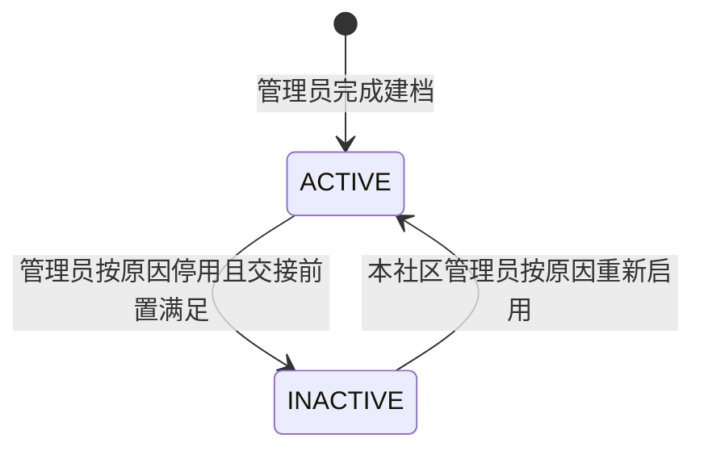
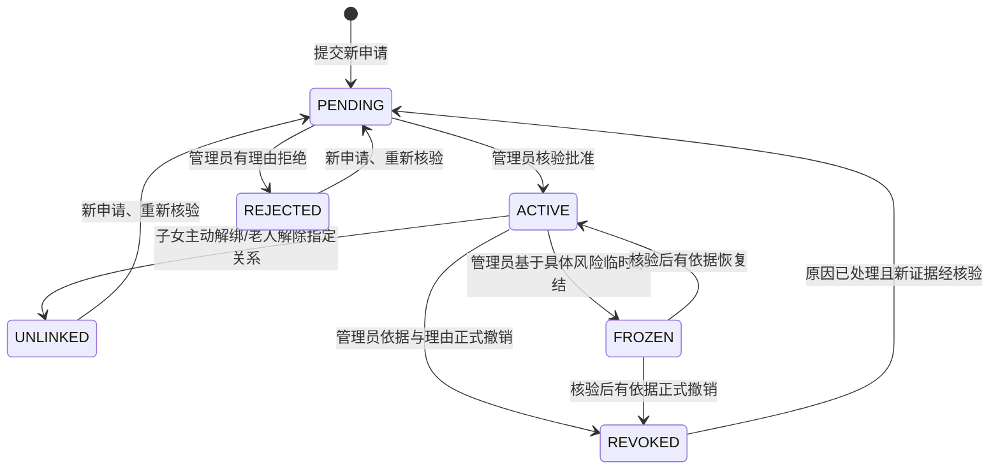
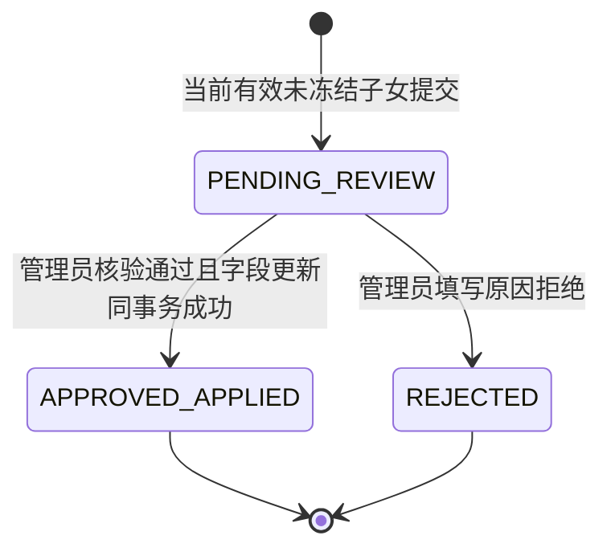
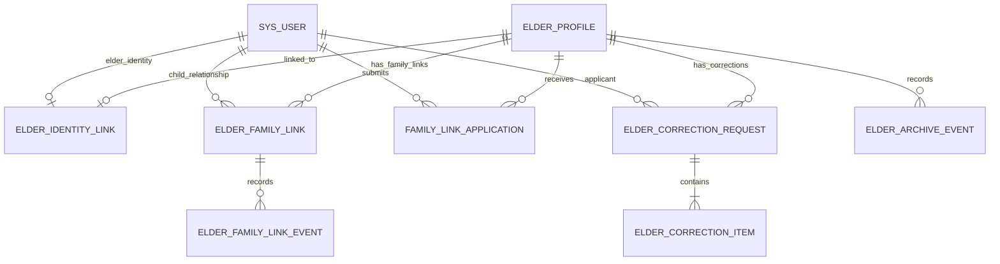

# 社区居家养老服务系统｜E-02 档案与状态联动专项设计

> **现行工作文档。** 本文件由[2026-10-25 原始资料](../../archive/2026-10-25-before-live-docs/design/specialized/E-02%20档案与状态联动专项设计_v0.1_2026-10-24.md)建立，后续设计和实现可直接修订本文件。原文中的版本、冻结、批准和‘下一步’等表述记录其形成时点；目前是否实现、通过测试，以新的运行记录为准。改变需求范围、权限或关键业务规则时，在[变更记录](../变更记录.md)登记原因与影响。

> **集成适用规则（2026-10-24）：** 本文件为 v0.1 模块初稿；共享数据模型、API/错误、锁序、时间、审计和状态映射以[集成设计基线 v1.1](../跨模块设计.md)为准，需求与 AT 状态见[追踪矩阵](../需求追踪.md)。SRS v1.0 的业务语义优先；本文冲突候选不得覆盖集成基线。本文不表示代码或测试已完成。

- **文档版本：** v0.1（专项设计候选稿）
- **编制日期：** 2026-10-24
- **设计状态：** 已形成可供详细设计评审的技术方案；尚未编码、未运行测试
- **适用需求基线：**《社区居家养老服务系统_需求规格说明书_SRS_v1.0.md》
- **适用总体设计：**《社区居家养老服务系统：总体设计基线 v1.1.md》
- **前置专项：** E-01《身份、授权与会话专项设计 v0.1》
- **主要模块：** M02 老人档案与亲情绑定；跨模块契约涉及 M01、M03、M04、M05、M06、M11、M12
- **主要追踪：** FR-M02-01—05、BR-01/02/12/13、G-01—G-11、FZ-01、Q02-B/C/D/L01—L03、Q02-EX01—EX07、AT-02/18/19/20/21

> 本文是工程设计候选稿，不修改或替代已冻结的 SRS v1.0。已批准业务规则、技术设计选择、尚需在编码前明确的设计边界分别标注。本文中的接口、表结构和测试均为设计输入；没有任何运行测试结果被预填为通过。

## 1. 目标、范围与非目标

### 1.1 目标

1. 将老人业务档案、老人账号关联、子女亲情关系、档案更正申请和档案停用/恢复分成不同状态主体，避免把账号停用、档案停用、解绑、冻结或工单状态混为一谈。
2. 落实档案字段规则、唯一性与重复建档核验，保证一个老人只维护一份业务档案，激活账号只关联既有档案。
3. 为档案更正申请提供“提交—管理员核验—实际更正或有理由拒绝—申请人按当前授权查询”的最小闭环。
4. 让亲情绑定的批准、解绑、冻结、恢复、正式撤销和重新申请都能立即影响服务端授权，并保留完整可追踪记录。
5. 让档案停用/恢复与用药任务、常规提醒、人工体征、SOS、既有告警和工单责任交接之间保持已批准的状态边界。
6. 明确数据库逻辑模型、API 契约、事务/锁顺序、并发冲突、失败语义和可执行测试入口。

### 1.2 本专项负责

- 老人档案创建、查询、本人允许修改的联系信息/地址/紧急联系人维护。
- 档案核心字段校验、证件号码规范化与唯一性、无证件号码时的重复候选核验、跨社区重复处理入口。
- 多对多亲情关系申请、管理员核验批准/拒绝、子女/老人解除关系、管理员正式撤销、争议冻结与核验后恢复/撤销。
- 档案更正申请状态、字段快照、管理员审批与实际写入的原子性、授权复核、现值冲突处理。
- 档案停用/恢复前置条件、状态审计、与 M04/M06 等模块的事务与授权契约。
- 关联 API、逻辑数据模型、错误语义、审计要求和专项测试设计。

### 1.3 本专项不负责

- 登录、会话令牌、激活码、密码恢复、手机号变更：由 E-01/M01 负责；E-02 调用其身份与授权能力。
- 体征评估规则、告警合并与 SOS 生命周期：由 E-04/M03/M05 负责；E-02 只定义档案状态和当前授权的调用契约。
- 用药计划、任务生成、打卡与提醒调度的内部实现：由 E-03/M04 负责；E-02 定义档案停用/恢复时必须满足的跨模块边界。
- 工单内部状态机和责任交接办理：由 E-05/M06 负责；E-02 调用其未结工单/交接状态检查。
- 通知发送与文件权限的完整实现：由 M11 专项负责；E-02 不增加 N-01 矩阵外的通知事件或接收角色。
- M12 审计存储基础设施的完整实现：E-02 要求关键业务变更与审计原子一致，并使用全局审计契约。
- 真实设备接入、临床诊断、生产级数据生命周期或未批准的跨社区自动迁移。

## 2. 需求追踪与不可违反的规则

| 来源 | 本专项必须落实的规则 | 主要设计落点 | 验收入口 |
|---|---|---|---|
| FR-M02-01 / G-10 / FZ-01 | 一个老人一份档案；管理员可先建档后关联账号；老人本人可维护指定联系字段；子女只能提交更正申请，不能直接改档；管理员批准并实际更正或有理由拒绝；授权失效/现值冲突不得静默覆盖；保留前后证据 | §§5—9 | AT-02、AT-18 |
| FR-M02-02 / G-01/G-04/G-05 | 多对多亲情关系；管理员核验亲属关系与老人授权意愿；合法代理须有可核验依据；单纯亲属关系不够；老人未激活可先建立亲情关系，但审批前子女无老人数据访问权 | §§6—8 | AT-02 |
| FR-M02-03 / G-03 | 子女或老人可解除关系；解除立即失权但不删除历史、不自动取消预约/工单/计划；重新申请必须重新核验；管理员撤销后须先处理原撤销原因并重新核验 | §§6—8 | AT-02、AT-20 |
| FR-M02-04 / G-02 | 具体争议/授权意愿矛盾/疑似冒用时可临时冻结；冻结立即撤销该关系权限；5 个工作日内复核；逾期继续冻结，不自动恢复；恢复或撤销均须有依据和审计 | §§6—8、§11 | AT-02 |
| FR-M02-05 / G-06/G-07/G-11 / BR-13 | 停用前处理未结工单；无紧急绕过；停档禁止一般新业务并保留历史；暂停新任务和常规提醒、不补造停用期任务；有效老人账号且已认证时 SOS 是唯一新业务例外；已接受 SOS/既有告警/停档前已保存体征的异步评估继续处理 | §§7、10 | AT-18/19/20 |
| Q02-EX01—EX04（G-06/G-08/G-09） | 恢复只处理未来应生成任务与常规提醒；停档后不补录未入库体征；其他当前有效且未冻结的子女可维护既有计划；并发冲突拒绝而非最后写入覆盖 | §§7、10 | AT-18/19/21 |
| Q02-EX05 / Q05-01 | 工作人员账号停用后立即失去访问权；既有工单保留，须有记录交接 | §10.4 | AT-20、AT-27—30（跨模块） |
| Q02-EX06 | 档案字段、缺失原因、证件号码掩码/受限访问/唯一性、无证件号码候选重复核验、跨社区重复不新建第二份档案 | §5 | AT-18 |
| Q02-EX07 | 停档 SOS 窄范围例外及账号停用/身份未认证时的明确拒绝 | §10.3 | AT-19、AT-26（跨模块） |
| BR-01/02/12/13 | 每次请求校验账号、档案、角色、社区和当前关系；账号停用不删除档案/关系；解绑/冻结即时失权；档案停用不等于删除，不自动取消既有业务 | §§4、6—10 | AT-02、AT-18—20 |
| BR-07/10 | 同键同内容幂等返回原结果；同键异内容 409；冲突写入只允许一个合法结果，失败方不得覆盖成功方 | §§8、9、12 | AT-02、AT-18、AT-20 |

## 3. 核心设计原则

1. **身份、档案、亲情关系、业务记录分离。** `sys_user` 不代替 `elder_profile`；老人账号关联不等于子女亲情授权；档案停用不等于账号停用；冻结不等于正式撤销。
2. **服务端当前状态是唯一授权依据。** 不信任前端传入的 `communityId`、`roleCode`、`elderId` 或旧页面状态；每次访问重新校验当前关系、账号和档案状态。
3. **批准必须落到真实数据。** 档案更正申请的“批准”与实际字段更新在同一数据库事务内提交；不能出现“显示已批准但档案未改”或“档案已改但申请仍待处理”。
4. **冲突不采用最后写入覆盖。** 对更正申请比较申请时保存的目标字段快照；任一目标字段已变化则整单不写入，记录冲突并要求管理员重新核验/有理由拒绝。
5. **状态变更与审计同事务。** 档案状态、关系状态、申请状态、字段前后值证据及必要审计记录在同一事务内提交；关键审计写入失败时业务操作不得返回成功。
6. **停用只限制新业务，不删除事实。** 档案、亲情关系、任务、打卡、通知、工单、审核、文件和处理结果保留；不把停档后的未确认任务改成已服药或已漏服。
7. **跨模块检查不能只依赖事件通知。** M04/M06 等在真正执行任务生成、普通工单创建或提醒发送时仍须检查当前档案状态；内存事件丢失不能导致越权新业务。
8. **业务时间使用服务端权威时间和 `Asia/Shanghai`。** 5 个工作日复核期限须使用明确的工作日历，不可直接以 120 小时替代。
9. **技术提案不升级为业务批准。** 本文 §14 单列未明确的细节；未决事项在编码前按项目治理流程确认，不通过代码默认值静默裁决。

## 4. 组件职责与跨模块依赖

| 组件/服务 | 职责 | 关键约束 |
|---|---|---|
| `ElderProfileController` | 档案创建、查询、本人联系信息修改、管理员维护入口 | 只做参数校验与调用，不把前端可见性当权限控制 |
| `ElderProfileService` | 档案字段校验、重复候选查询、档案创建与更新 | 统一规范化；使用版本/锁控制；不在普通创建中自动跨社区迁移 |
| `FamilyLinkService` | 亲情申请、核验、批准/拒绝、解绑、冻结、恢复、撤销 | 关系状态与申请历史分开；关系状态变化立即影响当前授权 |
| `CorrectionRequestService` | 更正申请提交、查询、审批、拒绝和冲突处理 | 审批和实际修改原子提交；授权和目标字段快照二次核验 |
| `ArchiveLifecycleService` | 档案停用/恢复与状态事件 | 停用前检查未结工单/交接；与新业务创建使用统一档案锁顺序 |
| `ArchiveAccessPolicy` | 为各模块提供当前档案状态/关系状态授权判断 | 不缓存可独立过期的亲情授权副本 |
| `M01 AuthorizationService` | 认证主体、会话、账号状态、当前角色和社区权限 | E-02 不复制会话表或实现另一套认证逻辑 |
| `M04 MedicationTaskCoordinator` | 任务生成、提醒发送前校验档案状态，恢复后只补齐未来应生成任务 | 停档期间不生成普通新任务/常规提醒；不回补停用期间任务或过期提醒 |
| `M06 WorkOrderCoordinator` | 查询未结工单、确认责任交接已完成、与档案状态变更串行化 | 仅发起交接不等于完成交接；状态码由 E-05 详细设计统一 |
| `M03/M05` | 体征、评估、告警、SOS 的执行前校验和既有事件续办 | 停档禁止普通人工体征和一般新业务；SOS 只按已批准窄例外处理 |
| `M11 NotificationService` | 依 N-01 矩阵处理已批准业务通知 | E-02 不增加通知事件/收件角色；不因解绑而补发历史通知 |
| `M12 AuditService` | 结构化审计与查询 | 审计事件与关键状态/字段更新同事务；敏感值不明文进入通用日志 |

### 4.1 技术架构约束

沿用项目既定单体分层架构：Java + Spring Boot、MyBatis-Plus、MySQL 8.0、REST API；不为 E-02 新增微服务、Redis 或消息中间件。所有写入由 Service 层事务控制，数据库约束作为最终防线。

### 4.2 全局锁序候选

本节只列本模块的业务对象锁。统一前缀按集成基线 v1.1 §2.4：如采用维护门闩则先取得相应共享/排他锁，其后先处理幂等记录，再按本节顺序锁定业务对象。全序仍为静态候选；须逐事务映射 SQL 并通过真实数据库并发验证后才能冻结。

1. `elder_profile`（按 `elder_id` 升序；多档案操作必须先排序）。
2. `elder_family_link`（按 `link_id` 升序）。
3. `family_link_application` 或 `elder_correction_request`（按主键升序）。
4. M06 工单/交接相关行（按 `work_order_id` 升序）。
5. 写入业务事件/审计记录。

调用方可以先用普通只读查询取得 `elder_id`，但加锁后必须重新读取并校验所有关键条件。其他模块不得先锁工单再反向锁档案；如现有实现不能遵循此顺序，应在 E-05 设计中明确替代方案并完成死锁测试。

## 5. 老人档案数据与状态设计

### 5.1 档案状态机



- 本期业务状态仅使用 `ACTIVE` / `INACTIVE`；物理删除不作为业务操作。
- 停用/恢复都要求本社区管理员权限、原因、操作者、服务端时间和审计。
- `INACTIVE` 禁止一般新业务，但不能阻断已接受 SOS、既有健康告警和针对停档前已保存体征的异步评估。
- `INACTIVE` 时仍按当前账号与关系权限提供允许的历史查询；历史保留不等于允许已解绑/冻结用户查询。
- 档案状态变化不自动取消计划、预约、工单、通知、任务或历史文件。

### 5.2 档案字段规则

| 字段 | 规则 | 写入权限/备注 |
|---|---|---|
| `elder_id` | 系统主键，创建后不可变 | 服务端生成 |
| `archive_no` | 系统档案编号，唯一、不可由普通表单修改 | 服务端生成；格式在全局数据库设计中统一 |
| `name` | 必填；按既定 Unicode/空白规范化规则校验 | 管理员维护；老人更正通过本人允许流程或更正申请闭环 |
| `sex` | 枚举值含未知/未说明，不因未知强制猜测 | 管理员维护；更正须留痕 |
| `birth_date` | 可为空/未知，但未知时必须填写原因；合法日期校验 | 管理员维护；更正须留痕 |
| `community_id` | 必须指向有效社区 | 仅本社区授权管理员经明确的归属核验/迁移流程变更；不得把它作为普通档案字段直接修改 |
| `address` | 按本期档案表单要求校验 | 老人本人可修改；有效未冻结子女只能提交更正申请 |
| `contact_phone` | 可按实际情况缺失；缺失须记录原因并提示管理员 | 老人本人可修改；子女走更正申请 |
| `contact_phone_missing_reason` | 联系电话缺失时必填；存在有效联系电话时清空或不适用 | 与联系电话同事务更新 |
| `emergency_contact_name/relation/phone` | 按实际情况填写；缺失须记录原因并提示管理员 | 老人本人可修改；子女走更正申请 |
| `emergency_contact_name_missing_reason` / `emergency_contact_relation_missing_reason` / `emergency_contact_phone_missing_reason` | 对应紧急联系人字段缺失时分别记录原因；有值的字段不应保留过期缺失原因 | 与对应字段同事务更新 |
| `id_number_ciphertext` | 证件号码可选；如采集须加密存储、受限访问、掩码展示 | 不默认保存证件照片 |
| `id_number_lookup_hmac` | 对规范化证件号码计算带密钥 HMAC；唯一索引；未采集时为 NULL | 不使用无密钥普通散列作为唯一保护措施 |
| `status` | `ACTIVE` / `INACTIVE` | 仅本社区管理员通过状态接口变更 |
| `status_reason` | 每次停用/恢复必须记录原因 | 审计保留历史，当前字段只作最近状态摘要 |
| `row_version` | 每次成功修改档案字段/状态时递增 | 用于乐观并发检测 |
| `created_at/by`, `updated_at/by` | 服务端生成，不接受客户端覆盖 | 统一审计时区口径 |

**证件号码规范化建议：** 去除首尾及中间允许忽略的空白/分隔符，统一字母大小写，再对规范化值做 HMAC；实际允许的字符规则按中国身份证号码格式校验，但证件号码为可选字段，不因未提供而拒绝建档。HMAC 密钥应来自环境安全配置，不存于数据库或代码仓库。

### 5.3 重复建档与跨社区重复

1. **提供证件号码：** 先规范化，再以 `id_number_lookup_hmac` 唯一约束兜底。重复时返回明确业务冲突，不创建第二份档案；列表/错误响应不泄露现有档案的完整身份信息。
2. **未提供证件号码：** 查询候选重复项，至少检查姓名规范化精确匹配，以及已知出生日期、联系电话等可用匹配条件。候选结果只用于管理员人工核验，不自动认定同一人，也不能仅因未找到候选项而跳过建档前核验。
3. **管理员确认无重复：** 才能完成创建，并记录核验人、时间和结论；若候选项存在，先记录处理结论再继续或拒绝创建。
4. **发现跨社区疑似重复：** 不创建第二档案，不自动覆盖 `community_id`。返回 `CROSS_COMMUNITY_MATCH_REQUIRES_VERIFICATION`，由有权人员转入既有档案归属核验/变更流程。
5. **激活老人账号：** 只能关联已有 `elder_id`；数据库必须保证一个老人档案最多关联一个有效老人账号、一个老人账号最多关联一个老人档案。账号激活不新建档案、不产生子女授权。

### 5.4 档案本人资料更新

- 老人本人只能修改 SRS 允许的联系信息、地址和紧急联系人字段，不得通过该接口修改姓名、证件号、社区归属、档案状态或档案编号。
- 请求必须包含 JSON 字段 `expectedVersion`；版本不一致返回 `409 ARCHIVE_VERSION_CONFLICT`，不采用最后写入覆盖。
- 一次请求中的字段要么全部通过校验并提交，要么全部不变；缺失原因与对应联系方式必须保持一致。
- 服务端从 E-01 认证上下文解析当前老人账号，并校验 `elder_identity_link` 指向该 `elder_id`；不接受客户端自行指定另一个 `elder_id` 作为本人档案。
- 成功后递增版本，记录字段级审计；通用日志只记录字段名、结果、对象 ID 和 trace ID，不写入完整电话/地址/证件号码。

## 6. 亲情关系与授权状态设计

### 6.1 状态机



- 只有 `ACTIVE` 且子女账号有效、未冻结的关系授予子女访问范围。
- `PENDING`、`REJECTED`、`UNLINKED`、`REVOKED`、`FROZEN` 均不授予关系访问权。
- 冻结立即失权，但冻结本身不等于正式撤销；复核可按证据恢复或撤销。
- 冻结后 5 个工作日内完成复核；逾期保持 `FROZEN`，记录延期原因，不自动恢复。系统可在管理员待办列表显示逾期项，但不得因此擅自增加未批准的外部通知事件。
- 子女主动解绑后再次申请必须生成新的申请记录并重新核验；管理员正式撤销后，除新申请外还必须记录原撤销原因已处理的依据。不得把旧关系直接改回 `ACTIVE`。
- 老人档案未激活不阻止管理员先批准有效亲情关系；但未审批关系不能访问老人数据。

### 6.2 申请与关系分离

- `family_link_application` 保存每次申请和核验结论，历史申请不可覆盖。
- `elder_family_link` 保存该子女与该老人当前关系状态及当前申请版本；同一对子女/老人仅有一条当前关系行，历史状态由事件表保留。
- 相同对子女/老人重复提交且已有待审申请时，按幂等规则返回现有申请，不创建第二条待审申请。
- 拒绝后允许补充材料重新申请；重新申请创建新申请记录，旧拒绝结果保留。
- 管理员协助提交必须记录被协助人、操作者、协助原因及核验依据；不得把管理员操作伪装成子女本人提交。

### 6.3 授权判定矩阵

| 当前关系状态 | 子女访问老人允许数据 | 子女发起新业务 | 管理员核验/处置 |
|---|---|---|---|
| `PENDING` | 不允许 | 不允许 | 本社区管理员可核验并批准/拒绝 |
| `ACTIVE` | 按 SRS 固定角色范围，且账号有效、档案状态及对象规则通过 | 按各模块业务规则 | 按已批准权限操作 |
| `FROZEN` | 立即拒绝关系范围内访问与写入 | 不允许 | 本社区管理员可在证据基础上恢复或正式撤销 |
| `REJECTED` | 不允许 | 不允许；可提交新申请 | 可查看/审计历史申请 |
| `UNLINKED` | 不允许，包括不再按旧关系查询历史 | 不允许；新申请重新核验 | 按权限查看历史记录 |
| `REVOKED` | 不允许 | 不允许；只有原原因已处理且新证据支持时可重申请 | 按权限查看历史并处理新申请 |

“历史保留”是指系统不删除业务事实；不代表已解绑、冻结、撤销或账号停用的用户继续拥有历史查询权。

### 6.4 亲情申请核验

管理员批准前至少核验：

1. 老人档案存在且归属当前管理员有权处理的社区。
2. 子女账号有效、类型符合家庭账号要求。
3. 亲属关系及老人授权意愿已按 SRS 核验；老人无法表达时须有覆盖该事项的可核验合法监护/代理权限。
4. 单纯亲属关系不能替代代理权限；材料冲突、授权意愿不明或存在实质争议时暂缓/拒绝，不默认批准。
5. 同一对子女/老人不存在另一条有效关系或重复待审申请。
6. 批准、拒绝、冻结、恢复、撤销均记录操作者、时间、原因/结论及必要证据元数据；不默认保存证件照片。

## 7. 档案更正申请设计（FZ-01）

### 7.1 状态机与终态语义



- 本期最小闭环为 `PENDING_REVIEW`、`APPROVED_APPLIED`、`REJECTED` 三种业务状态。
- 不设置“已批准但待后台异步修改”状态：批准与真实档案更新同事务提交。
- 授权变化、档案停用或目标字段冲突时，系统不得静默应用。此类阻断记为待处理申请的 `block_code` 与审计事件，状态仍为 `PENDING_REVIEW`，由管理员重新核验并有理由拒绝，或在冲突被合法解决后重新发起审批检查。原申请内容不可被静默改写。
- 同一申请拒绝后如仍需更正，须提交新申请；不把旧申请状态重置为待审。

### 7.2 提交规则

1. 仅当前有效、账号有效且关系 `ACTIVE`、未冻结的授权子女可提交。
2. 正文必须包含 `elder_id`、`reason`、至少一个更正字段及每个字段的建议值；幂等键通过 `Idempotency-Key` 请求头传入。不允许空原因或空字段集合。
3. 服务端先读取老人档案与关系，再按全局锁顺序锁定档案/关系，重新检查权限和档案状态。
4. 提交时为每个目标字段保存规范化后的当前值快照 `baseline_value`，以便审批时检测目标字段是否已变化。快照与申请内容作为受保护的业务证据保存。
5. 不直接更新 `elder_profile`；只创建申请及申请项，记录申请人、提交时间、关系版本、档案版本和原因。
6. 账号或关系在审批前失效时，不允许继续凭提交时的旧授权批准。档案停用时的新申请拒绝；既有待审申请在停档期间如何继续办理按 §14 的待确认项处理。

### 7.3 审批通过的原子操作

管理员点击批准后，服务端在单一事务内执行：

1. 从申请 ID 读取 `elder_id`，按全局锁顺序锁定 `elder_profile`、当前 `elder_family_link` 和 `elder_correction_request`。
2. 校验管理员账号、当前角色、社区归属、申请状态仍为 `PENDING_REVIEW`，且该申请尚未处理。
3. 校验申请人账号仍有效，且该申请对应的关系仍为 `ACTIVE`、未冻结、未解除/撤销；提交时记录的关系版本仍对应本次授权。任何授权失效均阻止批准。
4. 校验档案状态和所有目标字段的当前值。对每个目标字段，将当前规范化值与提交时 `baseline_value` 比较；任何一个目标字段发生变化时，整单不修改，记录 `FIELD_VALUE_CONFLICT`，返回 409，禁止部分更新。
5. 对所有建议值重新运行字段级校验；不允许把字段验证委托给前端。
6. 全部检查通过后，原子更新所有目标字段，递增 `row_version`，写入每个字段的前值/后值证据，申请状态改为 `APPROVED_APPLIED`，记录核验结论、审批人和时间，写入审计事件。
7. 事务提交后才向客户端返回成功；如任何持久化/审计写入失败，整个事务回滚，申请仍为待处理，档案字段不变。

**审批不允许部分成功。** 多字段申请中只要一个字段冲突或非法，整单不写入；管理员须重新核验并有理由拒绝旧申请，申请人可根据当前事实提交新申请。

### 7.4 有理由拒绝

- 只有当前有权处理该老人档案的本社区管理员可以作出业务拒绝。
- `reason` 必填，服务端拒绝空白或仅空格内容。
- 同一事务中将申请状态改为 `REJECTED`，记录拒绝原因、操作者、时间和审计事件；不修改档案字段。
- 失权申请人只能在当前授权范围内查询申请结果；已解绑/冻结/撤销后，不因为自己是历史申请人而获得老人数据访问权。是否提供只含自身申请元数据的独立历史查询，不在本期默认扩张。

### 7.5 冲突处理与幂等

- 申请提交接口支持 `Idempotency-Key`。同键同规范化内容返回原申请；同键不同内容返回 `409 IDEMPOTENCY_KEY_REUSED` 并审计，不覆盖旧申请。
- 管理员批准/拒绝接口对 `request_id` 与状态版本做条件更新；同一申请并发审批只有一个终态成功。
- 如果第二个请求重复批准同一申请，可在安全授权范围内返回已完成的原结果；如果请求意图与既有终态冲突，返回 `409 CORRECTION_REQUEST_ALREADY_DECIDED`。
- 目标字段冲突时写入 `block_code=FIELD_VALUE_CONFLICT`、发生时间和审计结果，但不把请求标成已批准，不修改任何字段。
- 授权失效时写入 `block_code=APPLICANT_AUTHORIZATION_REVOKED`；不能因管理员仍有权限而绕过申请人授权条件。

## 8. 逻辑数据模型

> 下表是逻辑模型与约束建议，不是已经冻结的最终物理 DDL。全局数据库专项应统一命名、时间类型、外键策略、索引与迁移脚本。

### 8.1 `elder_profile`——老人业务档案

| 字段 | 类型建议 | 约束/用途 |
|---|---|---|
| `elder_id` | BIGINT | 主键；服务端生成 |
| `archive_no` | VARCHAR | 非空唯一；创建后不可修改 |
| `community_id` | BIGINT | 非空；关联社区；归属变更走专门核验流程 |
| `name` | VARCHAR | 非空；规范化校验 |
| `sex` | VARCHAR/ENUM | 允许未知/未说明 |
| `birth_date` | DATE NULL | 未知时必须保存未知原因 |
| `birth_date_unknown_reason` | VARCHAR NULL | 与未知出生日期规则一致 |
| `address` | VARCHAR | 按表单规则校验 |
| `contact_phone` | VARCHAR NULL | 按实际情况填写；敏感信息按数据保护规则存储/展示 |
| `contact_phone_missing_reason` | VARCHAR NULL | 电话缺失时必填 |
| `emergency_contact_name/relation/phone` | VARCHAR NULL | 按实际情况填写 |
| `emergency_contact_name_missing_reason` / `emergency_contact_relation_missing_reason` / `emergency_contact_phone_missing_reason` | VARCHAR NULL | 紧急联系人信息缺失时必填 |
| `id_number_ciphertext` | VARBINARY/TEXT NULL | 证件号码可选；如采集则加密存储，访问受限 |
| `id_number_lookup_hmac` | CHAR(64) NULL | 规范化证件号码的 HMAC；唯一索引，密钥不入库 |
| `status` | VARCHAR | `ACTIVE` / `INACTIVE` |
| `status_reason` | VARCHAR NULL | 最近一次状态变更原因摘要；完整历史另存事件/审计 |
| `row_version` | BIGINT | 乐观锁版本，成功修改后递增 |
| `created_at/by`, `updated_at/by` | DATETIME/ID | 服务端时间与操作者 |

索引/约束：`UNIQUE(archive_no)`、`UNIQUE(id_number_lookup_hmac)`（NULL 可重复）、`INDEX(community_id,status)`、`INDEX(name,birth_date)`、`INDEX(contact_phone)`；对老人账号关联建立双向唯一约束。证件号码加密值不能直接建唯一索引，必须以规范化 HMAC 做唯一性兜底。

### 8.2 elder_identity_link——老人账号关联（本专项的数据定义所有者）

| 字段 | 类型 | 用途 |
|---|---|---|
| link_id | BIGINT | 主键 |
| elder_id | BIGINT | 指向既有老人档案；唯一约束 |
| user_id | BIGINT | 指向 M01 sys_user；唯一约束 |
| linked_by_activation_ticket_id | CHAR(36) | 指向已消费的一次性激活票据；唯一约束 |
| linked_at | DATETIME(3) | 成功建立关联的服务端 UTC 时间 |

约束：UNIQUE(elder_id)、UNIQUE(user_id)、UNIQUE(linked_by_activation_ticket_id)。本实体不设独立 status；账号状态、老人档案状态和亲情关系状态各自独立。激活老人账号只关联既有档案，不自动创建子女关系。E-01 负责激活流程，引用本表模型。

### 8.3 `elder_family_link`——当前亲情关系

| 字段 | 类型建议 | 用途 |
|---|---|---|
| `link_id` | BIGINT | 主键 |
| `elder_id` | BIGINT | 老人档案 ID |
| `child_user_id` | BIGINT | 子女账号 ID |
| `status` | VARCHAR | `PENDING` / `ACTIVE` / `FROZEN` / `REJECTED` / `UNLINKED` / `REVOKED` |
| `current_application_id` | BIGINT NULL | 当前关系对应的申请版本 |
| `link_generation` | BIGINT | 每次重新申请/重新建立关系递增，阻止旧请求复活旧授权 |
| `freeze_reason_code/text` | VARCHAR NULL | 冻结原因与说明 |
| `frozen_at/by` | DATETIME/ID NULL | 冻结时间和操作者 |
| `review_due_at` | DATETIME NULL | 按配置工作日历计算的复核截止时间 |
| `resolved_at/by` | DATETIME/ID NULL | 冻结复核或终止处理结果 |
| `row_version` | BIGINT | 并发版本 |
| `created_at`, `updated_at` | DATETIME | 服务端时间 |

约束建议：`UNIQUE(elder_id, child_user_id)` 表示当前关系行唯一；状态历史保留在申请/关系事件中。每次重新申请更新当前关系行为新 `PENDING` 版本，必须增加 `link_generation` 并关联新的申请，不能直接恢复旧的 `ACTIVE`。外键和删除策略禁止级联物理删除历史关系。

### 8.4 `family_link_application`——亲情申请历史

关键字段：`application_id`、`elder_id`、`child_user_id`、`submitted_by_user_id`、`submission_mode`（本人/管理员协助）、`status`（`PENDING`/`APPROVED`/`REJECTED`）、`evidence_metadata`、`reason`、`reviewer_user_id`、`reviewed_at`、`decision_reason`、`link_generation`、`idempotency_key`、`request_hash`、`created_at`。

- 保存每次申请及核验结论，不覆盖旧拒绝记录。
- 不默认保存证件照片；仅保存必要的核验元数据和证据引用。
- 同一对子女/老人只允许一个有效待审申请；并发提交由关系行锁与唯一约束共同保护。
- 拒绝后重新申请使用新的 `application_id` 与幂等键，并保留旧申请。

### 8.5 `elder_correction_request`——档案更正申请

关键字段：

- `request_id`、`elder_id`、`applicant_user_id`、`applicant_link_id`、`applicant_link_generation`。
- `status`：`PENDING_REVIEW` / `APPROVED_APPLIED` / `REJECTED`。
- `reason`、`submitted_at`、`submitted_archive_version`、`idempotency_key`、`request_hash`。
- `reviewer_user_id`、`reviewed_at`、`decision_reason`、`block_code`、`block_at`、`row_version`。
- `created_at`、`updated_at`。

约束建议：`UNIQUE(applicant_user_id,idempotency_key)`；`INDEX(elder_id,status,submitted_at)`；`INDEX(applicant_user_id,submitted_at)`。状态为终态时不可被普通 API 改回待审。

### 8.6 `elder_correction_item`——更正字段及前后值证据

关键字段：`item_id`、`request_id`、`field_code`、`baseline_value_protected`、`proposed_value_protected`、`before_value_protected`、`after_value_protected`、`value_digest`、`applied_at`。

- 每个申请至少一条字段项；同一申请中 `field_code` 不重复。
- `baseline_value_protected` 保存提交时目标字段的规范化快照；审批时用于冲突比较。
- `before_value_protected` / `after_value_protected` 仅在实际更新成功时写入；拒绝或冲突时不得伪造更改前后值。
- 受保护值可按字段采用加密存储；通用审计日志不存完整身份证号、电话或地址明文。
- 申请字段项与申请状态同事务写入；字段项不允许客户端自行更新或删除。

### 8.7 `elder_archive_event`——档案状态/关键业务事件

记录 `event_id`、`elder_id`、`event_type`、`old_status`、`new_status`、`reason_code/text`、`actor_user_id`、`occurred_at`、`trace_id`、`related_object_type/id`、`metadata`。只追加，不更新历史事件；与 `elder_profile` 状态变更同事务写入。该表是业务事件载体，不替代 M12 通用审计。

### 8.8 `elder_family_link_event`——关系状态历史

记录 `event_id`、`link_id`、`application_id`、`old_status`、`new_status`、`event_type`、`reason`、`evidence_metadata`、`actor_user_id`、`occurred_at`、`trace_id`。冻结、恢复、撤销、解绑、批准和拒绝均需事件。关系状态变更与事件同事务提交。

### 8.9 逻辑关系图



图中 `SYS_USER` 为 E-01 已定义账号实体的逻辑引用；图示不代表最终 DDL 已生成。

## 9. API 契约草案

### 9.1 通用规则

- 路径前缀统一 `/api/v1`。
- 认证与会话由 E-01 提供；每个接口仍需执行对象级授权。
- 时间采用 ISO-8601，服务端业务日期按 `Asia/Shanghai`；服务端时间为权威。
- 所有会创建业务事实、改变状态或触发副作用的命令通过 `Idempotency-Key` 请求头传幂等键；JSON 正文不重复传入。必须说明同键同内容和同键异内容语义。
- 档案/关系写入统一使用 JSON 字段 `expectedVersion`；版本冲突返回 HTTP 409。
- 读请求对象不存在或不可访问时统一按安全规则返回 404；已知对象上的角色/状态不允许操作时返回 403 或 409。
- 申请结果与档案更改状态不得由前端自行推断；必须以服务端状态为准。

### 9.2 档案接口

| 方法与路径 | 角色/范围 | 关键输入 | 成功语义 |
|---|---|---|---|
| `POST /api/v1/elders` | 本社区管理员 | 核心字段、缺失原因、可选证件号码、重复核验结论 | 创建一份 `ACTIVE` 档案；证件号重复或候选未核验则拒绝 |
| `GET /api/v1/elders` | 管理员按社区范围 | 筛选、分页 | 仅返回当前社区授权范围；候选重复列表需额外受限 |
| `GET /api/v1/elders/{elderId}` | 老人本人、有效未冻结子女、相应社区工作人员/管理员 | 路径 ID | 当前权限内返回允许字段；身份证号始终掩码 |
| `PATCH /api/v1/elders/{elderId}/self-contact` | 与档案关联的老人本人 | `expectedVersion`、地址/电话/紧急联系人字段及缺失原因 | 仅允许字段原子更新；版本冲突 409 |
| `PATCH /api/v1/elders/{elderId}/admin-fields` | 本社区管理员 | `expectedVersion`、管理员可维护字段、原因 | 更新管理员权限字段并审计；社区归属变化不得绕过归属核验流程 |
| `POST /api/v1/elders/{elderId}/deactivate` | 本社区管理员 | `expectedVersion`、停用原因 | 前置工单/交接检查通过后变为 `INACTIVE` |
| `POST /api/v1/elders/{elderId}/reactivate` | 本社区管理员 | `expectedVersion`、恢复原因 | 变为 `ACTIVE`；不补造停用期任务或补发过期提醒 |

### 9.3 更正申请接口

| 方法与路径 | 角色/范围 | 关键输入 | 成功/失败语义 |
|---|---|---|---|
| `POST /api/v1/elders/{elderId}/correction-requests` | 当前有效未冻结授权子女 | `reason`、`items[{fieldCode, proposedValue}]`；`Idempotency-Key` 请求头 | 创建 `PENDING_REVIEW`；不改档；重复同键返回原申请 |
| `GET /api/v1/elders/{elderId}/correction-requests` | 当前仍有该老人访问权限的申请人；本社区管理员 | 分页/状态筛选 | 申请人只能看当前授权范围；管理员按社区范围查看 |
| `GET /api/v1/correction-requests/{requestId}` | 同上 | 路径 ID | 返回申请状态、允许展示的字段值、原因及处理结果；无权访问返回 404 |
| `POST /api/v1/correction-requests/{requestId}/approve` | 本社区管理员 | `expectedVersion`、核验摘要 | 同事务更新档案和申请为 `APPROVED_APPLIED`；冲突 409 且不部分修改 |
| `POST /api/v1/correction-requests/{requestId}/reject` | 本社区管理员 | `expectedVersion`、必填拒绝原因 | 申请变为 `REJECTED`；档案不变 |

#### 提交示例

```json
{
  "reason": "核实后发现紧急联系人电话录入有误",
  "items": [
    { "fieldCode": "emergency_contact_phone", "proposedValue": "13800000000" }
  ]
}
```

示例仅说明结构，号码为虚构数据；真实响应不得暴露未授权字段。

### 9.4 亲情关系接口

| 方法与路径 | 角色/范围 | 关键输入 | 成功/失败语义 |
|---|---|---|---|
| `POST /api/v1/elders/{elderId}/family-link-applications` | 子女本人；或有权限管理员协助提交 | 本人申请默认使用当前账号；协助申请须指定目标账号并记录依据 | 创建待审申请；相同对子女/老人重复待审请求去重 |
| `GET /api/v1/family-link-applications/{applicationId}` | 申请人当前允许查看的范围；本社区管理员 | 路径 ID | 返回当前申请状态和必要核验结果 |
| `POST /api/v1/family-link-applications/{applicationId}/approve` | 本社区管理员 | `expectedVersion`、核验依据元数据、结论 | 核验通过后关系变为 `ACTIVE`；同事务写申请、关系和审计 |
| `POST /api/v1/family-link-applications/{applicationId}/reject` | 本社区管理员 | `expectedVersion`、必填原因 | 申请变为 `REJECTED`，保留历史 |
| `POST /api/v1/family-links/{linkId}/unlink` | 关系中的子女本人或已认证老人本人 | `expectedVersion`、可选原因 | 当前关系变为 `UNLINKED`，立即失权，不取消其他业务 |
| `POST /api/v1/family-links/{linkId}/freeze` | 本社区管理员 | `expectedVersion`、具体原因、必要依据元数据 | 关系变为 `FROZEN` 并立即失权，计算复核截止时间 |
| `POST /api/v1/family-links/{linkId}/resolve-freeze` | 本社区管理员 | `expectedVersion`、结果 `RESTORE`/`REVOKE`、依据、原因 | 只能按核验结果恢复或正式撤销；不自动恢复 |
| `POST /api/v1/family-links/{linkId}/revoke` | 本社区管理员 | `expectedVersion`、撤销原因、依据 | 关系变为 `REVOKED`；后续重新申请须核验原原因已处理 |

### 9.5 请求/响应与错误约定

成功响应建议包含 `data`、`traceId` 和服务端生成的时间；错误响应包含稳定 `code`、用户可理解的 `message`、`traceId`，不得包含堆栈、SQL、证件号码或内部授权细节。

| HTTP | 错误码示例 | 语义 |
|---|---|---|
| 400 | `VALIDATION_ERROR` | 字段格式、必填、缺失原因或字段组合不合法 |
| 401 | `SESSION_EXPIRED` / `SESSION_REVOKED` | 认证会话无效，由 E-01 统一处理 |
| 403 | `ACTION_NOT_ALLOWED` | 已知对象上的操作超出当前角色权限 |
| 404 | `RESOURCE_NOT_FOUND_OR_NOT_ACCESSIBLE` | 对象不存在或当前用户无权访问，防止枚举 |
| 409 | `ARCHIVE_VERSION_CONFLICT` | 档案版本冲突，刷新后重新提交 |
| 409 | `DUPLICATE_ELDER_RECORD` | 证件号码或唯一档案约束冲突；不泄露已有档案详情 |
| 409 | `DUPLICATE_FAMILY_LINK_APPLICATION` | 已有同对子女/老人待审申请，返回现有申请引用或安全提示 |
| 409 | `CORRECTION_REQUEST_ALREADY_DECIDED` | 更正申请已进入终态，不能重复审批 |
| 409 | `FIELD_VALUE_CONFLICT` | 申请目标字段在提交后变化；不更新任何字段 |
| 409 | `APPLICANT_AUTHORIZATION_REVOKED` | 申请人授权在审批前失效；不得批准 |
| 409 | `ARCHIVE_HAS_UNHANDED_WORK_ORDERS` | 存在未结且未完成合法交接的工单，拒绝停用 |
| 409 | `CROSS_COMMUNITY_MATCH_REQUIRES_VERIFICATION` | 疑似跨社区重复，禁止新建第二份档案 |
| 409 | `IDEMPOTENCY_KEY_REUSED` | 同一幂等键对应不同规范化请求内容 |
| 429 | `RATE_LIMITED` | 按公共安全策略限制频繁请求 |
| 500 | `INTERNAL_ERROR` | 通用服务错误；返回 trace ID，不暴露堆栈 |

错误码是本专项建议的契约名称，最终须与全局 API 规范统一；不得因统一命名而改变已批准的业务结果。

## 10. 档案停用/恢复的跨模块契约

### 10.1 停用前置与事务

`POST /api/v1/elders/{id}/deactivate` 的核心流程：

1. 认证为本社区管理员，校验 `expectedVersion` 和非空停用原因。
2. 以 `elder_id` 锁定档案行，并重新校验档案当前为 `ACTIVE`、社区归属及权限。
3. 调用 M06 同事务/同连接约定下的检查：所有未结工单必须已结案，或已完成明确的合法转交/重新分配并完成责任交接；只发起交接申请不算完成。
4. 如仍有未结且未完成交接的工单，返回 `409 ARCHIVE_HAS_UNHANDED_WORK_ORDERS`，档案状态不变，审计失败结果。
5. 条件满足时，将档案状态更新为 `INACTIVE`，递增 `row_version`，写入 `elder_archive_event` 和 M12 审计记录；同一事务提交。
6. 不删除/取消任何计划、任务、打卡、通知、工单、告警或文件；不执行“紧急绕过”。

**并发要求：** 普通新业务/普通工单创建在最终提交前必须锁定同一档案行并检查 `ACTIVE`。停用与新建竞争时，只有按锁顺序先合法提交的一方成功；另一方重新读取状态并明确拒绝。SOS 是已批准的窄范围例外，不按普通业务 guard 拒绝，但必须校验老人账号有效、身份已认证并在 SOS 记录中标记档案停用状态。

### 10.2 恢复流程

1. 本社区管理员提交恢复原因和 `expectedVersion`。
2. 锁定档案并检查当前为 `INACTIVE`；更新为 `ACTIVE`、递增版本、写入状态事件和审计。
3. 不复活任何已解除、冻结、正式撤销或失效的亲情关系；不自动启用失效账号。
4. M04 按当前档案状态、当前计划状态、计划有效日期及任务状态重新判断未来任务生成。只恢复恢复生效后未来应生成的任务和常规提醒；不补造停用期间任务，不补发已过期常规提醒。
5. 已生成当日任务保留原快照，只能在原截止窗口内正常确认；超过普通打卡窗口的任务保持 `OVER_WINDOW_UNCONFIRMED`，不得自动推断漏服。
6. 恢复操作失败时状态不变；不允许先改档案、再依赖异步通知决定是否恢复。

### 10.3 M04 用药与提醒的必需契约

- 每次生成新任务前重新检查档案 `ACTIVE`、计划在该日期有效、账号/授权状态符合对应业务规则，并按 `Asia/Shanghai` 的服务端日期处理。
- 档案停用期间不生成新服药任务或新的常规提醒。已存在任务、打卡和通知历史不删除、不覆盖。
- 停用期间错过的普通提醒不得在恢复后作为过期提醒补发；恢复只处理未来仍应发生的任务/提醒。
- 停用期间已有当日任务的状态不得被系统自动改为已服药或已漏服；截止前仍按正常规则确认，过窗后按既有状态语义处理。
- 任务调度必须具备重复运行安全性：同一老人/计划版本/业务日期/提醒时点不得重复创建有效任务；冲突按 BR-07/10 返回或复用已存在结果，不采用最后写入覆盖。
- 正确性不能只依赖档案状态变更时发出的进程内事件；Scheduler 在执行时必须再次读取数据库当前状态。

### 10.4 M06 工单与责任交接契约

- 停用前查询该老人所有未结工单，并识别已结案、已完成合法转交/重新分配与责任交接、仍未完成三类结果。
- 只有前两类可通过停用前置检查；“已发起交接但接收方未确认/责任主体未明确”的工单仍视为未完成交接。
- 档案停用不能自动取消或删除工单。交接后的工单必须有明确可处理的责任主体和可追踪记录。
- 工单创建事务与档案停用事务必须遵循共同锁顺序；具体状态字段和交接步骤由 E-05 统一定义，E-02 不自行发明 M06 状态码。

### 10.5 M03/M05 体征、告警与 SOS 契约

- 档案停用后禁止普通人工体征新增；不允许补录停档前采集但从未入库的数据。
- 已存在体征的纠错必须由本社区管理员走独立审计流程，记录原因、原值、新值、操作者和时间；不静默覆盖或删除原始证据。
- 已接受 SOS、既有健康告警，以及针对停档前已保存体征的异步评估必须继续处理；档案停用不能使这些已接受业务记录回滚或丢弃。
- 停档时有效且已认证的老人可提交 SOS 作为唯一窄范围新业务例外，并在 SOS 中标记档案停用；老人账号停用或身份认证无效时明确拒绝并展示备用联系方式。
- 健康告警与 SOS 保持不同业务链路；E-02 不将档案停用改写成告警结案或工单结案。

### 10.6 账号/关系状态组合

| 账号 | 档案 | 亲情关系 | 结果 |
|---|---|---|---|
| 老人账号有效 | ACTIVE | 不适用 | 老人按本人角色与档案关联权限访问 |
| 老人账号停用 | ACTIVE | 子女关系 ACTIVE | 老人账号所有请求拒绝；其他当前有效子女不受影响 |
| 子女账号停用 | ACTIVE | 关系 ACTIVE | 该子女因账号状态不可访问；恢复账号后仍须重新检查关系当前状态 |
| 子女账号有效 | ACTIVE | FROZEN/UNLINKED/REVOKED | 不得通过该关系访问老人数据；其他有效子女不受影响 |
| 老人账号有效且已认证 | INACTIVE | 不适用 | 普通新业务拒绝；允许已批准 SOS 窄例外；允许范围内历史查询 |
| 子女账号有效 | INACTIVE | ACTIVE | 允许当前权限范围内历史查询；一般新业务拒绝；保留既有业务 |

## 11. 安全、审计与隐私

### 11.1 必须记录的事件

- 档案创建、字段修改、重复候选核验、跨社区重复拦截。
- 老人账号关联/解除（关联创建主要由 E-01 处理，E-02 保留引用和交界审计）。
- 亲情申请提交、管理员协助提交、批准、拒绝、解绑、冻结、恢复、正式撤销、重新申请。
- 档案更正申请提交、管理员审批尝试、字段冲突、授权失效、批准并实际修改、拒绝。
- 档案停用/恢复、停用前工单检查结果、未结工单导致的拒绝。
- 关键并发冲突、幂等键复用冲突和审计写入失败。

### 11.2 审计字段

至少包括：`event_id`、事件类型、操作者 ID/角色、对象类型/ID、老人档案 ID、社区 ID、结果、原因码、服务端时间、trace ID、关联申请/关系/工单 ID、必要的前后版本号。

- 对敏感字段，通用审计只存字段名、受控的掩码/摘要或受保护证据引用；完整前后值按权限存放在更正证据数据中。
- 不记录密码、会话令牌、验证码、激活码明文、完整身份证号码或无关健康信息。
- 审计记录只追加，不提供普通业务界面修改/删除功能。
- 关键审计写入失败时，档案/关系/更正申请的关键事务必须回滚，不返回业务成功。

### 11.3 最小权限与防越权

- 仅本社区管理员可管理本社区档案、审批亲情申请、处理争议冻结和执行停用/恢复。
- 子女不能通过 `PATCH /api/v1/elders/{id}` 等通用入口直接改档；只能提交更正申请。
- 子女申请和结果查询均实时检查当前绑定状态；解绑后不得以申请人历史身份继续访问老人数据。
- 文件访问必须检查所属业务对象权限，不能仅凭文件 ID 下载档案附件。
- 证件号码只在确有必要的权限范围展示掩码；查询/导出不得返回完整值。
- 不因管理员协助、运维调试或跨社区重复核验绕过正常授权和审计。

## 12. E-02 测试设计（全部待执行）

> 所有用例使用虚构/合成数据。下列内容是测试设计，不是执行结果。当前状态统一为 **未测**；运行后需填写实际结果、环境版本、数据库断言和证据路径。

| 用例 | 追踪 | 步骤摘要 | 预期结果与关键断言 |
|---|---|---|---|
| E02-T01 档案必填与未知值 | FR-M02-01、G-10、AT-18 | 创建档案，分别测试性别未知、出生日期未知及缺失原因、电话/紧急联系人缺失原因 | 合法未知值可保存；未知/缺失但原因缺失时拒绝；系统不自行猜测出生日期或联系方式 |
| E02-T02 证件号码规范化唯一 | G-10、AT-18 | 使用同一证件号不同空格/大小写格式创建两份档案 | 规范化后第二次创建被唯一约束拒绝；不返回第一份档案敏感信息；无部分记录 |
| E02-T03 无证件号候选重复核验 | G-10、AT-18 | 使用相同姓名/出生日期/电话组合建立候选，再尝试建档 | 系统显示候选供管理员核验；未完成核验不能创建；系统不自动认定重复或自动放行 |
| E02-T04 跨社区疑似重复 | G-10、AT-18 | C1 管理员创建档案时发现 C2 候选 | 阻止新建第二档案，返回归属核验提示；不自动改 community_id |
| E02-T05 老人本人字段边界 | FR-M02-01、BR-01、AT-18 | 老人本人修改电话/地址/紧急联系人，再尝试修改姓名、状态、社区和档案编号 | 允许字段通过校验后原子更新；越权字段拒绝；每次成功递增版本并留审计 |
| E02-T06 子女不能直接改档 | FR-M02-01、FZ-01、AT-02/18 | 有效子女尝试通用 PATCH，再提交更正申请 | 直接修改返回拒绝且档案不变；合法申请只创建申请，不改档案 |
| E02-T07 亲情申请批准前隔离 | FR-M02-02、AT-02 | 子女注册后申请绑定，审批前尝试老人详情/列表/文件/统计 | 审批前全部拒绝；批准后仅获得 SRS 固定权限范围，不扩大社区或对象范围 |
| E02-T08 亲情批准的核验依据 | G-01/G-04/G-05、AT-02 | 分别测试老人有效意愿、合法代理依据、仅亲属关系、材料冲突 | 只有满足核验规则才能批准；仅亲属身份不足以替代代理权；不足/冲突时暂缓或拒绝并审计 |
| E02-T09 同对子女/老人重复申请 | FR-M02-02、BR-07/10、AT-02 | 并发提交相同对子女/老人待审申请，使用相同与不同幂等键 | 不出现多条有效待审申请；同键同内容返回原申请；同键异内容 409 并审计 |
| E02-T10 解绑立即失权 | FR-M02-03、BR-02、AT-02/20 | 子女解绑后重用旧会话、URL、文件 ID 和列表请求 | 解绑事务提交后新请求均拒绝；不删除业务历史、不自动取消预约/工单/计划 |
| E02-T11 冻结即时失权 | FR-M02-04、G-02、AT-02 | 管理员记录具体争议并冻结；并发发起子女读写请求 | 冻结后关系访问立即拒绝；其他有效子女仍可访问；冻结事件和依据留痕 |
| E02-T12 冻结期限与逾期 | G-02、AT-02 | 使用测试工作日历计算 5 个工作日截止，模拟逾期未复核 | 到期前显示待复核；逾期仍为 FROZEN，不自动恢复；记录延期原因；不新增未批准的外部通知 |
| E02-T13 冻结恢复/撤销 | FR-M02-04、G-02、AT-02 | 有证据恢复；再以正式撤销结案；尝试无依据直接恢复 | 有依据操作才成功；恢复/撤销均留人、时间、原因和依据；无依据操作拒绝 |
| E02-T14 拒绝后重新申请 | FR-M02-02/03、G-03、AT-02 | 拒绝申请后补充材料重新申请 | 生成新 application_id；旧拒绝历史保留；新申请仍需重新核验，不自动 ACTIVE |
| E02-T15 正式撤销后重新申请 | G-03、AT-02 | 管理员正式撤销关系，未处理原原因即重新申请；再提供充分依据后申请 | 未证明原原因已处理时不得批准；提供依据后仍作为新申请重新核验；旧关系不直接复活 |
| E02-T16 更正申请成功闭环 | FZ-01、FR-M02-01、AT-02/18 | 有效子女提交一项/多项字段申请，管理员核验并批准 | 申请状态与真实字段同事务变为 APPROVED_APPLIED；前后值、申请人、审批人、时间可追踪 |
| E02-T17 更正申请有理由拒绝 | FZ-01、AT-02/18 | 管理员拒绝并提交原因 | 空原因拒绝；有效原因将申请置为 REJECTED；档案字段完全不变；申请人按当前授权查询结果 |
| E02-T18 审批前解绑/冻结 | FZ-01、BR-02、AT-02/18 | 提交申请后先解绑或冻结，再尝试批准 | 审批被阻止，记录 APPLICANT_AUTHORIZATION_REVOKED；档案不变；不能借历史申请恢复权限 |
| E02-T19 更正目标字段冲突 | FZ-01、BR-10、AT-02/18 | 子女申请后管理员/老人先修改同一目标字段，再审批 | 返回 409 FIELD_VALUE_CONFLICT；所有目标字段不变；记录冲突；无部分写入或虚假前后值 |
| E02-T20 更正无关字段变化 | BR-10、AT-02/18 | 申请针对电话；申请提交后管理员只修改地址，再审批 | 若目标字段基线未变，按字段快照规则重新校验后可继续；不得因无关字段变化误覆盖地址 |
| E02-T21 同一申请并发审批 | BR-07/10、AT-02/18 | 两个管理员并发批准/拒绝同一申请 | 只有一个合法终态提交；失败方收到状态冲突；申请、档案和审计一致 |
| E02-T22 档案停用前置检查 | FR-M02-05、BR-13、AT-18/19 | 存在未结工单且无完成交接时停用 | 返回 409；档案仍 ACTIVE；未结工单和责任人不变；记录失败结果 |
| E02-T23 合法交接后停用 | FR-M02-05、Q02-L02、AT-18 | 将未结工单完成合法转交/重新分配并确认责任交接，再停用 | 只有 M06 证明交接完成后允许停用；工单不删除且新责任主体可处理 |
| E02-T24 停用与普通业务创建竞争 | BR-10/13、AT-18/19 | 并发执行档案停用与普通工单/新任务创建 | 按共同锁顺序只有合法的一方提交；停用成功后普通新业务被拒；无“停用后仍新建”的竞争窗口 |
| E02-T25 停档 SOS 窄例外 | G-11、AT-19 | 档案 INACTIVE，分别用有效已认证老人账号、停用账号、未认证请求发 SOS | 仅有效且已认证老人请求可按 SOS 专项接受并标记停档；账号停用/认证无效明确拒绝并显示备用联系方式 |
| E02-T26 停档任务与提醒 | G-06、Q02-L01、AT-19/21 | 停档前后执行 M04 Scheduler，模拟提醒到期和停档跨日 | 停档期间不生成普通新任务/常规提醒；历史任务不删除、不自动标服药/漏服；过期提醒不补发 |
| E02-T27 恢复不补造历史任务 | G-06、Q02-EX01、AT-19/21 | 停档多日后恢复，检查停档期、当前日与未来任务 | 不补造停档期间任务/过期提醒；当前日任务按原截止规则；仅生成恢复后未来应有任务 |
| E02-T28 账号/关系/档案状态组合 | BR-01/02/12/13、AT-20 | 测试老人账号停用、子女账号停用/恢复、档案停用、关系冻结/解绑的先后顺序 | 各状态独立生效；恢复账号不复活无效关系；停档不删除档案/关系；历史访问始终受当前权限约束 |
| E02-T29 审计原子性 | FR-M02-01/03/04/05、AT-12/18 | 模拟审计写入失败后执行档案更新、冻结、审批、停用 | 关键事务全部回滚；不得出现业务成功但无审计；失败返回 trace ID |
| E02-T30 敏感数据保护 | NFR-01/06、AT-12/18 | 检查 API、日志、审计、异常和数据库字段展示 | 证件号掩码；无凭证/密码/验证码明文；审计保留必要证据但通用日志不泄露完整 PII |

### 12.1 测试证据要求

每条用例执行后保存：用例 ID、需求追踪、代码版本/数据库版本、合成测试数据 ID、请求/响应脱敏记录、关键数据库断言、并发/失败注入方式、服务端 trace ID、实际结果、证据位置和结论。未执行用例保持“未测”。静态复核、单元测试模拟和接口 mock 不等于真实运行验收。

## 13. E-02 模块开工门槛

进入 M02 编码前至少满足：

- [ ] SRS v1.0 的 FR-M02-01—05、G-01—G-11、FZ-01 和 Q02-EX01—EX07 已逐项映射到实现任务。
- [ ] E-01 的账号状态、角色上下文、老人账号关联及 `AuthorizationService` 契约可被 M02 调用。
- [ ] 物理数据库 DDL 已确定：档案唯一性、证件号码 HMAC、老人账号一对一关联、亲情关系唯一当前行、申请历史、版本列、外键和索引均有迁移脚本。
- [ ] 档案更正申请的字段白名单/特殊字段路由、档案停用期间已有待审申请的处理口径已确认（见 §14）。
- [ ] 5 个工作日复核所用工作日历来源和维护方式已确定；测试环境有可重复的测试日历。
- [ ] M06 已提供“未结工单/完成交接”查询和事务/锁顺序契约；不能只通过前端页面判断。
- [ ] M04 已确认任务生成、常规提醒发送、档案停用和恢复的当前状态检查机制。
- [ ] M03/M05 已确认停档体征、已接受告警/评估与 SOS 例外的接口校验边界。
- [ ] API 错误码、幂等、版本冲突和审计字段已与全局规范统一。
- [ ] E02-T01—T30 中适用用例已转为可执行测试；并发测试可稳定复现。
- [ ] 所有初始化与验收数据均为虚构/合成数据，开发环境可重复搭建。

满足门槛后按“详细设计冻结 → 编码 → 模块测试 → 缺陷修复 → 回归”推进。E-02 文档形成不代表 M02 代码完成或 AT-02/18/19/20 通过。

## 14. 设计决策与待确认边界

### 14.1 本文提出的工程设计决策

1. 将档案、更正申请、亲情关系和申请历史拆分为独立逻辑实体，避免状态覆盖和历史丢失。
2. 档案更正采用字段级基线快照；审批前只比较本次申请涉及的字段。目标字段发生变化时整单冲突，不采用最后写入覆盖。
3. 更正批准与档案实际更新同一事务完成；只有实际应用成功才可进入 `APPROVED_APPLIED`。
4. 亲情关系保留唯一当前行和独立申请历史；每次重新申请提升 `link_generation`，防止旧授权复活。
5. 档案停用与普通新业务创建共用老人档案行锁与状态检查；任务 Scheduler 不能只依赖内存事件。
6. 证件号码使用应用层加密与带密钥 HMAC 唯一性检查；审计通用字段不保存完整敏感值。
7. 冻结逾期不自动恢复；逾期项进入管理员待办，只有核验后才能恢复或正式撤销。

### 14.2 编码前需明确的设计边界（本稿不擅自当作已批准业务规则）

| 编号 | 问题 | 当前建议 | 原因与处理要求 |
|---|---|---|---|
| E02-D01 | 子女更正申请可提交的字段白名单，以及社区归属变更如何进入既有核验流程 | 普通更正接口明确白名单；档案编号、档案状态不经通用更正接口修改；`community_id` 变更必须转归属核验/变更流程，不在普通更新中直接改 | SRS 确认子女只能提交更正申请、管理员办理；同时要求跨社区重复不新建第二份档案，但未冻结该专门流程的详细状态/API。实现前需把字段表和特殊流程入口落到设计记录 |
| E02-D02 | 档案停用时已存在的 `PENDING_REVIEW` 更正申请如何处理 | 不删除、不自动拒绝；停档期间阻止新的申请，既有申请审批先阻断并留 `ARCHIVE_INACTIVE` 处理记录，等待恢复后重新核验，或由管理员有理由拒绝 | SRS 明确停档禁止一般新业务，但没有直接说明已存在更正申请是否可继续审批；建议采用不扩大权限且不丢历史的保守处理，编码前明确 |
| E02-D03 | “5 个工作日”的节假日/调休日历来源 | 使用可配置工作日历，保存计算后的 `review_due_at` 和日历版本；不能把五个自然日或 120 小时当作五个工作日 | 业务时区已定为 `Asia/Shanghai`，但节假日数据维护责任和来源未在 SRS 冻结；需确定演示/部署环境日历输入方式 |
| E02-D04 | 跨社区归属变更的审批主体和责任交接细节 | E-02 只提供阻止重复建档与转入既有归属核验流程的入口，不自动改变社区；跨社区流程需单独形成状态/API 契约 | SRS 要求核验/变更归属，不创建第二份档案；不能从这句话推断源/目标社区审批步骤或自动转移权限 |

这些项目是详细设计边界，不意味着已确认业务规则失效，也不影响已冻结的 SRS。未明确前不得在实现中静默选择会改变授权或业务结果的行为。

### 14.3 实施中需验证

- MySQL 8.0 的唯一索引、`SELECT ... FOR UPDATE`、事务隔离和版本更新是否满足并发要求。
- 证件号码规范化与 HMAC 方案在现有环境的密钥配置、密钥轮换和备份恢复中可操作。
- 5 个工作日的工作日历可重复、可追踪，并能在测试中模拟周末、法定节假日和调休工作日。
- M04/M06 等模块遵循相同档案锁顺序，不出现反向锁死锁；用并发失败注入验证。
- 受保护的更正字段前后值可由有权管理员审查，普通业务日志和无权用户响应不会泄露。
- 关联审计与业务数据同事务；失败时无部分成功。

## 15. 版本记录

| 版本 | 日期 | 变更 |
|---|---|---|
| v0.1 | 2026-10-24 | 首次形成 E-02 档案、亲情关系、更正申请、停用/恢复、跨模块契约、逻辑数据模型、API、并发和 30 条测试设计候选稿；未修改 SRS/总体设计基线，未执行代码或运行测试。 |
