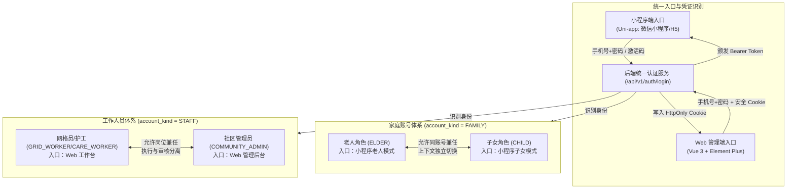
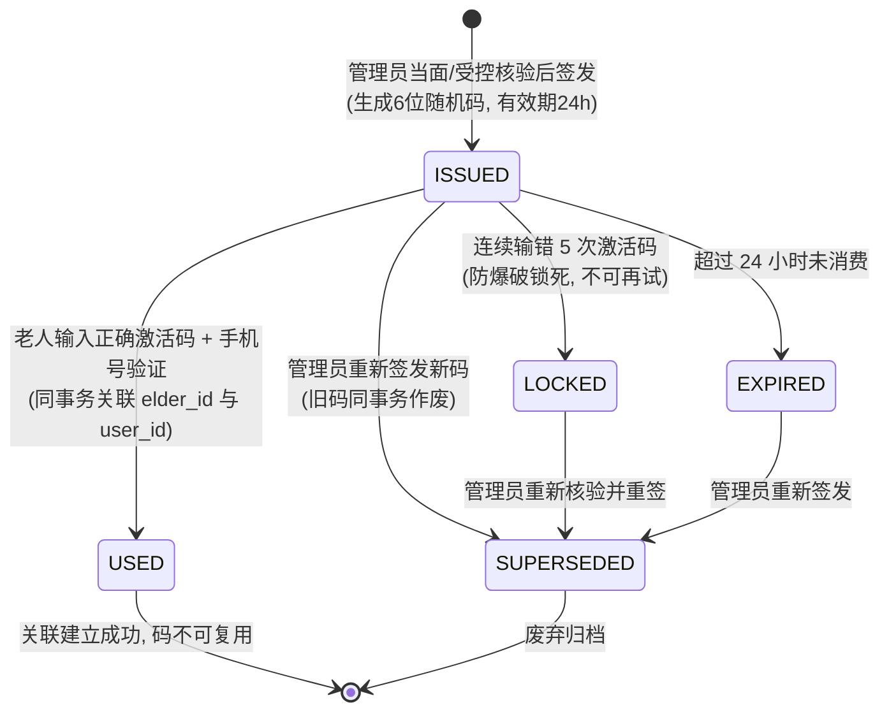
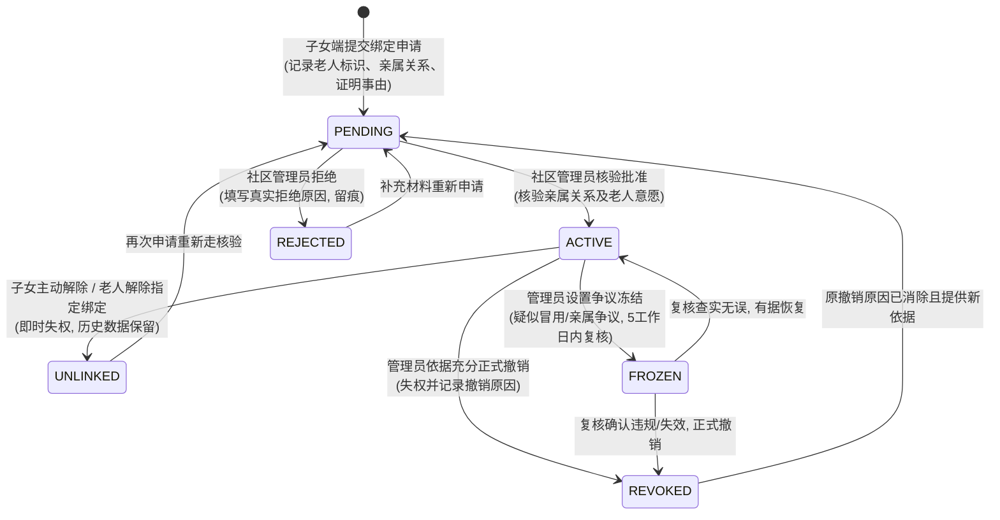
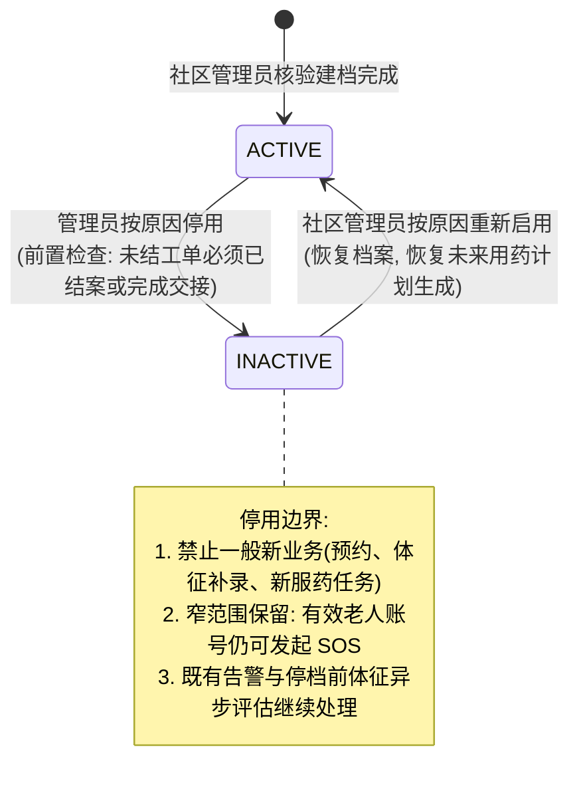
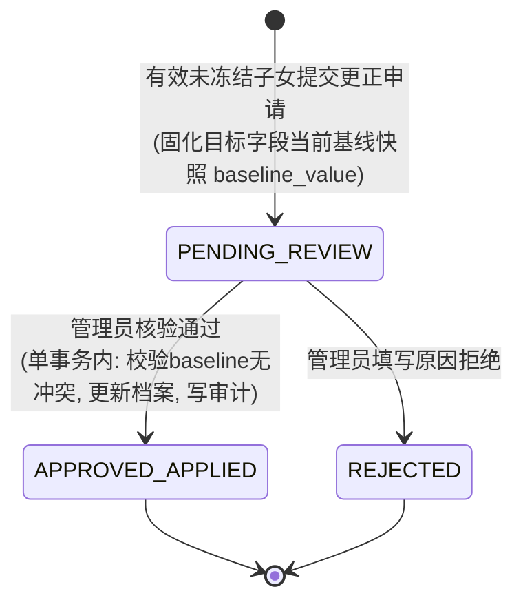

# M01 身份认证与 M02 老人档案原型与交互设计说明书（现行工作稿）

本文只保留页面交互与目标行为。2026-10-25 的原型代码映射、实现状态和测试叙述保存在[整理前快照](../archive/2026-10-26-before-document-consolidation/原型与交互设计_M01_M02.md)；实际执行结果见[隔离联调记录](../validation/系统隔离联调记录_2026-10-26.md)。设计描述不表示所有交互已经通过验收。

## 1. 业务范围与角色分流架构

### 1.1 账号体系与四角色入口映射

系统采用**统一账号体系与双端分离入口**，业务账号分为 `FAMILY`（家庭用户）与 `STAFF`（工作人员）两大独立体系，严格禁止跨体系兼任：

* **老人角色（`ELDER`）**：由社区管理员先建立业务档案，老人凭 6 位一次性激活码首次激活账号并完成身份关联。界面为大字适老模式。
* **子女角色（`CHILD`）**：支持自主注册，未通过社区管理员亲情绑定核验前，无权访问任何老人健康或业务数据。
* **双角色兼任（老人 + 子女）**：允许同一手机号账号兼有 `ELDER` 和 `CHILD` 角色。两种模式的页面数据上下文严格隔离，切换入口时重新向服务端请求当前角色权限，不自动互通数据。
* **网格员 / 护工（`GRID_WORKER` / `CARE_WORKER`）**：由社区管理员分配，仅能查看分配给本人的工单及执行所需脱敏信息。
* **社区管理员（`COMMUNITY_ADMIN`）**：负责本社区的老人建档、激活码签发、亲情绑定审批、争议冻结及工单调度。
* **系统运维人员**：独立运维身份，不分配为业务角色，默认禁止直接通过业务界面浏览老人健康或亲情隐私数据。

### 1.2 会话时限与自动撤销规则

| 客户端环境 | 空闲超时时限 | 绝对有效时限 | 自动失效/撤销条件 |
| :--- | :--- | :--- | :--- |
| **Web 管理端** | 30 分钟无操作 | 12 小时 | 密码重置、换号成功、角色变更、主动退出、账号停用 |
| **小程序端** | 7 天无操作 | 30 天 | 密码重置、换号成功、角色变更、主动退出、账号停用 |

*注：静默短轮询、心跳或查询不延长空闲时限；解绑或冻结亲情关系立即撤销对应老人的数据访问权限，但不强制退出子女账号。*

---

## 2. 核心状态流转图（Mermaid）

### 2.1 老人 6 位一次性激活码生命周期状态机

激活码是老人档案关联登录账号的安全凭据，生命周期如下：

### 2.2 亲情绑定与授权关系生命周期状态机

亲情关系是子女访问老人数据的唯一合法授权依据，状态流转如下：

### 2.3 老人档案状态机

### 2.4 档案更正申请闭环状态机（FZ-01）

---

## 3. 各端涉及页面的低保真结构表

### 3.1 通用认证与分流页面

#### 页面 P-01：双端统一登录页（小程序 / Web）

| 布局区块 | 核心字段 / 元素 | 校验规则 / 约束 | 按钮 / 交互动作 |
| :--- | :--- | :--- | :--- |
| **品牌区** | 平台 Logo、系统名称“社区居家养老服务系统” | 适老化大图标，清晰无干扰 | - |
| **表单区** | 手机号输入框 (`phone`) | 必填，中国大陆 11 位手机号格式 | 自动过滤空格/横杠 |
| | 登录密码输入框 (`password`) | 必填，长度 ≥ 8 位，密码明文隐藏切换 | 提供眼睛图标切换明文 |
| **辅助区** | 角色入口提示文案 | 提示“老人首次使用请先激活” | 点击“首次激活”跳转 P-05；点击“子女注册”跳转 P-07 |
| **操作区** | 登录按钮 (`btn_submit`) | 防连击（防重复点击），支持加载状态 | 提交登录，触发 `/api/v1/auth/login` |
| | 找回密码链接 | - | 点击跳转 P-13 密码恢复 |

#### 页面 P-02：多角色入口选择页（仅限兼任角色用户）

| 布局区块 | 核心字段 / 元素 | 校验规则 / 约束 | 按钮 / 交互动作 |
| :--- | :--- | :--- | :--- |
| **标题区** | “请选择本次登录的工作模式” | 明确告知用户角色相互隔离 | - |
| **卡片 A** | “老人模式”（`ELDER`） | 仅当账号拥有有效 `ELDER` 角色时展示 | 点击进入老人端大字首页 |
| **卡片 B** | “子女监护模式”（`CHILD`） | 仅当账号拥有有效 `CHILD` 角色时展示 | 点击进入子女端监护首页 |
| **说明区** | 角色权限隔离提示文案 | 提示“登录后可在个人中心随时切换” | - |

---

### 3.2 Web 管理端（社区管理员工作区）

#### 页面 P-03：社区管理员 - 老人档案列表与建档表单

| 布局区块 | 核心字段 / 元素 | 校验规则 / 约束 | 按钮 / 交互动作 |
| :--- | :--- | :--- | :--- |
| **查询区** | 姓名、档案编号、联系电话、状态（全部/在档/已停用） | 仅限本社区所属档案 | 搜索、重置 |
| **新建表单：基本信息** | 老人姓名 (`name`) | 必填，1~20 字符 | 失去焦点自动查重提示 |
| | 性别 (`sex`) | 枚举：男 / 女 / 未说明 | 单选组 |
| | 出生日期 (`birth_date`) | 日期选择器，不可选未来日期；若缺失必须填写缺失原因 | 校验合法性 |
| | 身份证号 (`id_number`) | 可选；若填写执行 18 位身份证校验，后端 HMAC 查重唯一 | 掩码存储与展示 |
| **新建表单：联系方式** | 联系电话 (`contact_phone`) | 可选；若未填写，`contact_phone_missing_reason` 必填 | 互斥校验 |
| | 现居地址 (`address`) | 必填，详细街道门牌号 | 文本输入 |
| **新建表单：紧急联系人** | 紧急联系人姓名/关系/电话 | 可选；任一缺失必须分别记录对应缺失原因 | 表单级联动校验 |
| **操作区** | 建档确认按钮 (`btn_create`) | 校验查重结果，若有重复嫌疑需弹窗复核 | 提交建档，成功后提示是否立即签发激活码 |

#### 页面 P-04：社区管理员 - 激活码签发与重签弹窗

| 布局区块 | 核心字段 / 元素 | 校验规则 / 约束 | 按钮 / 交互动作 |
| :--- | :--- | :--- | :--- |
| **对象摘要** | 老人姓名、档案编号、归属社区、当前关联账号状态 | 展示是否已有账号关联 | - |
| **历史状态** | 最近签发时间、有效截止时间、当前状态（有效/已消费/已锁死/已过期） | 显示当前是否存在有效码 | - |
| **交付记录项** | 交付方式 (`delivery_type`) | 必选：当面交付老人 / 代理人代领 | 单选下拉 |
| | 监护/代理人核验依据 (`proxy_reason`) | 若为代理人代领，必填合法代理依据说明 | 文本输入 |
| **操作区** | “生成新激活码” 按钮 | 同一档案 24h 内最多 3 次；旧码立即作废 | 生成 6 位随机码，弹窗醒目展示 |
| **展示区** | **6 位一次性数字激活码** | 仅显示一次！大字字号，带安全复制提示 | 弹窗关闭后不可再次查看明文 |

#### 页面 P-10：社区管理员 - 亲情绑定核验与争议管理列表

| 布局区块 | 核心字段 / 元素 | 校验规则 / 约束 | 按钮 / 交互动作 |
| :--- | :--- | :--- | :--- |
| **标签页** | 待审核 (`PENDING`) / 生效中 (`ACTIVE`) / 争议冻结 (`FROZEN`) / 历史记录 | 标签切换，展示待办徽标计数 | 切换列表视图 |
| **列表项** | 申请人（子女姓名、手机号）、老人姓名、亲属关系称谓、证明事由、申请时间 | 仅展示本社区管辖老人 | - |
| **核验动作区** | 批准按钮 (`btn_approve`) | 仅 `PENDING` 态可用 | 弹出确认框，记录操作日志，同事务生效 |
| | 拒绝按钮 (`btn_reject`) | 仅 `PENDING` 态可用，**拒绝原因必填** | 弹窗输入原因并提交，通知子女 |
| | 争议冻结按钮 (`btn_freeze`) | 仅 `ACTIVE` 态可用，**冻结原因必填** | 设置为 `FROZEN`，启动 5 工作日复核倒计时 |
| | 解除冻结/恢复 (`btn_unfreeze`) | 仅 `FROZEN` 态可用，**恢复依据必填** | 恢复为 `ACTIVE` 态 |
| | 正式撤销绑定 (`btn_revoke`) | `ACTIVE` 或 `FROZEN` 可用，**撤销依据必填** | 设为 `REVOKED`，阻断权限 |

#### 页面 P-12：社区管理员 - 档案更正审批工作台（FZ-01）

| 布局区块 | 核心字段 / 元素 | 校验规则 / 约束 | 按钮 / 交互动作 |
| :--- | :--- | :--- | :--- |
| **基本信息** | 申请子女姓名、老人档案号、申请理由、提交时间 | 申请时固化的申请版本 | - |
| **比对表格** | 字段名称 \| 申请时原值快照 (`baseline`) \| 当前最新数据库值 \| 子女建议更正值 | 标红高亮冲突值（若当前值 ≠ baseline） | 自动识别并发冲突 |
| **审批决策** | 批准更正按钮 (`btn_apply`) | 若存在字段冲突禁止批准，返回冲突提示 | 单事务更新档案并结案申请 |
| | 驳回申请按钮 (`btn_reject`) | **驳回理由必填** | 标记 `REJECTED` 并通知子女 |

---

### 3.3 小程序端（老人模式）

#### 页面 P-05：老人端 - 首次激活与账号绑定页

| 布局区块 | 核心字段 / 元素 | 校验规则 / 约束 | 按钮 / 交互动作 |
| :--- | :--- | :--- | :--- |
| **大字引导** | “老人身份激活”、“请输入社区为您提供的6位数字卡号” | 字号 ≥ 20px，高对比度 | 语音播报按钮（朗读操作指引） |
| **凭证输入** | 6 位数字激活码 (`activationCode`) | 6 个大输入格，自动聚焦下一个，数字键盘 | 输入满 6 位自动校验格式 |
| | 老人本人手机号 (`phone`) | 11 位有效手机号 | - |
| | 短信验证码 (`smsCode`) | 6 位数字，60 秒重发冷却 | 获取验证码按钮（大按钮） |
| | 设置登录密码 (`password`) | ≥ 8 位字符 | 简易密码规则，便于老人或家属代设 |
| **操作区** | **“确认激活”大按钮** | 尺寸 ≥ 48×48 CSS px；连续输错 5 次前端锁定 | 触发激活事务，成功后直接进入老人首页 |
| **帮助区** | 遇到困难联系社区电话 | 点击直接拨打网格员或社区电话 | 拨号唤起 |

#### 页面 P-06：老人端 - 个人资料与联系信息修改页

| 布局区块 | 核心字段 / 元素 | 校验规则 / 约束 | 按钮 / 交互动作 |
| :--- | :--- | :--- | :--- |
| **只读信息** | 姓名、身份证号（脱敏）、所属社区、档案编号 | 老人本人不可随意更改，显示“如需变更请联系社区” | 只读展示 |
| **可维护项** | 联系电话 (`contact_phone`) | 老人本人有权修改，支持留空（但需选原因） | 允许直接输入 |
| | 居住地址 (`address`) | 老人本人有权修改 | 文本输入 |
| | 紧急联系人姓名、关系、电话 | 老人本人有权修改 | 字段组合维护 |
| **保存操作** | “保存修改”按钮 | 携带当前 `row_version`，检测版本冲突 | 提交保存，成功后语音或弹窗大字提示 |

---

### 3.4 小程序端（子女模式）

#### 页面 P-07：子女端 - 账号注册页

| 布局区块 | 核心字段 / 元素 | 校验规则 / 约束 | 按钮 / 交互动作 |
| :--- | :--- | :--- | :--- |
| **表单区** | 手机号 (`phone`) | 11 位手机号，查重未被使用 | - |
| | 短信验证码 (`smsCode`) | 6 位数字 | 倒计时发送 |
| | 登录密码 (`password`) | ≥ 8 位，包含字母与数字组合 | 强度提示 |
| **协议区** | 服务协议与隐私保护勾选框 | 必选 | 勾选协议 |
| **操作区** | 注册并登录按钮 | 注册成功直接自动分配 `CHILD` 角色会话 | 跳转子女空态首页（提示添加绑定老人） |

#### 页面 P-08：子女端 - 亲情绑定申请页

| 布局区块 | 核心字段 / 元素 | 校验规则 / 约束 | 按钮 / 交互动作 |
| :--- | :--- | :--- | :--- |
| **老人信息** | 老人姓名 (`elder_name`) | 必填，用于精确比对档案 | - |
| | 老人身份证号 或 档案编号 | 二选一必填，防止误绑他人 | 格式校验 |
| | 所属社区 (`community_id`) | 下拉选择社区，限定核验归属 | - |
| **关系声明** | 与老人关系 (`relationship`) | 枚举：父母、祖父母、其他亲属、指定监护人 | 单选下拉 |
| | 申请附言与证明事由 (`apply_reason`) | 必填，简述监护情况 | 文本域，限 200 字 |
| **操作区** | “提交绑定申请”按钮 | 携带幂等键，防重复提交 | 提交后进入“审核中”等待页 |

#### 页面 P-09：子女端 - 监护首页与多老人切换组件

| 布局区块 | 核心字段 / 元素 | 校验规则 / 约束 | 按钮 / 交互动作 |
| :--- | :--- | :--- | :--- |
| **顶部切换栏** | 当前选中老人卡片：老人姓名、年龄、档案编号、当前关系状态标签（正常 / 审核中 / 已冻结） | 下拉或横向滑动展示已关联老人列表；提供“+ 添加关注老人”入口 | 点击切换老人上下文；切换后**清空上一老人所有页面状态与缓存**，重新加载当前老人数据 |
| **主体功能区** | 健康监测卡片、用药计划入口、助老服务预约入口 | 严格依赖当前老人的授权状态（`ACTIVE` 开放，其他状态拦截） | 点击进入相应业务模块 |
| **关系管理** | “解绑此老人”链接按钮 | 二次弹窗确认：“解绑后将无法继续查看老人健康与服务进度” | 提交解绑，状态变 `UNLINKED`，即时失权 |
| | “申请更正老人档案资料”入口 | 仅关系为 `ACTIVE` 且未冻结时可点击 | 点击进入 P-11 |

#### 页面 P-11：子女端 - 老人档案更正申请页（FZ-01）

| 布局区块 | 核心字段 / 元素 | 校验规则 / 约束 | 按钮 / 交互动作 |
| :--- | :--- | :--- | :--- |
| **当前资料** | 展示当前老人的居住地址、联系电话、紧急联系人信息 | 显示当前权威值 | - |
| **申请更正项** | 勾选更正字段：地址 / 电话 / 紧急联系人 | 至少勾选一项更正 | 动态展开对应的新值输入框 |
| | 建议更正后的新值 | 校验输入格式 | - |
| | 更正理由说明 (`reason`) | 必填，详细说明为何更正（如老人搬家、换号） | 限 200 字 |
| **操作区** | “提交更正申请”按钮 | 固化当前字段 baseline 快照，生成更正申请单 | 提交后进入审批待办跟踪 |

---

### 3.5 密码找回与人工核验页面

#### 页面 P-13：统一密码恢复与账号人工核验申请页

| 布局区块 | 核心字段 / 元素 | 校验规则 / 约束 | 按钮 / 交互动作 |
| :--- | :--- | :--- | :--- |
| **找回方式** | Tab 1: 手机验证码自助找回 \| Tab 2: 原手机号不可用人工申诉 | 标签切换 | - |
| **自助找回** | 注册手机号、短信验证码、新密码（≥8位） | 验证码验证通过后方可设置新密码 | 提交后撤销所有会话，要求重新登录 |
| **人工申诉** | 用户姓名、证件号码、原手机号、现联系电话、申诉原因说明 | 提交至所属社区管理员后台核验 | 提交人工核验工单，提示“社区将在 2 个工作日内核验” |

---

## 4. 完整的交互四态定义

| 交互状态 | 适用场景 | 小程序端视觉与交互表现 | Web 管理端视觉与交互表现 |
| :--- | :--- | :--- | :--- |
| **空态 (Empty)** | • 子女端尚未绑定任何老人 • 管理员待审核绑定列表为空 • 更正申请列表为空 | 居中展示温和友好的插画与大字提示：“暂无监护的老人”，正下方提供主操作大按钮：“+ 申请绑定老人”。 | 表格区域居中展示 Element Plus 空状态组件（`el-empty`），提示“暂无待处理的亲情绑定申请”，无多余干扰。 |
| **加载态 (Loading)** | • 登录与激活校验网络请求 • 亲情申请提交中 • 切换老人加载数据中 | 页面覆盖半透明遮罩与大尺寸 Loading 动效，主按钮置灰禁用并显示“正在处理中，请稍候...”，**严格阻止重复点击**。 | 表格区域展示骨架屏或局部 `v-loading` 转圈动效，操作按钮置为 `loading=true` 状态，禁止重复提交表单。 |
| **失败态 (Error)** | • 激活码输错（剩余次数提醒） • 激活码连续 5 次输错锁死 • 登录密码错误 • 更正申请并发冲突 (409) | • 激活码错误：输入框红色边框抖动，提示“激活码错误，还剩 X 次重试机会”； • 锁死：大红色告警卡片提示“该激活码已失效，请联系社区重新签发”； • 冲突：轻提示弹窗“老人资料在此期间已被更新，请刷新重试”。 | 页面顶部弹出持久警示条或表单字段下方标红错误文本，对于 409 状态冲突弹窗提示具体冲突字段并提供“刷新最新数据”快捷按钮。 |
| **无权 / 冻结拦截态 (Unauthorized / Frozen Interception)** | • 亲情绑定为 `PENDING`（审核中） • 亲情绑定为 `FROZEN`（争议冻结） • 亲情绑定已 `UNLINKED` 或 `REVOKED` • 老人档案处于 `INACTIVE`（已停用） • 会话过期 (401) | • **审核中拦截**：页面展示时钟图标黄色提示框：“亲情绑定申请正在社区审核中，暂无法查看健康与用药数据”； • **冻结拦截**：警示黄/橙色卡片：“监护关系已被社区临时冻结（复核中），访问权限已暂停，如有疑问请联系社区管理员”； • **档案停用**：老人端顶部横幅提示“档案已暂停”，除 **SOS 紧急求助按钮**保持可用外，其他业务按钮均置灰禁用； • **401 过期**：自动清空本地 token，弹窗提示“登录已过期，请重新登录”，点击确定平滑返回登录页。 | • **无权拦截**：页面提示 `403` 无权限访问当前社区或对象，严禁透露未授权老人敏感内容； • **401 过期**：自动清除 Cookie/会话，跳转回后台登录页并携带 `redirect` 参数。 |

---

## 5. 交互落地与验收映射（对应验收测试 AT）

本交互规格直接覆盖下列需求与验收场景：
* **AT-01 / AT-15**：四角色登录与会话失效边界（P-01, P-02）；
* **AT-14**：老人 6 位激活码签发、错误 5 次锁死、重签作废旧码与激活绑定闭环（P-04, P-05）；
* **AT-02 / AT-20**：亲情关系申请、审批、解绑失权、争议冻结与多老人切换隔离（P-08, P-09, P-10）；
* **AT-18**：老人档案建立、字段缺失原因联动与档案本人维护（P-03, P-06）；
* **AT-18 (FZ-01)**：档案更正申请提交、快照比对、并发冲突与原子审批（P-11, P-12）；
* **AT-16**：密码找回与人工核验重置（P-13）。

---
