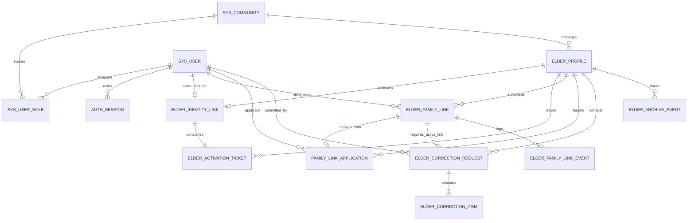

# M01/M02 数据库物理设计与数据字典说明书（现行工作稿）

> **现行工作文档。** 本文件依据 [跨模块设计基线](./跨模块设计.md) §2、[E-01 专项设计](./modules/E-01.md) §7、[E-02 专项设计](./modules/E-02.md) §8 及 [M01/M02 交互设计说明书](./原型与交互设计_M01_M02.md) 编制。
> 本规范落实项目工程门槛 **`M01/02-02 D2 物理数据库`**，定义了 Flyway 物理迁移脚本 `V2__m01_m02_identity_and_archive.sql` 所落地的全部 16 张物理数据表、索引、约束及合成演示种子数据。

---

## 1. 物理数据库规范与全局原则

1. **引擎与字符集**：存储引擎统一为 `InnoDB`，字符集 `utf8mb4`，排序规则 `utf8mb4_0900_ai_ci`。
2. **主键与外键规范**：
   * 内部关系型主键一律采用 MySQL 有符号 `BIGINT AUTO_INCREMENT`；
   * 非秘密定位符、会话 ID、安全挑战 ID 采用 `CHAR(36)` (UUID)；
   * 严格禁止 `ON DELETE CASCADE` 物理级联删除；状态变更写当前状态并追加领域事件历史。
3. **时间与瞬间**：
   * 时间戳字段统一以 `_at` 结尾，物理类型固定为 `DATETIME(3)`；
   * 数据库连接会话明确固定时区 `Asia/Shanghai`（底层存储按 UTC 瞬间对齐）。
4. **并发控制与版本号**：
   * 涉及并发写入的业务聚合根（`elder_profile`, `elder_family_link`, `elder_correction_request`）统一配置 `row_version BIGINT NOT NULL DEFAULT 1` 乐观锁字段。
5. **安全与脱敏要求**：
   * 登录密码保存 PBKDF2-HMAC-SHA-256 版本化哈希（`password_hash`），不存明文；
   * 激活码仅保存 6 位数字的 HMAC-SHA256 摘要（`code_mac BINARY(32)`），明文仅在签发时返回一次；
   * 身份证号码如采集则加密存储，查重索引采用规范化 HMAC-SHA256 摘要（`id_number_lookup_hmac CHAR(64)`），密钥不入库。

---

## 2. 物理数据表清单（16 张表）

| 序号 | 表名 | 中文名称 | 所属数据域 | 核心职责 |
| :---: | :--- | :--- | :--- | :--- |
| 1 | `environment_maintenance_gate` | 全局维护门闩表 | 基础设施 (D1) | 单行表，Level 00 互斥门闩，用于重置与备份互斥 |
| 2 | `sys_community` | 社区管辖表 | 组织架构 (M01/02) | 社区管辖区域、网格归属权威实体 |
| 3 | `sys_user` | 系统业务账号表 | 认证中心 (M01) | 统一手机号账号、密码哈希、账号生命周期状态 |
| 4 | `sys_user_role` | 用户角色分配表 | 授权体系 (M01) | 账号与角色（老人/子女/网格员/护工/管理员）及社区范围映射 |
| 5 | `auth_session` | 服务端会话管理表 | 认证中心 (M01) | 不透明令牌 SHA-256 摘要、会话过期与即时撤销流水 |
| 6 | `elder_profile` | 老人业务档案表 | 业务核心 (M02) | 独居/空巢老人基础资料、紧急联系人、乐观锁版本 |
| 7 | `elder_activation_ticket` | 激活码签发记录表 | 认证业务 (M01) | 6位一次性数字激活码、输错5次锁死、作废旧码与交付审计 |
| 8 | `elder_identity_link` | 档案账号关联表 | 身份关联 (M02/01) | 双向唯一约束：`elder_id` 与 `user_id` 强绑定，消费激活票据 |
| 9 | `family_link_application` | 亲情绑定申请流水 | 亲情关系 (M02) | 子女提交绑定申请历史、证明事由、审批结论留痕 |
| 10 | `elder_family_link` | 亲情授权关系表 | 授权关系 (M02) | 子女对老人数据访问的权威授权状态机（ACTIVE/FROZEN 等） |
| 11 | `elder_correction_request` | 档案更正申请表 | 档案闭环 (M02/FZ-01) | 子女更正申请、审批流水与并发冲突控制（baseline 对比） |
| 12 | `elder_correction_item` | 档案更正明细项表 | 档案闭环 (M02/FZ-01) | 固化目标字段 baseline 快照值、建议值与审批前后值 |
| 13 | `elder_archive_event` | 档案变更领域事件表 | 领域审计 (M02) | 档案建档、停用、恢复及资料变更的追加历史 |
| 14 | `elder_family_link_event` | 亲情关系变更事件表 | 领域审计 (M02) | 亲情申请、审批、解绑、争议冻结与撤销的历史事件追加 |
| 15 | `phone_verification_challenge`| 短信验证安全挑战表 | 账号安全 (M01) | 注册、激活、恢复、换号验证码的 HMAC 摘要与防刷挑战 |
| 16 | `phone_change_request` | 手机号变更申请表 | 账号安全 (M01/FZ-02) | 原号验证/人工申诉/新号验证多阶段换号流转与安全通知 |

---

## 3. 核心物理 ER 关系图

---

## 4. 关键物理约束与并发控制设计

### 4.1 激活码与老人账号双向唯一绑定
* **物理约束**：
  * `elder_identity_link.elder_id` 建立 `UNIQUE KEY uk_identity_elder`；
  * `elder_identity_link.user_id` 建立 `UNIQUE KEY uk_identity_user`；
  * `elder_identity_link.linked_by_activation_ticket_id` 建立 `UNIQUE KEY uk_identity_ticket`。
* **业务保证**：一份老人档案最多绑定一个老人登录账号，一个账号不可绑定多个老人，一张激活票据不可二次消费。

### 4.2 亲情绑定唯一性与授权代次
* **物理约束**：
  * `elder_family_link` 建立复合唯一索引 `UNIQUE KEY uk_family_elder_child (elder_id, child_user_id)`；
* **授权代次 (`link_generation`)**：
  * 每次子女解绑重申、或撤销后重新核验，递增 `link_generation`；
  * 更正申请等业务必须校验提交时的 `applicant_link_generation` 是否与当前一致，防止旧授权并发操作复活已解除关系。

### 4.3 档案更正 baseline 快照比对（FZ-01）
* **存储设计**：
  * `elder_correction_item.baseline_value_protected`：记录子女提交时该字段在数据库的基线值；
  * `elder_correction_item.proposed_value_protected`：记录子女建议的新值；
* **并发检测**：
  * 审批事务中通过 SQL 比对 `elder_profile` 字段当前值与 `baseline_value_protected`；
  * 若当前值已发生变化，审批直接以 `409 FIELD_VALUE_CONFLICT` 阻断并记录 `block_code`，杜绝脏写与并发覆盖。

---

## 5. 演示环境合成种子数据验证

合成演示数据存放在 [`database/seed/demo_synthetic_seed_m01_m02.sql`](../../database/seed/demo_synthetic_seed_m01_m02.sql)，首次导入入口为 [`ops/windows/load-demo-seed.ps1`](../../ops/windows/load-demo-seed.ps1)；只有目标库为空且写入静默时才运行。

### 覆盖的核心测试角色与状态表

| 用户角色 / 实体 | 标识 / 手机号 | 初始测试状态 | 对应演示场景与用途 |
| :--- | :--- | :--- | :--- |
| **社区管理员** | `13800000001` (user_id=1) | `ACTIVE` / `COMMUNITY_ADMIN` | 登录管理后台、核验建档、签发激活码、亲情审批与争议冻结 |
| **网格员 / 护工** | `13800000002` (user_id=2) | `ACTIVE` / `GRID_WORKER` | 登录工作台、工单执行接单与服务结果上传 |
| **老人（张建国）** | `13800000003` (elder_id=1, user_id=3) | `ACTIVE` / `ELDER` (已激活) | 小程序老人模式登录、大字首页、查看体征、用药打卡与 SOS |
| **老人（李秀英）** | 无账号 (elder_id=2) | `ACTIVE` / 待激活 (未关联账号) | 验证 6 位激活码 (`123456`) 首次输入与账号绑定流程 |
| **老人（王大明）** | `13800000010` (elder_id=3) | `ACTIVE` / 涉及争议 | 演示监护争议冻结与复核流程 |
| **子女 1（张伟）** | `13800000004` (user_id=4) | 与张建国处于 **`ACTIVE`** 绑定 | 正常监护老人、查看健康数据、提交档案更正申请 |
| **子女 2（李强）** | `13800000005` (user_id=5) | 与张建国处于 **`PENDING`** 申请 | 演示“待管理员审核”拦截态，提示审核中无法查看健康数据 |
| **子女 3（王芳）** | `13800000006` (user_id=6) | 与王大明处于 **`FROZEN`** 争议冻结 | 演示“争议冻结（5工作日复核）”黄色警示拦截态 |
| **档案更正申请** | `request_id=1` (张伟提交) | `PENDING_REVIEW` | 演示管理员后台高亮对比原值（baseline）与新值，原子审批 |

### 实际迁移与验证证据
1. **Flyway V2 迁移执行**：
   * 迁移脚本：`services/api/src/main/resources/db/migration/V2__m01_m02_identity_and_archive.sql`；
   * 执行耗时：497 ms，`flyway_schema_history` 状态为 `success=1`；
   * 后端 Actuator 检查：`http://127.0.0.1:8080/actuator/health` 返回 `status: UP`。
2. **种子数据导入核验**：
   * 脚本执行：`./ops/windows/load-demo-seed.ps1`；
   * 导入统计：6 个系统账号、3 份老人档案、3 条亲情关系（ACTIVE/PENDING/FROZEN）、1 单带 baseline 的档案更正申请。
