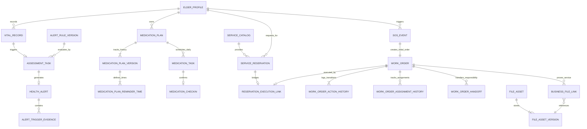

# M03–M12 核心业务物理数据库设计与数据字典说明书（现行工作稿）

> **现行工作文档。** 本文件依据 [需求与范围说明书 (SRS)](./需求与范围.md)、[跨模块设计基线](./跨模块设计.md) 及系统 Flyway 物理迁移脚本编制。
> 本规范落实系统核心业务域物理数据库设计，覆盖 Flyway 迁移脚本 `V3__core_business_schema.sql`、`V3_1`—`V3_10` 中已提供的迁移，以及其所落地的 **30 张核心业务物理数据表**、字段规范、索引体系与级联外键约束。
> （基础认证与档案的 16 张表参见 [M01/M02 数据库设计说明书](./数据库设计_M01_M02.md)）。

---

## 1. 物理数据库规范与全局原则

1. **存储引擎与字符集**：
   - 存储引擎统一采用 MySQL `InnoDB`，支持 ACID 事务、行级锁与外键约束；
   - 字符集统一为 `utf8mb4`，排序规则统一为 `utf8mb4_0900_ai_ci`。
2. **主键与标识符设计**：
   - 内部关系主键统一采用无符号/有符号 `BIGINT AUTO_INCREMENT`，以确保 B+ 树自增聚簇索引写入性能；
   - 外部业务编号采用具备业务语义的前缀编码（如工单号 `WO + 年月日时分秒 + 随机后缀`、资产 UUID `CHAR(36)`）。
3. **时间与瞬间**：
   - 时间戳统一采用 `DATETIME(3)` 精确到毫秒，字段命名以 `_at` 结尾（如 `created_at`, `occurred_at`）；
   - 日期统一采用 `DATE`（如 `task_date`, `service_date`），时间点统一采用 `TIME`（如 `scheduled_time`）；
   - 服务端及数据库连接会话明确固定时区为 `Asia/Shanghai`。
4. **并发控制与版本号**：
   - 强并发写聚合根（如 `work_order` 核心工单表）统一配置 `row_version BIGINT NOT NULL DEFAULT 1` 乐观锁版本字段，更新时采用 CAS（`WHERE work_order_id = ? AND row_version = ?`），冲突时抛出 409 Conflict。
5. **软删除与历史追加原则**：
   - 严格禁止物理级联删除（`ON DELETE CASCADE`），关键业务实体变更一律采用状态迁移，并在对应的历史流转表（如 `work_order_action_history`, `work_order_assignment_history`）中追加不可变日志。
6. **安全与脱敏规范**：
   - 防刷限流（`auth_rate_limit`）中的手机号与 IP 不直接存明文，采用服务端密钥的 HMAC-SHA-256 摘要存库（`BINARY(32)`）；
   - 文件资产统一保存为受控存储相对路径与 SHA-256 校验摘要，前端通过专用控制器鉴权流式读取。

---

## 2. 物理数据表清单（30 张表）

| 序号 | 表名 | 中文名称 | 所属数据域 | 核心职责 |
| :---: | :--- | :--- | :--- | :--- |
| 1 | `idempotency_record` | 跨模块通用幂等记录表 | 基础设施 (M12) | 记录客户端 `Idempotency-Key`、请求摘要与原响应体，实现幂等重放 |
| 2 | `audit_log` | 全局安全审计日志表 | 基础设施 (M12) | 记录全系统关键写操作人、所属社区、目标实体、操作类型与脱敏明细 |
| 3 | `auth_rate_limit` | 登录防刷限流表 (V3.1) | 认证安全 (M01/M12) | 基于 HMAC 散列的手机号与 IP 登录失败频次窗口与冷却锁死控制 |
| 4 | `vital_record` | 老人健康体征记录表 | 体征监测 (M03) | 存储老人血压、血糖、心率、体温等体征实测值与采集来源 |
| 5 | `alert_rule_version` | 预警规则版本表 | 健康预警 (M05) | 固化体征三级超标预警阈值 JSON，支持规则多版本演进与可追溯 |
| 6 | `assessment_task` | 体征自动评估任务表 | 健康预警 (M05) | 体征录入后异步触发的评估任务，绑定固定规则版本，失败可重试 |
| 7 | `health_alert` | 老人健康异常预警表 | 健康预警 (M05) | 记录超标生成的预警事件，追踪等级、待处理状态与管理员结案处置 |
| 8 | `alert_trigger_evidence` | 预警触发证据快照表 | 健康预警 (M05) | 固化告警生成瞬间的实测值、阈值指标及上下文 JSON 快照 |
| 9 | `sos_event` | 老人主动 SOS 求助事实表 | 应急救助 (M10) | 记录长辈端长按触发的紧急求助，原子关联初始派生工单 |
| 10 | `simulation_control` | IoT 设备仿真控制表 | 仿真测试 (M03/M10) | 控制老人虚拟体征的数据生成周期、波动幅度与异常注入概率 |
| 11 | `medication_plan` | 老人用药计划总表 | 日常用药 (M04) | 记录长期/短期用药计划聚合根，关联当前生效不可变版本号 |
| 12 | `medication_plan_version` | 用药计划不可变版本表 | 日常用药 (M04) | 保存用药方案历史快照，计划调整次日生效，历史版本不可覆盖 |
| 13 | `medication_plan_reminder_time` | 用药每日提醒时点表 | 日常用药 (M04) | 维护特定版本用药计划每日多次提醒的时钟点（如早 08:00、午 12:00） |
| 14 | `medication_task` | 每日服药打卡任务表 | 日常用药 (M04) | 每日零点系统自动为长辈快照生成的当日待打卡任务实例 |
| 15 | `medication_checkin` | 老人服药打卡记录表 | 日常用药 (M04) | 记录长辈实际服药打卡确认事实，含打卡方式与幂等防重 |
| 16 | `service_catalog` | 社区助老服务目录表 | 养老服务 (M06) | 维护助餐、保洁、就医陪诊等标准服务分类、指导价格与服务说明 |
| 17 | `service_reservation` | 居家养老服务预约申请表 | 养老预约 (M06) | 老人/子女提交的上门预约申请，含 V3.2 动态槽位去重生成列 |
| 18 | `reservation_execution_link` | 预约与工单原子映射表 | 调度协调 (M06/M07) | 固化预约受理与派生工单的唯一对应关系，保障事务一致性 |
| 19 | `reservation_cancel_request` | 预约取消申请流水表 | 养老预约 (M06) | 记录预约确认前自主取消或确认后需审批取消的原因与审批历史 |
| 20 | `service_stop_request` | 现场服务执行中止申请表 | 工单履约 (M08) | 护工上门现场遭遇突发状况（如老人不在家/送医）申请中止事实留痕 |
| 21 | `work_order` | 社区助老与应急工单主表 | 核心履约 (M07/M08) | 工单状态机核心表，含乐观锁版本号、现场凭证照片列表 (V3.3) |
| 22 | `work_order_assignment_history` | 工单派单与改派历史表 | 工单调度 (M07) | 记录社区管理员派单、改派、护工拒单退回的历史责任轨迹 |
| 23 | `work_order_action_history` | 工单状态流转操作日志表 | 核心履约 (M07/M08) | 记录工单从派单到结案全链路每一步的状态变迁、操作人与表单快照 |
| 24 | `work_order_handoff` | 现场服务责任交接表 | 工单履约 (M08) | 护工现场突发换人交接班时的双方交接确认与管理员批准留痕 |
| 25 | `notification_event` | 系统领域通知事件表 | 消息通知 (M11) | 业务触发的消息通知聚合根，含业务去重键与多角色模板 |
| 26 | `notification_delivery` | 逐收件人通知投递流水表 | 消息通知 (M11) | Outbox 投递队列，支持站内信短轮询、已读状态及失败重试机制 |
| 27 | `file_asset` | 受控业务文件资产主表 | 证据管理 (M08/M12) | 统一管理工单照片、证件材料等文件资产元数据与对外 UUID |
| 28 | `file_asset_version` | 文件资产物理版本表 | 证据管理 (M08/M12) | 记录文件本地受控相对存储路径、文件大小、MIME 类型及 SHA-256 摘要 |
| 29 | `business_file_link` | 业务实体与文件凭证关联表 | 证据管理 (M08/M12) | 权威关联工单、档案更正与具体文件版本，支持服务前后多照片打标 |
| 30 | `file_upload_session` | 工单照片上传暂存表 (V3.10) | 证据管理 (M08) | 将已校验的资产版本绑定到工单和上传人；暂存记录本身不构成履约凭证 |

---

## 3. 核心物理 ER 拓扑图



---

## 4. 重点物理表结构与数据字典详解

### 4.1 助老预约表 (`service_reservation`) & 动态槽位生成列 (V3.2)
本表承载长辈及子女的上门服务预约。V3.2 引入 `active_slot_key` **持久化虚拟生成列**（STORED Generated Column），当预约为已取消或已拒绝时生成列值为 `NULL`，巧妙释放唯一索引槽位，避免老人取消后无法再次预约同一时段。

```sql
CREATE TABLE `service_reservation` (
    `reservation_id` BIGINT NOT NULL AUTO_INCREMENT COMMENT '预约主键ID',
    `elder_id` BIGINT NOT NULL COMMENT '老人档案ID',
    `applicant_user_id` BIGINT NOT NULL COMMENT '申请人用户ID (子女或老人本人)',
    `community_id` BIGINT NOT NULL COMMENT '归属社区ID',
    `service_type` VARCHAR(32) NOT NULL COMMENT '服务大类: DAILY_CARE, MEDICAL_ESCORT, CLEANING, MEAL_DELIVERY',
    `service_date` DATE NOT NULL COMMENT '预约上门日期 (YYYY-MM-DD)',
    `slot_code` VARCHAR(16) NOT NULL COMMENT '时段编码: MORNING_1 (08:00-10:00), MORNING_2 (10:00-12:00), AFTERNOON_1 (14:00-16:00), AFTERNOON_2 (16:00-18:00)',
    `service_address` VARCHAR(255) NOT NULL COMMENT '服务地点快照',
    `contact_phone` VARCHAR(20) NOT NULL COMMENT '现场联系电话',
    `special_notes` VARCHAR(255) NULL COMMENT '长辈特殊健康状况/叮嘱',
    `status` VARCHAR(24) NOT NULL DEFAULT 'PENDING_CONFIRMATION' COMMENT '状态: PENDING_CONFIRMATION, CONFIRMED, REJECTED, CANCELLED, SERVICE_STOPPED',
    `reviewer_user_id` BIGINT NULL COMMENT '确认受理工单的社区管理员ID',
    `confirmed_at` DATETIME(3) NULL COMMENT '确认受理时间',
    `idempotency_key` VARCHAR(80) NOT NULL COMMENT '提交预约幂等键',
    `active_slot_key` VARCHAR(128) GENERATED ALWAYS AS (
        CASE
            WHEN `status` IN ('CANCELLED', 'REJECTED', 'SERVICE_STOPPED') THEN NULL
            ELSE CONCAT(`elder_id`, '#', `service_type`, '#', `service_date`, '#', `slot_code`)
        END
    ) STORED COMMENT '有效预约防冲突生成键（仅有效状态非空）',
    `created_at` DATETIME(3) NOT NULL DEFAULT CURRENT_TIMESTAMP(3) COMMENT '创建时间',
    `updated_at` DATETIME(3) NOT NULL DEFAULT CURRENT_TIMESTAMP(3) ON UPDATE CURRENT_TIMESTAMP(3) COMMENT '更新时间',
    PRIMARY KEY (`reservation_id`),
    UNIQUE KEY `uk_active_elder_service_slot` (`active_slot_key`),
    UNIQUE KEY `uk_reservation_idempotency` (`idempotency_key`),
    INDEX `idx_reservation_elder_status` (`elder_id`, `status`),
    INDEX `idx_reservation_community_date` (`community_id`, `service_date`)
) ENGINE=InnoDB DEFAULT CHARSET=utf8mb4 COLLATE=utf8mb4_0900_ai_ci COMMENT='居家养老服务预约申请表';
```

---

### 4.2 核心工单表 (`work_order`) & 履约凭证照片 (V3.3)
工单表是全系统线下履约调度的核心。配置了 `row_version` 实现乐观锁并发防护；在 V3.3 中扩充 `photo_urls` 字段支持存储现场照片凭证 URL（以分号分隔）。

```sql
CREATE TABLE `work_order` (
    `work_order_id` BIGINT NOT NULL AUTO_INCREMENT COMMENT '工单主键ID',
    `order_no` VARCHAR(32) NOT NULL COMMENT '工单编号 (如 WO202610250001, 全局唯一)',
    `source_type` VARCHAR(24) NOT NULL COMMENT '来源: SOS(紧急求助), RESERVATION(预约), HEALTH_ALERT(告警派生), MANUAL(人工录入)',
    `source_reference_id` VARCHAR(64) NOT NULL COMMENT '来源主键标识',
    `elder_id` BIGINT NOT NULL COMMENT '服务长辈档案ID',
    `community_id` BIGINT NOT NULL COMMENT '归属社区ID',
    `service_type` VARCHAR(32) NOT NULL COMMENT '服务类型',
    `order_title` VARCHAR(128) NOT NULL COMMENT '工单标题摘要',
    `order_description` TEXT NULL COMMENT '详细要求或现场情况',
    `urgency_level` VARCHAR(16) NOT NULL DEFAULT 'NORMAL' COMMENT '紧急程度: NORMAL(普通), URGENT(紧急, 如SOS)',
    `status` VARCHAR(32) NOT NULL DEFAULT 'PENDING_DISPATCH' COMMENT '状态机: PENDING_DISPATCH, PENDING_ACCEPT, ACCEPTED, PROCESSING, PENDING_RESULT_REVIEW, CLOSED, VOIDED, TERMINATED_PRE_ACCEPTANCE, SERVICE_STOPPED',
    `current_assignee_id` BIGINT NULL COMMENT '当前分配的护工用户ID (CARE_WORKER)',
    `dispatch_time` DATETIME(3) NULL COMMENT '派单时间',
    `accept_time` DATETIME(3) NULL COMMENT '护工接单时间',
    `service_start_time` DATETIME(3) NULL COMMENT '上门服务开始时间',
    `service_finish_time` DATETIME(3) NULL COMMENT '现场服务结束时间',
    `service_result_summary` TEXT NULL COMMENT '服务总结与长辈反馈',
    `result_photo_required` TINYINT(1) NOT NULL DEFAULT 1 COMMENT '是否必须上传现场照片 (1:是, 0:否)',
    `photo_exemption_reason` VARCHAR(255) NULL COMMENT '免照申请说明 (如涉及老人更衣等隐私豁免)',
    `photo_urls` TEXT NULL COMMENT '现场履约凭据照片URL列表 (分号分隔，V3.3新增)',
    `reviewer_user_id` BIGINT NULL COMMENT '审核结案管理员ID (禁止本人自审本人执行)',
    `reviewed_at` DATETIME(3) NULL COMMENT '审核结案时间',
    `review_comment` VARCHAR(500) NULL COMMENT '审核意见',
    `row_version` BIGINT NOT NULL DEFAULT 1 COMMENT '并发控制乐观锁版本号',
    `created_at` DATETIME(3) NOT NULL DEFAULT CURRENT_TIMESTAMP(3) COMMENT '建单时间',
    `updated_at` DATETIME(3) NOT NULL DEFAULT CURRENT_TIMESTAMP(3) ON UPDATE CURRENT_TIMESTAMP(3) COMMENT '更新时间',
    PRIMARY KEY (`work_order_id`),
    UNIQUE KEY `uk_work_order_no` (`order_no`),
    INDEX `idx_order_community_status` (`community_id`, `status`),
    INDEX `idx_order_elder_status` (`elder_id`, `status`),
    INDEX `idx_order_assignee_status` (`current_assignee_id`, `status`)
) ENGINE=InnoDB DEFAULT CHARSET=utf8mb4 COLLATE=utf8mb4_0900_ai_ci COMMENT='社区助老服务与应急工单主表';
```

---

### 4.3 日常用药计划与打卡表 (`medication_plan`, `medication_task`, `medication_checkin`)
针对慢性病长辈每日按时服药需求，设计“计划聚合根 -> 不可变版本快照 -> 每日生成任务 -> 单次打卡事实”四层物理结构。
- **任务唯一性约束**：`uk_med_task_identity (plan_id, task_date, scheduled_time)` 确保同一计划在同一天同一时刻不会重复生成打卡任务；
- **打卡唯一性约束**：`uk_checkin_task (task_id)` 确保一个任务仅能产生一次有效服药打卡记录，彻底杜绝并发重复计费或重复打卡。

```sql
CREATE TABLE `medication_task` (
    `task_id` BIGINT NOT NULL AUTO_INCREMENT COMMENT '任务ID',
    `elder_id` BIGINT NOT NULL COMMENT '老人档案ID',
    `plan_id` BIGINT NOT NULL COMMENT '所属计划ID',
    `version_no` INT NOT NULL COMMENT '生成任务时引用的不可变版本号',
    `task_date` DATE NOT NULL COMMENT '任务所属自然日 (YYYY-MM-DD)',
    `scheduled_time` TIME NOT NULL COMMENT '计划服用时间 (HH:mm:ss)',
    `medicine_name` VARCHAR(128) NOT NULL COMMENT '药品快照',
    `dosage` VARCHAR(64) NOT NULL COMMENT '剂量快照',
    `status` VARCHAR(32) NOT NULL DEFAULT 'PENDING' COMMENT 'PENDING: 待服用, CONFIRMED: 已按时打卡, OVER_WINDOW_UNCONFIRMED: 过窗未确认',
    `confirmed_at` DATETIME(3) NULL COMMENT '打卡确认时间',
    `created_at` DATETIME(3) NOT NULL DEFAULT CURRENT_TIMESTAMP(3) COMMENT '任务生成入库时间',
    PRIMARY KEY (`task_id`),
    UNIQUE KEY `uk_med_task_identity` (`plan_id`, `task_date`, `scheduled_time`),
    INDEX `idx_med_task_elder_date` (`elder_id`, `task_date`, `status`)
) ENGINE=InnoDB DEFAULT CHARSET=utf8mb4 COLLATE=utf8mb4_0900_ai_ci COMMENT='每日服药任务实例表';

CREATE TABLE `medication_checkin` (
    `checkin_id` BIGINT NOT NULL AUTO_INCREMENT COMMENT '打卡记录ID',
    `task_id` BIGINT NOT NULL COMMENT '服药任务ID',
    `elder_id` BIGINT NOT NULL COMMENT '老人档案ID',
    `checkin_time` DATETIME(3) NOT NULL COMMENT '打卡提交时间',
    `checkin_mode` VARCHAR(24) NOT NULL DEFAULT 'SELF_CONFIRMED' COMMENT '打卡方式: SELF_CONFIRMED(老人自主点击), VOICE_CONFIRMED(语音确认)',
    `actual_status` VARCHAR(24) NOT NULL DEFAULT 'TAKEN' COMMENT 'TAKEN: 已服用',
    `idempotency_key` VARCHAR(80) NOT NULL COMMENT '打卡幂等键',
    PRIMARY KEY (`checkin_id`),
    UNIQUE KEY `uk_checkin_task` (`task_id`)
) ENGINE=InnoDB DEFAULT CHARSET=utf8mb4 COLLATE=utf8mb4_0900_ai_ci COMMENT='老人服药打卡确认记录表';
```

---

### 4.4 健康体征监测与异常预警表 (`vital_record`, `health_alert`, `sos_event`)
- `vital_record` 接收高低压、血糖等数据，支持人工与仿真标记（`source_type`）；
- `health_alert` 记录异常预警事件，外键强约束 `elder_id` 与 `vital_id`；
- `sos_event` 记录突发求助，包含触控防抖时长 `press_duration_ms`（必须 ≥ 2000ms），并在同事务内强绑定初始生成的应急工单 `initial_work_order_id`。

---

### 4.5 跨模块通用幂等表 (`idempotency_record`)
为关键写接口（创建工单、服药打卡、发起预约、触发 SOS）提供全系统通用幂等防护。
- **复合唯一约束**：`uk_idempotency_scope_key (principal_scope, operation_scope, idempotency_key)`；
- **重放保障**：存储完整的 `response_status`、`response_body` (MEDIUMTEXT) 与 `trace_id`；
- **异内容冲突识别**：比对 `request_hash`（正文 SHA-256），相同键若入参不同则立即返回 409。

---

### 4.6 全局操作审计日志表 (`audit_log`)
不可篡改的操作流水审计。详细记录操作者 ID、角色、社区 ID、受控对象类型、动作、成败结果及全局请求追踪号 `trace_id`。

---

### 4.7 文件资产、履约关联与上传暂存表
`file_asset` 标识对外资产 UUID，`file_asset_version` 保存受控相对路径、原始文件名、大小、MIME 和 SHA-256；新文件上传只创建待使用资产版本。`file_upload_session` 将该版本关联到工单及上传人，暂存不能作为结案证据。护工提交结果时，服务端校验 UUID 对应的工单、大小和摘要，在同一事务中创建 `business_file_link` 并把确切版本 ID 写入提交历史；审核和结案会再次校验文件存在及摘要。旧版本保留，重新提交不会覆盖历史。

文件通过专用控制器读取。新资产的读取需通过当前角色、工单归属及凭证版本权限校验，并返回 `private, no-store` 与 `X-Content-Type-Options: nosniff`。历史 `photo_urls` 兼容读取只针对旧存储路径和能唯一关联工单的记录；历史文件尚无 SHA-256 记录，不能据此宣称通过摘要完整性校验。
