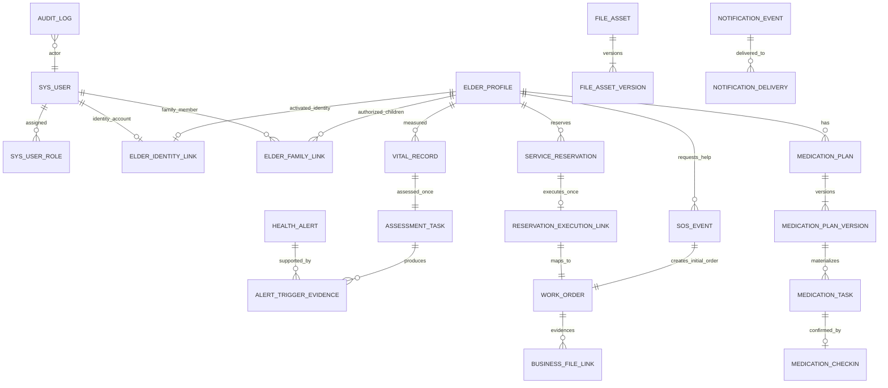

# 跨模块设计（现行工作稿）

> **现行工作文档。** 本文件由[2026-10-25 原始资料](../archive/2026-10-25-before-live-docs/design/E-01—E-07集成设计基线_v1.1_2026-10-24.md)建立，后续设计和实现可直接修订本文件。原文中的版本、冻结、批准和‘下一步’等表述记录其形成时点；目前是否实现、通过测试，以新的运行记录为准。改变需求范围、权限或关键业务规则时，在[变更记录](./变更记录.md)登记原因与影响。

**来源日期：** 2026-10-24\
**来源说明：** 原集成设计 v1.1 吸收统一 API、状态机与全局锁顺序建议稿的审议结论；旧版保存在历史资料中。\
**适用需求：** [现行需求与范围](./需求与范围.md)\
**适用总体设计：** [现行总体设计](./总体设计.md)\
**当前状态：** 跨专项逻辑模型、共同 API 规则和跨模块状态映射已有工作口径；物理 DDL、完整端点字段表和运行验收尚未完成。专项细节与共享规则冲突时，先核对现行需求，再修订相关工作文件。

## 1. 效力、范围与决策层级

本文件维护统一逻辑数据模型、统一 API 与状态机、需求追踪及实施依赖。这里的规则仍需通过数据库迁移、代码和运行测试落实；本文本身不是验收结果。

决策优先级如下：

1. [现行需求与范围](./需求与范围.md)中的业务规则和非本期边界；
2. [现行总体设计](./总体设计.md)；
3. 本文件给出的共享实体、接口、安全、状态协调和实现顺序；
4. E-01—E-07 专项文档中的模块细节。若专项候选与前三项冲突，专项候选须在编码前修订。

本期只面向隔离的开发、测试和演示环境，使用虚构或合成数据；不在此处扩大生产级保留、设备接入或灾备承诺。

## 2. 统一数据模型

### 2.1 数据类型、时间和标识

| 数据项 | 统一规则 |
| --- | --- |
| 内部关系型主键 | 本期逻辑模型统一使用 MySQL BIGINT（有符号）；同一外键两端类型、符号和精度必须完全一致。此项是无既有代码规范前的工程约定，不是 SRS 业务要求；若工程基座发现已批准的 ID 规范，只能在 D1 一次性核对并整体替换。 |
| 对外标识 | 不以“ID 难猜”代替授权。只有会话、一次性票据、上传会话等确有不透明标识需求时才使用 UUID/CHAR(36)；业务关系仍通过一致类型的内部主外键表达。 |
| 时间瞬间 | 逻辑字段统一命名为 *_at，物理存储使用 DATETIME(3)，按 UTC 写入/读取，数据库连接明确固定 UTC。不得混用 TIMESTAMP(3)、无精度 DATETIME 与本地时间表达同类瞬间。 |
| 业务自然日/时刻 | 日期用 DATE，每日提醒墙上时刻用 TIME(0)；预约、打卡、通知窗口和统计按 Asia/Shanghai 计算。API 时间戳使用带时区的 ISO-8601；服务端时间权威。 |
| 幂等与追踪 | 可重试写操作统一使用 Idempotency-Key 请求头；正文不再重复定义同义幂等字段。持久化追踪字段为 trace_id，API 响应使用 traceId。规范化请求摘要采用版本化规范 JSON 的 SHA-256，不保存秘密明文。 |
| 版本控制 | 可并发更新的聚合根使用 row_version 整数递增。状态命令携带预期版本；过期请求不得采用最后写入覆盖。 |
| 软删除与外键 | 业务对象没有普通物理删除接口；关系/历史外键不得 ON DELETE CASCADE。状态变更写当前状态和追加历史，不以删除替代撤销、解绑、停用或结案。 |

关系主键类型是统一工程选型，不提升为业务规则。表名、列长度、索引、MySQL 版本兼容和迁移 SQL 在 DDL 阶段冻结。

### 2.2 权威逻辑实体与交叉引用

逻辑实体可合并为较少物理表，但其业务身份、唯一性与历史语义不能合并丢失。

| 数据域 | 权威逻辑实体 | 关键关系和唯一约束 | 历史/删除规则 |
| --- | --- | --- | --- |
| 账号与角色（M01） | `sys_user`、`sys_user_role`、`auth_session` | 规范化手机号唯一；有效角色分配按 `(user_id, role_code, community_id)` 唯一；会话 token 摘要唯一 | 手机号变更不换 `user_id`；角色撤销、账号停用撤销会话但不级联删除档案、关系或业务；保留角色变更审计。 |
| 老人身份关联（M02 定义，M01 调用） | 单一定义 elder_identity_link(link_id, elder_id, user_id, linked_by_activation_ticket_id, linked_at) | elder_id、user_id 双向唯一；两个内部外键均为 BIGINT 并分别指向 elder_profile、sys_user；激活票据使用不透明 ID、唯一消费 | 不另设独立 status；关联可用性由账号状态和关联存在性判定。账号停用/换号不删除关联。若未来需要解除身份关联，须先批准业务规则和显式历史流程。 |
| 老人档案（M02） | `elder_profile` | `archive_no` 唯一；可选证件号码以规范化 HMAC 唯一；`community_id` 外键；`row_version` 并发控制 | `ACTIVE/INACTIVE`；停用原因、状态事件追加保存；无证件号码时重复候选核验留证。档案停用不删除或自动取消关联对象。 |
| 亲情授权（M02） | `family_link_application`、`elder_family_link`、`elder_family_link_event` | 申请历史独立；当前 `(elder_id, child_user_id)` 关系唯一；同时最多一个待审申请；重新申请使用新申请 ID 和递增 `link_generation` | 关系状态 `PENDING/ACTIVE/FROZEN/REJECTED/UNLINKED/REVOKED`；状态事件追加；旧授权代次请求不得复活。解绑/冻结/撤销即时失权，历史仍留存。 |
| 档案更正/状态（M02） | `elder_correction_request`、`elder_correction_item`、`elder_archive_event` | 更正字段项归属申请；申请提交版本和关系代次固化；档案与事件变更同事务 | 申请状态 `PENDING_REVIEW/APPROVED_APPLIED/REJECTED`；实际修改才记录 before/after；业务事件表不替代 M12 审计。 |
| 幂等（跨模块） | `idempotency_record` | 逻辑唯一范围为 `(principal_scope, operation_scope, idempotency_key)`；`principal_scope` 是认证主体或服务端识别的匿名安全上下文，`operation_scope` 由 HTTP 方法和版本化规范路由模板构成；存规范化请求摘要及原业务结果引用 | `Idempotency-Key` 只放请求头。相同主体、接口和键的同摘要重放原结果，异摘要返回 409。匿名上下文不可由客户端任意声明；物理字段与匿名流程映射在 D2 冻结。记录保留期须长于模块最大重试期限。 |
| 体征/评估/告警（M03/M05/M12） | `vital_record`、`alert_rule_version`、`assessment_task`、`health_alert`、`alert_trigger_evidence` | 每条已接受体征最多一项首次评估任务；`(assessment_task_id, alert_category)` 证据唯一；规则版本生效区间不得重叠；告警固定锚点不可改 | 体征、规则版本、评估尝试和触发证据追加保留；失败重试沿用首次任务固定版本；正常体征不关闭告警；告警与工单各自状态化。 |
| SOS 与工单（M05/M06） | `sos_event`、`work_order`、`work_order_assignment_history`、`work_order_handoff`、`work_order_action_history` | 每个 SOS 幂等请求最多一条 SOS 与一条初始紧急工单；历史记录引用老人、社区、操作者和来源 | SOS 是不可删除的主动求助事实；工单状态历史、分配历史和提交审核版本追加保留；管理员处理终止 SOS 工单不删除 SOS。 |
| 用药（M04） | `medication_plan`、`medication_plan_version`、`medication_plan_reminder_time`、`medication_task`、`medication_checkin` | `(plan_id, version_no)` 唯一；每版本提醒时刻唯一；任务逻辑身份 `(plan_id, task_date, scheduled_time)` 唯一；每任务最多一条有效打卡 | 计划版本不可原位覆盖；日期任务保留创建时快照；停档/停计划不删除任务/打卡；过窗状态不是漏服。 |
| 预约与执行关联（M07/M06） | `service_reservation`、`reservation_slot_claim`、`reservation_cancel_request`、`service_stop_request`、`reservation_execution_link` | 有效时段键 `(elder_id, service_type, service_date, normalized_slot_code)` 唯一；`reservation_execution_link.reservation_id` 唯一且 `work_order_id` 唯一；执行关联行不复制工单状态 | 预约、申请和执行关联分别保留历史。终态释放时段占用与状态转换同事务；每预约最多一条执行流程。预约状态不替代工单状态。 |
| 通知逻辑契约（M11） | notification_event、notification_delivery | 事件含 policy_scope、来源对象、事件类型/阶段和唯一去重键；投递按事件、目标、渠道去重 | 业务状态与逻辑事件同事务；外发在事务外。每次发送/重试重验当前授权。N01_BUSINESS 严格遵守 SRS N-01；FZ02_SECURITY 独立遵守换号目标核验规则，不并入 N-01、不含老人业务详情。两种策略可由同一逻辑契约承载，物理表映射留 D2 冻结。 |
| 文件与证据（M06/M11） | file_object、file_asset、file_asset_version、business_file_link、file_upload_session | file_asset_version 指向物理对象；business_file_link 是业务归属和具体版本的唯一权威关系；(asset_id, version_no) 唯一 | file_asset 不重复保存物理对象或业务归属；暂存不等于证据；审核固定引用实际审核的版本。历史版本/业务链接保留，废弃与物理清理走独立授权流程。 |
| 通用审计（M12） | 统一逻辑契约 audit_log | 审计 ID、操作者/角色/社区快照、对象、动作、结果、发生时间、trace_id；按权限查询 | 只追加，业务用户不能编辑；关键状态变更与必需审计同事务。elder_archive_event、alert_action_log、工单/预约历史仍是领域历史，不替代通用审计；不得另建语义重复的第二套通用审计表。 |
| 仿真（M10） | `simulation_control`、`simulation_run_unit` | 控制代次/配置版本；执行单元 ID 和样本关联唯一 | stop 与领取新单元在同一控制行串行化；已领取单元可完成当前原子写入；停止不回滚已接受样本。 |
| 演示重置（M12） | `demo_reset_job`、`demo_reset_item` | 同一环境/数据集只允许一个活动作业；幂等键唯一 | 重置仅作用于预检后冻结的明确合成数据清单；审计、重置作业、系统配置、迁移记录和备份不属于默认目标。失败分段留检查点。 |
| 联合备份/恢复（部署/M12） | `backup_manifest`、`backup_file_manifest`、`restore_job` | 备份集 ID 唯一；数据库、文件、配置清单与摘要属于同一一致性点 | 只有通过核验的 `VALIDATED` 备份集可用于正式恢复；恢复目标隔离至所有检查成功。最近 7 份已验证日备份保留；重大变更前备份单独标记，保留期限须在部署冻结时补定。 |

### 2.3 统一关系图（逻辑）

图示是业务关系，不要求每个方框独立建物理表。所有历史事实在清理策略批准前禁用自动物理清理；正式演示重置仅可按授权清单删除合成数据，审计及重置作业记录保留在目标范围外。

### 2.4 跨模块锁序候选与事务边界

本表是跨专项统一的**静态候选顺序**，不是已验证的数据库锁表。它尚未经过真实 SQL、执行计划、死锁注入和并发测试。事务只取得实际需要的行锁；同级多行按主键升序。实施前须逐事务记录锁行、锁范围、读写性质和提交点。

| 候选等级 | 锁对象 | 同级排序与适用场景 |
| ---: | --- | --- |
| 00 | `environment_maintenance_gate`（工程候选） | 普通写事务共享锁；演示重置和采用静默窗口的备份任务排他锁。须在 D1 决定是否采用此机制；不采用时须验证等效方案，并覆盖全部写入口。 |
| 10 | `idempotency_record` | 按 `(principal_scope, operation_scope, idempotency_key)` 锁定；同一请求只处理自己的幂等记录。幂等记录先于领域对象锁。 |
| 20 | `elder_activation_ticket` | 按 ticket ID；激活/重签事务中先于账号和档案。 |
| 21 | 手机验证、密码恢复及限流挑战记录 | 多条按主键升序；同一事务涉及激活票据时先票据、后挑战。 |
| 30 | `sys_user` | 多账号按 `user_id` 升序。 |
| 31 | `phone_change_request` | 先账号、后申请；多申请按主键升序。 |
| 40—43 | `elder_profile`、`elder_identity_link`、`sys_user_role`、`auth_session` | 先档案再身份关联；角色分配和会话按主键升序。账号角色变更先锁账号，随后撤销相关会话。 |
| 50 | `elder_family_link` | 多关系按 `link_id` 升序。 |
| 60 | `family_link_application`、`elder_correction_request` | 固定表优先级后按主键升序；审批先锁老人及需核验的当前关系，再锁申请。 |
| 70—73 | `medication_plan`、计划版本、`medication_task`、`medication_checkin` | 计划、版本、任务、打卡依次加锁；各类多行按主键升序，打卡仍由 `UNIQUE(task_id)` 兜底。 |
| 79 | `alert_rule_version` 时间线协调资源（仅规则切换/固定版本时） | 只在需要串行化规则生效区间或固定首次规则版本时取得；一般评估读取已固定版本，不为只读扩大锁范围。 |
| 80—83 | `vital_record`、`assessment_task`、`health_alert`/触发证据、`sos_event` | 多行按不可变主键升序；告警状态使用条件更新。SOS 作为不可删除的事件事实，与健康告警及工单分开。 |
| 90—93 | `service_reservation`、取消/中止申请、`reservation_execution_link`、`work_order`及分配/交接记录 | 预约 → 相关申请 → 执行关联 → 工单；多预约/工单按主键升序。所有预约—工单跨模块事务遵循此顺序。 |
| 100—105 | `file_upload_session`、`file_asset`、`file_object`、文件版本、`business_file_link`、废弃申请 | 若提交工单结果，先锁业务聚合根，再按此顺序处理文件；不得先锁上传会话再反锁工单。 |
| 110 | `notification_event`、`notification_delivery` | 业务事务只写必要 outbox；投递器领取并提交租约后释放投递行锁，再复核授权。 |
| 120 | `audit_log` 与领域历史追加记录 | 事务末尾追加；不再回锁业务聚合根。 |

**统一使用规则：** 从申请、任务、工单或上传会话 ID 进入时，可先普通只读查询定位关联 ID；真正写事务必须按候选等级加锁后重新读取并核验权限、状态、版本和关系。禁止先锁较高等级对象再反向锁较低等级对象。门闩等级 00 的具体实现及全写入口覆盖在 D1 决定；它尚未冻结。

预约取消与接单均按预约 → 相关申请（如需）→ 执行关联 → 工单加锁，并在一个事务中条件更新；只有一方成功。工单入口若关联预约，必须先只读定位预约 ID，再按该顺序加锁。档案停用先锁老人档案，再检查相关关系/申请/工单；用药写入先锁档案，再按需锁亲情关系及计划/任务；文件结果提交先锁工单，再锁上传会话和文件记录。

`simulation_control`/调度租约是独立协调锁：领取或停止判定完成后先提交释放，再进入普通业务事务；不得持有仿真控制锁等待档案或业务实体锁。所有短信、通知发送、对象存储 IO、长计算和备份文件复制均在业务事务外执行，或由已提交的 outbox/job 执行。

仅对明确可恢复的死锁/锁等待错误做有限的整事务重试。初始实现最多重试 2 次（共 3 次事务尝试）是待确认的工程建议；每次必须从事务起点重新读取并复核权限、授权、版本、状态和幂等结果。耗尽后使用 `503 INTERNAL_RETRY_EXHAUSTED`；不得盲目重放旧 SQL。

**必须同事务提交：** 业务状态、领域状态历史、幂等结果、必需的 audit_log，以及需可靠发送的通知逻辑事件/投递记录。外部网络发送不在数据库事务内，失败不回滚已提交业务。数据库与文件系统、备份/恢复不假设跨资源 ACID，须用文件/运维作业状态和补偿步骤处理。

**编码放行前的锁序核验清单：** 至少覆盖激活/重签、换号、亲情冻结/解绑、更正审批、档案停用/恢复、用药计划/打卡、体征评估/告警、SOS 建单、预约取消/接单/中止、文件提交、演示重置与一致性备份。并发验收应证明取消与接单仅一方成功、授权写入与冻结/解绑串行化、SOS 原子建单、维护窗口覆盖全部写入口，及仿真停止不回滚已接受样本。当前无真实数据库验证证据。

### 2.5 历史保留规则

| 类别 | 当前规则 | 允许清理的条件 |
| --- | --- | --- |
| 老人、账号/角色、身份关联、亲情关系/申请、档案更正、体征、评估、告警、SOS、计划/任务/打卡、预约/工单/分配/处理/审核/中止、通知逻辑事件、业务文件版本和 M12 审计 | 不因解绑、停用、拒绝、取消、结案、替换或普通模块操作自动删除；v1 演示实现默认无自动清理。 | 只有 SRS 明确允许的授权演示数据重置，且目标仅为明确标记的虚构/合成数据；必须保留审计/重置作业/配置/迁移记录，并验证引用关系。生产保留政策不在本期。 |
| 文件暂存、未提交上传和失效验证码/挑战 | 过期后立即不可用于业务；不得作为业务证据。 | 物理清理 TTL 由 M11/API 实现前补定；清理只触及未提交临时对象，审计/失败摘要保留。该 TTL 未补定前，不开放自动物理清理。 |
| 会话 token、幂等响应快照、限流窗口和投递技术租约 | 过期/撤销只改变可用性；历史操作审计仍保留。 | 物理清理周期须在 DDL/API 冻结清单中登记，并长于最大重试/排障窗口；清理不能删除业务结果或 M12 审计。未设定前关闭定时清理。 |
| 联合备份 | 最近 7 份已验证日备份保留；新备份验证通过前不得淘汰旧备份。重大变更前备份独立标识。 | 日备份超过 7 份时按可审计顺序淘汰最旧的已验证日备份；重大变更前备份保留期由部署专项冻结，不得默认混入 7 份轮换。 |

## 3. 统一 API、错误语义与状态机

### 3.1 API 共同约定

| 项目 | 统一契约 |
| --- | --- |
| 路径 | 所有业务接口必须完整使用 `/api/v1` 前缀。E-01 中省略此前缀的 `/auth/...` 示例规范化为 `/api/v1/auth/...`。 |
| 认证 | 服务端会话由 M01 管理；Web 使用安全 Cookie 并校验 CSRF，小程序使用 Bearer 凭证。每次请求服务端重验账号、角色分配、社区、对象归属和当前亲情授权；不能信任客户端提供的 user/role/community/status/source。 |
| 成功响应 | `{"code":"OK","message":"操作成功","traceId":"...","data":{...}}`。列表统一使用 `data.items/page/pageSize/total`；`page` 从 1 开始，`pageSize` 的默认值和上限在 D3 统一配置。 |
| 错误响应 | `{"code":"...","message":"...","traceId":"...","data":null}`；字段级错误放 `data.fieldErrors` 或端点定义的安全结构。仅调用者有权查看时才返回 `currentState`/`currentVersion`。不得返回 SQL、堆栈、凭证、内部路径或无权对象内容。 |
| 追踪 | 服务端生成 `traceId`，贯穿 API、业务日志、outbox、审计及作业记录；数据库字段统一 `trace_id`。可选响应头 `X-Trace-Id` 必须与 JSON 的 `traceId` 相同。`requestId` 仅可作为业务申请标识放入 `data`，不得当作追踪 ID。 |
| 幂等 | 所有会创建业务事实、推进状态或触发副作用的命令使用 `Idempotency-Key` 请求头；查询 GET 不需要。逻辑范围为 `(principal_scope, operation_scope, key)`：主体为认证用户或服务端识别的匿名安全上下文；操作范围由 HTTP 方法和版本化规范路由模板组成。请求摘要覆盖会改变业务结果的规范化输入。相同键/摘要重放原结果；相同范围键/异摘要返回 HTTP 409 `IDEMPOTENCY_KEY_REUSED`。 |
| 并发版本 | 有并发覆盖风险的聚合根写请求统一使用 JSON 字段 `expectedVersion`；不使用 `expectedRequestVersion`，也不在端点间混用 `If-Match`。服务端在事务内校验并条件更新；旧版本返回 HTTP 409，且不得留下部分副作用。 |
| 时间与分页 | 时间戳 ISO-8601 且带时区；业务日期 `YYYY-MM-DD`；提醒时刻 `HH:mm:ss`。分页排序字段白名单化；所有列表都按当前角色、社区、对象归属和授权范围在服务端过滤。 |
| 权限隐藏 | 登录无效为 401；已知且可见对象但角色/状态不允许为 403/409；读对象不存在或不可访问统一 404 `RESOURCE_NOT_FOUND_OR_NOT_ACCESSIBLE`。不能以错误码帮助猜测无权对象。 |
| 通知/文件 | 事务内只写 outbox；M11 外发器逐收件人实时复核权限。文件读取按当前授权检查，物理路径/storage key 不作为下载授权。 |

### 3.2 HTTP 与错误码目录

| HTTP | 统一错误码/规则 | 用途与客户端动作 |
| ---: | --- | --- |
| 200/201 | 成功使用 `OK` | 查询/状态命令成功为 200；创建资源成功为 201，并返回新资源标识。 |
| 202 | 已受理的异步作业 | 仅表示作业已创建/排队，不表示重置、备份或恢复已成功；返回 `jobId` 和初始状态。 |
| 400 | `VALIDATION_ERROR`（允许模块字段码） | 请求结构、类型或字段值非法；修正后提交。 |
| 401 | `AUTHENTICATION_REQUIRED`、`SESSION_EXPIRED`、`SESSION_REVOKED`；登录失败 `INVALID_CREDENTIALS` | 清理无效会话并重新认证；登录不泄露账号是否存在。 |
| 403 | `ACTION_NOT_ALLOWED` | 已识别且可见的资源上角色/社区权限不足。E-04 `ACCESS_DENIED` 归一到此码。 |
| 404 | `RESOURCE_NOT_FOUND_OR_NOT_ACCESSIBLE` | 对象不存在或对当前主体不可见。E-04 `RESOURCE_NOT_FOUND`、E-01/02/03 旧写法归一到此码。 |
| 409 | `STATE_CONFLICT`、`VERSION_CONFLICT`、`IDEMPOTENCY_KEY_REUSED` 或具体领域冲突码 | 状态/唯一约束/幂等冲突；由客户端刷新或用原键查询，不能盲目换键重建。领域码如 `RESERVATION_STATE_CONFLICT` 可保留，但 HTTP 和冲突行为统一。 |
| 422 | `BUSINESS_RULE_VIOLATION` 或具体领域码 | 格式有效但不满足业务范围/状态前提，如预约时间窗口。 |
| 413 | `FILE_TOO_LARGE` | 上传内容超过已冻结的文件上限；不截断后当作成功文件。 |
| 415 | `FILE_TYPE_NOT_ALLOWED` | 实际文件格式不允许；声明类型不能替代内容校验。 |
| 429 | `RATE_LIMITED` / `AUTH_COOLDOWN` | 返回安全的重试等待信息，不暴露账号内部状态。 |
| 500 | `INTERNAL_ERROR` | 返回 `traceId`；不暴露堆栈。 |
| 503 | `DEPENDENCY_UNAVAILABLE`、`RULE_VERSION_UNAVAILABLE`、`INTERNAL_RETRY_EXHAUSTED` 等 | 仅用于必需依赖不可用、无法安全确定规则或有限重试耗尽；客户端不得盲目生成新幂等键。 |

跨模块具体领域错误码、HTTP 映射和客户端动作见[统一 API/状态机/锁顺序建议稿的错误码注册表](../archive/2026-10-25-before-live-docs/design/专项设计集成复核_统一API状态机与全局锁顺序_v0.1_2026-10-24.md#3-统一错误码注册表)。该注册表是 D3 API 冻结的输入；端点不得另造同义码，SRS 的拒绝结果优先。

不得改变 SRS 结果来迁就错误码统一：例如停档 SOS 的已批准窄范围例外、通知失败不回滚、已接单预约不能普通取消仍按各自业务规则判定。

### 3.3 权威状态主体与迁移

同一字符串只在所属状态主体内解释。预约、执行关联、工单、告警、SOS、文件、通知和运维作业不得共享一个含义模糊的“通用终态”。

| 状态主体 | 状态/允许迁移 | 跨主体约束 |
| --- | --- | --- |
| 老人档案 | `ACTIVE ↔ INACTIVE`，均由本社区管理员按原因操作；停用前须完成未结工单结案或已完成责任交接。 | 停用不删除/取消既有业务；禁止一般新业务；仍有效且已认证的老人可走 SOS 例外。 |
| 亲情关系 | `PENDING→ACTIVE/REJECTED`；`ACTIVE→FROZEN/UNLINKED/REVOKED`；`FROZEN→ACTIVE/REVOKED`；重新申请是新申请/新代次，不直接复活旧关系。 | 仅账号有效且当前关系 `ACTIVE` 的授权范围可用；冻结、解绑、撤销立即失权。 |
| 用药计划/版本 | 计划新增/修改/停用/重启都生成不可变版本；新建默认次日生效，修改/停用/重启次日生效。 | 当日已生成任务快照不被覆盖；停档不生成普通新任务/提醒；恢复只补未来应有任务。 |
| 用药任务 | `PENDING→CONFIRMED`；跨到次日未确认变为 `OVER_WINDOW_UNCONFIRMED`；未来任务不可打卡。 | `CONFIRMED` 必须有关联本人声明的有效 check-in；过窗不等于漏服，不提供普通历史补打。 |
| 评估任务 | `PENDING→RUNNING→SUCCEEDED`；运行失败走 `FAILED_RETRYABLE→RUNNING` 或 `FAILED_FINAL`。 | 每体征只创建一项首次任务，规则版本创建时固定，重试不可换版。 |
| 健康告警 | `PENDING→PROCESSING/CLOSED`；`PROCESSING→CLOSED`；已结案不重开。 | 仅本社区管理员可改变告警状态/结案；工单结案不自动关闭告警；健康告警本身不等于工单。 |
| SOS | 接受后为不可删除的求助事实；管理员可在关联工单未进 `PROCESSING` 时对该工单专门置 `VOIDED`。 | SOS 接受、SOS 事实、唯一初始紧急工单、幂等结果、审计/outbox 同事务；`VOIDED` 不删除/改写 SOS。 |
| M06 工单 | `PENDING_DISPATCH→PENDING_ACCEPT→ACCEPTED→PROCESSING→PENDING_RESULT_REVIEW→CLOSED`；待接单可改派并重算计时；`PENDING_ACCEPT→PENDING_DISPATCH` 原因拒单；审核退回 `PENDING_RESULT_REVIEW→RETURNED→PROCESSING`。SOS 可在未进 `PROCESSING` 前专门进入 `VOIDED`。预约取消可使未接单关联工单进入 `TERMINATED_PRE_ACCEPTANCE`；批准服务中止使工单进入 `SERVICE_STOPPED`。 | `CLOSED` 仅正常审核完成；`VOIDED` 仅无效 SOS 管理终止；`TERMINATED_PRE_ACCEPTANCE` 仅确认预约取消且未接单；`SERVICE_STOPPED` 仅批准的服务中止。不同终态不得互换。 |
| M06 责任交接（建议统一方案） | 独立 `work_order_handoff`：`REQUESTED→ACCEPTED/REJECTED/CANCELLED`。发起交接不等于完成交接；接收人接受后，在同一事务更新当前承接人与分配历史。 | 不把已接单/处理中工单退回待派来清除进度；主工单状态保持原状态，处理提交和审核历史不变。工作人员失效后立即无访问权，由管理员发起交接；新承接人资格按 M06 重验。 |
| M07 预约 | `PENDING_CONFIRMATION→CONFIRMED/REJECTED/CANCELLED`；`CONFIRMED→CANCELLED/COMPLETED/SERVICE_STOPPED`。确认后取消请求 `PENDING_REVIEW→APPROVED/REJECTED`；中止请求独立 `PENDING_REVIEW→APPROVED/REJECTED`。 | 管理员确认时预约变 `CONFIRMED` 并在同事务生成 M06 `PENDING_DISPATCH` 工单及唯一执行关联。SRS 5.1 的 `PENDING_CONFIRMATION→PENDING_DISPATCH` 表示业务流程进入派单，不把该值写入预约状态列。取消审批只在尚未接单时批准；接单获胜后只能走独立中止。 |
| 文件资产/版本 | `UPLOAD_INITIATED→STAGED→VALIDATING→VALIDATED→ATTACHED_PENDING_COMMIT→ACTIVE`；替换成功旧版 `SUPERSEDED`；异常 `MISSING/QUARANTINED`；独立废弃后 `RETIREMENT_PENDING→RETIRED`；失败 `FAILED`。 | 仅 `ACTIVE` 且当前对象权限通过的版本可作为有效证据。上传阶段不能显示为工单已提交；普通接口不删除已提交版本。 |
| M11 业务通知 | 逻辑事件只创建一次；逐收件人 `PENDING→SENDING→SENT/RETRY_WAIT/SKIPPED/FAILED`，重试留在同一投递记录。 | 按 N-01 唯一事件/角色矩阵；每次发送/重试复核当前权限；新绑定不补发旧通知；无收件人与失败须留结果。 |
| 仿真执行单元 | `QUEUED→RUNNING→SUCCEEDED/FAILED/CANCELLED`。停止仿真取消未开始单元，阻止新领取；已开始单元完成或原子失败。 | 停止不回滚已接受的样本；来源标记由服务端生成。 |
| 演示重置 | `REQUESTED→REJECTED/PREPARED→RUNNING→DB_APPLIED→FILES_RECONCILED→VERIFYING→SUCCEEDED`；可进入 `PARTIAL_FAILURE/FAILED_NEEDS_RECOVERY`；未破坏性执行前可取消。 | `RUNNING` 后不宣称可简单撤销；按冻结目标清单和检查点续办；审计/配置/迁移/备份保留。 |
| 备份/恢复 | 备份仅 `VALIDATED` 可用；失败/部分失败不是恢复点。恢复从请求/预检/隔离准备依序进入数据库、文件、引用和应用核验，最后 `SUCCEEDED` 或 `PARTIAL_FAILURE/FAILED_NEEDS_RECOVERY`。 | 恢复目标验证前保持隔离；不把数据库恢复成功单独当作联合恢复成功。 |

### 3.4 关键跨模块事务矩阵

| 操作 | 必须同事务的本地数据库事实 | 事务外动作与失败处理 |
| --- | --- | --- |
| 老人首次激活 | 消费激活票、建立唯一 `elder_identity_link`、关联角色/幂等结果、审计 | 手机校验/通知须通过独立流程；不能重复关联。 |
| 更正申请批准 | 重新核验申请代次与目标字段版本；更新档案、申请结果、前后值、领域事件、审计 | 如存在外部通知走 outbox；冲突时任何字段不得部分更新。 |
| 体征接受/评估任务 | 保存体征、首次任务、固定规则版本、幂等、审计 | worker 重试沿固定版本；外发通知只走 outbox。 |
| SOS 接受 | SOS、唯一初始工单、来源关联、幂等结果、审计、通知 outbox | 提交后异步通知；通知失败不回滚 SOS。 |
| 预约确认 | 预约 `CONFIRMED`、M06 初始 `PENDING_DISPATCH` 工单、唯一执行关联、时段占用、状态历史、审计、必要 outbox | 同键重放返回原预约/工单；任何一个 DB 步骤失败全部回滚。 |
| 预约取消审批/接单 | 同顺序锁预约、执行关联、工单；预约与未接单工单终止、释放时段、历史、审计/outbox 一起提交 | 只有先提交的一方成功；败方收到冲突。若接单先成功，转中止路径。 |
| 服务中止审批 | 中止申请、预约 `SERVICE_STOPPED`、工单 `SERVICE_STOPPED`、必需字段、历史、审计/outbox 同事务 | 通知失败不回滚；已完成/未完成/后续安排不可丢。 |
| M06 处理结果提交 | 工单状态/处理版本、有效文件版本关联、审计/outbox 同事务 | 存储对象先验证可读；物理落盘和数据库不能原子时用文件作业状态，不让无效文件通过审核。 |
| 服药打卡 | check-in、任务状态、幂等结果、审计一起提交 | 通知调度需在提交后重判；同任务最多一个有效确认。 |

## 4. 需求追踪与验收矩阵

逐项关联见[《需求追踪矩阵 E-01—E-07》](./需求追踪.md)。矩阵以 SRS 的 BR/FR/NFR/Q/G/C/FZ/N/M/S 及 AT 编号为索引，标明专项设计落点、验收入口和状态。

状态判读统一为：

- **设计：** `集成口径已覆盖`、`初稿待模块细化`、`待补专项` 或 `待 DDL/API 冻结`；本文件形成不代表每个端点/字段均已完成评审。
- **实现：** 当前均为 `未开始`（本工作区只有项目文档，没有业务代码）。
- **测试：** 当前均为 `未测`；本轮没有执行代码、数据库、并发、文件、部署或 AT/A 验收。
- **证据：** 设计引用是文档证据，不是运行证据；运行证据未生成前统一为 `缺失`，禁止标“通过”。

## 5. 实施顺序和开工门槛

### 5.1 依赖顺序

| 阶段 | 范围与顺序 | 先决依赖/交付物 |
| --- | --- | --- |
| 0. 工程基座 | 明确实际源码仓库、前后端栈、MySQL 版本、运行环境、部署/存储目标、迁移方式及测试启动说明；本次文档工作区当前没有业务源码。 | 冻结环境清单和干净环境初始化路径；否则不得开始模块编码。 |
| 1. 共享支撑 | 数据库迁移骨架、认证上下文、全局 API 错误/trace、幂等服务、M12 `audit_log`、M11 逻辑事件/逐收件人 outbox 最小实现。 | 先冻结本基线共享实体、锁序候选/逐事务核验清单、通用响应和事务模板；高风险跨模块写操作须在锁序并发验证后放行。 |
| 2. 身份与档案 | E-01 → E-02：账号/会话/角色 → 老人档案/身份关联/亲情授权/更正/停用联动。 | M01 完成后才开放所有对象级 API；M02 的档案状态与关系授权检查供其他模块复用。 |
| 3. 工单骨架 | M06 核心工单/分配/接单/拒单/处理/审核/交接历史与状态条件更新。 | 先落实预约接单互斥、SOS 创建接口、责任交接规则；此阶段是 E-04、E-05 的强依赖。 |
| 4. 健康、SOS 与仿真 | E-04：体征、固定规则版本评估、健康告警、SOS 与紧急工单原子建单、仿真启停。 | 依赖 M01/M02、M06 状态骨架、M11 outbox 与 M12 审计。 |
| 5. 用药调度 | E-03：版本、日期任务、本人打卡、提醒/关怀和授权复核。 | 依赖 M01/M02、全域时间规则、M11 outbox；先证明提醒前生成与停机恢复。 |
| 6. 预约 | E-05：服务目录、预约、取消/中止审批、M06 执行关联。 | 依赖 M06 完整状态与锁序；预约确认/工单创建同事务，接单/取消竞态通过双向并发用例验证。 |
| 7. 文件与运维 | E-06 文件证据、受控读取、演示重置；之后 E-07 联合备份/恢复。 | E-06 依赖 M06 处理结果与 M11 文件服务；E-07 依赖已冻结文件清单、DB 迁移版本和具体部署/存储目标。 |
| 8. 其余模块与集成验收 | M08 适老界面、M09 看板及全系统 AT-01—41、NFR 实测。 | M08/M09 不在 E-01—E-07 中，需要单独模块详细设计；通过 AT-38—41 的实际平台、性能、部署和恢复验收。 |

E-03、E-04 可在共享支撑和 M01/M02 完成后并行开发，但 E-04 中 SOS 至少等 M06 工单骨架接口冻结；E-05 必须等 M06 状态模型。E-07 不能早于文件关联和部署目标冻结。

### 5.2 模块开工门槛（全部满足才允许开该模块）

1. 该模块的 BR/FR/NFR/Q/G/C/FZ/N/M/S 编号已进入矩阵，并有来源条款、设计章节、AT 编号和负责人。
2. 涉及的共享实体、外键/唯一约束、软删除/历史规则已并入版本化数据字典；DDL/迁移脚本已评审，升级和回滚策略已写明。
3. 所有端点使用统一 `/api/v1`、请求/响应、错误码、权限复核、幂等范围、版本冲突和时间约定；跨模块接口有版本化契约。
4. 所有状态有所有者、允许迁移、操作者、拒绝条件、历史记录及终态语义；跨主体变更有事务/失败边界。
5. 并发锁遵循 §2.4；唯一约束有数据库实现方式；冲突双方的可观察结果有测试步骤。
6. 该模块 AT 已展开为可运行步骤、虚构数据、前置状态、预期 API/DB 断言、并发/失败注入、清理方式和证据目录；测试环境可复现。
7. 模块级未决项没有影响授权、数据丢失、状态冲突或跨模块原子性的阻塞问题；不相关的性能/展示细节可登记后续任务。
8. 每阶段验收由真实运行记录支撑；静态文档检查、示例响应和设计伪代码不得标记为运行通过。

### 5.3 数据/API 冻结点和阶段验收

| 冻结点 | 必须冻结的内容 | 放行条件 |
| --- | --- | --- |
| D0 逻辑数据模型（本基线） | 共享逻辑实体、字段语义、关系/唯一性、状态历史与保留类别；锁序为静态候选 | 本文件 v1.1 已给出更新后的文档口径。锁序仍须逐事务映射并通过并发验证，未验证前不得称为冻结/通过。若需改变 SRS 业务语义，先走需求变更。 |
| D1 工程基座 | 代码仓库、技术栈、MySQL 版本、字符集/排序规则、时区连接、文件存储路径/权限、配置和迁移工具 | 干净环境可初始化；数据库/文件可备份到独立受控位置。 |
| D2 物理数据库 | 表/列类型、索引、外键、约束、迁移与回滚、种子数据 | D0 实体均可实现，唯一性和删除/重置边界有可验证断言。 |
| D3 API/状态契约 | 每端点完整方法、路径、字段、权限、版本、幂等、响应/错误、事务与 outbox | 跨模块提供/调用方共同评审并冻结版本；集成测试契约可运行。 |
| G1 模块开工 | 该模块 §5.2 条件和开发分支/环境就绪 | 状态改动不越过依赖模块冻结契约。 |
| G2 模块验收 | 对应 AT 运行通过，缺陷可追踪；失败路径/权限/并发已验证 | 记录环境、版本、用例、日志/截图或 DB 断言证据。 |
| G3 全系统验收 | AT-01—41 适用项、NFR-01—07、备份恢复/部署复现 | 性能、适老化、部署及恢复目标均有实测证据；未执行项仍标“未测”。 |

## 6. 编码前需登记的工程参数

以下不是业务规则未决，而是需结合实际源码和部署冻结的工程值；未冻结项不得被专项文档里的“建议值”默认为生产事实：

- MySQL 具体版本、主键生成、字符集、唯一索引对 NULL/活动关系的实现、表名长度与迁移方案；
- 幂等记录与上传暂存的最短保留期、挑战/限流数据清理周期；
- M11 有界重试次数/间隔/终态策略，以及 M06 超时通知频次；
- 文件存储位置、单文件“5 MB”的字节换算、备份隔离位置与恢复演练目标环境；
- M06 责任交接端点/角色审批细节、`RETURNED` 阶段交接操作、预接单终止展示文案；
- 预约时段代码、服务目录主数据、AT 测试运行脚本与证据目录。

这些参数须按 D1—D3 冻结；业务要求、来源、测试预期不得因参数选择而改变。

## 7. 版本记录

| 版本 | 日期 | 说明 |
| --- | --- | --- |
| v1.0 | 2026-10-24 | 完成 E-01—E-07 首轮集成：统一逻辑数据模型、共享 API/错误/幂等/锁序候选、M06/M07 状态主体映射、全局追踪矩阵、依赖顺序与开工/冻结门槛。没有修改冻结 SRS/总体设计业务结论；未运行代码或测试。 |
| v1.1 | 2026-10-24 | 吸收统一 API、状态机与全局锁顺序审议项：统一 `pageSize`、`expectedVersion`、幂等主体/操作范围，细化锁序候选和错误 HTTP 状态，确认 SOS 事件名与预约确认原子建单。维护门闩仍待 D1 选型；真实锁序和并发未验证。 |
