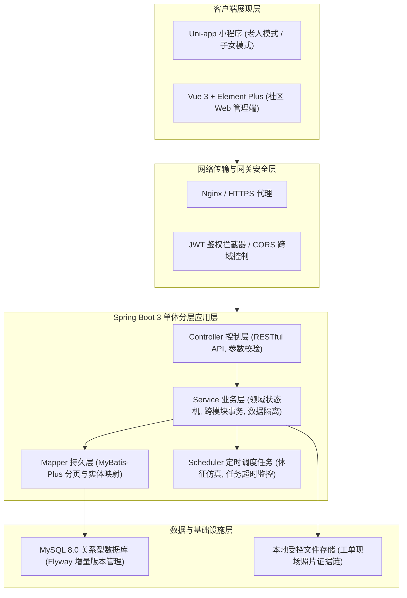
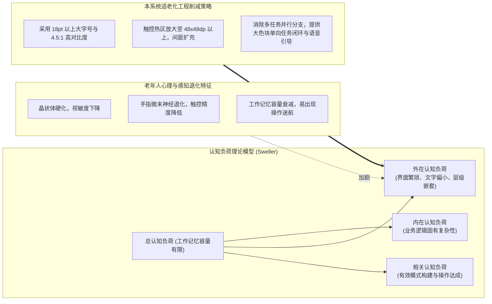

# 第 2 章 相关技术与理论基础

## 2.1 核心技术框架

### 2.1.1 Spring Boot 后端工程框架

Spring Boot 是由 Pivotal 团队提供的全新开源轻量级企业级 Java 应用程序框架。针对传统 Spring 框架繁琐的 XML 配置和复杂的依赖依赖版本冲突问题，Spring Boot 遵循“约定优于配置”（Convention Over Configuration）的核心思想，通过自动化装配（Auto-Configuration）机制和精简的“Starter”起步依赖体系，大幅削减了样板化配置代码，使得工程脚手架能够开箱即用。

在本系统中，后端核心基于最新的 Spring Boot 3 构建，运行于 Java 17/21 长期支持版本（LTS）之上。Spring Boot 提供了稳健的 IOC（控制反转）与 AOP（面向切面编程）容器，配合其内置的内嵌式 Tomcat 引擎，使得单体应用程序具备优异的响应速度、热拔插扩展能力与平滑的部署运维体验。

### 2.1.2 Vue 3 与 Uni-app 跨端框架

Vue 3 是目前业界广泛采用的现代化渐进式 JavaScript 界面开发框架，其核心优势包括：
1. **基于 Proxy 的高灵敏响应式系统**：相较于 Vue 2 的 `Object.defineProperty`，Vue 3 的响应式追踪支持深层属性监听、动态属性增删检测以及原生集合数据结构（Set/Map）的原生支持，运行内存占用更少，渲染效率更高。
2. **组合式 API（Composition API）**：通过 `setup` 语法糖、`ref`、`reactive` 以及可复用的组合式函数（Composables），将具有高度内聚性的业务逻辑、状态机与网络请求组织在同一个逻辑模块内，有效解决了大型项目“选项式 API（Options API）”带来的代码跳转分散和不易复用问题。

针对本系统移动端需要兼顾微信小程序生态与老年人、家属多端跨平台使用的特点，系统选用了基于 Vue 3 核心的 **Uni-app** 跨端框架。Uni-app 允许开发者采用一套 Vue 3 单文件组件（SFC）代码规范，经过底层 Webpack/Vite 编译器针对性转译，即可同步编译为符合微信小程序规范（`mp-weixin`）、H5 及移动 Native 容器的发行产物。这极大降低了双端开发维护成本，同时保障了移动端组件（如微信原生授权弹窗、大字号样式穿透）的良好兼容性。

### 2.1.3 前后端分离与单体分层架构

本系统整体采用现代**前后端分离架构（B/S 模式）**。前端客户端（Uni-app 小程序端与 Vue 3 Web 管理后台）完全负责界面的视觉渲染、交互反馈与用户输入收集；后端 Spring Boot 应用以无状态形式部署，通过标准 RESTful API（基于 JSON 格式）对外提供业务能力支撑。

在系统总体架构选型上，本项目摒弃了对于中小型社区治理场景过于厚重的微服务体系（如 Spring Cloud、Kubernetes），坚持采用**高内聚、低耦合的模块化单体分层架构（Modular Monolithic Architecture）**：
- **表现层（Controller）**：负责请求参数校验、数据传输对象（DTO）组装与视图对象（VO）封装；
- **业务逻辑层（Service）**：负责领域状态转移、跨模块事务控制、数据级权限校验及业务审计日志记录；
- **数据访问层（Mapper）**：结合 MyBatis-Plus 框架简化常规 CRUD 操作与复杂分页联表查询；
- **任务调度层（Scheduler）**：依托 Spring 原生 `@Scheduled` 实现定时体征仿真、超时服药关怀提醒与逾期工单报警。

该选型在保障系统高性能与高可靠性的同时，避免了分布式网络通信延迟、跨服务分布式事务以及多组件部署维护带来的资源浪费。

---

## 2.2 关键技术与机制

### 2.2.1 基于 JWT 与受控会话的身份认证机制

系统用户身份鉴权采用基于 **JSON Web Token（JWT）** 的无状态认证方案，并结合数据库层面的会话受控撤销机制（Revocable Session）：
- 客户端在手机号与安全哈希密码核验通过后，服务端签发包含用户 ID、主角色代码及签名有效期的 JWT 令牌；
- 针对老年人频繁重新登录极易遗忘密码的实际痛点，系统将小程序端登录会话无操作过期时间设定为 7 天，绝对有效期为 30 天；针对管理端 Web 后台，将会话无操作过期时间设定为 30 分钟，绝对有效期为 12 小时；
- 服务端设计了安全主动失效机制：当管理员重置工作人员账号、修改用户角色或子女主动解除亲情绑定时，系统立即在服务端更新受控会话版本号，强制已有旧会话的 JWT 立即失效，保证权限变更的毫秒级生效。

### 2.2.2 异步事件通知与短轮询即时刷新机制

在社区居家养老中，突发 SOS 紧急告警与服务派单消息具有极高的时效性要求。传统 WebSocket 在网络不稳定或移动端后台挂起时容易频繁断线重连，对服务器长连接句柄造成较大开销。因此，本系统采用**轻量级异步事件总线 + 前端短轮询自适应刷新（Adaptive Short-Polling）**的组合策略：
- 后端发生紧急求助、状态机流转或告警生成时，通过 Spring 内部事件机制（`ApplicationEventPublisher`）异步写入通知与审计流水表；
- 前端管理大屏与护工工作台在关键业务页开启低频自适应短轮询（间隔 3–5 秒），拉取最新待办任务增量；检测到危急告警（`CRITICAL`）时前端通过 Web Audio API 触发高分贝报警音，兼顾了即时性与低资源消耗。

### 2.2.3 基于有限状态机（FSM）的业务流转机制

工单流转与服务履约是本系统最重要的业务生命线。为避免代码中充斥错综复杂的 `if-else` 条件判断，系统将服务全流程抽象为**有限状态机（Finite State Machine, FSM）**。状态机由三要素构成：
1. **状态（State）**：工单所处的离散离散阶段（如 `PENDING_DISPATCH`、`ACCEPTED`、`IN_PROGRESS`、`CLOSED` 等）；
2. **事件与动作（Event / Action）**：触发状态迁移的显式业务请求（如 `dispatch`、`accept`、`submitReview`）；
3. **转移约束（Guard / Transition Matrix）**：执行迁移前的前置断言判定，包括操作人角色权限合法性、前序状态依赖以及关键数据（如必须附带履约照片）的完整性。

### 2.2.4 社区网格化治理与属地数据权限隔离机制

针对养老数据高敏感性特征，系统实现了基于“社区属地”的行级多租户数据隔离机制：
- 数据库表结构原生嵌入 `community_id` 字段；
- 管理员登录后，系统自动将其授权上下文绑定至所属社区；其所查询的全部老人档案、告警记录与工单池均受限于本社区范围，严禁跨社区越权操作；
- 针对护工端实施“本人分配限制”（`requireCareWorkerOrder`），护工仅对派发给本人的工单具有详情查阅与状态更新权限，有效防止老人敏感住址与病史的大范围泄露。

### 2.2.5 数据库演进管理与行级乐观锁并发控制

- **Flyway 数据库增量演进**：通过 Flyway 脚本（`V1__` 至 `V3_3__`）实施数据库结构的版本化控制，确保不同开发机、测试机及生产演示环境在启动时能够全自动执行未执行的增量 SQL 脚本，杜绝因人工手动刷库导致的环境不一致。
- **行级乐观锁并发防护**：在 `work_order` 表中设计 `version` 整数列。在多管理员并发派单或护工高并发接单的临界区，通过 `UPDATE ... WHERE id = ? AND version = ?` 语句利用数据库底层行锁特性实施校验。一旦发生版本冲突，受影响行数为 0，系统立即回滚事务并返回竞态异常，防止工单被重复分配或状态覆盖。

---

## 2.3 适老化设计的理论基础

### 2.3.1 认知负荷理论（Cognitive Load Theory）

认知负荷理论（Cognitive Load Theory, CLT）是由澳大利亚教育心理学家 John Sweller 于 20 世纪 80 年代提出的人机认知理论。该理论将人类在完成特定信息加工任务时认知系统所承受的负荷划分为三类：
1. **内在认知负荷（Intrinsic Cognitive Load）**：由任务本身的固有复杂度决定；
2. **外在认知负荷（Extraneous Cognitive Load）**：由信息呈现方式、界面布局和操作流程的不合理设计所引起的不必要认知负担；
3. **相关认知负荷（Germane Cognitive Load）**：用户用于构建心理图式和深度理解所投入的有效心理资源。

老年人由于视网膜光通量下降、感知觉退化与短期工作记忆容量缩减，其总可用工作记忆容量远低于青年群体。如果软件界面充斥复杂的菜单嵌套、微小的点击热区或花哨的动画，老年用户的大脑资源将被完全消耗在识别图标与寻找入口等“外在认知负荷”上，极易产生畏难与误操作。

因此，本系统的适老化改造立足于**“最大限度削减外在认知负荷”**：
- **视觉层削减**：剔除无关装饰，界面大留白，选用清晰易读的无衬线字体；
- **操作层削减**：将复杂的服药登记简化为醒目的“已服药/未服药”大色块单选打卡，消除多步骤分支嵌套；
- **引导层辅助**：结合语音播报与关键按钮触觉振动反馈，提供多通道信息支持。

### 2.3.2 国家互联网应用适老化设计通用规范

本系统界面的交互参数指标严格对照国家政策法规与标准体系执行：
1. **《移动互联网应用（APP）适老化通用设计规范》（工信厅信管函〔2021〕67 号）**：
   - **字号要求**：正文字号不小于 $18\text{pt}$，常态字号放大倍率支持 1.3–1.4 倍；
   - **热区与防误触**：核心操作按钮可点击区域不小于 $48\text{dp} \times 48\text{dp}$，相邻按钮间距保留安全空白；
   - **内容纯净化**：严禁出现任何诱导式按键、插屏广告或诱导跳转链接。
2. **《信息技术 互联网内容无障碍可访问性技术要求与测试方法》（GB/T 37668—2019）**：
   - 规定文本内容与其背景之间的静态色彩对比度至少应达到 $4.5:1$（大文本至少达到 $3:1$）；
   - 所有关键操作状态变更（如 SOS 成功触发、用药打卡成功）均应提供视觉提示与可访问性文本读屏标签。

本章所述的核心技术框架、安全机制与适老化理论，为后续系统需求分析、详细设计与工程测试奠定了坚实的科学支撑。
