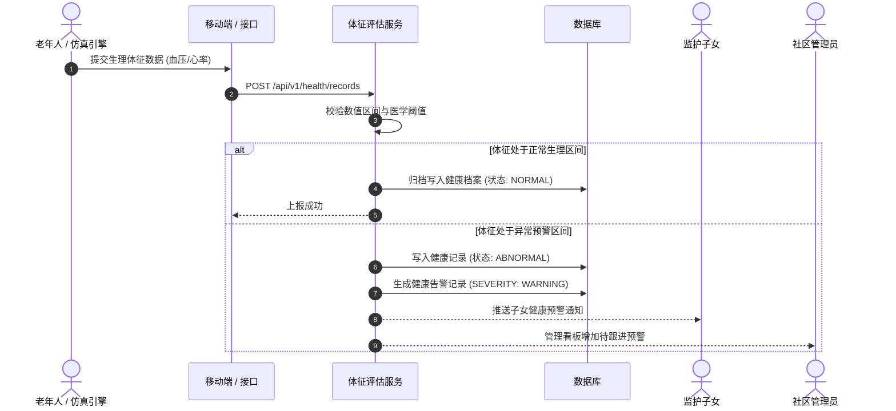
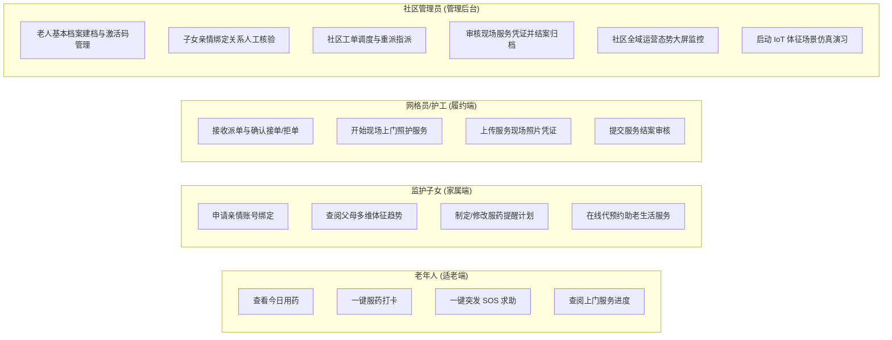

# 第 3 章 系统需求分析

## 3.1 核心业务流程分析

社区居家养老系统的核心使命是将“家庭、老人、社区、护工”四方主体通过数字链路紧密链接。针对日常健康管理、突发事件处置与生活照护三大实际场景，系统梳理了三条核心业务主流程。

### 3.1.1 老人健康体征监测与异常处理流程

日常健康监护流程旨在实现老人体征数据的长效跟踪与渐进式异常识别：
1. **数据采集与上报**：老人本人或社区管理员通过移动端/管理端手工录入血压（收缩压/舒张压）、血糖、心率等体征；系统亦可通过仿真引擎按设定的时间间隔生成带有 `SIMULATION` 标记的测试体征；
2. **规则校验与评估**：数据进入服务端后，健康模块规则引擎对体征数值的有效区间与医学阈值进行多维逻辑判断；
3. **健康档案归档与预警**：若数据处于正常生理区间，系统直接写入体征历史表，更新老人的最新健康档案状态；若检测到轻度或中度超标，系统将自动触发健康预警，在子女端与管理员端生成健康预警提示，同时生成服药关怀提醒，督促子女或网格员电话回访。

### 3.1.2 突发 SOS 紧急告警与联动建单流程

突发求助流程要求“极简触发、秒级建单、优先派发”：
1. **一键求助触发**：当独居老人突发跌倒、急性心脑血管不适时，在小程序首页点击醒目的红色“一键 SOS”紧急求助按钮；
2. **原子化告警与建单**：服务端接收到 SOS 请求后，在同一本地数据库事务内完成两项核心操作：持久化紧急告警记录（`severity = CRITICAL`），并联动生成紧急工单（`order_type = EMERGENCY`, `status = PENDING_DISPATCH`）；
3. **全渠道紧急调度**：系统立即向社区管理员 Web 调度中心大屏发送高优先级告警弹窗并播放高分贝警报音，同时向老人所有已绑定的合法亲情子女推送紧急求助短消息与电话提醒；社区管理员在 3 分钟内完成近邻网格员或待命护工的指派。

### 3.1.3 助老服务预约与网格履约闭环流程

助老服务（助餐、助洁、助医、助浴）采取“家属线上预约、社区调度统筹、护工上门履约、凭证审核结案”的闭环流转模式：
1. **需求提报**：子女根据老人需求在小程序端选择对应服务项目（如上门助洁），选择期望服务日期与时间段，提交预约申请；
2. **社区统筹与派发**：社区管理员收到预约申请后核验社区配额与老人资质，审批通过并自动生成待派工单；管理员结合网格员当前的在手任务负载，将工单派发给指定的社区护工；
3. **现场履约与拍照**：护工在专属移动工作台接收任务通知并确认接单，准时前往老人家中实施线下服务；服务完成后现场拍摄真实照片并填写处置描述，提交线上审核；
4. **审核验收与评价**：管理员在后台复核现场照片凭证，确认服务达标后执行结案归档；子女端同步收到服务结案通知并可查阅现场照片。

---

## 3.2 系统角色划分与权限边界

系统设计了清晰的四类角色模型，严格贯彻“最小特权”与“职责分离”原则：

| 角色名称 | 角色代码 | 服务端定位与职责 | 数据范围与权限边界 |
| :--- | :--- | :--- | :--- |
| **老年用户** | `ROLE_ELDER` | 系统终极受助对象。享受大字无障碍交互、体征自查、一键服药打卡、一键求助 SOS、服务进度穿透查阅。 | 严格仅能访问本人档案、本人的健康体征记录及指派给本人的服务工单进度；严禁查阅他人任何数据。 |
| **监护子女** | `ROLE_FAMILY` | 老年人的远程监护人与日常代办人。查看老人健康走势、设定用药计划、代提助老服务预约、管理亲情绑定。 | 仅能访问与本人账号存在合法有效绑定关系的老人数据；解绑后立即失权；严禁越权代替社区执行工单审核与结案。 |
| **网格员/护工** | `ROLE_CARE_WORKER` `ROLE_GRID_WORKER` | 线下服务履约与应急上门人员。接单、现场照护处置、采集并上传履约照片凭证。 | **护工受限于本人分配工单**（`assigned_to = me`），严禁跨工单查看全社区老人档案；网格员负责协助社区内日常走访。 |
| **社区管理员** | `ROLE_COMMUNITY_ADMIN` | 社区居家养老运营主导者。老人建档、亲情关系核验、工单派发调度、服务审核结案、大屏看板监测。 | 严格隔离在所属社区物理辖区（`community_id`）；严禁跨越物理社区越权调度或查看其他社区老年人敏感信息。 |

---

## 3.3 系统用例分析

系统用例图形式化地表达了四类角色与各核心功能模块之间的交互边界。

### 3.3.1 老年人适老端核心用例描述
- **用例：一键突发 SOS 求助**
  - **前置条件**：老人已通过激活码绑定身份并登录小程序适老端；
  - **主要流程**：老人轻触首页红色“紧急呼救”悬浮按钮；系统弹出二次防误触确认大框（默认倒计时 3 秒自动确认）；服务端同步生成紧急告警并触发紧急调度单；
  - **后置条件**：界面展示救援人员接单进度与预计到达时间，后台触发短信通知已绑定的子女。

### 3.3.2 监护子女端核心用例描述
- **用例：助老服务在线代预约**
  - **前置条件**：子女已与老人建立合法有效的亲情绑定关系；
  - **主要流程**：子女进入“服务代办”板块，选定目标老人、服务大类（助洁）及期望服务时间段，填写特殊照护备注后提交；
  - **后置条件**：系统生成 `service_reservation` 记录并推送到社区管理员待办池。

### 3.3.3 网格员与护工履约端核心用例描述
- **用例：上传服务现场照片凭证并提交结案**
  - **前置条件**：护工已接单且当前工单处于 `IN_PROGRESS`（处置中）；
  - **主要流程**：护工在移动端点击“拍照存证”，调起摄像头拍摄服务现场照片；系统上传文件并生成哈希摘要；护工输入简要处置结论，点击“提交审核”；
  - **后置条件**：状态机推进至 `SUBMITTED`，锁定照片不允许再增删，等待管理员复核。

### 3.3.4 社区管理员调度端核心用例描述
- **用例：社区工单调度与指派**
  - **前置条件**：工单处于 `PENDING_DISPATCH`，管理员拥有该社区操作权限；
  - **主要流程**：管理员进入工单调度中心，系统列表展示待派工单；管理员点击“派单”，系统弹出本辖区激活状态的护工列表及其当前在手工单数；管理员选中目标护工后确认；
  - **后置条件**：系统通过行级乐观锁将工单推进至 `DISPATCHED`，版本号自增，向目标护工端发送即时待办通知。

---

## 3.4 系统非功能需求分析

### 3.4.1 适老化与人机易用性指标
严格贯彻工信厅信管函〔2021〕67 号与 GB/T 37668—2019 标准：
1. **正文字号**：适老端小程序主标题字号 $\ge 24\text{pt}$，正文字号 $\ge 18\text{pt}$，辅助说明字号 $\ge 14\text{pt}$，支持系统级字号无级缩放而不出现排版错乱截断；
2. **触控热区**：所有操作按钮点击区域不小于 $48\text{dp} \times 48\text{dp}$，按钮之间水平间距 $\ge 16\text{dp}$，从物理层面杜绝老年人由于手指震颤引发的连击误触；
3. **视觉色彩**：正文文字与背景色彩对比度达到 $4.5:1$ 以上；禁用闪烁、强对比或花哨的动画过渡，减少视觉干扰；
4. **单任务闭环**：单页只聚焦于一个核心任务，消除三层以上的复杂层级嵌套路由。

### 3.4.2 数据安全性与隐私合规性
1. **数据隔离合规**：所有查询与写入 SQL 必须经过 `community_id` 物理辖区过滤，杜绝跨社区越权访问；
2. **亲情授权控制**：子女对老人敏感档案的访问严格受制于当前有效的亲情授权链，解绑即刻吊销一切数据透析权限；
3. **密码安全与凭据保护**：用户登录密码采用加盐安全哈希算法存储；老人首次激活采用 6 位伪随机数字激活码，设置 24 小时绝对有效期与单次有效约束。

### 3.4.3 并发控制与接口响应性能
1. **并发竞态保护**：在工单指派、接单流转等写操作环节，利用乐观锁机制彻底解决多管理员或多护工同时并发操作导致的脏数据覆盖；
2. **响应时延要求**：在局域网及标准 4G/5G 网络环境下，常规数据查询与页面拉取接口 95% 分位响应时间 $\le 300\text{ms}$，复杂统计看板接口 $\le 800\text{ms}$；
3. **高并发承载**：单机部署环境下，核心体征上报与工单状态查询接口在 50 并发持续冲击下，系统吞吐量（TPS）不低于 $300\text{ req/s}$，错误率为 0。

---

## 3.5 系统可行性分析

### 3.5.1 技术可行性
- **开发语言与后端框架**：Java 17/21 具有行业顶级的工业级稳定性与内存管理效率，Spring Boot 3 与 MyBatis-Plus 技术生态成熟、参考范例详尽，内置自动化事务与依赖注入机制；
- **前端跨端框架**：Vue 3 + Uni-app 构架稳定，Element Plus 提供丰富的后台管理组件库，针对微信小程序的编译转译链路已经受海量生产环境考验；
- **技术可行性结论**：开发团队完全掌握上述技术栈，技术路径不存在无法突破的底层瓶颈，技术可行性完全具备。

### 3.5.2 经济可行性
- **软件成本**：本项目采用的全套工具链（OpenJDK、MySQL Community Edition、Spring Boot、Vue 3、Node.js、VS Code/IntelliJ IDEA）均为完全开源免费或社区免费版，无商业版权许可采购费用；
- **部署与硬件成本**：系统采用单体分层设计，无需购买昂贵的商业云中间件集群或硬件负载均衡设备，仅需一台 2 核 4G 的基础云服务器或普通社区内网服务器即可平稳运行，建设与维护成本极低；
- **经济可行性结论**：成本低廉，非常符合基层社区和街道办对民生养老项目的预算约束，经济可行性优异。

### 3.5.3 操作可行性
- **面向老年人**：无需复杂的拼音打字或菜单查找，通过大色块一键直达、高对比图标与语音图文引导，经简单指引即能独立上手操作；
- **面向基层工作人员**：管理后台界面符合标准 ERP/OA 交互直觉，提供一键派单、快速审核弹窗与醒目的时效提醒，基层工作人员无需专业培训即可流畅使用；
- **操作可行性结论**：人机交互亲和友好，符合各层次使用群体的认知习惯，操作可行性极高。

### 3.5.4 社会与法律合规可行性
- **国家战略支持**：符合国家“积极应对人口老龄化”顶层战略与数字化无障碍建设规划，受民政与工信部门政策大力扶持；
- **法律合规性**：严格遵守《中华人民共和国个人信息保护法》与《中华人民共和国无障碍环境建设法》，在数据收集前履行明示告知义务，不违规采集与老人健康照护无关的生物识别信息，不存在任何法律纠纷风险；
- **社会合规可行性结论**：完全合规合法，具备深厚的社会公益价值。
