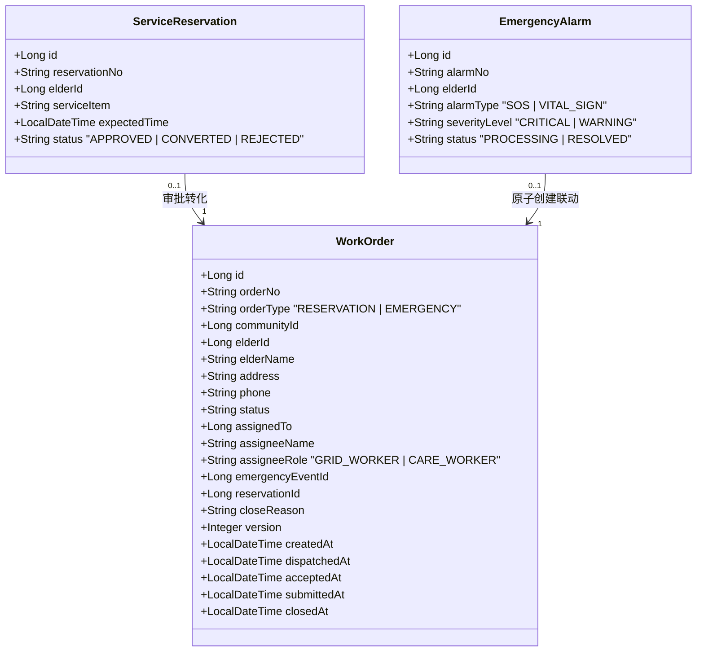
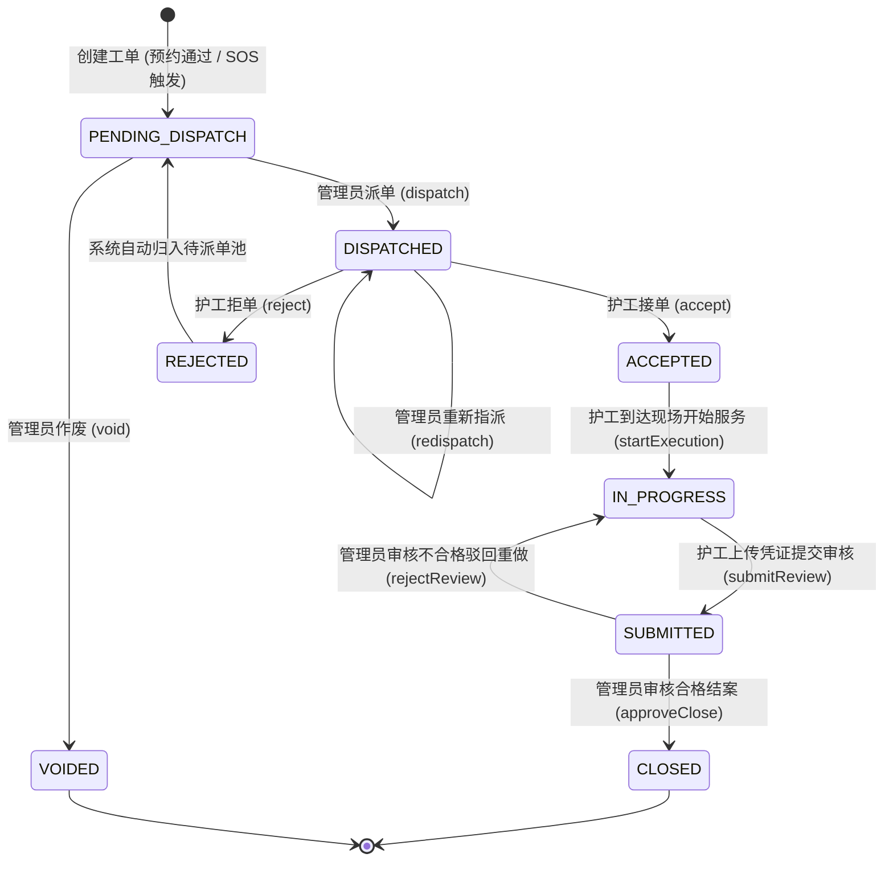
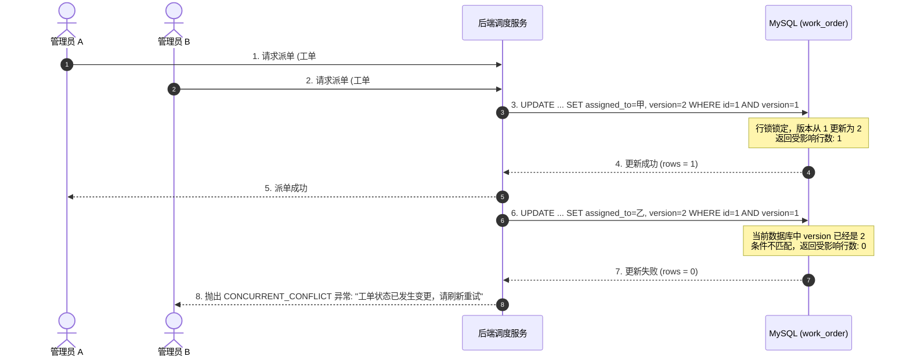

# 第 4.7 节 基于网格化与状态机的社区服务工单流转与调度机制详细设计

> **本节定位**：本科毕业论文《第 4 章 系统设计》中第 4.7 节核心特色与技术创新模块。  
> **设计目标**：针对居家养老“需求多样、突发性强、服务链条长、线下履约难监督”的痛点，构建一套基于**有限状态机（FSM）**与**社区属地网格化（Grid Governance）**的闭环工单流转体系，辅以**行级乐观锁并发控制**和**履约证据链防伪机制**，确保服务过程可追溯、防越权、防竞态。

---

## 4.7.1 助老服务与 SOS 求助统一工单转化模型

在社区居家养老业务场景中，工单来源具有双重属性：一是老人或子女日常发起的**计划性助老服务预约**（助餐、助洁、助医等）；二是老人突发不适时发起的**一键 SOS 紧急求助**或体征多维异常自动报警。为统一后端调度逻辑与履约流程，系统建立了统一的工单抽象模型。

### 1. 统一工单业务实体设计

统一工单由核心表 `work_order` 承载，关联老人档案与指派对象，并保留原始来源凭据引用：



### 2. 双源工单接入机制

- **普通服务预约转化链（异步受控）**：
  子女或老人在移动端提交预约单后进入 `service_reservation` 待审状态。社区管理员人工核验老人资质与服务排期，审核通过后调用建单逻辑，原子性生成 `order_type = RESERVATION` 的工单，初始状态置为 `PENDING_DISPATCH`（待派单），并记录 `reservation_id` 实现双向溯源。
- **突发 SOS 紧急建单链（同步原子保障）**：
  老人触发 SOS 求助或生理指标超出危急阈值时，服务端在同一事务内持久化 `emergency_alarm` 记录，并立即原子生成 `order_type = EMERGENCY` 的初始紧急工单。该工单天然具备最高调度优先级，绕过前置审批阶段，直接进入网格预警与调度流，确保救援响应零时延。

---

## 4.7.2 基于有限状态机的工单流转状态转移矩阵

为杜绝传统业务系统中“跨角色乱改状态”、“未接单先结案”等非法流转漏洞，本系统采用严格的**有限状态机（Finite State Machine, FSM）**进行全生命周期管控。

### 1. 状态集定义

系统定义工单状态集合 $S$ 与输入事件集合 $E$ 如下：

$$S = \{ \text{PENDING\_DISPATCH}, \text{DISPATCHED}, \text{ACCEPTED}, \text{IN\_PROGRESS}, \text{SUBMITTED}, \text{CLOSED}, \text{REJECTED}, \text{VOIDED} \}$$

- `PENDING_DISPATCH`（待派单）：新建工单的初始状态；
- `DISPATCHED`（已派单）：管理员已指定网格员/护工，等待履约人接单；
- `ACCEPTED`（已接单）：履约人确认接单，准备前往服务现场；
- `IN_PROGRESS`（处置中）：履约人员到达现场，开始实施照护或救助；
- `SUBMITTED`（已提交）：现场处置完毕，护工已上传照片与记录，等待社区核验；
- `CLOSED`（已结案）：管理员审核服务凭证合格，工单正常归档；
- `REJECTED`（已退回/拒单）：护工因不可抗力拒单，或管理员审核驳回；
- `VOIDED`（已作废）：工单因老人取消或重复误报而终止。

### 2. 工单全生命周期状态流转图



### 3. 状态转移矩阵与操作权限约束

状态机不仅校验状态的前后序合法性，同时与操作人角色（`OperatorRole`）进行强绑定：

| 现态（Current State） | 触发动作（Action） | 操作主体（Role） | 转移后目标状态（Next State） | 前置业务校验约束 |
| :--- | :--- | :--- | :--- | :--- |
| `PENDING_DISPATCH` | `dispatchOrder` | `COMMUNITY_ADMIN` | `DISPATCHED` | 被指派人必须为本社区处于激活状态的护工或网格员 |
| `PENDING_DISPATCH` | `voidOrder` | `COMMUNITY_ADMIN` | `VOIDED` | 须录入作废原因并记录审计日志 |
| `DISPATCHED` | `acceptOrder` | `CARE_WORKER` / `GRID_WORKER` | `ACCEPTED` | 当前登录人必须与 `assigned_to` 完全匹配 |
| `DISPATCHED` | `rejectOrder` | `CARE_WORKER` / `GRID_WORKER` | `REJECTED` | 须填写拒单理由；系统自动触发回退至待派单池 |
| `ACCEPTED` | `startExecution` | `CARE_WORKER` / `GRID_WORKER` | `IN_PROGRESS` | 仅限本人操作 |
| `IN_PROGRESS` | `submitReview` | `CARE_WORKER` / `GRID_WORKER` | `SUBMITTED` | **强制校验**：必须已上传至少 1 张现场照片凭证 |
| `SUBMITTED` | `reviewOrder(PASS)` | `COMMUNITY_ADMIN` | `CLOSED` | 验证凭证完整性；记录审核意见并归档 |
| `SUBMITTED` | `reviewOrder(REJECT)`| `COMMUNITY_ADMIN` | `IN_PROGRESS` | 填写驳回整改意见；退回护工重新处置 |

任何不在上述转移矩阵中的状态跳跃（如从 `PENDING_DISPATCH` 直接调用 `approveClose`，或由 `CLOSED` 再次调用 `submitReview`），均会被服务层直接拦截并抛出 `ILLEGAL_STATE_TRANSITION` 异常。

---

## 4.7.3 基于社区网格化的派发策略与防越权校验

社区居家养老的物理特性决定了服务必须具有**属地就近性**与**隐私专属性**。本系统构建了严格的社区多租户隔离与角色范围限制算法。

### 1. 属地网格化调度匹配原则

调度派单时，系统执行“社区范围硬隔离”过滤：
1. **老人属地锚定**：工单生成时，其 `community_id` 严格继承自老人档案所在社区，任何用户不得修改工单的社区归属。
2. **候选服务人员过滤**：管理员在后台拉取可派发员工列表时，后端仅返回本社区内且账号状态为 `ACTIVE`、具备 `CARE_WORKER` 或 `GRID_WORKER` 角色的员工。
3. **防跨区派发断言**：派单处理函数内部强制执行断言校验：
   ```java
   requireOrderInCurrentCommunity(order, "COMMUNITY_ADMIN");
   UserRole assignment = findActiveDispatchAssignment(
       dto.getAssigneeUserId(), elder.getCommunityId(), "CARE_WORKER");
   if (assignment == null) {
       throw new BusinessException(ErrorCode.ACCESS_DENIED, "被指派人员不属于该老人所在社区");
   }
   ```

### 2. 护工端“最小必要权限”数据防越权机制

为防止护工账号因窥探全社区老人敏感病史或家庭资产而引发隐私泄露风险，系统实现了**基于本人指派工单的动态数据受权（Scope-based Access Control）**：
- **档案信息脱敏与限制**：护工无法直接访问全社区老人档案列表接口；
- **专属工作台过滤**：护工调用工单列表时，服务端自动追加强制查询条件 `assigned_to = :currentUserId`，且剔除已结案超过时限的工单；
- **工单穿透详情校验**：当护工请求某工单详情时，服务端调用 `requireCareWorkerOrder` 进行三重要素比对：
  $$\text{AllowAccess} \iff (order.\text{assigned\_to} == current.\text{userId}) \land (order.\text{status} \notin \text{TERMINAL\_STATUSES})$$
  一旦管理员将该工单转派他人，原子护工对该工单及其关联老人联系方式的访问权即刻失效。

---

## 4.7.4 基于乐观锁的并发调度控制机制

在多人协作的社区调度中心，极易出现以下两类典型的高并发竞态问题：
1. **双重指派冲突**：两名社区网格管理员同时选中了同一张紧急工单，并分别指派给不同的护工；
2. **状态覆写冲突**：护工在网络较差环境下反复点击“接单”或在管理员重派的同时发起接单，导致脏数据写入。

### 1. 行级乐观锁（Optimistic Locking）控制原理

本系统采用行级版本号控制方案，在 `work_order` 表中设置无符号整数列 `version`（默认初始值为 0）。

在执行任何修改工单状态或受派人的写操作时，SQL 语句必须同时比对工单主键与版本号，并自增版本：

$$\text{UPDATE } work\_order \text{ SET } status = S_{new}, version = version + 1 \text{ WHERE } id = \text{orderId} \text{ AND } version = \text{oldVersion}$$

### 2. 并发调度事务执行时序



该机制在单体分层架构下无需额外架设 Redis 分布式锁集群，以极低的系统开销和代码侵入性，完美化解了并发冲突，保障了核心工单状态机的一致性与原子性。

---

## 4.7.5 履约凭证存证与防篡改机制

线下服务真实性是智慧居家养老落地的关键瓶颈。系统设计了“现场照片存证”子模块，建立起不可抵赖的履约证据链。

### 1. 照片存证元数据结构

建立独立的证据关联表 `work_order_photo_evidence`：

```sql
CREATE TABLE `work_order_photo_evidence` (
  `id` BIGINT NOT NULL AUTO_INCREMENT COMMENT '证据主键',
  `work_order_id` BIGINT NOT NULL COMMENT '关联工单ID',
  `file_id` VARCHAR(64) NOT NULL COMMENT '文件存储唯一标识',
  `file_url` VARCHAR(512) NOT NULL COMMENT '访问相对路径',
  `file_hash` CHAR(64) NOT NULL COMMENT 'SHA-256文件摘要',
  `file_size` BIGINT NOT NULL COMMENT '文件大小(Byte)',
  `uploaded_by` BIGINT NOT NULL COMMENT '上传人用户ID',
  `created_at` DATETIME NOT NULL DEFAULT CURRENT_TIMESTAMP COMMENT '上传时间',
  PRIMARY KEY (`id`),
  KEY `idx_wo_evidence` (`work_order_id`)
) ENGINE=InnoDB DEFAULT CHARSET=utf8mb4 COMMENT='工单履约照片证据表';
```

### 2. 凭证防篡改与提交时强约束规则

为了杜绝“假冒上传”或“盗用他人证据”，系统在证据链闭环中设立了三道防线：
1. **上传时态与身份防线**：只有处于 `IN_PROGRESS` 状态且 `assigned_to` 为当前登录护工时，才允许向该工单上传照片；系统后端计算文件 SHA-256 哈希值写入元数据，防止底层文件被篡改。
2. **结案前置强校验防线**：护工发起 `submitReview` 时，服务层强制执行凭证完整性断言：
   ```java
   int photoCount = photoEvidenceMapper.countByWorkOrderId(workOrderId);
   if (photoCount < 1) {
       throw new BusinessException(ErrorCode.EVIDENCE_MISSING, "未上传现场服务照片凭证，无法提交审核");
   }
   ```
3. **审核过程防修改防线**：工单一旦进入 `SUBMITTED` 或 `CLOSED` 状态，照片删除与追加接口自动对护工封锁；管理员端可直观比对工单服务地址与现场照片真实性，确保线下照护服务保质保量完成。
