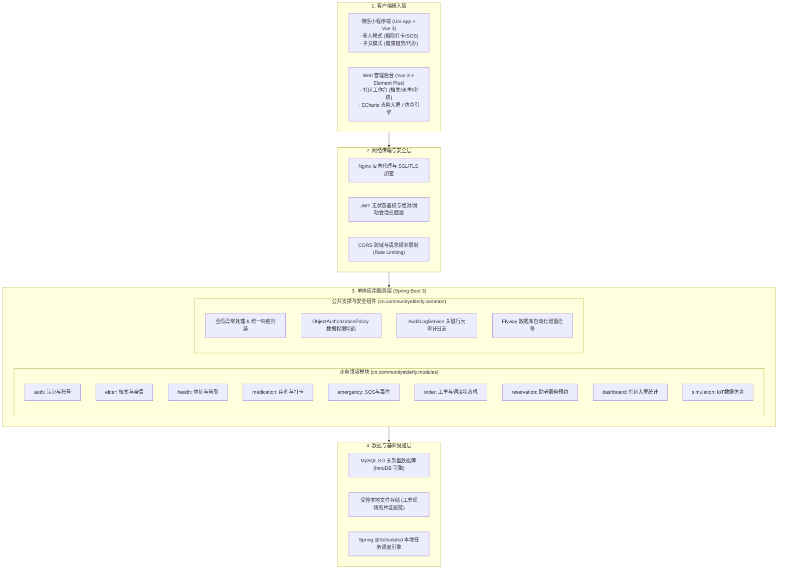
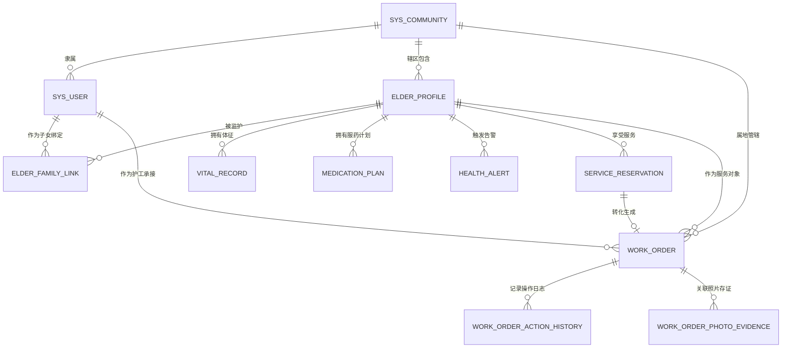

# 第 4 章 系统设计

## 4.1 系统设计原则

为了确保社区居家养老服务系统在高可用性、数据合规性与老年人机交互上的优异表现，系统遵循以下四大核心设计原则：

1. **适老化优先与认知负荷最小化原则**：以认知负荷理论为指导，老年人界面的交互链路必须坚持“单向闭环、大触控区、高对比度、无诱导插屏”，将界面的外在认知负荷压缩至最低，确保独居与高龄老人能独立自如使用。
2. **职责分层与模块高内聚低耦合原则**：严格遵从 Controller-Service-Mapper 单体分层规范。表现层专注于输入解析与视图封装；业务逻辑层聚焦于领域状态机流转与跨模块事务保障；持久层统一采用 MyBatis-Plus 规范数据访问，杜绝跨层直接越权调用。
3. **社区属地强隔离与最小权限原则**：以物理社区（`community_id`）为硬边界实施行级多租户隔离。管理员仅能调度管理本辖区业务，护工仅限调取本人分配工单关联数据，子女仅在亲情授权有效期内查阅被监护老人数据，从架构根源杜绝数据越权与隐私泄露。
4. **状态强一致与并发防护原则**：面向多人协同派单、高并发接单等关键写操作场景，摒弃复杂低效的人工协调，依托行级乐观锁（`version` 版本号）与有限状态机（FSM）矩阵实现严格的原子性保护与逆向流转拦截。

---

## 4.2 系统总体物理架构与技术体系设计

系统物理架构分为**客户端接入层、网络传输与安全层、单体应用服务层、数据与文件持久层**四层结构：

---

## 4.3 受助与监护端（小程序）模块设计

移动端小程序依托 Uni-app 框架构建，针对老龄用户与家属子女两类群体的认知差异，设计了老人模式与子女模式双重视图。

### 4.3.1 老年人大字极简交互与语音引导设计
- **大字大图视觉布局**：主功能卡片采用醒目的高纯度色彩与无衬线粗体字（字号 $\ge 20\text{pt}$），支持常态字号自适应缩放；
- **今日用药打卡卡片**：聚合显示老人当日待服药物，点击卡片即调起全屏弹窗播报服药剂量并完成打卡；
- **一键 SOS 悬浮呼救**：常驻于屏幕右下方，轻触即触发 3 秒防误触倒计时，伴随触觉微震动与语音提示“正在呼叫社区与家属”。

### 4.3.2 亲情账号绑定与受控代办设计
- **亲情申请与授权分离**：子女输入老人手机号发起申请，需上传亲属关系说明；
- **社区人工轻量核验**：社区管理员在后台确认老人授权意愿后批准生效；
- **动态失权机制**：老人可主动解绑子女，解绑后服务端立即撤回该子女对该老人的全部查询与操作权限。

### 4.3.3 服药提醒与健康档案监护设计
- **多维健康趋势图**：子女端集成移动端适配图表，直观展示老人近 7 天/30 天的血压、血糖与心率波动走势；
- **服药计划远程配置**：子女可代为录入药物名称、单次剂量、每日频次与服药时间点，服务端根据计划自动生成每日服药打卡任务。

### 4.3.4 助老服务在线代预约设计
- **服务目录展示**：列出助餐（爱心食堂配送）、助洁（上门保洁）、助医（陪同就医陪诊）等标准化项目；
- **日历排期选择**：子女根据老人空闲时间选择期望上门服务时间，提交预约申请进入社区待审池。

---

## 4.4 线下履约端（移动工作台）模块设计

针对网格员与上门护工，系统提供了轻量级移动工作台，兼顾便携性与合规性。

### 4.4.1 护工受派工单看板与抢单接单设计
- **待办任务列表**：仅拉取指派给当前登录护工的有效工单，展示老人姓名、上门地址、联系电话与预约时段；
- **接单/拒单确认**：护工可点击“确认接单”将状态推进至 `ACCEPTED`；若因突发情况无法履约，点击“拒单”并填写原因，工单退回社区待派池。

### 4.4.2 上门服务现场执行与照片凭证存证设计
- **服务状态推进**：护工到达现场后点击“开始服务”，状态机推进至 `IN_PROGRESS`；
- **现场拍照存证**：调用手机相机拍摄现场服务照片（如助洁后居室环境或助医现场照片），照片自动附带时间戳并计算文件哈希存证；
- **提交审核归档**：录入服务小结，确认照片已上传后，点击“提交审核”推进至 `SUBMITTED`。

---

## 4.5 社区综合管理端（Web 后台）模块设计

社区 Web 后台基于 Vue 3 + Element Plus 构建，是社区养老治理的指挥枢纽。

### 4.5.1 社区老人档案与监护关系审批
- **老人档案全生命周期管理**：录入老人身份证号、紧急联系人、慢性病史与慢病标签；为线下到场的老人签发 6 位动态激活码；
- **亲情绑定审批**：审核子女发起的亲情关联申请，核实老人授权真实意愿并记录审核日志。

### 4.5.2 社区服务目录与工单派发调度
- **服务项目配置**：设定助老服务单价、服务规范及预约上限；
- **网格化调度台**：集中展示本社区所有 `PENDING_DISPATCH` 状态的工单，展示社区内护工名单、空闲状态及当前在手单量，支持一键指派与紧急转派。

### 4.5.3 工单履约审核与结案归档
- **照片凭证复核**：展示护工上传的现场履约照片与处理说明，管理员复核通过后予以结案；审核不合格时退回整改。

### 4.5.4 社区健康态势与响应时效大屏看板
- **ECharts 数据可视化**：大屏实时滚动显示社区在册老人数、高危慢病老人数、待处理突发 SOS 告警数；
- **核心时效统计**：展示社区工单平均接单响应时长、平均处置闭环率与老人服药打卡合规率。

### 4.5.5 IoT 场景仿真与系统参数配置
- **仿真演练引擎**：支持管理员选择目标老人与预置场景（如血压突增、夜间心率过缓），以设定频率生成带有 `SIMULATION` 标记的体征流，用于日常业务演练与答辩展示。

---

## 4.6 数据库系统设计

### 4.6.1 数据库概念模型设计（E-R 图）

### 4.6.2 数据库逻辑结构设计

本系统核心业务涵盖以下 10 张关键数据表，均采用 InnoDB 存储引擎与 `utf8mb4` 字符集：

#### 1. 系统社区表 (`sys_community`)
| 字段名 | 数据类型 | 允许空 | 默认值 | 约束 / 说明 |
| :--- | :--- | :--- | :--- | :--- |
| `id` | BIGINT | NO | 自增 | 社区主键 ID |
| `community_name` | VARCHAR(64) | NO | | 社区全称 |
| `community_code` | VARCHAR(32) | NO | | 社区唯一代号 |
| `address` | VARCHAR(256)| YES | NULL | 社区街道办地址 |
| `created_at` | DATETIME | NO | CURRENT_TIMESTAMP | 创建时间 |

#### 2. 系统用户账号表 (`sys_user`)
| 字段名 | 数据类型 | 允许空 | 默认值 | 约束 / 说明 |
| :--- | :--- | :--- | :--- | :--- |
| `id` | BIGINT | NO | 自增 | 用户主键 ID |
| `phone` | VARCHAR(20) | NO | | 登录手机号（唯一索引） |
| `password_hash`| VARCHAR(256)| NO | | 加盐哈希散列密码 |
| `real_name` | VARCHAR(32) | NO | | 用户真实姓名 |
| `account_kind` | VARCHAR(16) | NO | 'CITIZEN' | 账号类别：`CITIZEN` / `STAFF` |
| `status` | VARCHAR(16) | NO | 'ACTIVE' | 账号状态：`ACTIVE` / `DISABLED` |
| `created_at` | DATETIME | NO | CURRENT_TIMESTAMP | 注册时间 |

#### 3. 用户角色关联表 (`sys_user_role`)
| 字段名 | 数据类型 | 允许空 | 默认值 | 约束 / 说明 |
| :--- | :--- | :--- | :--- | :--- |
| `id` | BIGINT | NO | 自增 | 主键 ID |
| `user_id` | BIGINT | NO | | 关联用户 ID |
| `role_code` | VARCHAR(32) | NO | | 角色编码（`COMMUNITY_ADMIN`/`CARE_WORKER`等） |
| `community_id` | BIGINT | YES | NULL | 履职社区 ID（社区人员必填） |
| `created_at` | DATETIME | NO | CURRENT_TIMESTAMP | 分配时间 |

#### 4. 老人基本档案表 (`elder_profile`)
| 字段名 | 数据类型 | 允许空 | 默认值 | 约束 / 说明 |
| :--- | :--- | :--- | :--- | :--- |
| `id` | BIGINT | NO | 自增 | 老人档案主键 ID |
| `community_id` | BIGINT | NO | | 属地管辖社区 ID |
| `full_name` | VARCHAR(32) | NO | | 老人真实姓名 |
| `id_card_hash` | CHAR(64) | NO | | 身份证号脱敏哈希 |
| `phone` | VARCHAR(20) | YES | NULL | 联系电话 |
| `address` | VARCHAR(256)| NO | | 居家详细居住地址 |
| `chronic_diseases`| VARCHAR(256)| YES| NULL | 慢性病标签（高血压/糖尿病等） |
| `status` | VARCHAR(16) | NO | 'ACTIVE' | 档案状态：`ACTIVE` / `INACTIVE` |

#### 5. 亲情绑定关系表 (`elder_family_link`)
| 字段名 | 数据类型 | 允许空 | 默认值 | 约束 / 说明 |
| :--- | :--- | :--- | :--- | :--- |
| `id` | BIGINT | NO | 自增 | 主键 ID |
| `elder_id` | BIGINT | NO | | 关联老人档案 ID |
| `family_user_id`| BIGINT | NO | | 关联子女用户 ID |
| `relation_type` | VARCHAR(16)| NO | | 亲属关系类型（父子/母子/其他） |
| `is_emergency_contact`| TINYINT(1)| NO | 1 | 是否设为首要紧急联系人 |
| `status` | VARCHAR(16)| NO | 'ACTIVE' | 绑定状态：`ACTIVE` / `REVOKED` |

#### 6. 生理体征记录表 (`vital_record`)
| 字段名 | 数据类型 | 允许空 | 默认值 | 约束 / 说明 |
| :--- | :--- | :--- | :--- | :--- |
| `id` | BIGINT | NO | 自增 | 主键 ID |
| `elder_id` | BIGINT | NO | | 关联老人档案 ID |
| `systolic_pressure`| INT | YES | NULL | 收缩压 (mmHg) |
| `diastolic_pressure`| INT | YES | NULL | 舒张压 (mmHg) |
| `blood_sugar` | DECIMAL(4,1)| YES | NULL | 空腹/餐后血糖 (mmol/L) |
| `heart_rate` | INT | YES | NULL | 静息心率 (次/分) |
| `source_type` | VARCHAR(16)| NO | 'MANUAL' | 数据来源：`MANUAL` / `SIMULATION` |
| `measured_at` | DATETIME | NO | | 测量时间 |

#### 7. 服药计划表 (`medication_plan`)
| 字段名 | 数据类型 | 允许空 | 默认值 | 约束 / 说明 |
| :--- | :--- | :--- | :--- | :--- |
| `id` | BIGINT | NO | 自增 | 主键 ID |
| `elder_id` | BIGINT | NO | | 关联老人档案 ID |
| `medicine_name`| VARCHAR(64) | NO | | 药品通用名称 |
| `dosage` | VARCHAR(32) | NO | | 单次用药剂量说明 |
| `frequency_type`| VARCHAR(16)| NO | 'DAILY' | 用药频次 |
| `start_date` | DATE | NO | | 计划开始日期 |
| `end_date` | DATE | YES | NULL | 计划终止日期 |
| `status` | VARCHAR(16) | NO | 'ACTIVE' | 计划状态 |

#### 8. 服务预约申请表 (`service_reservation`)
| 字段名 | 数据类型 | 允许空 | 默认值 | 约束 / 说明 |
| :--- | :--- | :--- | :--- | :--- |
| `id` | BIGINT | NO | 自增 | 主键 ID |
| `reservation_no`| VARCHAR(32)| NO | | 预约业务唯一编号 |
| `elder_id` | BIGINT | NO | | 关联老人 ID |
| `applicant_id` | BIGINT | NO | | 申请人家属用户 ID |
| `service_item` | VARCHAR(64) | NO | | 服务项目名称 |
| `expected_time`| DATETIME | NO | | 期望上门服务时间 |
| `status` | VARCHAR(16) | NO | 'PENDING'| 审批状态：`PENDING`/`APPROVED`/`REJECTED` |

#### 9. 社区服务工单表 (`work_order`)
| 字段名 | 数据类型 | 允许空 | 默认值 | 约束 / 说明 |
| :--- | :--- | :--- | :--- | :--- |
| `id` | BIGINT | NO | 自增 | 工单主键 ID |
| `order_no` | VARCHAR(32) | NO | | 工单外部唯一业务号 |
| `order_type` | VARCHAR(16) | NO | | 工单类型：`RESERVATION` / `EMERGENCY` |
| `community_id` | BIGINT | NO | | 属地管辖社区 ID |
| `elder_id` | BIGINT | NO | | 关联老人 ID |
| `status` | VARCHAR(32) | NO | 'PENDING_DISPATCH'| 有限状态机状态（见 4.7 节） |
| `assigned_to` | BIGINT | YES | NULL | 被派发护工/网格员用户 ID |
| `version` | INT | NO | 0 | **行级乐观锁版本号** |
| `created_at` | DATETIME | NO | CURRENT_TIMESTAMP | 创建时间 |
| `closed_at` | DATETIME | YES | NULL | 结案时间 |

#### 10. 工单履约照片证据表 (`work_order_photo_evidence`)
| 字段名 | 数据类型 | 允许空 | 默认值 | 约束 / 说明 |
| :--- | :--- | :--- | :--- | :--- |
| `id` | BIGINT | NO | 自增 | 证据主键 ID |
| `work_order_id`| BIGINT | NO | | 关联工单 ID |
| `file_id` | VARCHAR(64) | NO | | 物理文件存储标识符 |
| `file_url` | VARCHAR(512)| NO | | 访问相对 URL |
| `file_hash` | CHAR(64) | NO | | SHA-256 文件摘要哈希 |
| `uploaded_by` | BIGINT | NO | | 上传人用户 ID（必须匹配护工） |
| `created_at` | DATETIME | NO | CURRENT_TIMESTAMP | 上传时间 |

### 4.6.3 数据库版本演进与 Flyway 迁移策略
系统借助 Flyway 机制实现 DDL 的版本受控平滑迁移：
- `V1__bootstrap_empty_schema.sql`：初始化工程空 Schema；
- `V2__m01_m02_identity_and_archive.sql`：建立用户、会话、社区、老人档案与亲情绑定核心骨架；
- `V3__core_business_schema.sql`：建立体征、用药计划、告警、预约与工单全量业务表；
- `V3_1__` 至 `V3_3__`：针对登录频次限流、工单唯一排期约束与照片证据链字段实施平滑增量变更。
系统每次启动时自动扫描并校验版本校验和（Checksum），保障团队开发环境与生产演示库的一致性。

---

## 4.7 核心特色机制详细设计

*(注：4.7.1 助老服务与 SOS 统一工单模型、4.7.2 有限状态机状态转移矩阵、4.7.3 网格化派发与防越权、4.7.4 行级乐观锁并发控制、4.7.5 照片履约存证与防伪机制之完整规范设计，详见独立核心设计专章：[`thesis/chapters/第4章_核心机制专项设计_工单流转与调度.md`](./第4章_核心机制专项设计_工单流转与调度.md)。)*
